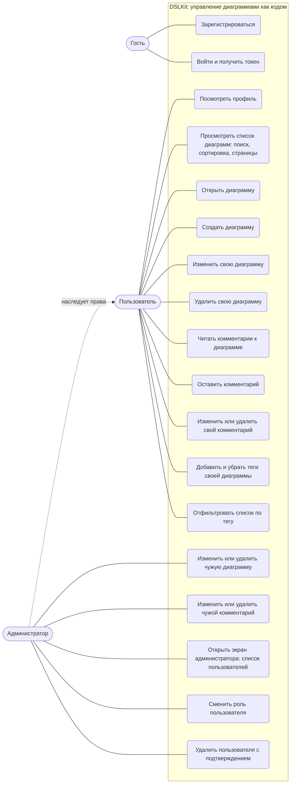
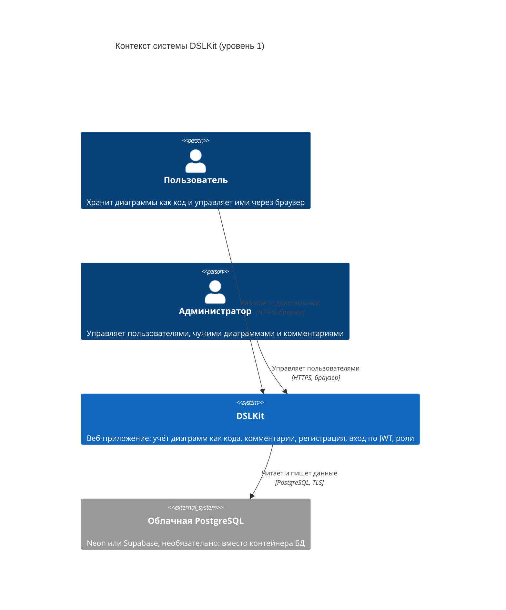
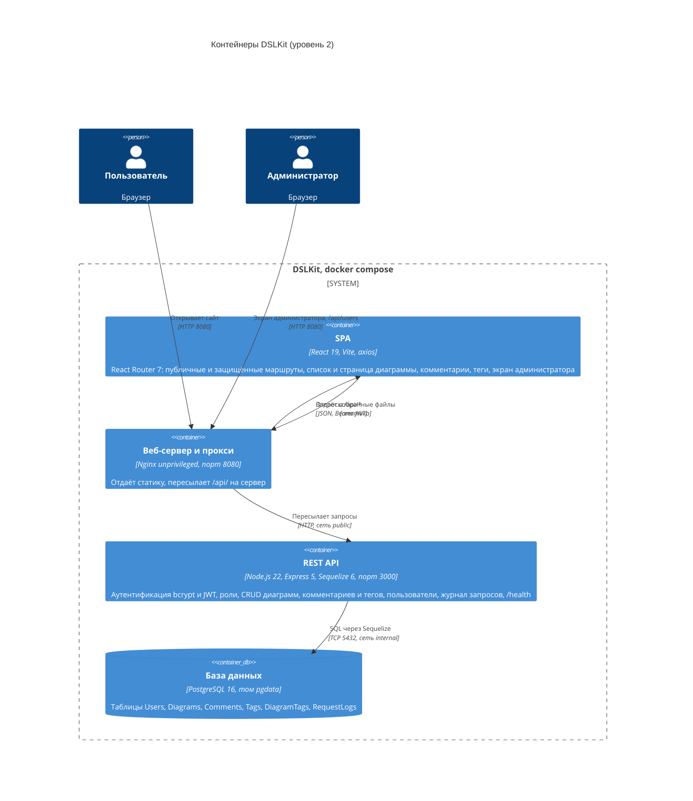
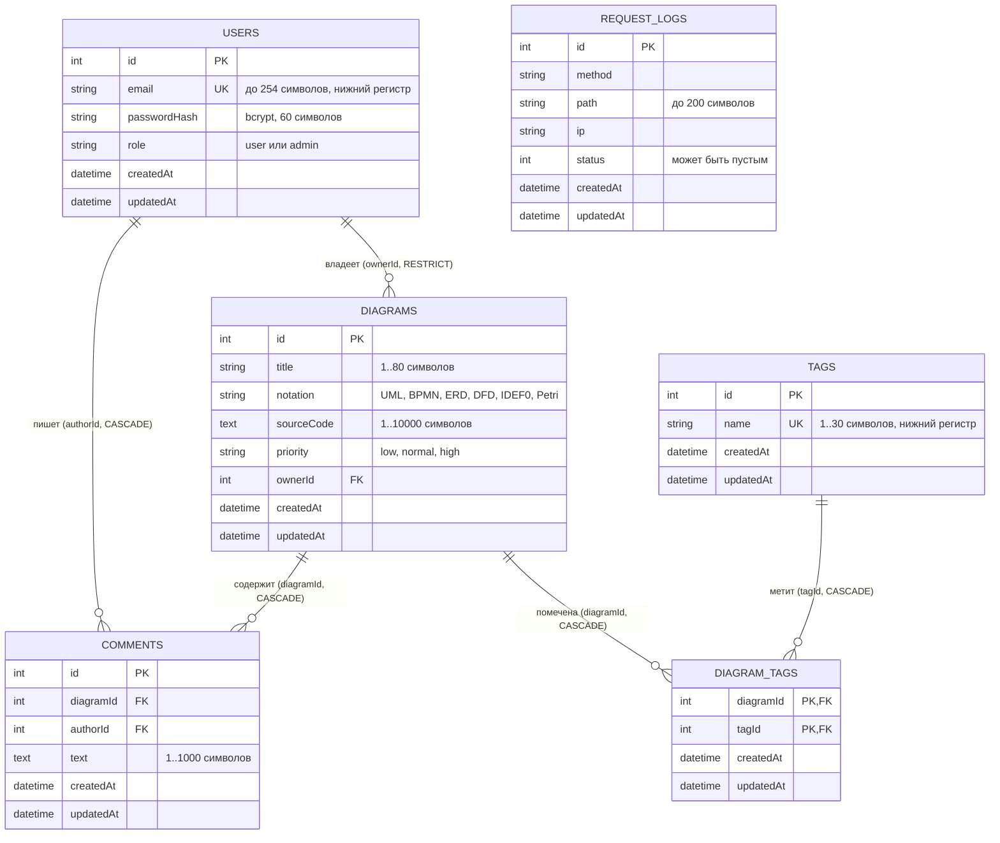

# Explanatory Note to the Course Project

> English parallel version of `note.md`. The title page, the assignment and the table of contents are placeholders: they are produced in Word by the university standard. Every `[TODO: ...]` marker must be closed by the owner, the list is in `README.md`. The Russian text is the primary one.

## Title Page

[TODO: title page by the university standard (2024 edition): university, department, topic "Development of the DSLKit web application: a diagrams-as-code editor", discipline "Internet Technologies and Web Programming", student name, group, variant 26, supervisor, Minsk 2026]

## Assignment

[TODO: assignment by the department template: topic, input data, list of questions, deadlines, signatures]

## Table of Contents

[TODO: generated in Word from the headings of this file. For an appendix the table of contents names the section that refers to it, for example "to subsection 3.2"]

## List of Symbols, Abbreviations and Terms

API – Application Programming Interface.

CORS – Cross-Origin Resource Sharing.

CRUD – Create, Read, Update, Delete, the basic operations on records.

DSL – Domain-Specific Language.

ER – Entity-Relationship model.

JWT – JSON Web Token, a token for authentication.

ORM – Object-Relational Mapping.

RBAC – Role-Based Access Control.

REST – Representational State Transfer, an architecture style of web services.

SPA – Single Page Application.

CI/CD – Continuous Integration / Continuous Deployment.

## Introduction

**Relevance.** Diagrams of processes, data and architecture are needed in every development team, but ordinary graphical editors suit teamwork badly. A file with a picture cannot be compared line by line in a version control system, it is hard to check automatically and hard to change in bulk. The diagrams-as-code approach removes the problem: a diagram is described as text in a special language, the text lives in the repository next to the source code, and the picture is drawn automatically. Services of this class are in demand among developers, architects and teachers because they lower the cost of keeping diagrams up to date.

The DSLKit project is conceived as a SaaS editor of diagrams as code for six notations: UML, BPMN, ERD, DFD, IDEF0 and Petri nets. The course project implements the server and client core of such a system: diagram storage with comments and tags, user registration and login, access control, an administrator screen and deployment in containers. The visual editor with a preview was built separately in the first part of the discipline as a static site. In the course project it serves as the subject area and as the source of interface requirements.

**Purpose.** To develop the full-featured web application "DSLKit" on a modern stack: a React client, a Node.js and Express server, a PostgreSQL relational database, JWT authentication and a Docker Compose launch.

**Tasks:**

1. Analyze the subject area and formulate functional and non-functional requirements.
2. Design the architecture, the data structure and the REST API, and choose the technology stack.
3. Implement the server side: REST API, database, authentication and authorization.
4. Develop the client side: a React SPA with routing (public, protected and role-based routes) and a responsive interface.
5. Integrate the parts, test them and deploy the application in containers.

**Object and subject of the study.** The object is the process of developing web applications. The subject is the methods and technologies of building SPAs with React, Node.js and PostgreSQL.

**Practical value.** The application can serve as the basis of a diagram storage service for a student group or a small team: each user has a personal set of diagrams, the administrator manages accounts and can fix a record of another user. The server works as a standalone API to which any client can connect, including the editor from the first part of the discipline.

**Structure.** The explanatory note consists of an introduction, three chapters, a conclusion, a list of sources and appendices. Chapter 1 contains the analysis and design of the system. Chapter 2 describes the implementation of the server and client, integration and deployment. Chapter 3 contains the user guide and the test results.

## Chapter 1 Analysis and Design of the System

### 1.1 Subject Area Analysis and Requirements

**The problem.** A developer who keeps diagrams as code faces three groups of tasks. The source text of a diagram has to be stored together with its title and notation, the data of different people has to be separated, and access has to be managed safely. Free online editors usually store data without an account or tie it to a third-party service, so the user does not control who sees the diagrams. In such services, according to the competitor review in the first part of the work, one meets unclear pricing and disabled buttons without an explanation. DSLKit avoids these defects: the account is its own, the rights are explicit, and the input limits are visible to the user and kept in one configuration file.

The subject area is described by five concepts. A user is a person with an email address and a role. A diagram is a record with a title, a notation, DSL source code and a priority, and it has an owner. A comment is a short text on a diagram with an author and a time. A tag is a short label put on diagrams: a diagram can have several tags and one tag can be on many diagrams. A request is a unit of the log from which the administrator can reconstruct what happened on the server.

**Functional requirements.** The requirements are written as user stories and collected in Table 1.

Table 1 – Functional requirements (FR)

| No.  | User story                                                                          | Module         |
| ---- | ----------------------------------------------------------------------------------- | -------------- |
| FR1  | A guest can register with an email address and a password                           | Authentication |
| FR16 | The owner of a diagram or an administrator can add a tag to the diagram and remove it, any user can show the diagrams with a chosen tag | Diagrams       |
| FR2  | A registered user can log in and receive a token                                    | Authentication |
| FR16 | The owner of a diagram or an administrator can add a tag to the diagram and remove it, any user can show the diagrams with a chosen tag | Diagrams       |
| FR3  | A user can view their profile                                                       | Authentication |
| FR16 | The owner of a diagram or an administrator can add a tag to the diagram and remove it, any user can show the diagrams with a chosen tag | Diagrams       |
| FR4  | A user can view the list of diagrams and search it by title                         | Diagrams       |
| FR5  | A user can sort the list and get it page by page                                    | Diagrams       |
| FR6  | A user can create a diagram: title, notation, source code, priority                 | Diagrams       |
| FR7  | A user can edit and delete their own diagram                                        | Diagrams       |
| FR8  | A user can see a clear message on a network or server error and retry               | Diagrams       |
| FR9  | An administrator can edit or delete any diagram                                     | Administration |
| FR10 | An administrator can see the list of users on a separate screen                                         | Administration |
| FR11 | An administrator can change the role of another user                                | Administration |
| FR12 | An administrator can delete a user after a confirmation if the user has no diagrams                              | Administration |
| FR13 | A user can read the comments on a diagram and leave their own                       | Diagrams       |
| FR14 | The author of a comment or an administrator can edit and delete the comment         | Diagrams       |
| FR15 | The login and registration pages are open to a guest, the others need a login and return to the requested address | Authentication |
| FR16 | The owner of a diagram or an administrator can add a tag to the diagram and remove it, any user can show the diagrams with a chosen tag | Diagrams       |

The three functional modules required by the course project condition are named in the last column of Table 1: authentication, diagrams and administration.

**Non-functional requirements.** The key non-functional requirements (NFR) are listed in Table 2.

Table 2 – Non-functional requirements (NFR)

| No.  | Category        | Requirement                                                                                                  |
| ---- | --------------- | ------------------------------------------------------------------------------------------------------------ |
| NFR1 | Security        | A password is stored only as a bcrypt hash, the token is signed with HS256, the secret is at least 32 characters |
| NFR2 | Security        | Login and registration are rate limited, after five failed attempts the email is locked for 15 minutes       |
| NFR3 | Security        | The server does not expose internal errors: the client gets a 500 answer without a stack trace               |
| NFR4 | Reliability     | Input limits (title, code, email, password length) live in `limits.json` and match on the client and server  |
| NFR5 | Reliability     | Huge input does not crash the server: the request body is limited to 100 KB, numbers in requests are checked |
| NFR6 | Performance     | The diagram list is served in pages of at most 100 items, the answer takes under a second on typical data [TODO: measure] |
| NFR7 | Responsiveness  | The interface works from 375 to 1280 pixels wide, touch targets are at least 44 pixels, text is at least 14 pixels |
| NFR8 | Accessibility   | Visible field labels, skip navigation, a theme switch without JavaScript, contrast by WCAG 2.2 AA           |
| NFR9 | Maintainability | Automated tests for the server and client, the whole stack starts with one command                          |

Requirements NFR1 to NFR5 are confirmed by the automated server tests, requirements NFR7 and NFR8 are fixed by the interface rules of the first part of the discipline. The measurement for NFR6 has not been done yet.

### 1.2 Application Architecture Design

**Logical architecture.** The actors of the system are shown in Figure 1. A guest can only register and log in. A user works with their own diagrams and profile. An administrator inherits the rights of a user and additionally manages records and accounts of other people. The source text of the diagram is given in appendix E.


Figure 1 – Use case diagram of DSLKit for a guest, a user and an administrator

**Physical architecture.** The system is described with the C4 model at two levels. The system context is shown in Figure 2: two kinds of people work with one system, and a cloud PostgreSQL database can be connected on request instead of the container.


Figure 2 – C4 level 1 diagram: the context of the DSLKit system

The internal structure is shown in Figure 3. The browser talks to a single address, to Nginx on port 8080. Nginx serves the built React files and forwards requests with the `/api/` prefix to the Express server. Only the server talks to the PostgreSQL database. The database sits in an internal Docker network with no access from outside.


Figure 3 – C4 level 2 diagram: containers of DSLKit and the protocols between them

A single entry point through Nginx has two consequences. First, for the browser the client and the server share one origin, so CORS is not needed in the container mode. Second, the server address is not baked into the built client: the build gets the value `/api`.

**REST API design.** The API resources are `auth` (registration and login), `profile`, `diagrams`, `comments`, `tags` and `users`. The main endpoints are collected in Table 3. All answers are JSON, errors have the form `{ "error": "...", "details": [...] }`, where `details` lists the fields with a description of the problem.

Table 3 – Main REST API endpoints

| Method | URL                  | Access              | Description and example                                                                                         |
| ------ | -------------------- | ------------------- | --------------------------------------------------------------------------------------------------------------- |
| POST   | `/auth/register`     | everyone            | Registration. Body `{"email","password"}`, answer 201 `{id,email,role,createdAt}`, 400, 409 (email taken)       |
| POST   | `/auth/login`        | everyone            | Login. Body `{"email","password"}`, answer 200 `{token,tokenType,expiresIn}`, 400, 401, 429                      |
| GET    | `/profile`           | token               | Current user, 200 or 401                                                                                        |
| GET    | `/diagrams`          | token               | List. Parameters `search`, `limit` (1–100), `offset`, `sort`, `order`. Header `X-Total-Count`, the answer is an array |
| GET    | `/diagrams/:id`      | token               | One diagram, 200, 400 (bad id), 404                                                                             |
| POST   | `/diagrams`          | token               | Create. Body `{"title","notation","sourceCode","priority"}`, answer 201 and the `Location` header                |
| PUT    | `/diagrams/:id`      | owner or admin      | Full replacement, 200, 400, 403, 404                                                                            |
| DELETE | `/diagrams/:id`      | owner or admin      | Deletion, 204, 403, 404                                                                                         |
| GET    | `/diagrams/:id/comments` | token           | Comments of a diagram, oldest first. Parameters `limit` (1–100), `offset`, `order`. Header `X-Total-Count`, the answer is an array, 404 (no such diagram) |
| POST   | `/diagrams/:id/comments` | token           | New comment. Body `{"text"}` (1–1000 characters), the author comes from the token, answer 201 and the `Location` header, 400, 404 |
| PATCH  | `/comments/:id`      | author or admin     | Text change, body `{"text"}`, 200, 400, 403, 404                                                                |
| DELETE | `/comments/:id`      | author or admin     | Deletion, 204, 403, 404                                                                                         |
| GET    | `/tags`              | token               | All tags with the number of diagrams for each. Parameters `limit`, `offset`, `sort` (`id`, `name`), `order`. Header `X-Total-Count` |
| GET    | `/diagrams/:id/tags` | token               | Tags of a diagram in alphabetical order, 200, 400, 404                                                          |
| POST   | `/diagrams/:id/tags` | owner or admin     | Body `{"name"}` (up to 30 characters, letters, digits, space, `-`, `_`), the name is lowercased, the tag is created on first use. Answer 201 or 200 (already set), 400 (including more than 10 tags), 403, 404 |
| DELETE | `/diagrams/:id/tags/:tagId` | owner or admin | Remove a tag from the diagram, the tag itself stays, 204, 400, 403, 404                                          |
| DELETE | `/tags/:id`          | admin               | Delete a tag from all diagrams, 204, 403, 404                                                                   |
| GET    | `/users`             | admin               | List of users without hashes, 200, 403                                                                          |
| PATCH  | `/users/:id/role`    | admin               | Role change. Body `{"role":"admin"}`, 200, 400 (own role or bad value), 404                                     |
| DELETE | `/users/:id`         | admin               | User deletion, 204, 400 (self), 404, 409 (has diagrams)            |
| GET    | `/health`            | everyone            | Server and database check for Docker, 200 `{"status":"ok"}` or 503                                              |

An example request body for creating a diagram is `{"title":"Order","notation":"BPMN","sourceCode":"start -> pay -> ship","priority":"normal"}`. The allowed notations are UML, BPMN, ERD, DFD, IDEF0 and Petri. The allowed priorities are low, normal and high.

### 1.3 Data Structure Design

The database has five entities and one link table, `DiagramTags`. The ER diagram is shown in Figure 4, its source text is in appendix E.


Figure 4 – ER diagram of the database: users, diagrams, comments, tags and the request log

The `Users` table stores accounts: a unique lowercase email address, a password hash and the role `user` or `admin`. The `Diagrams` table stores diagrams: a title of up to 80 characters, a notation from a fixed list, source code of up to 10000 characters, a priority and the foreign key `ownerId` to `Users`. The relation is one to many: a user has many diagrams. The foreign key uses the `RESTRICT` rule, so a user cannot be deleted while diagrams belong to them. The `RequestLogs` table stores the request log: method, path, client address and the response status, which is written when the response ends. A log in a table instead of a file is required by the condition of variant 26. The `Comments` table stores comments on diagrams: a text of 1 to 1000 characters, the foreign keys `diagramId` to `Diagrams` and `authorId` to `Users`, and the creation and change times. Both keys use the `CASCADE` rule: deleting a diagram deletes its comments, deleting a user deletes the comments of that user. As for diagrams, the integrity rules are duplicated in the database: an empty text and a text longer than 1000 characters are forbidden. The `Tags` table stores tags: a unique name of up to 30 characters in lower case, and the database forbids an empty name and a name with capital letters. The many-to-many relation between diagrams and tags is the `DiagramTags` table with the composite primary key (`diagramId`, `tagId`): a diagram cannot get the same tag twice. Both foreign keys use the `CASCADE` rule, so deleting a diagram or a tag removes only the link rows, and the diagram or the tag itself stays.

The integrity rules are duplicated in the database itself: a check of the allowed notation, a ban on an empty title or code made of spaces, and a limit on the title length. The table stays correct even if something writes to it bypassing the API. The tables are created by Sequelize migrations, not by `sync()`, so the schema can be rolled back and reproduced.

The course project condition recommends four to six entities. The schema has five: `Users`, `Diagrams`, `Comments`, `Tags` and `RequestLogs`. There are three one-to-many relations: user to diagrams, user to comments and diagram to comments. There is one many-to-many relation: diagrams to tags, through the `DiagramTags` table. The comment and tag tables are created by the fifth and the sixth migrations, which can be rolled back with `db:migrate:undo`.

## Chapter 2 Implementation of the Web Application

### 2.1 Choice and Justification of the Technology Stack

The comparison of technologies is given in Table 4. The choice follows the course project condition and the experience from the labs of the second part.

Table 4 – Technology choice and justification

| Layer             | Chosen                          | Alternative            | Justification                                                                                        |
| ----------------- | ------------------------------- | ---------------------- | ---------------------------------------------------------------------------------------------------- |
| Client            | React 19, React Router 7, Vite, axios           | Vue, Angular           | Component approach, hooks, a large ecosystem, fast Vite build, testing with Vitest                   |
| Server            | Node.js 22, Express 5           | NestJS, Fastify        | One language on the client and the server, a simple middleware chain, Express 5 passes a rejected promise to the error handler |
| Database          | PostgreSQL 16                   | MongoDB                | Transactions, foreign keys and integrity constraints, needed for the user to diagrams relation       |
| ORM               | Sequelize 6 with migrations     | Prisma, TypeORM        | Mature support of PostgreSQL and SQLite, migrations and seeds, used in lab 2                         |
| Authentication    | bcrypt and JWT (HS256)          | Sessions, OAuth        | No session store needed, fits SPA and mobile clients, studied in lab 3                               |
| Containers        | Docker and Docker Compose       | Manual launch          | One launch of the whole stack, reproducibility, network isolation                                    |
| Web server        | Nginx                           | Express serves static files | Static caching, reverse proxy, non-root run in the nginx-unprivileged image                     |
| Tools             | Git, Postman and REST Client, VS Code | –                | Version control, manual API checks, code editor                                                      |

The main database of the application is PostgreSQL 16: the connection is set by the `DATABASE_URL` variable, a local instance is started by the container `docker compose up -d db`. SQLite stays only as the test mode (`SQLITE_STORAGE`), so the test suite needs no server. Work on a real PostgreSQL was checked by running the container stack of lab 8 again: migrations apply, the seed fills the tables, filters and access checks work.

### 2.2 Server Side Implementation

#### 2.2.1 Project Structure and Setup

The server side lives in the `course-project/app/server` folder of branch `course-app` (based on lab 3) and is split into layers, as Table 5 shows.

Table 5 – Structure of the server side

| Path                 | Purpose                                                                          |
| -------------------- | -------------------------------------------------------------------------------- |
| `server.js`          | Entry point: reads settings from the environment, checks the database, starts listening |
| `src/app.js`         | Builds the Express application: middleware order and routes                      |
| `src/models/`        | Sequelize models `User`, `Diagram`, `Comment`, `Tag`, `DiagramTag`, `RequestLog` and constants                    |
| `src/routes/`        | Routes `auth`, `diagrams`, `comments`, `tags`, `users`                                                |
| `src/controllers/`   | Handlers: all the request logic                                                  |
| `src/middleware/`    | Token and role checks, input validation, rate limiting, CORS, log, error handling |
| `migrations/`, `seeders/` | Database schema and initial data (the administrator from environment variables) |
| `limits.json`        | All input limits in one file                                                     |
| `tests/`             | Automated tests on a temporary database                                          |

The `package.json` file lists dependencies (`express` 5, `sequelize` 6, `bcrypt`, `jsonwebtoken`, `pg`, `sqlite3`) and the scripts `start`, `dev`, `test`, `db:migrate`, `db:seed`. The `engines` field fixes Node.js 22 or newer. Settings are read from `.env`, the sample `.env.example` is in the repository and the `.env` itself is not.

The middleware order in `src/app.js` matters: first CORS and security headers, then the `/health` route (before the log, so Docker probes do not fill the table), then the request log, JSON parsing with a size limit, the content type check, the routes, the unknown route handler and the common error handler. Thanks to this, any error, including a failed write to the log, becomes a well-formed JSON answer.

#### 2.2.2 Data Models and Database Work

The diagram model describes fields and checks. A model example with comments is given in appendix A. String lengths come from `limits.json`, so a limit is changed in one place. The user model hides the password hash: the `toJSON` method returns only public fields, so even an accidental serialization of the object (an answer `res.json(user)`, a log) does not reveal the hash. The comment model (appendix A) holds the text and two keys. The controller sets `diagramId` and `authorId` from the URL and the token, so a request body cannot replace the author or the diagram.

#### 2.2.3 REST API Implementation

The diagram controller (a fragment in appendix A) performs the CRUD operations. The list supports a substring search by title (the value is passed as a query parameter, so SQL injection is impossible), sorting only by fields from a whitelist and paging. The total number of records is returned in the `X-Total-Count` header while the body stays an array, so the clients of the earlier labs do not change. Creation takes the owner from the token, not from the request body, so the owner cannot be forged.

Input validation runs before the controller (appendix A): the title and the code are required, blank values are rejected, the length is measured after trimming, the notation and the priority are matched against a list, unknown fields are dropped. The identifier in the address is checked with a strict regular expression, because `Number()` would accept the values `0x1` and `1e0`, and numbers above the `INTEGER` range would cause a PostgreSQL error and a 500 answer. The validation error answer lists the fields with an explanation.
Comments (appendix A) are connected by a separate router: `GET` and `POST /diagrams/:id/comments`, `PATCH` and `DELETE /comments/:id`. The list is paged, oldest comments first, the total is in `X-Total-Count`. The text is checked after trimming: it is not empty, not longer than 1000 characters and has no control characters except a line break and a tab. Any signed-in user can read and write comments, the author or an administrator can edit and delete them. A missing diagram or comment gives 404, someone else's comment gives 403.

Tags are connected the same way: `GET /tags`, `GET` and `POST /diagrams/:id/tags`, `DELETE /diagrams/:id/tags/:tagId` and `DELETE /tags/:id`. The tag name is trimmed, inner spaces are squeezed and letters are lowercased, so "Billing" and "billing " are one tag. A tag is created when it is first added (`findOrCreate`), adding the same name again answers 200 and changes nothing. A diagram can have at most 10 tags. The owner of a diagram or an administrator can set and remove tags, any signed-in user can read them, and only an administrator can delete a tag completely. The diagram list accepts the `tag` parameter: it finds the diagrams with that tag, and an unknown tag gives an empty list.

#### 2.2.4 Authentication and Authorization

The JWT scheme has four steps. The client sends the email and the password to `/auth/login`. The server compares the password with the bcrypt hash and signs a token with HS256, the issuer `dslkit`, a lifetime of 1 hour by default (at most 24 hours) and the user identifier. The client stores the token and adds the header `Authorization: Bearer <token>` to every request. On each request the server verifies the signature, the expiry and the issuer, and then reads the user from the database.

The last step is important: the role in the token is only a hint and the decision is made from the database. So deleting an account and changing a role take effect at once, not when the token expires. The check accepts only HS256, so tokens with the algorithm `none` and HS512 are rejected. The code of the token middleware and of `requireRole` is in appendix A.

Authorization follows the RBAC model with two roles. The owner of a diagram or an administrator can change and delete it, the author of a comment or an administrator can change and delete the comment, the tags of a diagram can be changed by its owner or an administrator, user management is open to the administrator only. The role at registration is always `user`, and the first administrator is created by a seed from the `ADMIN_EMAIL` and `ADMIN_PASSWORD` variables. An administrator cannot change the role of or delete themselves, so the system never stays without an administrator.

#### 2.2.5 Error Handling and Security

The security measures are summarized in Table 6.

Table 6 – Security measures of the server side

| Threat                           | Measure                                                                                                  |
| -------------------------------- | -------------------------------------------------------------------------------------------------------- |
| Password theft from the database | bcrypt hash with 10 rounds, password length from 8 characters and at most 72 bytes                       |
| Discovery of existing emails     | The same answer and the same time for a wrong password and an unknown email (comparison with a fallback hash) |
| Password guessing                | At most 20 logins per address in 15 minutes (answer 429, header `Retry-After`), email lock after 5 failures |
| Registration flooding            | At most 10 registrations per address per hour                                                            |
| Token forgery                    | HS256 only, issuer check, secret of 32 characters or more, the server does not start without a secret    |
| SQL injection                    | Parameterized Sequelize queries, a whitelist of sort fields                                              |
| Foreign request origin           | CORS with a single allowed address, the value `*` is forbidden, the `Vary: Origin` header                |
| Leak of internal data            | Common error handler: on status 500 the client gets only "Internal server error"                         |
| Huge request bodies              | A limit of 100 KB, a length check of every field                                                         |
| Foreign comments, a forged author | The author comes from the token, not from the body, only the author or an administrator can change and delete, others get 403, extra body fields are dropped |
| Common headers                   | `x-powered-by` is disabled, security headers are added                                                   |

The `helmet` package is not used: the set of security headers is assembled by hand in `src/middleware/http.js`. The decision is deliberate: the needed headers (content policy, no framing, `nosniff`, no cache) are written in one file and covered by tests, and no extra dependency is added. Passwords are written neither to the log nor to answers.
The dependencies were checked with `npm audit --omit=dev`. There are no high or critical vulnerabilities in the server or the client. Two moderate ones remain in the transitive dependency `uuid` of Sequelize 6 (the fix needs Sequelize 3, so it is not applied) and two moderate ones in React Router 6 (an open redirect through a backslash in `Link` and `navigate`, and deserialization in server rendering, the fix exists only in version 7). The first one is closed because the client never passes an address typed by the user to `Link` or `navigate`, and the return address goes through `safeReturnPath`. The second one does not apply, there is no server rendering.

### 2.3 Client Side Implementation

#### 2.3.1 React Application Structure

The client is in the `course-project/app/client` folder. `src/components` holds the components `Header`, `Footer`, `AuthForm`, `DiagramForm`, `DiagramItem`, `CommentsSection`, `TagsSection`, `ErrorPage`, `ErrorHelp`, `ErrorBoundary` and the route guards in `RouteGuards`. `src/pages` holds the pages: login and registration, the list and the page of a diagram, the administrator screen and the error pages. `src/hooks` holds the hooks `useDiagrams` (the list), `useComments` (the comments of a diagram), `useTags` (the tags of a diagram) and `useUsers` (the administrator screen), `useDebouncedValue` delays the value for search, and the login state lives in `src/auth.jsx`. `src/utils` holds form validation, `safeReturnPath` and the page title, and the input limits are in `src/limits.json` and match the server ones. The API service and the interceptors are in `src/api.js`.

#### 2.3.2 Routing

Routing is built on React Router 7 (the `react-router` package 7.18.4, the version is pinned in `package.json`). In library mode version 7 uses the same `Routes` and `Route` description as version 6, and imports come from the single `react-router` package. All pages share one layout (header, main content, footer), and access is split into three levels:

- public: `/login`, `/register` and the error pages `/401`, `/403` and `/500`, the root `/` leads a guest to the login and a signed-in user to the list,
- protected (the wrapper route `RequireAuth`): `/diagrams` and `/diagrams/:id`, a guest is sent to `/login` and the whole requested address (path, query, hash) goes along in the navigation state,
- role-based (the wrapper `RequireRole` inside the protected ones): `/admin` for the role `admin` only, an ordinary user sees the 403 page and the request for the users is not sent.

After the login the login page returns the user to the requested address. The address goes through `safeReturnPath` (appendix B): only a path on this site is allowed, addresses like `//host` and `https://host`, a backslash, spaces, control characters and the login pages themselves are refused, then the user lands on the list. The role comes from the server with `GET /profile`, not from the token: the admin page waits for the answer and shows an error page with a "Retry" button on a failure. Hiding a page on the client does not protect data, the server checks every request to `/users` itself.

The pages for the errors 401, 403, 404 and 500 are built the same way: a code, a title and three parts (what it is, why it happened, how to fix it) from the catalog `errorCatalog.js`, then the actions of the page. The 404 page is shown for an unknown address, for an identifier that is not a number and for a diagram that is not on the server. A rendering error is caught by `ErrorBoundary` and shows the same 500 page. The tab title changes with the page.

On the Nginx side the SPA falls back to `index.html` for unknown paths, so a direct visit by address and a page reload work.

#### 2.3.3 Key Components and State

The diagram list state is moved to the `useDiagrams` hook. The hook keeps the array of records, the loading and error flags, performs optimistic changes and rolls them back when the server refuses. The helper hook `useDebouncedValue` delays the search request by 400 milliseconds, so the server does not get a request for every key press. The login state is held by `AuthProvider` in `src/auth.jsx`: it is defined by the presence of the token and by the `auth:logout` event raised on a 401 answer, and the role and the email are read with `GET /profile`. Client fragments are given in appendix B.

The optimistic update works as follows. When a record is added, the client shows it at once with a temporary identifier `temp-N` and sends the request. If the server succeeds, the temporary record is replaced with the answer. If the server refuses, the record disappears and the user sees a message. A record with a temporary identifier cannot be deleted or changed, and while a request about a record is in progress a repeated action on it is ignored. This removes races on fast clicks.
Comments (the `useComments` hook) and the administrator screen (the `useUsers` hook) are not optimistic: a comment is read by other people and a role is a right, so a row changes after the server answer. While a request for a comment or a user runs, its buttons are locked. Both screens have the states of loading, an error with an explanation and a "Retry" button, and an empty list. A server refusal is shown as a clear phrase: for example, an administrator trying to change their own role or to delete themselves gets a message that the system must not be left without an administrator, and deleting a user who has diagrams gets a message that the diagrams must be deleted first. Deleting a user needs a confirmation in a separate block with the focus on the "Cancel" button.

#### 2.3.4 Server Communication

Communication uses axios with a shared instance: the base address comes from `VITE_API_URL`, the timeout is 8 seconds. The request interceptor adds the token. The response interceptor on a 401 code removes the token and tells the application to show the login form. The list has three states: loading (an indicator), error (a text and the "Retry" button) and data. Search sends a request to the server and cancels the previous one with `AbortController`. The service code is in appendix B.

The token is stored in `localStorage`, as the lab condition requires. The risk is that a script injected into the page can read the token. So the client does not insert markup from data: record texts and server messages are rendered by React as plain text and `dangerouslySetInnerHTML` is not used. The token lifetime is one hour.

#### 2.3.5 Responsive Interface

The look of the client continues the first part of the discipline: the site styles are connected unchanged and the own rules are few. The interface uses Flexbox and Grid layouts, record cards in a grid, a fixed header with a logo and a light and dark theme switch. Sizes are set in `rem` from a fluid root size. The breakpoints are 576, 768 and 1024 pixels. Touch targets are at least 44 pixels, there is one main button per screen and one font, Inter. The layout proportions follow the golden ratio 1 : 1.618.

### 2.4 Integration, Build and Deployment

#### 2.4.1 Client and Server Integration

In development mode the client runs on port 5178 and calls the server on port 3000 directly. For this the server enables CORS with a single allowed origin from the `CORS_ORIGIN` variable. The answer to the preflight request is returned without a token and with code 204. In the container mode the browser talks to one address and CORS is not used: Nginx forwards `/api/` to the server.

#### 2.4.2 Containerization with Docker

The stack is described in the `course-project/app/docker` folder and has three services: `db` (PostgreSQL 16), `backend` (the server) and `frontend` (Nginx with the built client). The full files are in appendix C. The main decisions:

- The server Dockerfile has two stages: the first installs only runtime dependencies with `npm ci --omit=dev`, the second copies them into a clean image. The server runs as the `node` user, not as root.
- The client Dockerfile is multi-stage: the `builder` stage builds the Vite static files, the final image contains only Nginx without Node.js and sources. The `nginx-unprivileged` image is used, it listens on port 8080.
- Every service has a health check. The database is checked with `pg_isready`, the server with the `/health` route, the client with a request to the main page.
- The `depends_on` condition with `service_healthy` sets the start order: the server waits for the database, the client waits for the server. At start the server applies migrations and the administrator seed.
- The `internal` network is marked as internal, it holds the database and the server, so the database is not reachable from outside. The `public` network connects the server and the client. The database port is not published to the host, and the server port is bound to `127.0.0.1`.
- The server runs with `read_only`, `cap_drop: ALL` and `no-new-privileges`.
- Secrets are read from the `.env` file, which is not in the repository. The sample `.env.example` has no values, and empty required values stop the launch.
- If Docker Hub is unavailable, the `REGISTRY` variable substitutes the address of an image mirror.

The result of a launch is shown in Figure 5: all three containers have the healthy status.


Figure 5 – Output of the `docker ps` command with the healthy status of the database, server and client containers

#### 2.4.3 Deployment

The main way to run the system is Docker Compose on one machine, described above and in section 3.1. For publishing on the network, following the department recommendation, one can use the free services listed in appendix F: the client on Netlify or GitHub Pages, the server on Render, the database on Neon or Supabase. In this case the `db` service of Compose is not needed, and the connection string and `DATABASE_SSL=true` are set in the environment variables of the platform.

[TODO: choose and perform the cloud deployment (if required), record the application address and the check date. There is no public address now, a placeholder is left in the conclusion.]

#### 2.4.4 Testing

Automated tests are written for both parts. The server is tested with the built-in `node --test` runner on a temporary SQLite database with real migrations, bcrypt runs with four rounds for speed. The server suite has 226 tests: unit, functional, negative, attacks (token forgery, IDOR and a forged author of a comment, huge text, control characters), contract, load and resilience (a database failure, parallel requests, a diagram deleted while comments are written, tags and their link with diagrams). The client is tested with Vitest and React Testing Library, the suite has 237 tests: routes (public, protected, role-based, return to the requested address, error pages), comments, tags, the administrator screen, form validation, requests and accessibility with axe-core by the WCAG 2 A and AA rules. The Docker configuration is checked by 21 file checks without starting the daemon. The run on 24.10.2026: the server 225 of 226 tests (line coverage 100%, branches 98.27%; the load test exceeded its time limit on a busy machine and passed when run alone), the client 237 of 237 (line coverage 96.71%, statements 93.75%), Docker 21 of 21. [TODO: before submission repeat the full server run on a free machine and record 226 of 226.]

Manual scenarios and control examples are given in subsection 3.2. For manual API checks there is a `requests.http` file for the REST Client extension and the Postman collection `postman_collection.json`.

## Chapter 3 User Guide and Testing

### 3.1 User Guide

**Environment requirements.** The application needs a modern browser: Chrome, Edge or Firefox of current versions [TODO: state the versions it was checked in]. A developer needs Git, Node.js 22 or newer and Docker with Compose v2.

**Starting the application.** Commands for a developer:

1. Clone the repository: `git clone https://github.com/KsushaKhadzhinova/DSLKit-Project`, then switch to branch `course-app`.
2. Go to `course-project/app/docker` and copy `.env.example` to `.env`.
3. Put into `.env` a database password of letters and digits and a `JWT_SECRET` of at least 32 random characters. The secret is generated with the command given in `.env.example`. Values are never written to the repository.
4. Run `docker compose up --build`. After the start the application is available at `http://localhost:8080` and the server check at `http://localhost:8080/api/health`.
5. Stop the stack with `docker compose down`. The `-v` key removes the database data too.

The project is distributed under the MIT license, the `LICENSE` file is in the repository root. To run without Docker, start the server in `course-project/app/server` with `npm install`, `npm run db:migrate`, `npm run dev`, and the client in `course-project/app/client` with `npm install`, `npm run dev` (address `http://localhost:5178`).

**Scenario 1. Registration and login.** The user opens the application, sees the login form and goes to registration. The login and registration pages have their own addresses, `/login` and `/register`. They enter an email and a password of at least 8 characters and submit the form. On an error an explanation appears under the field: an empty value, a too long email, a too short password. After registration the user logs in, the token is saved and the workspace opens. The login form is shown in Figure 6.


Figure 6 – The login and registration form before the start of work

**Scenario 2. Creating a diagram.** In the workspace the user fills in the form: title, notation, source code and priority, then presses the main button. The record appears in the list at once and gets a permanent identifier after the server answer. The state of the list with several records is shown in Figure 7.


Figure 7 – The workspace with the list of the user diagrams

The moment of adding a new record is shown in Figure 8.


Figure 8 – Optimistic addition: the new record is shown before the server answer

**Scenario 3. Search, edit and delete.** The search field filters the list by title with a delay of 400 milliseconds. A record title is edited in place: Enter saves, Escape cancels. Deletion removes the record at once and brings it back if the server refuses. If the server is unavailable, a message and the "Retry" button are shown instead of the list, as in Figure 9.


Figure 9 – The error message for an unavailable server and the retry button

**Scenario 4. Diagram page and comments.** The title of a card in the list leads to the diagram page `/diagrams/:id`: it shows the notation, the priority, the source code and the "Comments" section. The comments are shown in pages of 20 with a "Load more" button. The user writes a text of up to 1000 characters and presses "Send": an empty text is refused with a message under the field, and after the server answer the comment appears at the end of the list. On their own comments the user sees the "Edit" and "Delete" buttons, an administrator sees them on all of them. Other people's comments are signed "User No. N", one's own are signed "You". If the diagram does not exist, the 404 error page with an explanation is shown.

**Scenario 5. Tags.** Under the source code of a diagram there is the "Tags" section. Each tag is a link to `/diagrams?tag=name`: the list then shows only the diagrams with that tag, with the caption "Tag: name" and a "Show all diagrams" link above it. The owner and an administrator see the "New tag" field and a "Remove" button on every tag. An empty name and a name with forbidden characters are refused with a message under the field before any request. When a diagram already has 10 tags, the field and the button are disabled with an explanation.

**Scenario 5. Administration.** An administrator sees the "Administration" item in the header and opens the `/admin` screen: a table of users with the email, the role, the creation time and a "Delete" button. The role is changed with a select, the result is confirmed by a message. An attempt to change one's own role or to delete oneself is refused by the server and the screen explains the reason. Deleting needs a confirmation: a "Delete the user?" block appears with the "Cancel" button (it has the focus) and the "Delete" button. An ordinary user who opens `/admin` sees the 403 page.

### 3.2 Control Examples and Testing

The control examples cover the three modules. The input data for them is collected in appendix D. The column "Actual result" is filled by the owner during a manual run, the expected results are taken from the documentation and the automated tests of the server side.

Table 7 – Control examples

| No. | Input data                                                    | User actions                                        | Expected result                                                  | Actual result                            |
| --- | ------------------------------------------------------------- | --------------------------------------------------- | ---------------------------------------------------------------- | ---------------------------------------- |
| 1   | Email `alice@example.com`, a password of 8 or more characters | Submit the registration form                        | Answer 201, the user has the role `user`, no hash in the answer  | Passed (automated tests)                  |
| 2   | The same email in another case, `ALICE@example.com`           | Register again                                      | Answer 409, message "A user with this email already exists"      | Passed (automated tests)                  |
| 3   | A password of 7 characters                                    | Submit the registration form                        | Answer 400, `details` names the field `password`                 | Passed (automated tests)                  |
| 4   | Correct email and password                                    | Log in                                              | Answer 200, the body has `token`, `tokenType: Bearer`, `expiresIn: 1h` | Passed (automated tests)            |
| 5   | Correct email, wrong password                                 | Log in                                              | Answer 401 "Invalid email or password", the same as for an unknown email | Passed (automated tests)          |
| 6   | Six wrong passwords in a row for one email                    | Repeat the login                                    | After the fifth failure the answer is 429 with `Retry-After`     | Passed (automated tests)                  |
| 7   | A request without the `Authorization` header                  | `GET /diagrams`                                     | Answer 401 "Missing Bearer token"                                | Passed (automated tests)                  |
| 8   | User token, title "Order", notation BPMN, code                | Create a diagram                                    | Answer 201, `Location` header, the owner is the user             | Passed (automated tests)                  |
| 9   | A title made of spaces                                        | Create a diagram                                    | Answer 400, field `title`: a non-empty string                    | Passed (automated tests)                  |
| 10  | A title longer than 80 characters                             | Create a diagram                                    | Answer 400, field `title`: at most 80 characters                 | Passed (automated tests)                  |
| 11  | Two diagrams, one has the word "Order" in the title           | `GET /diagrams?search=Order`                        | One record in the answer, `X-Total-Count` equals 1               | Passed (automated tests)                  |
| 12  | The parameter `limit=1000`                                    | `GET /diagrams?limit=1000`                          | Answer 400, field `limit`: from 1 to 100                         | Passed (automated tests)                  |
| 13  | Token of the second user, diagram of the first                | `DELETE /diagrams/:id`                              | Answer 403, the diagram stays                                    | Passed (automated tests)                  |
| 14  | Administrator token, the same diagram                         | `DELETE /diagrams/:id`                              | Answer 204                                                       | Passed (automated tests)                  |
| 15  | Token of an ordinary user                                     | `GET /users`                                        | Answer 403 "Requires the admin role"                             | Passed (automated tests)                  |
| 16  | Administrator token, the administrator own identifier         | `PATCH /users/:id/role` with the value `user`       | Answer 400, changing the own role is forbidden                   | Passed (automated tests)                  |
| 17  | A stopped database                                            | `GET /health`                                       | Answer 503 `{"status":"unavailable"}`                            | Passed (automated tests)                  |
| 18  | A stopped server, the workspace is open                       | Refresh the list in the client                      | An error message and the "Retry" button, Figure 9                | Passed (automated tests)                  |
| 19  | A guest opens the address `/diagrams/3`                       | Log in on the login page that opens                 | A redirect to `/login`, after the login `/diagrams/3` opens, not the list | Passed (automated tests)             |
| 20  | The return address `//evil.test` in the navigation state      | Open `/login` with a token                          | A redirect to `/diagrams`, the external address is not used      | Passed (automated tests)                 |
| 21  | Token of an ordinary user                                     | Open `/admin`                                       | The "Error 403" page, the request for the users is not sent      | Passed (automated tests)                 |
| 22  | An unknown address `/no/such/page`                            | Open the address                                    | The "Error 404" page with three parts: what it is, why, how to fix | Passed (automated tests)               |
| 23  | User token, an existing diagram                               | `POST /diagrams/:id/comments` with the text `  Hello  ` | Answer 201, `Location` header, the author from the token, the text without outer spaces | Passed (automated tests) |
| 24  | Body `{"text":"x","authorId":1,"diagramId":999}`              | `POST /diagrams/:id/comments`                       | Answer 201, the author and the diagram come from the token and the URL, extra fields are dropped | Passed (automated tests) |
| 25  | Token of the second user, someone else's comment              | `PATCH` and `DELETE /comments/:id`                  | Answer 403, the comment is unchanged                             | Passed (automated tests)                 |
| 26  | A text of 1001 characters or with a NUL character             | `POST /diagrams/:id/comments`                       | Answer 400, field `text`, nothing is written to the database     | Passed (automated tests)                 |
| 27  | Administrator, their own identifier                           | Change their own role on the administrator screen   | The message "You cannot change your own role...", the role is unchanged | Passed (automated tests)          |
| 28  | Administrator, a user without diagrams                        | Press "Delete" and confirm                          | A confirmation block, after "Delete" the row disappears          | Passed (automated tests)                 |
| 29  | Owner token, a diagram, the name `  Billing  `              | `POST /diagrams/:id/tags`                           | Answer 201, the tag `billing`, the same name again answers 200 and does not duplicate the link | Passed (automated tests)          |
| 30  | Token of an unrelated user                                    | `POST /diagrams/:id/tags`                           | Answer 403, the tags of the diagram are unchanged                | Passed (automated tests)          |
| 31  | The name `<script>` or of 31 characters, an eleventh tag      | `POST /diagrams/:id/tags`                           | Answer 400, field `name`, nothing is written to the database     | Passed (automated tests)          |
| 32  | A diagram with the tag `shop`, a diagram without tags         | `GET /diagrams?tag=SHOP`                            | One diagram in the answer, `X-Total-Count` is 1                  | Passed (automated tests)          |

A screenshot of the test run and the `npm test` output are placed in appendix G or in the main text after the run [TODO: attach the test output with the number of passed tests and the coverage].

**Conclusion on compliance with the requirements.** The functional requirements FR1 to FR16 are implemented at the API level and covered by the automated tests of the server side. All of them are available in the client interface too: FR9 to FR12 on the administrator screen, FR13, FR14 and FR16 on the diagram page and in the list, FR15 in the routing. The non-functional requirements for security and input limits are met and checked by tests. NFR6 (performance) and a part of NFR8 (accessibility) are not confirmed by measurement and need measurements. [TODO: after filling in Table 7 update the conclusion with the actual results.]

## Conclusion

In the course of the work all tasks have been solved: the subject area has been analyzed and 16 functional and 9 non-functional requirements have been formulated, the architecture by the C4 model, a REST API of 21 endpoints and a data schema of five entities have been designed, and the server side with JWT authentication and a role model, a React client and a container launch of the whole stack with one command have been implemented.

The purpose of the work, the development of the web application "DSLKit", has been achieved. The result is a working web application that starts with `docker compose up --build` and is available locally at `http://localhost:8080` [TODO: if a cloud deployment is made, give the public address]. The application implements registration and login, diagram storage with search, sorting and paging, comments and tags on diagrams, separation of the rights of the owner and the administrator, a request log in the database and a service health check.

Limitations of the work: there is no logout with token revocation and no refresh tokens, the rate limit counters are kept in the memory of one server instance, so scaling to several instances is not supported, and comments have no replies and no real-time updates.

In the future one can add a diagram preview in the client through the Kroki service, real-time collaborative editing (a WebSocket prototype exists in lab 7), token revocation, integration with the editor from the first part of the discipline and graphical support of all six notations.

## List of Sources

1. Express. Documentation [Electronic resource]. – URL: https://expressjs.com. – Accessed: [TODO: date].
2. Node.js Documentation [Electronic resource]. – URL: https://nodejs.org/docs/latest/api/. – Accessed: [TODO: date].
3. React. Learn React [Electronic resource]. – URL: https://react.dev/learn. – Accessed: [TODO: date].
4. Vite. Guide [Electronic resource]. – URL: https://vite.dev/guide/. – Accessed: [TODO: date].
5. Sequelize. Documentation, version 6 [Electronic resource]. – URL: https://sequelize.org/docs/v6/. – Accessed: [TODO: date].
6. PostgreSQL 16 Documentation [Electronic resource]. – URL: https://www.postgresql.org/docs/16/. – Accessed: [TODO: date].
7. Axios. Documentation [Electronic resource]. – URL: https://axios-http.com/docs/intro. – Accessed: [TODO: date].
8. Docker. Docker Compose documentation [Electronic resource]. – URL: https://docs.docker.com/compose/. – Accessed: [TODO: date].
9. Nginx. Documentation [Electronic resource]. – URL: https://nginx.org/en/docs/. – Accessed: [TODO: date].
10. RFC 7519. JSON Web Token (JWT). – IETF, 2015 [Electronic resource]. – URL: https://www.rfc-editor.org/rfc/rfc7519. – Accessed: [TODO: date].
11. RFC 9110. HTTP Semantics. – IETF, 2022 [Electronic resource]. – URL: https://www.rfc-editor.org/rfc/rfc9110. – Accessed: [TODO: date].
12. OWASP Cheat Sheet Series [Electronic resource]. – URL: https://cheatsheetseries.owasp.org. – Accessed: [TODO: date].
13. OWASP Application Security Verification Standard 4.0 [Electronic resource]. – URL: https://owasp.org/www-project-application-security-verification-standard/. – Accessed: [TODO: date].
14. Brown, S. The C4 model for visualising software architecture [Electronic resource]. – URL: https://c4model.com. – Accessed: [TODO: date].
15. Mermaid. Diagram syntax [Electronic resource]. – URL: https://mermaid.js.org. – Accessed: [TODO: date].
16. W3C. Web Content Accessibility Guidelines (WCAG) 2.2 [Electronic resource]. – URL: https://www.w3.org/TR/WCAG22/. – Accessed: [TODO: date].
17. MDN Web Docs. Cross-Origin Resource Sharing (CORS) [Electronic resource]. – URL: https://developer.mozilla.org/docs/Web/HTTP/CORS. – Accessed: [TODO: date].
18. Vitest. Guide [Electronic resource]. – URL: https://vitest.dev/guide/. – Accessed: [TODO: date].
19. DSLKit project repository [Electronic resource]. – URL: https://github.com/KsushaKhadzhinova/DSLKit-Project. – Accessed: [TODO: date].
20. [TODO: add one or two books not older than 5 years from the curriculum list and 1–2 recent articles (2022–2026). Format by the state standard or the university standard, 2024 edition.]

## Appendix A (mandatory) Server Side Code Fragments

The appendix contains key fragments of the server side from `course-project/app/server` (repository branch `course-app`, based on lab 3). It is referred to in subsections 2.2.2, 2.2.3 and 2.2.4.

The diagram model `src/models/diagram.js`:

```js
const { DataTypes } = require('sequelize');
const { NOTATIONS, PRIORITIES, DEFAULT_PRIORITY, LIMITS } = require('./diagram.constants');

// The table is created by migrations, never by sequelize.sync().
const defineDiagram = (sequelize) =>
  sequelize.define('Diagram', {
    title: { type: DataTypes.STRING(LIMITS.title), allowNull: false, validate: { len: [1, LIMITS.title] } },
    notation: { type: DataTypes.STRING(10), allowNull: false, validate: { isIn: [NOTATIONS] } },
    sourceCode: { type: DataTypes.TEXT, allowNull: false, validate: { len: [1, LIMITS.sourceCode] } },
    priority: { type: DataTypes.STRING(10), allowNull: false, defaultValue: DEFAULT_PRIORITY, validate: { isIn: [PRIORITIES] } },
    ownerId: { type: DataTypes.INTEGER, allowNull: false },
  });

module.exports = { defineDiagram };
```

Input validation `src/middleware/validate.js` (fragment):

```js
// Text is checked after trimming, so the stored value is what was measured.
const text = (name) => (v) => {
  if (typeof v !== 'string' || v.trim() === '') return 'must be a non-empty string';
  return v.trim().length <= LIMITS[name] || `must be at most ${LIMITS[name]} characters`;
};

const checks = {
  title: text('title'),
  notation: (v) => NOTATIONS.includes(v) || `must be one of ${NOTATIONS.join(', ')}`,
  sourceCode: text('sourceCode'),
  priority: (v) => PRIORITIES.includes(v) || `must be one of ${PRIORITIES.join(', ')}`,
};

// The raw text is checked first because Number() would accept '0x1', '1e0' and ' 1'.
const parseId =
  (key = 'diagramId', label = 'Diagram') =>
  (req, _res, next) => {
    const id = Number(req.params.id);
    if (!/^[1-9]\d*$/.test(req.params.id) || id > MAX_ID) return next(badRequest(`${label} id must be a positive integer up to ${MAX_ID}`));
    req[key] = id;
    return next();
  };
```

The diagram controller `src/controllers/diagrams.controller.js` (fragment):

```js
// Only the owner or an admin may change or delete a diagram.
const mayChange = (user, diagram) => user.role === 'admin' || diagram.ownerId === user.id;

const createDiagramsController = ({ Diagram }) => ({
  list: async (req, res, next) => {
    const { search } = req.query;
    if (search !== undefined && (typeof search !== 'string' || search.trim().length > LIMITS.title)) {
      return next(badRequest(`search must be a string of at most ${LIMITS.title} characters`));
    }
    const term = (search ?? '').trim();
    const where = term ? { title: { [Op.like]: `%${term}%` } } : undefined;
    const { limit, offset, sort, order } = parseListQuery(req.query, SORTABLE);
    const { count, rows } = await Diagram.findAndCountAll({ where, order: [[sort, order.toUpperCase()], ['id', 'ASC']], limit, offset });
    res.set('X-Total-Count', String(count));
    return res.json(rows);
  },

  create: async (req, res) => {
    const diagram = await Diagram.create({ ...req.diagramFields, ownerId: req.user.id });
    res.status(201).location(`/diagrams/${diagram.id}`).json(diagram);
  },

  remove: async (req, res, next) => {
    const diagram = await Diagram.findByPk(req.diagramId);
    if (!diagram) return next(missing(req.diagramId));
    if (!mayChange(req.user, diagram)) return next(forbidden('Only the owner or an admin can delete this diagram'));
    await diagram.destroy();
    return res.status(204).end();
  },
});
```

Token and role check `src/middleware/auth.js`:

```js
// Verifies the Bearer token, then loads the user so a deleted account or a changed role takes effect at once.
const createAuthenticate =
  ({ User }, { jwtSecret }) =>
  async (req, _res, next) => {
    const token = bearerToken(req);
    if (!token) return next(unauthorized('Missing Bearer token'));
    let payload;
    try {
      payload = jwt.verify(token, jwtSecret, { algorithms: ['HS256'], issuer: ISSUER });
    } catch (error) {
      return next(unauthorized(error.name === 'TokenExpiredError' ? 'Token expired' : 'Invalid token'));
    }
    const user = await User.findByPk(payload.id);
    if (!user) return next(unauthorized('User no longer exists'));
    req.user = { id: user.id, email: user.email, role: user.role };
    return next();
  };

const requireRole = (role) => (req, _res, next) => (req.user.role === role ? next() : next(forbidden(`Requires the ${role} role`)));
```

Protected routes `src/routes/diagrams.routes.js`:

```js
router.route('/').get(authenticate, controller.list).post(authenticate, validateDiagram, controller.create).all(allowMethods(['GET', 'POST']));
router
  .route('/:id')
  .get(authenticate, parseId(), controller.get)
  .put(authenticate, parseId(), validateDiagram, controller.replace)
  .delete(authenticate, parseId(), controller.remove)
  .all(allowMethods(['GET', 'PUT', 'DELETE']));
```

The comment model `src/models/comment.js`:

```js
const defineComment = (sequelize) =>
  sequelize.define('Comment', {
    diagramId: { type: DataTypes.INTEGER, allowNull: false },
    authorId: { type: DataTypes.INTEGER, allowNull: false },
    text: { type: DataTypes.TEXT, allowNull: false, validate: { len: [1, LIMITS.comment] } },
  });
```

The comment text check `src/middleware/validate.js` (fragment):

```js
// A comment is multi-line text: line breaks and tabs are fine, other control characters (NUL, escape, bell) are not.
const COMMENT_CONTROL = /[\u0000-\u0008\u000B\u000C\u000E-\u001F\u007F]/;

// The author and the diagram come from the token and the URL, so any other field in the body is dropped.
const validateComment = (req, _res, next) => {
  const result = commentProblem(req.body?.text);
  if (result !== true) return next(badRequest('Invalid comment data', [{ field: 'text', message: result }]));
  req.commentFields = { text: req.body.text.trim() };
  return next();
};
```

The comment controller `src/controllers/comments.controller.js` (fragment):

```js
// Only the author or an admin may change or delete a comment.
const mayChange = (user, comment) => user.role === 'admin' || comment.authorId === user.id;

create: async (req, res, next) => {
  if (!(await Diagram.findByPk(req.diagramId, { attributes: ['id'] }))) return next(diagramMissing(req.diagramId));
  const comment = await Comment.create({ ...req.commentFields, diagramId: req.diagramId, authorId: req.user.id });
  return res.status(201).location(`/comments/${comment.id}`).json(comment);
},

remove: async (req, res, next) => {
  const comment = await Comment.findByPk(req.commentId);
  if (!comment) return next(commentMissing(req.commentId));
  if (!mayChange(req.user, comment)) return next(forbidden('Only the author or an admin can delete this comment'));
  await comment.destroy();
  return res.status(204).end();
},
```

The comment routes `src/routes/comments.routes.js`:

```js
router
  .route('/diagrams/:id/comments')
  .get(authenticate, parseId(), controller.list)
  .post(authenticate, parseId(), validateComment, controller.create)
  .all(allowMethods(['GET', 'POST']));
router
  .route('/comments/:id')
  .patch(authenticate, parseId('commentId', 'Comment'), validateComment, controller.update)
  .delete(authenticate, parseId('commentId', 'Comment'), controller.remove)
  .all(allowMethods(['PATCH', 'DELETE']));
```

## Appendix B (mandatory) Client Side Code Fragments

The appendix contains client fragments from `course-project/app/client` (branch `course-app`). It is referred to in subsections 2.3.3 and 2.3.4. The routing fragments are at the end of the appendix and are referred to in subsection 2.3.2.

The API service `src/api.js` (fragment):

```js
const api = axios.create({ baseURL: import.meta.env.VITE_API_URL || 'http://localhost:3000', timeout: 8000 });

// Every request carries the JWT saved after login.
api.interceptors.request.use((config) => {
  const token = getToken();
  if (token) config.headers.Authorization = `Bearer ${token}`;
  return config;
});

// An expired or rejected token ends the session: the token is removed and the app is told to show the login form.
api.interceptors.response.use(
  (response) => response,
  (error) => {
    if (error.response?.status === 401 && getToken()) {
      clearToken();
      window.dispatchEvent(new Event('auth:logout'));
    }
    return Promise.reject(error);
  },
);

export const register = (email, password) => api.post('/auth/register', { email, password });
export const login = (email, password) => api.post('/auth/login', { email, password });
```

Routes `src/App.jsx` (fragment) and the guards `src/components/RouteGuards.jsx`:

```jsx
<Routes>
  <Route element={<Layout />}>
    <Route index element={<Home />} />
    <Route path="login" element={<AuthPage mode="login" />} />
    <Route path="register" element={<AuthPage mode="register" />} />
    <Route element={<RequireAuth />}>
      <Route path="diagrams" element={<DiagramsPage />} />
      <Route path="diagrams/:id" element={<DiagramPage />} />
      <Route element={<RequireRole role="admin" />}>
        <Route path="admin" element={<AdminPage />} />
      </Route>
    </Route>
    <Route path="*" element={<NotFoundPage />} />
  </Route>
</Routes>
```

```jsx
export function RequireAuth() {
  const { signedIn } = useAuth();
  const location = useLocation();
  const from = `${location.pathname}${location.search}${location.hash}`;
  return signedIn ? <Outlet /> : <Navigate to="/login" replace state={{ from }} />;
}
```

The return address check `src/utils/returnPath.js`:

```js
const UNSAFE_PATH_CHARACTER = /[\u0000- \u007f-\u009f\\]/;
const AUTH_PAGES = /^\/(login|register|401)([?#]|$)/;

export function safeReturnPath(value, fallback = '/diagrams') {
  if (typeof value !== 'string' || !value.startsWith('/') || value.startsWith('//') || UNSAFE_PATH_CHARACTER.test(value)) return fallback;
  return AUTH_PAGES.test(value) ? fallback : value;
}
```

## Appendix C (mandatory) Docker Configuration

The appendix contains the launch files from `course-project/app/docker` (branch `course-app`). It is referred to in subsection 2.4.2.

The `docker-compose.yml` file:

```yaml
name: dslkit

services:
  db:
    image: ${REGISTRY:-}library/postgres:16-alpine
    restart: unless-stopped
    environment:
      POSTGRES_USER: ${POSTGRES_USER:-dslkit}
      POSTGRES_PASSWORD: ${POSTGRES_PASSWORD:?set POSTGRES_PASSWORD in .env}
      POSTGRES_DB: ${POSTGRES_DB:-dslkit}
    volumes:
      - pgdata:/var/lib/postgresql/data
    networks: [internal]
    healthcheck:
      test: ['CMD-SHELL', 'pg_isready -U $${POSTGRES_USER} -d $${POSTGRES_DB}']
      interval: 5s
      timeout: 3s
      retries: 10

  backend:
    build:
      context: ../server
      dockerfile: ../docker/backend/Dockerfile
    restart: unless-stopped
    environment:
      PORT: 3000
      DATABASE_URL: postgres://${POSTGRES_USER:-dslkit}:${POSTGRES_PASSWORD}@db:5432/${POSTGRES_DB:-dslkit}
      JWT_SECRET: ${JWT_SECRET:?set JWT_SECRET in .env, at least 32 random characters}
      CORS_ORIGIN: http://localhost:${FRONTEND_PORT:-8080}
      TRUST_PROXY: '1'
    depends_on:
      db:
        condition: service_healthy
    ports:
      - '127.0.0.1:${BACKEND_PORT:-3000}:3000'
    read_only: true
    tmpfs: [/tmp]
    cap_drop: [ALL]
    security_opt: ['no-new-privileges:true']
    networks: [internal, public]

  frontend:
    build:
      context: ../client
      dockerfile: ../docker/frontend/Dockerfile
      additional_contexts:
        deploy: ./frontend
    restart: unless-stopped
    depends_on:
      backend:
        condition: service_healthy
    ports:
      - '${FRONTEND_PORT:-8080}:8080'
    networks: [public]

networks:
  internal:
    internal: true
  public:

volumes:
  pgdata:
```

The `backend/Dockerfile` file:

```dockerfile
ARG REGISTRY=

FROM ${REGISTRY}library/node:22-alpine AS deps
WORKDIR /app
COPY package.json package-lock.json ./
RUN npm ci --omit=dev && npm cache clean --force

FROM ${REGISTRY}library/node:22-alpine
WORKDIR /app
ENV PORT=3000
COPY --from=deps --chown=node:node /app/node_modules ./node_modules
COPY --chown=node:node . .
USER node
EXPOSE 3000
HEALTHCHECK --interval=15s --timeout=3s --start-period=20s --retries=3 \
  CMD node -e "fetch('http://127.0.0.1:'+process.env.PORT+'/health').then(r=>process.exit(r.ok?0:1),()=>process.exit(1))"
CMD ["sh", "-c", "npx sequelize-cli db:migrate && npx sequelize-cli db:seed:all && exec node server.js"]
```

The `frontend/Dockerfile` file:

```dockerfile
ARG REGISTRY=

FROM ${REGISTRY}library/node:22-alpine AS builder
WORKDIR /app
COPY package.json package-lock.json ./
RUN npm ci
COPY . .
ARG VITE_API_URL=/api
ENV VITE_API_URL=$VITE_API_URL
RUN npm run build

FROM ${REGISTRY}nginxinc/nginx-unprivileged:1.27-alpine
COPY --from=deploy nginx.conf /etc/nginx/conf.d/default.conf
COPY --from=builder /app/dist /usr/share/nginx/html
EXPOSE 8080
HEALTHCHECK --interval=15s --timeout=3s --start-period=5s --retries=3 \
  CMD wget -q -O /dev/null http://127.0.0.1:8080/ || exit 1
CMD ["nginx", "-g", "daemon off;"]
```

The `frontend/nginx.conf` file:

```nginx
server {
  listen 8080;
  root /usr/share/nginx/html;
  index index.html;

  location /api/ {
    proxy_pass http://backend:3000/;
    proxy_set_header Host $host;
    proxy_set_header X-Forwarded-For $proxy_add_x_forwarded_for;
    proxy_read_timeout 15s;
  }

  location /assets/ {
    expires 1y;
    add_header Cache-Control "public, immutable";
  }

  location / {
    try_files $uri /index.html;
  }
}
```

## Appendix D (mandatory) Test Input Data

The appendix contains the data for the control examples of Table 7. It is referred to in subsection 3.2. The passwords below are conditional and have nothing to do with real accounts.

Table 8 – Input data for the control examples

| Purpose                     | Data                                                                                       |
| --------------------------- | ------------------------------------------------------------------------------------------ |
| User 1                      | email `alice@example.com`, password `correct horse 42`                                     |
| User 2                      | email `bob@example.com`, password `battery staple 77`                                      |
| Administrator               | created by the seed from `ADMIN_EMAIL` and `ADMIN_PASSWORD` in `.env`, the owner enters the values |
| Diagram to create           | `{"title":"Order","notation":"BPMN","sourceCode":"start -> pay -> ship","priority":"normal"}` |
| Title of spaces             | `"   "`                                                                                    |
| Title of 81 characters      | a string of 81 letters `a`                                                                 |
| Wrong password              | `wrong password 1`                                                                         |
| Short password              | `1234567`                                                                                  |
| Comment to create           | `{"text":"I agree with the order of the steps"}`                                           |
| Comment of 1001 characters  | a string of 1001 letters `a`                                                               |
| Comment with a control character | the text `a`, a NUL character, the text `b`                                           |
| Tag to add                  | `{"name":"  Billing  "}` (stored as `billing`)                                             |
| Invalid tag                 | `<script>` or a string of 31 letters `a`                                                   |

## Appendix E (mandatory) Mermaid Source Text of the Diagrams

The appendix contains the source text of the diagrams of Figures 1 to 4. It is referred to in subsections 1.2 and 1.3. The files are in `course-project/diagrams/`, the pictures are built with `npx @mermaid-js/mermaid-cli -i file.mmd -o file.svg`.

The use case diagram:



The C4 diagram, system context:



The C4 diagram, containers:



The ER diagram:



## Appendix F (mandatory) Recommendations on Free Services

The appendix repeats the department recommendations for students from Belarus. It is referred to in subsection 2.4.3.

Client hosting: Netlify or GitHub Pages. Server and database hosting: Render or Supabase. Databases: PostgreSQL on Supabase, Neon or Render, MongoDB on Atlas. Continuous integration: GitHub Actions. Error tracking: GlitchTip. Web analytics: Yandex Metrica, Plausible or Rybbit. [TODO: keep only what the project really uses.]

## Appendix G (mandatory) Screenshots and Test Output

It is referred to in subsections 3.1 and 3.2.

[TODO: full screenshots of all screens (including the diagram page with comments, the administrator screen with the confirmation block, and the error pages 401, 403, 404 and 500), the `npm test` output of the server and the client, the `docker compose up` output and the `/api/health` page. The screenshots before the final interface look, that is Figures 5 to 9 in the text, are prepared from labs 5 and 8 and are to be replaced after the client is brought to the look of the first part of the discipline.]
