# Пояснительная записка к курсовой работе

> Черновик для переноса в Word. Титульный лист, задание и содержание оформляются в Word по Стандарту Предприятия, здесь они заданы заглушками. Все пометки `[TODO: ...]` должен закрыть владелец работы, список собран в `README.md`.

## Титульный лист

[TODO: титульный лист по Стандарту Предприятия, редакция 2024 года: университет, кафедра, тема «Разработка веб-приложения DSLKit: редактор диаграмм как кода», дисциплина «Интернет-технологии и веб-программирование», ФИО студента, группа, вариант 26, ФИО преподавателя, Минск 2026]

## Задание на курсовую работу

[TODO: задание по шаблону кафедры: тема, исходные данные, перечень вопросов, сроки, подписи]

## Содержание

[TODO: оглавление генерируется в Word автоматически по заголовкам этого файла. Для приложений в оглавлении указывается раздел, где на них ссылаются, например «к подразделу 3.2»]

## Перечень условных обозначений, сокращений и терминов

API – Application Programming Interface, программный интерфейс приложения.

CORS – Cross-Origin Resource Sharing, совместное использование ресурсов между источниками.

CRUD – Create, Read, Update, Delete, набор операций над записями.

DSL – Domain-Specific Language, предметно-ориентированный язык.

ER – Entity-Relationship, модель «сущность – связь».

JWT – JSON Web Token, токен для аутентификации.

ORM – Object-Relational Mapping, объектно-реляционное отображение.

RBAC – Role-Based Access Control, управление доступом на основе ролей.

REST – Representational State Transfer, стиль архитектуры веб-сервисов.

SPA – Single Page Application, одностраничное приложение.

CI/CD – Continuous Integration / Continuous Deployment, непрерывная интеграция и развёртывание.

Деплой – развёртывание приложения на сервере.

## Введение

**Актуальность темы.** Схемы процессов, данных и архитектуры нужны в каждой команде разработки, но обычные графические редакторы плохо подходят для командной работы. Файл с рисунком нельзя сравнить построчно в системе контроля версий, его трудно проверить автоматически и сложно изменить массово. Подход «диаграмма как код» решает эту проблему: диаграмма описывается текстом на специальном языке, текст хранится в репозитории вместе с исходным кодом, а рисунок строится автоматически. Сервисы такого класса востребованы у разработчиков, архитекторов и преподавателей, потому что снижают стоимость поддержки схем в актуальном состоянии.

Проект DSLKit задуман как SaaS-редактор диаграмм как кода для шести нотаций: UML, BPMN, ERD, DFD, IDEF0 и сетей Петри. В курсовой работе реализуется серверное и клиентское ядро такой системы: учёт диаграмм, регистрация и вход пользователей, разграничение прав и развёртывание в контейнерах. Визуальный редактор с предпросмотром выполнен отдельно, в первой части дисциплины, как статический сайт, и в курсовую работу входит как предметная область и источник требований к интерфейсу.

**Цель работы.** Разработать полнофункциональное веб-приложение «DSLKit» на современном стеке технологий: клиент на React, сервер на Node.js и Express, реляционная база данных PostgreSQL, аутентификация по JWT, запуск через Docker Compose.

**Задачи работы:**

1. Провести анализ предметной области и сформулировать функциональные и нефункциональные требования.
2. Спроектировать архитектуру, структуру данных и REST API, выбрать технологический стек.
3. Реализовать серверную часть: REST API, базу данных, аутентификацию и авторизацию.
4. Разработать клиентскую часть: React SPA с адаптивным интерфейсом.
5. Проинтегрировать части, провести тестирование и развернуть приложение в контейнерах.

**Объект и предмет исследования.** Объект исследования – процесс разработки веб-приложений. Предмет исследования – методы и технологии создания SPA с использованием React, Node.js и PostgreSQL.

**Практическая значимость.** Приложение можно использовать как основу сервиса хранения и учёта диаграмм для студенческой группы или небольшой команды: у каждого пользователя свой набор диаграмм, администратор управляет учётными записями и может исправить чужую запись. Серверная часть работает как самостоятельный API, к которому подключается любой клиент, в том числе редактор из первой части дисциплины.

**Структура работы.** Пояснительная записка состоит из введения, трёх глав, заключения, списка использованных источников и приложений. Глава 1 содержит анализ и проектирование системы. Глава 2 описывает реализацию серверной и клиентской частей, интеграцию и развёртывание. Глава 3 содержит руководство пользователя и результаты тестирования.

## Глава 1 Анализ и проектирование системы

### 1.1 Анализ предметной области и формулировка требований

**Описание проблемы.** Разработчик, который ведёт диаграммы как код, получает три группы задач. Нужно хранить исходный текст диаграммы вместе с названием и нотацией, нужно разделять данные разных людей, и нужно безопасно управлять доступом. Бесплатные онлайн-редакторы чаще всего хранят данные без учётной записи или привязывают их к стороннему сервису, поэтому пользователь не контролирует, кто видит его схемы. В подобных сервисах, по результатам разбора конкурентов в первой части работы, встречаются неясные тарифы и неактивные кнопки без объяснения причины. DSLKit обходит эти недостатки: учётная запись собственная, права явные, ограничения на ввод видны пользователю и указаны в одном файле конфигурации.

Предметная область описывается тремя понятиями. Пользователь – человек с адресом электронной почты и ролью. Диаграмма – запись с названием, нотацией, исходным кодом на DSL и приоритетом, у которой есть владелец. Запрос – единица журнала, по которой администратор может восстановить, что происходило на сервере.

**Функциональные требования.** Требования сформулированы как пользовательские истории и сведены в таблицу 1.

Таблица 1 – Функциональные требования (FR)

| №    | Пользовательская история                                                              | Модуль          |
| ---- | ------------------------------------------------------------------------------------- | --------------- |
| FR1  | Гость может зарегистрироваться по адресу почты и паролю                               | Аутентификация  |
| FR2  | Зарегистрированный пользователь может войти и получить токен                          | Аутентификация  |
| FR3  | Пользователь может посмотреть свой профиль                                            | Аутентификация  |
| FR4  | Пользователь может просмотреть список диаграмм с поиском по названию                  | Диаграммы       |
| FR5  | Пользователь может отсортировать список и получить его по страницам                   | Диаграммы       |
| FR6  | Пользователь может создать диаграмму: название, нотация, исходный код, приоритет      | Диаграммы       |
| FR7  | Пользователь может изменить и удалить свою диаграмму                                  | Диаграммы       |
| FR8  | Пользователь может увидеть понятное сообщение при ошибке сети или сервера и повторить | Диаграммы       |
| FR9  | Администратор может изменить или удалить любую диаграмму                              | Администрирование |
| FR10 | Администратор может посмотреть список пользователей                                   | Администрирование |
| FR11 | Администратор может сменить роль другого пользователя                                 | Администрирование |
| FR12 | Администратор может удалить пользователя, у которого нет диаграмм                     | Администрирование |

Три функциональных модуля, которых требует условие курсовой работы, выделены в последнем столбце таблицы 1: аутентификация, диаграммы и администрирование.

**Нефункциональные требования.** Ключевые нефункциональные требования (NFR) указаны в таблице 2.

Таблица 2 – Нефункциональные требования (NFR)

| №    | Категория       | Требование                                                                                                   |
| ---- | --------------- | ------------------------------------------------------------------------------------------------------------ |
| NFR1 | Безопасность    | Пароль хранится только в виде хеша bcrypt, токен подписан HS256, секрет не короче 32 символов                |
| NFR2 | Безопасность    | Вход и регистрация ограничены по частоте, после пяти неудачных попыток почта блокируется на 15 минут         |
| NFR3 | Безопасность    | Сервер не показывает внутренние ошибки: клиент получает ответ 500 без трассировки                            |
| NFR4 | Надёжность      | Ограничения на ввод (длина названия, кода, почты, пароля) лежат в `limits.json` и совпадают у клиента и сервера |
| NFR5 | Надёжность      | Огромный ввод не роняет сервер: размер тела запроса ограничен 100 КБ, числа в запросах проверяются          |
| NFR6 | Производительность | Список диаграмм отдаётся страницами, размер страницы не больше 100, ответ в пределах секунды на типичных данных [TODO: замер] |
| NFR7 | Адаптивность    | Интерфейс работает на ширине от 375 до 1280 пикселей, цели нажатия не меньше 44 пикселей, текст не мельче 14 пикселей |
| NFR8 | Доступность     | Видимые подписи полей, пропуск навигации, переключатель темы без JavaScript, контраст по WCAG 2.2 AA        |
| NFR9 | Сопровождаемость | Автоматические тесты сервера и клиента, запуск всего стека одной командой                                    |

Требования NFR1–NFR5 подтверждаются автоматическими тестами сервера, требования NFR7 и NFR8 закреплены правилами интерфейса из первой части дисциплины. Замер по NFR6 ещё не проведён.

### 1.2 Проектирование архитектуры приложения

**Логическая архитектура.** Акторы системы показаны на рисунке 1. Гость может только зарегистрироваться и войти. Пользователь работает со своими диаграммами и профилем. Администратор наследует права пользователя и дополнительно управляет чужими записями и учётными записями. Исходный текст диаграммы приведён в приложении Д.


Рисунок 1 – Диаграмма вариантов использования DSLKit для гостя, пользователя и администратора

**Физическая архитектура.** Описание системы выполнено по модели C4 двух уровней. Контекст системы показан на рисунке 2: два человека работают с одной системой, а облачная база PostgreSQL подключается по желанию вместо контейнера.


Рисунок 2 – Диаграмма C4 уровня 1: контекст системы DSLKit

Внутреннее устройство показано на рисунке 3. Браузер обращается только к одному адресу, к Nginx на порту 8080. Nginx отдаёт собранные файлы React и пересылает запросы с префиксом `/api/` на сервер Express. Сервер единственный обращается к базе данных PostgreSQL. База находится во внутренней сети Docker без доступа снаружи.


Рисунок 3 – Диаграмма C4 уровня 2: контейнеры DSLKit и протоколы между ними

Выбор единой точки входа через Nginx имеет два следствия. Во-первых, клиент и сервер для браузера находятся на одном источнике, поэтому в контейнерном режиме CORS не нужен. Во-вторых, адрес сервера не вшивается в собранный клиент: сборка получает значение `/api`.

**Проектирование REST API.** Ресурсы API: `auth` (регистрация и вход), `profile`, `diagrams`, `users`. Основные конечные точки собраны в таблице 3. Все ответы имеют формат JSON, ошибки возвращаются в виде `{ "error": "...", "details": [...] }`, где `details` содержит список полей с описанием проблемы.

Таблица 3 – Основные конечные точки REST API

| Метод  | URL                  | Доступ              | Описание и пример                                                                                               |
| ------ | -------------------- | ------------------- | --------------------------------------------------------------------------------------------------------------- |
| POST   | `/auth/register`     | все                 | Регистрация. Тело `{"email","password"}`, ответ 201 `{id,email,role,createdAt}`, 400, 409 (почта занята)        |
| POST   | `/auth/login`        | все                 | Вход. Тело `{"email","password"}`, ответ 200 `{token,tokenType,expiresIn}`, 400, 401, 429                        |
| GET    | `/profile`           | токен               | Текущий пользователь, 200 или 401                                                                               |
| GET    | `/diagrams`          | токен               | Список. Параметры `search`, `limit` (1–100), `offset`, `sort`, `order`. Заголовок `X-Total-Count`, ответ массив |
| GET    | `/diagrams/:id`      | токен               | Одна диаграмма, 200, 400 (неверный id), 404                                                                     |
| POST   | `/diagrams`          | токен               | Создание. Тело `{"title","notation","sourceCode","priority"}`, ответ 201 и заголовок `Location`                  |
| PUT    | `/diagrams/:id`      | владелец или admin  | Полная замена, 200, 400, 403, 404                                                                               |
| DELETE | `/diagrams/:id`      | владелец или admin  | Удаление, 204, 403, 404                                                                                         |
| GET    | `/users`             | admin               | Список пользователей без хешей, 200, 403                                                                        |
| PATCH  | `/users/:id/role`    | admin               | Смена роли. Тело `{"role":"admin"}`, 200, 400 (своя роль или неверное значение), 404                           |
| DELETE | `/users/:id`         | admin               | Удаление пользователя, 204, 400 (себя), 404, 409 (есть диаграммы) |
| GET    | `/health`            | все                 | Проверка сервера и базы для Docker, 200 `{"status":"ok"}` или 503                                               |

Пример тела запроса создания диаграммы: `{"title":"Заказ","notation":"BPMN","sourceCode":"start -> pay -> ship","priority":"normal"}`. Допустимые нотации: UML, BPMN, ERD, DFD, IDEF0, Petri. Допустимые приоритеты: low, normal, high.

### 1.3 Проектирование структуры данных

База данных содержит три таблицы. Диаграмма ER показана на рисунке 4, её исходный текст находится в приложении Д.


Рисунок 4 – ER-диаграмма базы данных: пользователи, диаграммы и журнал запросов

Таблица `Users` хранит учётные записи: уникальный адрес почты в нижнем регистре, хеш пароля и роль `user` или `admin`. Таблица `Diagrams` хранит диаграммы: название до 80 символов, нотацию из фиксированного списка, исходный код до 10000 символов, приоритет и внешний ключ `ownerId` на `Users`. Связь «один ко многим»: у пользователя много диаграмм. Внешний ключ создан с правилом `RESTRICT`, поэтому пользователя нельзя удалить, пока у него есть диаграммы. Таблица `RequestLogs` хранит журнал запросов: метод, путь, адрес клиента и код ответа, который записывается по окончании ответа. Журнал в таблице, а не в файле, требуется условием варианта 26.

Ограничения целостности продублированы в самой базе: проверка допустимой нотации, запрет пустых названия и кода из одних пробелов, ограничение длины названия. Так таблица остаётся корректной даже при записи в обход API. Таблицы создаются миграциями Sequelize, а не методом `sync()`, чтобы схему можно было откатывать и воспроизводить.

Условие курсовой работы рекомендует от четырёх до шести сущностей. В текущей схеме три сущности. [TODO: решить с преподавателем или добавить четвёртую сущность «Комментарий» с таблицей `Comments` и внешними ключами на диаграмму и автора. Вариант схемы лежит в `course-project/diagrams/er-planned.mmd`. Комментарии к диаграммам уже реализованы в лабораторной работе 6 на MongoDB как вложенные документы, но в основной стек не включены.]

## Глава 2 Реализация веб-приложения

### 2.1 Выбор и обоснование технологического стека

Сравнение технологий приведено в таблице 4. Выбор определён условием курсовой работы и опытом, полученным в лабораторных работах второй части.

Таблица 4 – Выбор технологий и обоснование

| Слой              | Выбрано                         | Альтернатива           | Обоснование                                                                                          |
| ----------------- | ------------------------------- | ---------------------- | ---------------------------------------------------------------------------------------------------- |
| Клиент            | React 19, Vite, axios           | Vue, Angular           | Компонентный подход, хуки, большая экосистема, быстрая сборка Vite, тестирование через Vitest        |
| Сервер            | Node.js 22, Express 5           | NestJS, Fastify        | Единый язык JavaScript на клиенте и сервере, простая цепочка middleware, Express 5 передаёт отказ промиса в обработчик ошибок |
| База данных       | PostgreSQL 16                   | MongoDB                | Транзакции, внешние ключи и ограничения целостности, нужны для связи «пользователь – диаграммы»       |
| ORM               | Sequelize 6 с миграциями        | Prisma, TypeORM        | Зрелая поддержка PostgreSQL и SQLite, миграции и сиды, использована в лабораторной работе 2          |
| Аутентификация    | bcrypt и JWT (HS256)            | Сессии, OAuth          | Не требует хранилища сессий, подходит для SPA и мобильных клиентов, изучена в лабораторной работе 3  |
| Контейнеризация   | Docker и Docker Compose         | Запуск вручную         | Один запуск всего стека, воспроизводимость, изоляция сетей                                           |
| Веб-сервер        | Nginx                           | Express раздаёт статику | Кэширование статики, обратный прокси, запуск не от root в образе nginx-unprivileged                   |
| Инструменты       | Git, Postman и REST Client, VS Code | –                  | Контроль версий, ручная проверка API, редактор кода                                                  |

Основная база приложения – PostgreSQL 16: подключение задаётся переменной `DATABASE_URL`, локальный экземпляр поднимается контейнером `docker compose up -d db`. SQLite остаётся только режимом тестов (`SQLITE_STORAGE`), чтобы набор тестов не требовал сервера. Работа на настоящем PostgreSQL проверена повторным запуском контейнерного стека лабораторной работы 8: миграции применяются, сид заполняет таблицы, фильтры и проверки доступа работают.

### 2.2 Реализация серверной части

#### 2.2.1 Структура проекта и настройка

Серверная часть расположена в каталоге `part-2/lab-03-auth` репозитория и разделена по слоям, как показано в таблице 5.

Таблица 5 – Структура серверной части

| Путь                 | Назначение                                                                       |
| -------------------- | -------------------------------------------------------------------------------- |
| `server.js`          | Точка входа: чтение настроек из окружения, проверка базы, запуск прослушивания   |
| `src/app.js`         | Сборка приложения Express: порядок middleware и подключение маршрутов            |
| `src/models/`        | Модели Sequelize `User`, `Diagram`, `RequestLog` и константы                      |
| `src/routes/`        | Маршруты `auth`, `diagrams`, `users`                                              |
| `src/controllers/`   | Обработчики: вся логика запросов                                                 |
| `src/middleware/`    | Проверка токена, роли, ввода, ограничение частоты, CORS, журнал, обработка ошибок |
| `migrations/`, `seeders/` | Схема базы и начальные данные (администратор из переменных окружения)         |
| `limits.json`        | Все пределы ввода в одном файле                                                   |
| `tests/`             | Автоматические тесты на временной базе                                            |

Файл `package.json` задаёт зависимости (`express` 5, `sequelize` 6, `bcrypt`, `jsonwebtoken`, `pg`, `sqlite3`) и скрипты `start`, `dev`, `test`, `db:migrate`, `db:seed`. Версия Node.js не ниже 22 закреплена полем `engines`. Настройки читаются из `.env`, образец `.env.example` лежит в репозитории, а сам `.env` в репозиторий не попадает.

Порядок middleware в `src/app.js` имеет значение: сначала CORS и заголовки безопасности, затем маршрут `/health` (до журнала, чтобы проверки Docker не заполняли таблицу), затем журнал запросов, разбор JSON с ограничением размера, проверка типа содержимого, маршруты, обработчик неизвестного маршрута и общий обработчик ошибок. Благодаря этому любая ошибка, в том числе сбой записи в журнал, превращается в оформленный JSON-ответ.

#### 2.2.2 Модели данных и работа с БД

Модель диаграммы описывает поля и проверки. Отдельный пример модели с комментариями приведён в приложении А. Длины строк берутся из `limits.json`, поэтому изменение предела делается в одном месте. Модель пользователя скрывает хеш пароля: метод `toJSON` возвращает только публичные поля, поэтому даже случайная сериализация объекта (ответ `res.json(user)`, журнал) не раскроет хеш.

#### 2.2.3 Реализация REST API

Контроллер диаграмм (фрагмент в приложении А) выполняет операции CRUD. Список поддерживает поиск по подстроке названия (значение передаётся параметром запроса, поэтому внедрение SQL невозможно), сортировку только по полям из белого списка и постраничный вывод. Общее число записей возвращается в заголовке `X-Total-Count`, а тело остаётся массивом, чтобы клиенты предыдущих лабораторных работ не менялись. Создание получает владельца из токена, а не из тела запроса, поэтому подделать владельца нельзя.

Проверка ввода выполняется до контроллера (приложение А): название и код обязательны, пробельные значения отклоняются, длина измеряется после обрезки пробелов, нотация и приоритет сверяются со списком, неизвестные поля отбрасываются. Идентификатор в адресе проверяется строгим регулярным выражением, потому что `Number()` принял бы значения `0x1` и `1e0`, а числа выше диапазона `INTEGER` привели бы к ошибке PostgreSQL и ответу 500. Ответ на ошибку проверки содержит список полей с пояснением.

#### 2.2.4 Аутентификация и авторизация

Схема работы JWT состоит из четырёх шагов. Клиент отправляет почту и пароль на `/auth/login`. Сервер сравнивает пароль с хешем bcrypt и подписывает токен алгоритмом HS256 с издателем `dslkit`, сроком жизни 1 час по умолчанию (не больше 24 часов) и идентификатором пользователя. Клиент сохраняет токен и добавляет заголовок `Authorization: Bearer <токен>` ко всем запросам. Сервер при каждом запросе проверяет подпись, срок и издателя, затем читает пользователя из базы.

Последний шаг важен: роль в токене служит лишь подсказкой, а решение принимается по базе. Поэтому удаление учётной записи и смена роли действуют немедленно, а не после истечения токена. Проверка принимает только HS256, поэтому токены с алгоритмом `none` и HS512 отклоняются. Код промежуточного обработчика проверки токена и функции `requireRole` приведён в приложении А.

Авторизация построена по модели RBAC с двумя ролями. Изменять и удалять диаграмму может её владелец или администратор, управление пользователями доступно только администратору. Роль при регистрации всегда `user`, а первого администратора создаёт сид из переменных `ADMIN_EMAIL` и `ADMIN_PASSWORD`. Администратор не может сменить роль или удалить самого себя, чтобы система не осталась без администратора.

#### 2.2.5 Обработка ошибок и безопасность

Меры безопасности сведены в таблицу 6.

Таблица 6 – Меры безопасности серверной части

| Угроза                           | Мера                                                                                                    |
| -------------------------------- | ------------------------------------------------------------------------------------------------------- |
| Кража паролей из базы            | Хеш bcrypt с 10 раундами, длина пароля от 8 символов и не больше 72 байт                                 |
| Определение существующих почт    | Одинаковый ответ и одинаковое время на неверный пароль и неизвестную почту (сравнение с запасным хешем) |
| Подбор пароля                    | Не более 20 входов с адреса за 15 минут (ответ 429, заголовок `Retry-After`), блокировка почты после 5 неудач |
| Подбор регистраций               | Не более 10 регистраций с адреса в час                                                                   |
| Подделка токена                  | Только HS256, проверка издателя, секрет от 32 символов, без секрета сервер не запускается               |
| Внедрение SQL                    | Параметризованные запросы Sequelize, белый список полей сортировки                                      |
| Чужой источник запросов          | CORS с единственным разрешённым адресом, значение `*` запрещено, заголовок `Vary: Origin`                |
| Утечка внутренних данных         | Общий обработчик ошибок: при статусе 500 клиент получает только «Internal server error»                  |
| Огромные тела запросов           | Лимит 100 КБ, проверка длины каждого поля                                                                |
| Типичные заголовки               | Отключён `x-powered-by`, добавлены заголовки безопасности                                                |

Пакет `helmet` не используется: набор заголовков безопасности собран вручную в `src/middleware/http.js`. Решение выбрано осознанно: нужные заголовки (политика содержимого, запрет показа во фрейме, `nosniff`, запрет кэша) записаны в одном файле и покрыты тестами, а лишняя зависимость не добавлена. Пароли не выводятся ни в журнал, ни в ответы.

### 2.3 Реализация клиентской части

#### 2.3.1 Структура React-приложения

Клиент находится в каталоге `part-2/lab-05-react-api`. В `src/components` лежат компоненты `Header`, `Footer`, `AuthForm`, `DiagramForm`, `DiagramItem` и `ErrorBoundary`. В `src/hooks` находятся хуки `useDiagrams` (состояние списка) и `useDebouncedValue` (отложенное значение для поиска). В `src/utils` собрана проверка форм, а пределы ввода лежат в `src/limits.json` и совпадают с серверными. Сервис работы с API и перехватчики находятся в `src/api.js`.

#### 2.3.2 Маршрутизация

Клиент лабораторной работы 5 состоит из одной страницы, в которой содержимое определяется состоянием: пока токена нет, показывается форма входа и регистрации, после входа показывается рабочая область. Отдельной библиотеки маршрутизации нет. Раздельные публичные и защищённые маршруты на React Router применены в практических занятиях второй части [TODO: решить, переносить ли React Router в курсовой проект. Если да, описать здесь настройку маршрутов `/login`, `/register` и защищённого `/diagrams`, а затем добавить в тесты. Условие пункта 2.3.2 требует пример защищённых и публичных маршрутов].

На стороне Nginx для SPA настроен возврат `index.html` на неизвестные пути, поэтому прямой переход по адресу и обновление страницы работают.

#### 2.3.3 Ключевые компоненты и состояние

Состояние списка диаграмм вынесено в хук `useDiagrams`. Хук держит массив записей, признаки загрузки и ошибки, выполняет оптимистичные изменения и откатывает их при отказе сервера. Вспомогательный хук `useDebouncedValue` откладывает запрос поиска на 400 миллисекунд, чтобы сервер не получал запрос на каждую нажатую клавишу. Глобальное состояние входа определяется наличием токена и событием `auth:logout`, которое генерируется при ответе 401. Фрагменты клиента приведены в приложении Б.

Оптимистичное обновление работает так. При добавлении записи клиент сразу показывает её с временным идентификатором `temp-N` и отправляет запрос. Если сервер отвечает успехом, временная запись заменяется ответом. Если сервер отказывает, запись исчезает и пользователь видит сообщение. Запись с временным идентификатором нельзя удалить или изменить, а пока запрос по записи не завершён, повторное действие над ней игнорируется. Так исключены гонки при быстрых нажатиях.

#### 2.3.4 Взаимодействие с сервером

Взаимодействие реализовано через axios с общим экземпляром: базовый адрес берётся из `VITE_API_URL`, тайм-аут составляет 8 секунд. Перехватчик запроса добавляет токен. Перехватчик ответа при коде 401 удаляет токен и сообщает приложению, что нужно показать форму входа. Для списка предусмотрены три состояния: загрузка (индикатор), ошибка (текст и кнопка «Повторить») и данные. Поиск отправляет запрос на сервер и отменяет предыдущий через `AbortController`. Код сервиса приведён в приложении Б.

Токен хранится в `localStorage`, как требует условие лабораторной работы. Риск состоит в том, что внедрённый на страницу скрипт прочитает токен. Поэтому клиент не вставляет разметку из данных: тексты записей и сообщения сервера выводятся React как обычный текст, а `dangerouslySetInnerHTML` не используется. Срок токена один час.

#### 2.3.5 Адаптивный интерфейс

Внешний вид клиента продолжает первую часть дисциплины: стили сайта подключены без изменений, собственные правила невелики. Применены гибкие раскладки Flexbox и Grid, карточки записей в сетке, закреплённая шапка с логотипом и переключателем светлой и тёмной темы. Размеры заданы в `rem` от плавного корневого размера. Пороги адаптации: 576, 768 и 1024 пикселей. Цели нажатия не меньше 44 пикселей, одна главная кнопка на экран, один шрифт Inter. Пропорции раскладки следуют золотому сечению 1 : 1,618.

### 2.4 Интеграция, сборка и развёртывание

#### 2.4.1 Интеграция клиента и сервера

В режиме разработки клиент работает на порту 5178 и обращается к серверу на порту 3000 напрямую. Для этого на сервере включён CORS с единственным разрешённым источником из переменной `CORS_ORIGIN`. Ответ на предварительный запрос (preflight) возвращается без токена и с кодом 204. В контейнерном режиме браузер обращается к одному адресу, и CORS не используется: Nginx пересылает `/api/` на сервер.

#### 2.4.2 Контейнеризация с Docker

Стек описан в каталоге `part-2/lab-08-docker` и состоит из трёх сервисов: `db` (PostgreSQL 16), `backend` (сервер) и `frontend` (Nginx с собранным клиентом). Полные файлы приведены в приложении В. Основные решения:

- Dockerfile сервера двухэтапный: первый этап ставит только рабочие зависимости командой `npm ci --omit=dev`, второй копирует их в чистый образ. Сервер работает от пользователя `node`, а не от root.
- Dockerfile клиента многоэтапный: этап `builder` собирает статику Vite, конечный образ содержит только Nginx без Node.js и исходников. Используется образ `nginx-unprivileged`, который слушает порт 8080.
- Для каждого сервиса настроена проверка работоспособности. База проверяется командой `pg_isready`, сервер маршрутом `/health`, клиент запросом главной страницы.
- Условие `depends_on` с `service_healthy` задаёт порядок запуска: сервер ждёт базу, клиент ждёт сервер. При старте сервер применяет миграции и сид администратора.
- Сеть `internal` помечена как внутренняя, в ней находятся база и сервер, база недоступна снаружи. Сеть `public` соединяет сервер и клиент. Порт базы на хост не публикуется, порт сервера привязан к `127.0.0.1`.
- Для сервера включены `read_only`, `cap_drop: ALL` и `no-new-privileges`.
- Секреты читаются из файла `.env`, которого нет в репозитории. Образец `.env.example` не содержит значений, а пустые обязательные значения останавливают запуск.
- Если Docker Hub недоступен, переменная `REGISTRY` подставляет адрес зеркала образов.

Результат запуска показан на рисунке 5: все три контейнера получили статус healthy.

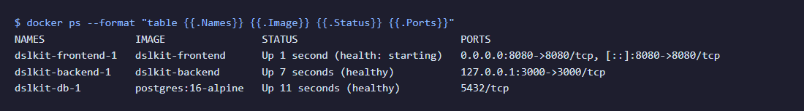

Рисунок 5 – Вывод команды `docker ps` со статусом healthy у контейнеров базы, сервера и клиента

#### 2.4.3 Деплой

Основной способ запуска – Docker Compose на одной машине, он описан выше и в разделе 3.1. Для публикации в сети по рекомендации кафедры можно использовать бесплатные сервисы, перечисленные в приложении Е: клиент на Netlify или GitHub Pages, сервер на Render, база на Neon или Supabase. В этом случае сервис `db` из Compose не нужен, а строка подключения и `DATABASE_SSL=true` задаются в переменных окружения платформы.

[TODO: выбрать и выполнить облачное развёртывание (если требуется), записать адрес приложения и дату проверки. Сейчас публичного адреса нет, в заключении оставлена заглушка.]

#### 2.4.4 Тестирование

Автоматические тесты написаны для обеих частей. Сервер проверяется встроенным средством `node --test` на временной базе SQLite с настоящими миграциями, bcrypt для скорости работает с четырьмя раундами. Набор сервера содержит 135 тестов, включая проверки `/health`, пагинации, безопасности токена и ограничения частоты. Клиент проверяется Vitest и React Testing Library, в наборе 100 тестов, среди них тест вывода разметки из ответа сервера как текста. Конфигурация Docker проверена шестью проверками файлов без запуска демона. Прогон перед защитой выполнен: сервер 135 из 135 тестов (покрытие строк 100%, ветвей 98%), клиент 100 из 100.

Ручные сценарии и контрольные примеры приведены в подразделе 3.2. Для ручной проверки API подготовлены файл `requests.http` для расширения REST Client и коллекция Postman `postman_collection.json`.

## Глава 3 Руководство пользователя и тестирование

### 3.1 Руководство пользователя

**Требования к окружению.** Для работы с приложением нужен современный браузер: Chrome, Edge или Firefox актуальных версий [TODO: указать версии, в которых проверялось]. Для запуска разработчиком нужны Git, Node.js 22 или новее и Docker с Compose v2.

**Запуск приложения.** Команды для разработчика:

1. Клонировать репозиторий: `git clone https://github.com/KsushaKhadzhinova/DSLKit-Project`, затем перейти на ветку `28`.
2. Перейти в каталог `part-2/lab-08-docker` и скопировать `.env.example` в `.env`.
3. Вписать в `.env` пароль базы из букв и цифр и секрет `JWT_SECRET` не короче 32 случайных символов. Секрет создаётся командой, указанной в `.env.example`. Значения в репозиторий не записываются.
4. Выполнить `docker compose up --build`. После запуска приложение доступно по адресу `http://localhost:8080`, проверка сервера по адресу `http://localhost:8080/api/health`.
5. Остановить стек командой `docker compose down`. Ключ `-v` дополнительно удаляет данные базы.

Для запуска без Docker сервер запускается в `part-2/lab-03-auth` командами `npm install`, `npm run db:migrate`, `npm run dev`, а клиент в `part-2/lab-05-react-api` командами `npm install`, `npm run dev` (адрес `http://localhost:5178`).

**Сценарий 1. Регистрация и вход.** Пользователь открывает приложение, видит форму входа и переходит к регистрации. Он вводит почту и пароль не короче 8 символов и отправляет форму. При ошибке под полем появляется пояснение: пустое значение, слишком длинная почта, слишком короткий пароль. После регистрации пользователь входит, токен сохраняется, и открывается рабочая область. Форма входа показана на рисунке 6.


Рисунок 6 – Форма входа и регистрации перед началом работы

**Сценарий 2. Создание диаграммы.** В рабочей области пользователь заполняет форму: название, нотация, исходный код и приоритет, затем нажимает главную кнопку. Запись появляется в списке сразу, а после ответа сервера получает постоянный идентификатор. Состояние списка с несколькими записями показано на рисунке 7.

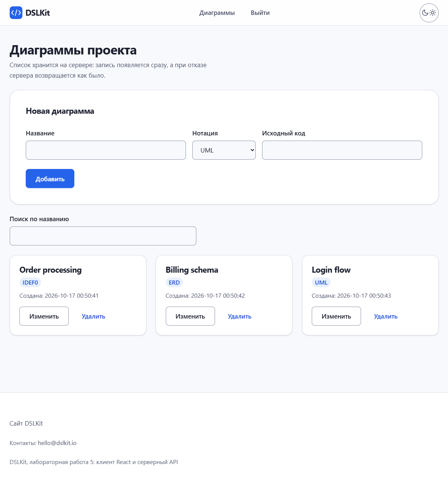

Рисунок 7 – Рабочая область со списком диаграмм пользователя

Момент добавления новой записи показан на рисунке 8.

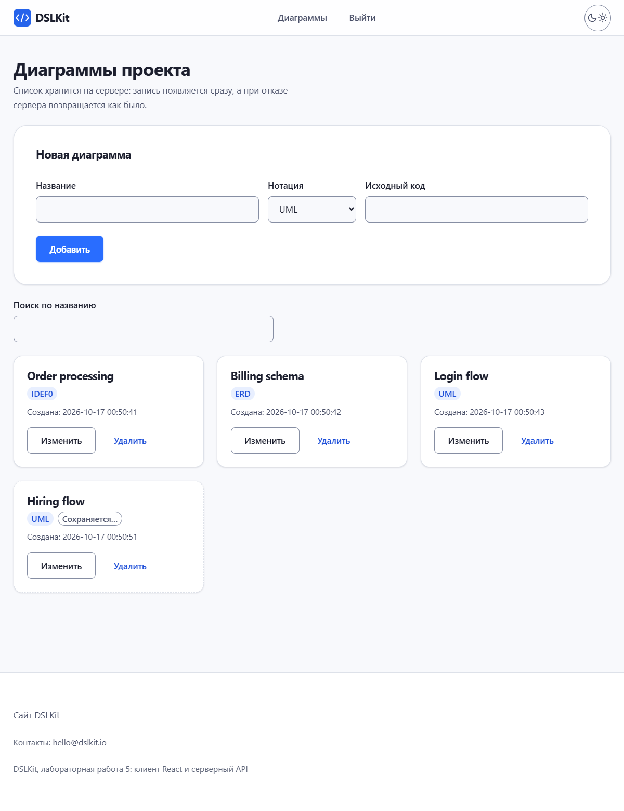

Рисунок 8 – Оптимистичное добавление: новая запись показана до ответа сервера

**Сценарий 3. Поиск, изменение и удаление.** Строка поиска фильтрует список по названию с задержкой 400 миллисекунд. Название записи меняется на месте: Enter сохраняет, Escape отменяет. Удаление убирает запись сразу, а при отказе сервера запись возвращается. Если сервер недоступен, вместо списка показывается сообщение и кнопка «Повторить», как на рисунке 9.

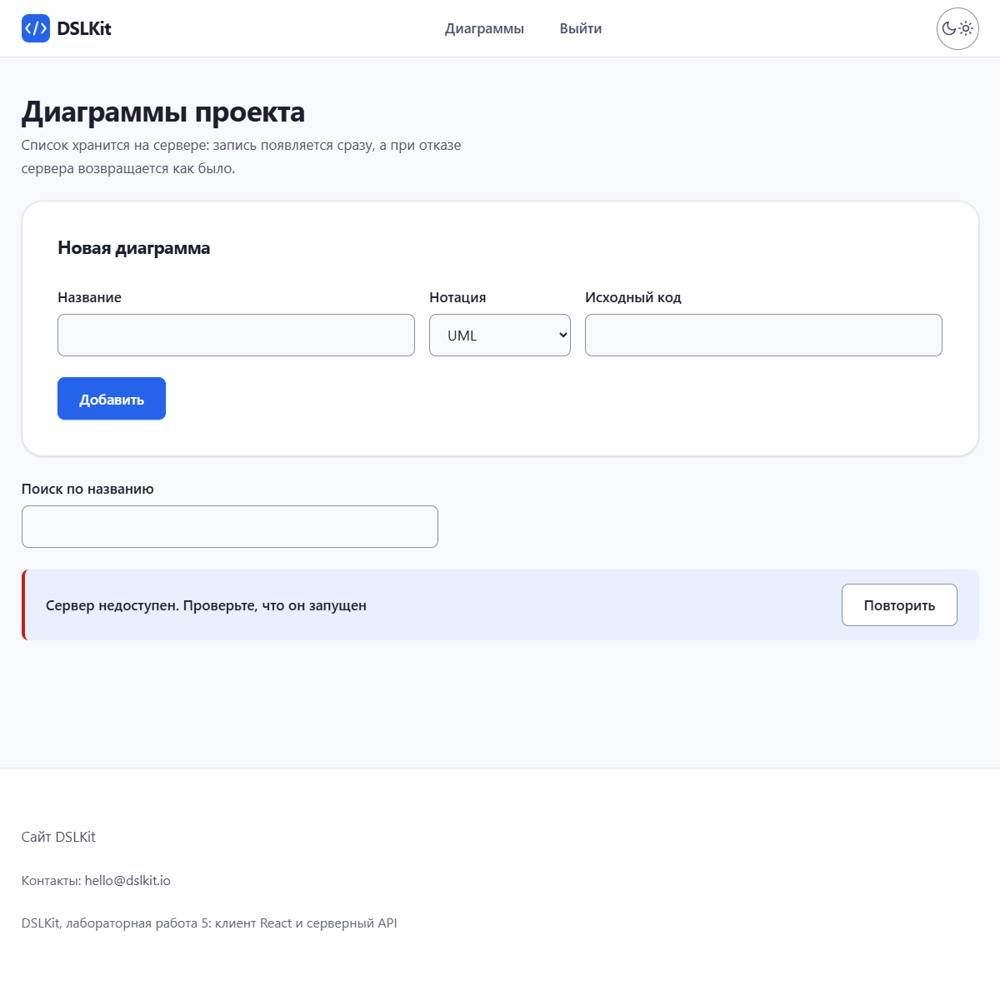

Рисунок 9 – Сообщение об ошибке при недоступном сервере и кнопка повтора

**Сценарий 4. Администрирование.** В текущем клиенте нет экрана администратора. Администратор работает с конечными точками `/users` через Postman или REST Client: получает список, меняет роль и удаляет пользователей. [TODO: решить, нужен ли в курсовой работе экран администратора в клиенте. Макет экрана «Админка пользователей» есть в `docs/design-contest/part2-screens/`. Если экран добавляется, дополнить этот сценарий скриншотом.]

### 3.2 Контрольные примеры и тестирование

Контрольные примеры охватывают три модуля. Исходные данные для них собраны в приложении Г. Колонка «Фактический результат» заполняется владельцем работы при ручном прогоне, ожидаемые результаты взяты из документации и автоматических тестов серверной части.

Таблица 7 – Контрольные примеры

| №   | Исходные данные                                               | Действия пользователя                               | Ожидаемый результат                                              | Фактический результат                    |
| --- | ------------------------------------------------------------- | --------------------------------------------------- | ---------------------------------------------------------------- | ---------------------------------------- |
| 1   | Почта `alice@example.com`, пароль из 8 и более символов       | Отправить форму регистрации                         | Ответ 201, у пользователя роль `user`, хеша в ответе нет         | [TODO: Пройдено / Не пройдено]           |
| 2   | Та же почта в другом регистре, `ALICE@example.com`            | Повторить регистрацию                               | Ответ 409, сообщение «A user with this email already exists»     | [TODO: Пройдено / Не пройдено]           |
| 3   | Пароль из 7 символов                                          | Отправить форму регистрации                         | Ответ 400, в `details` указано поле `password`                   | [TODO: Пройдено / Не пройдено]           |
| 4   | Верная почта и пароль                                         | Войти                                               | Ответ 200, в теле `token`, `tokenType: Bearer`, `expiresIn: 1h`  | [TODO: Пройдено / Не пройдено]           |
| 5   | Верная почта, неверный пароль                                 | Войти                                               | Ответ 401 «Invalid email or password», такой же как для неизвестной почты | [TODO: Пройдено / Не пройдено]  |
| 6   | Шесть неверных паролей подряд для одной почты                 | Повторить вход                                      | После пятой неудачи ответ 429 с заголовком `Retry-After`         | [TODO: Пройдено / Не пройдено]           |
| 7   | Запрос без заголовка `Authorization`                          | `GET /diagrams`                                     | Ответ 401 «Missing Bearer token»                                 | [TODO: Пройдено / Не пройдено]           |
| 8   | Токен пользователя, название «Заказ», нотация BPMN, код       | Создать диаграмму                                   | Ответ 201, заголовок `Location`, владелец равен пользователю     | [TODO: Пройдено / Не пройдено]           |
| 9   | Название из одних пробелов                                    | Создать диаграмму                                   | Ответ 400, поле `title`: непустая строка                         | [TODO: Пройдено / Не пройдено]           |
| 10  | Название длиннее 80 символов                                  | Создать диаграмму                                   | Ответ 400, поле `title`: не более 80 символов                    | [TODO: Пройдено / Не пройдено]           |
| 11  | Две диаграммы, в названии одной слово «Заказ»                 | `GET /diagrams?search=Заказ`                        | В ответе одна запись, `X-Total-Count` равен 1                    | [TODO: Пройдено / Не пройдено]           |
| 12  | Параметр `limit=1000`                                         | `GET /diagrams?limit=1000`                          | Ответ 400, поле `limit`: от 1 до 100                             | [TODO: Пройдено / Не пройдено]           |
| 13  | Токен второго пользователя, диаграмма первого                 | `DELETE /diagrams/:id`                              | Ответ 403, диаграмма осталась                                    | [TODO: Пройдено / Не пройдено]           |
| 14  | Токен администратора, та же диаграмма                         | `DELETE /diagrams/:id`                              | Ответ 204                                                        | [TODO: Пройдено / Не пройдено]           |
| 15  | Токен обычного пользователя                                   | `GET /users`                                        | Ответ 403 «Requires the admin role»                              | [TODO: Пройдено / Не пройдено]           |
| 16  | Токен администратора, идентификатор самого администратора     | `PATCH /users/:id/role` со значением `user`         | Ответ 400, смена собственной роли запрещена                      | [TODO: Пройдено / Не пройдено]           |
| 17  | Остановленная база                                            | `GET /health`                                       | Ответ 503 `{"status":"unavailable"}`                             | [TODO: Пройдено / Не пройдено]           |
| 18  | Остановленный сервер, открытая рабочая область                | Обновить список в клиенте                           | Сообщение об ошибке и кнопка «Повторить», рисунок 9              | [TODO: Пройдено / Не пройдено]           |

Скриншот тестового запуска и вывод `npm test` помещаются в приложение Ж или в основной текст после прогона [TODO: приложить вывод тестов с числом пройденных и покрытием].

**Вывод о соответствии требованиям.** Функциональные требования FR1–FR12 реализованы на уровне API и покрыты автоматическими тестами серверной части. Требования FR1–FR8 доступны и в интерфейсе клиента, требования FR9–FR12 доступны только через REST-клиент. Полные снимки экранов собраны в приложении Ж. Нефункциональные требования по безопасности и ограничениям ввода выполнены и проверяются тестами. Не подтверждены измерением NFR6 (производительность) и часть NFR8 (доступность): для них нужны замеры. [TODO: после заполнения таблицы 7 обновить вывод по фактическим результатам.]

## Заключение

В ходе работы решены все поставленные задачи: проанализирована предметная область и сформулированы 12 функциональных и 9 нефункциональных требований, спроектированы архитектура по модели C4, REST API из 12 конечных точек и схема данных из трёх таблиц, реализованы серверная часть с аутентификацией JWT и ролевой моделью, клиент на React и контейнерный запуск всего стека одной командой.

Цель работы – разработка веб-приложения «DSLKit» – достигнута. В результате создано рабочее веб-приложение, которое запускается командой `docker compose up --build` и доступно локально по адресу `http://localhost:8080` [TODO: если будет облачное развёртывание, указать публичный адрес]. Приложение реализует регистрацию и вход, учёт диаграмм с поиском, сортировкой и постраничным выводом, разграничение прав владельца и администратора, журнал запросов в базе данных и проверку состояния сервиса.

Ограничения выполненной работы: нет выхода с отзывом токена и refresh-токенов, счётчики ограничения частоты хранятся в памяти одного экземпляра сервера, поэтому масштабирование на несколько экземпляров не поддерживается, у администратора нет экрана в клиенте.

В дальнейшем возможно добавление предпросмотра диаграммы в клиенте через сервис Kroki, комментариев к диаграммам (прототип на MongoDB есть в лабораторной работе 6), совместного редактирования в реальном времени (прототип на WebSocket есть в лабораторной работе 7), экрана администратора, отзыва токенов, интеграции с редактором из первой части дисциплины и поддержки всех шести нотаций в графическом виде.

## Список использованных источников

1. Express. Documentation [Электронный ресурс]. – Режим доступа: https://expressjs.com. – Дата доступа: [TODO: дата].
2. Node.js Documentation [Электронный ресурс]. – Режим доступа: https://nodejs.org/docs/latest/api/. – Дата доступа: [TODO: дата].
3. React. Learn React [Электронный ресурс]. – Режим доступа: https://react.dev/learn. – Дата доступа: [TODO: дата].
4. Vite. Guide [Электронный ресурс]. – Режим доступа: https://vite.dev/guide/. – Дата доступа: [TODO: дата].
5. Sequelize. Documentation, версия 6 [Электронный ресурс]. – Режим доступа: https://sequelize.org/docs/v6/. – Дата доступа: [TODO: дата].
6. PostgreSQL 16 Documentation [Электронный ресурс]. – Режим доступа: https://www.postgresql.org/docs/16/. – Дата доступа: [TODO: дата].
7. Axios. Documentation [Электронный ресурс]. – Режим доступа: https://axios-http.com/docs/intro. – Дата доступа: [TODO: дата].
8. Docker. Docker Compose documentation [Электронный ресурс]. – Режим доступа: https://docs.docker.com/compose/. – Дата доступа: [TODO: дата].
9. Nginx. Beginner's Guide, Reverse Proxy [Электронный ресурс]. – Режим доступа: https://nginx.org/en/docs/. – Дата доступа: [TODO: дата].
10. RFC 7519. JSON Web Token (JWT). – IETF, 2015 [Электронный ресурс]. – Режим доступа: https://www.rfc-editor.org/rfc/rfc7519. – Дата доступа: [TODO: дата].
11. RFC 9110. HTTP Semantics. – IETF, 2022 [Электронный ресурс]. – Режим доступа: https://www.rfc-editor.org/rfc/rfc9110. – Дата доступа: [TODO: дата].
12. OWASP Cheat Sheet Series. Password Storage, Authentication, REST Security [Электронный ресурс]. – Режим доступа: https://cheatsheetseries.owasp.org. – Дата доступа: [TODO: дата].
13. OWASP Application Security Verification Standard 4.0 [Электронный ресурс]. – Режим доступа: https://owasp.org/www-project-application-security-verification-standard/. – Дата доступа: [TODO: дата].
14. Brown, S. The C4 model for visualising software architecture [Электронный ресурс]. – Режим доступа: https://c4model.com. – Дата доступа: [TODO: дата].
15. Mermaid. Diagram syntax: entity relationship, C4, flowchart [Электронный ресурс]. – Режим доступа: https://mermaid.js.org. – Дата доступа: [TODO: дата].
16. W3C. Web Content Accessibility Guidelines (WCAG) 2.2 [Электронный ресурс]. – Режим доступа: https://www.w3.org/TR/WCAG22/. – Дата доступа: [TODO: дата].
17. MDN Web Docs. Cross-Origin Resource Sharing (CORS) [Электронный ресурс]. – Режим доступа: https://developer.mozilla.org/docs/Web/HTTP/CORS. – Дата доступа: [TODO: дата].
18. Vitest. Guide [Электронный ресурс]. – Режим доступа: https://vitest.dev/guide/. – Дата доступа: [TODO: дата].
19. Репозиторий проекта DSLKit [Электронный ресурс]. – Режим доступа: https://github.com/KsushaKhadzhinova/DSLKit-Project. – Дата доступа: [TODO: дата].
20. [TODO: добавить одну-две книги не старше 5 лет из списка учебной программы и 1–2 актуальные статьи (Habr, 2022–2026). Источники оформить по ГОСТу или СТП, редакция 2024 года.]

## Приложение А (обязательное) Фрагменты кода серверной части

Приложение содержит ключевые фрагменты серверной части из `part-2/lab-03-auth` (ветка репозитория `23`, перенесено в ветки `25` и `28`). Ссылка на приложение дана в подразделах 2.2.2, 2.2.3 и 2.2.4.

Модель диаграммы `src/models/diagram.js`:

```js
const { DataTypes } = require('sequelize');
const { NOTATIONS, PRIORITIES, DEFAULT_PRIORITY, LIMITS } = require('./diagram.constants');

// The table is created by migrations, never by sequelize.sync().
const defineDiagram = (sequelize) =>
  sequelize.define('Diagram', {
    title: { type: DataTypes.STRING(LIMITS.title), allowNull: false, validate: { len: [1, LIMITS.title] } },
    notation: { type: DataTypes.STRING(10), allowNull: false, validate: { isIn: [NOTATIONS] } },
    sourceCode: { type: DataTypes.TEXT, allowNull: false, validate: { len: [1, LIMITS.sourceCode] } },
    priority: { type: DataTypes.STRING(10), allowNull: false, defaultValue: DEFAULT_PRIORITY, validate: { isIn: [PRIORITIES] } },
    ownerId: { type: DataTypes.INTEGER, allowNull: false },
  });

module.exports = { defineDiagram };
```

Проверка ввода `src/middleware/validate.js` (фрагмент):

```js
// Text is checked after trimming, so the stored value is what was measured.
const text = (name) => (v) => {
  if (typeof v !== 'string' || v.trim() === '') return 'must be a non-empty string';
  return v.trim().length <= LIMITS[name] || `must be at most ${LIMITS[name]} characters`;
};

const checks = {
  title: text('title'),
  notation: (v) => NOTATIONS.includes(v) || `must be one of ${NOTATIONS.join(', ')}`,
  sourceCode: text('sourceCode'),
  priority: (v) => PRIORITIES.includes(v) || `must be one of ${PRIORITIES.join(', ')}`,
};

// The raw text is checked first because Number() would accept '0x1', '1e0' and ' 1'.
const parseId =
  (key = 'diagramId', label = 'Diagram') =>
  (req, _res, next) => {
    const id = Number(req.params.id);
    if (!/^[1-9]\d*$/.test(req.params.id) || id > MAX_ID) return next(badRequest(`${label} id must be a positive integer up to ${MAX_ID}`));
    req[key] = id;
    return next();
  };
```

Контроллер диаграмм `src/controllers/diagrams.controller.js` (фрагмент):

```js
// Only the owner or an admin may change or delete a diagram.
const mayChange = (user, diagram) => user.role === 'admin' || diagram.ownerId === user.id;

const createDiagramsController = ({ Diagram }) => ({
  list: async (req, res, next) => {
    const { search } = req.query;
    if (search !== undefined && (typeof search !== 'string' || search.trim().length > LIMITS.title)) {
      return next(badRequest(`search must be a string of at most ${LIMITS.title} characters`));
    }
    const term = (search ?? '').trim();
    const where = term ? { title: { [Op.like]: `%${term}%` } } : undefined;
    const { limit, offset, sort, order } = parseListQuery(req.query, SORTABLE);
    const { count, rows } = await Diagram.findAndCountAll({ where, order: [[sort, order.toUpperCase()], ['id', 'ASC']], limit, offset });
    res.set('X-Total-Count', String(count));
    return res.json(rows);
  },

  create: async (req, res) => {
    const diagram = await Diagram.create({ ...req.diagramFields, ownerId: req.user.id });
    res.status(201).location(`/diagrams/${diagram.id}`).json(diagram);
  },

  remove: async (req, res, next) => {
    const diagram = await Diagram.findByPk(req.diagramId);
    if (!diagram) return next(missing(req.diagramId));
    if (!mayChange(req.user, diagram)) return next(forbidden('Only the owner or an admin can delete this diagram'));
    await diagram.destroy();
    return res.status(204).end();
  },
});
```

Проверка токена и роли `src/middleware/auth.js`:

```js
// Verifies the Bearer token, then loads the user so a deleted account or a changed role takes effect at once.
const createAuthenticate =
  ({ User }, { jwtSecret }) =>
  async (req, _res, next) => {
    const token = bearerToken(req);
    if (!token) return next(unauthorized('Missing Bearer token'));
    let payload;
    try {
      payload = jwt.verify(token, jwtSecret, { algorithms: ['HS256'], issuer: ISSUER });
    } catch (error) {
      return next(unauthorized(error.name === 'TokenExpiredError' ? 'Token expired' : 'Invalid token'));
    }
    const user = await User.findByPk(payload.id);
    if (!user) return next(unauthorized('User no longer exists'));
    req.user = { id: user.id, email: user.email, role: user.role };
    return next();
  };

const requireRole = (role) => (req, _res, next) => (req.user.role === role ? next() : next(forbidden(`Requires the ${role} role`)));
```

Защищённые маршруты `src/routes/diagrams.routes.js`:

```js
router.route('/').get(authenticate, controller.list).post(authenticate, validateDiagram, controller.create).all(allowMethods(['GET', 'POST']));
router
  .route('/:id')
  .get(authenticate, parseId(), controller.get)
  .put(authenticate, parseId(), validateDiagram, controller.replace)
  .delete(authenticate, parseId(), controller.remove)
  .all(allowMethods(['GET', 'PUT', 'DELETE']));
```

## Приложение Б (обязательное) Фрагменты кода клиентской части

Приложение содержит фрагменты клиента из `part-2/lab-05-react-api` (ветка `25`). Ссылка на приложение дана в подразделах 2.3.3 и 2.3.4.

Сервис API `src/api.js` (фрагмент):

```js
const api = axios.create({ baseURL: import.meta.env.VITE_API_URL || 'http://localhost:3000', timeout: 8000 });

// Every request carries the JWT saved after login.
api.interceptors.request.use((config) => {
  const token = getToken();
  if (token) config.headers.Authorization = `Bearer ${token}`;
  return config;
});

// An expired or rejected token ends the session: the token is removed and the app is told to show the login form.
api.interceptors.response.use(
  (response) => response,
  (error) => {
    if (error.response?.status === 401 && getToken()) {
      clearToken();
      window.dispatchEvent(new Event('auth:logout'));
    }
    return Promise.reject(error);
  },
);

export const register = (email, password) => api.post('/auth/register', { email, password });
export const login = (email, password) => api.post('/auth/login', { email, password });
```

Оптимистичное добавление диаграммы из хука `useDiagrams.js` (`part-2/lab-05-react-api/src/hooks`): запись появляется сразу с временным идентификатором, при успехе заменяется ответом сервера, при ошибке убирается и показывается сообщение.

```js
const add = useCallback(async (fields) => {
  tempCounter.current += 1;
  const tempId = `temp-${tempCounter.current}`;
  setItems((current) => [...current, { ...fields, id: tempId, createdAt: new Date().toISOString(), pending: true }]);
  changeTotal(1);
  try {
    const { data } = await addDiagram(fields);
    localIds.current.add(data.id);
    setItems((current) => current.map((item) => (item.id === tempId ? data : item)));
    return true;
  } catch (failure) {
    setItems((current) => current.filter((item) => item.id !== tempId));
    changeTotal(-1);
    setNotice(`Не удалось добавить диаграмму. ${errorMessage(failure)}`);
    return false;
  }
}, []);
```

## Приложение В (обязательное) Конфигурация Docker

Приложение содержит файлы запуска из `part-2/lab-08-docker` (ветка `28`). Ссылка на приложение дана в подразделе 2.4.2.

Файл `docker-compose.yml`:

```yaml
name: dslkit

services:
  db:
    image: ${REGISTRY:-}library/postgres:16-alpine
    restart: unless-stopped
    environment:
      POSTGRES_USER: ${POSTGRES_USER:-dslkit}
      POSTGRES_PASSWORD: ${POSTGRES_PASSWORD:?set POSTGRES_PASSWORD in .env}
      POSTGRES_DB: ${POSTGRES_DB:-dslkit}
    volumes:
      - pgdata:/var/lib/postgresql/data
    networks: [internal]
    healthcheck:
      test: ['CMD-SHELL', 'pg_isready -U $${POSTGRES_USER} -d $${POSTGRES_DB}']
      interval: 5s
      timeout: 3s
      retries: 10

  backend:
    build:
      context: ../lab-03-auth
      dockerfile: ../lab-08-docker/backend/Dockerfile
    restart: unless-stopped
    environment:
      PORT: 3000
      DATABASE_URL: postgres://${POSTGRES_USER:-dslkit}:${POSTGRES_PASSWORD}@db:5432/${POSTGRES_DB:-dslkit}
      JWT_SECRET: ${JWT_SECRET:?set JWT_SECRET in .env, at least 32 random characters}
      CORS_ORIGIN: http://localhost:${FRONTEND_PORT:-8080}
      TRUST_PROXY: '1'
    depends_on:
      db:
        condition: service_healthy
    ports:
      - '127.0.0.1:${BACKEND_PORT:-3000}:3000'
    read_only: true
    tmpfs: [/tmp]
    cap_drop: [ALL]
    security_opt: ['no-new-privileges:true']
    networks: [internal, public]

  frontend:
    build:
      context: ../lab-05-react-api
      dockerfile: ../lab-08-docker/frontend/Dockerfile
      additional_contexts:
        deploy: ./frontend
    restart: unless-stopped
    depends_on:
      backend:
        condition: service_healthy
    ports:
      - '${FRONTEND_PORT:-8080}:8080'
    networks: [public]

networks:
  internal:
    internal: true
  public:

volumes:
  pgdata:
```

Файл `backend/Dockerfile`:

```dockerfile
ARG REGISTRY=

FROM ${REGISTRY}library/node:22-alpine AS deps
WORKDIR /app
COPY package.json package-lock.json ./
RUN npm ci --omit=dev && npm cache clean --force

FROM ${REGISTRY}library/node:22-alpine
WORKDIR /app
ENV PORT=3000
COPY --from=deps --chown=node:node /app/node_modules ./node_modules
COPY --chown=node:node . .
USER node
EXPOSE 3000
HEALTHCHECK --interval=15s --timeout=3s --start-period=20s --retries=3 \
  CMD node -e "fetch('http://127.0.0.1:'+process.env.PORT+'/health').then(r=>process.exit(r.ok?0:1),()=>process.exit(1))"
CMD ["sh", "-c", "npx sequelize-cli db:migrate && npx sequelize-cli db:seed:all && exec node server.js"]
```

Файл `frontend/Dockerfile`:

```dockerfile
ARG REGISTRY=

FROM ${REGISTRY}library/node:22-alpine AS builder
WORKDIR /app
COPY package.json package-lock.json ./
RUN npm ci
COPY . .
ARG VITE_API_URL=/api
ENV VITE_API_URL=$VITE_API_URL
RUN npm run build

FROM ${REGISTRY}nginxinc/nginx-unprivileged:1.27-alpine
COPY --from=deploy nginx.conf /etc/nginx/conf.d/default.conf
COPY --from=builder /app/dist /usr/share/nginx/html
EXPOSE 8080
HEALTHCHECK --interval=15s --timeout=3s --start-period=5s --retries=3 \
  CMD wget -q -O /dev/null http://127.0.0.1:8080/ || exit 1
CMD ["nginx", "-g", "daemon off;"]
```

Файл `frontend/nginx.conf`:

```nginx
server {
  listen 8080;
  root /usr/share/nginx/html;
  index index.html;

  location /api/ {
    proxy_pass http://backend:3000/;
    proxy_set_header Host $host;
    proxy_set_header X-Forwarded-For $proxy_add_x_forwarded_for;
    proxy_read_timeout 15s;
  }

  location /assets/ {
    expires 1y;
    add_header Cache-Control "public, immutable";
  }

  location / {
    try_files $uri /index.html;
  }
}
```

## Приложение Г (обязательное) Исходные данные для тестирования

Приложение содержит данные для контрольных примеров таблицы 7. Ссылка на приложение дана в подразделе 3.2. Пароли ниже условные, к настоящим учётным записям отношения не имеют.

Таблица 8 – Исходные данные для контрольных примеров

| Назначение                  | Данные                                                                                     |
| --------------------------- | ------------------------------------------------------------------------------------------ |
| Пользователь 1              | почта `alice@example.com`, пароль `correct horse 42`                                       |
| Пользователь 2              | почта `bob@example.com`, пароль `battery staple 77`                                        |
| Администратор               | создаётся сидом из `ADMIN_EMAIL` и `ADMIN_PASSWORD` в `.env`, значения владелец вписывает сам |
| Диаграмма для создания      | `{"title":"Заказ","notation":"BPMN","sourceCode":"start -> pay -> ship","priority":"normal"}` |
| Название из пробелов        | `"   "`                                                                                    |
| Название из 81 символа      | строка из 81 буквы `a`                                                                     |
| Неверный пароль             | `wrong password 1`                                                                         |
| Короткий пароль             | `1234567`                                                                                  |

Демонстрационные диаграммы создаёт сид `seeders/20261016000002-demo-diagrams.js` из `seed-data/diagrams.js`: три исходные диаграммы, затем по четыре на каждую нотацию и несколько «неудобных» строк, которые пользователь мог бы ввести сам. Сид идемпотентен: существующая строка не дублируется, удалённая возвращается. Владельцами назначаются администратор и демонстрационные пользователи по очереди.

## Приложение Д (обязательное) Исходный текст диаграмм Mermaid

Приложение содержит исходный текст диаграмм, показанных на рисунках 1–4. Ссылка на приложение дана в подразделах 1.2 и 1.3. Файлы лежат в `course-project/diagrams/`, рисунки строятся командой `npx @mermaid-js/mermaid-cli -i файл.mmd -o файл.svg`.

Диаграмма вариантов использования:

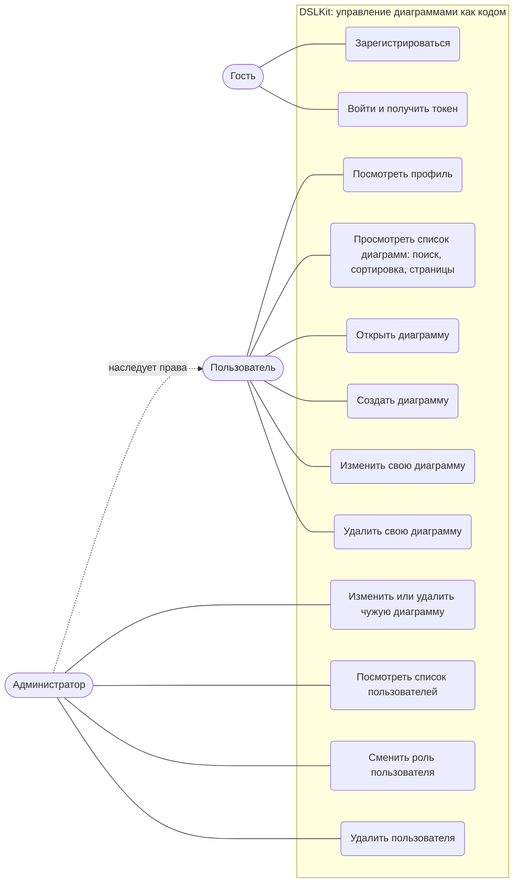

Диаграмма C4, контекст системы:

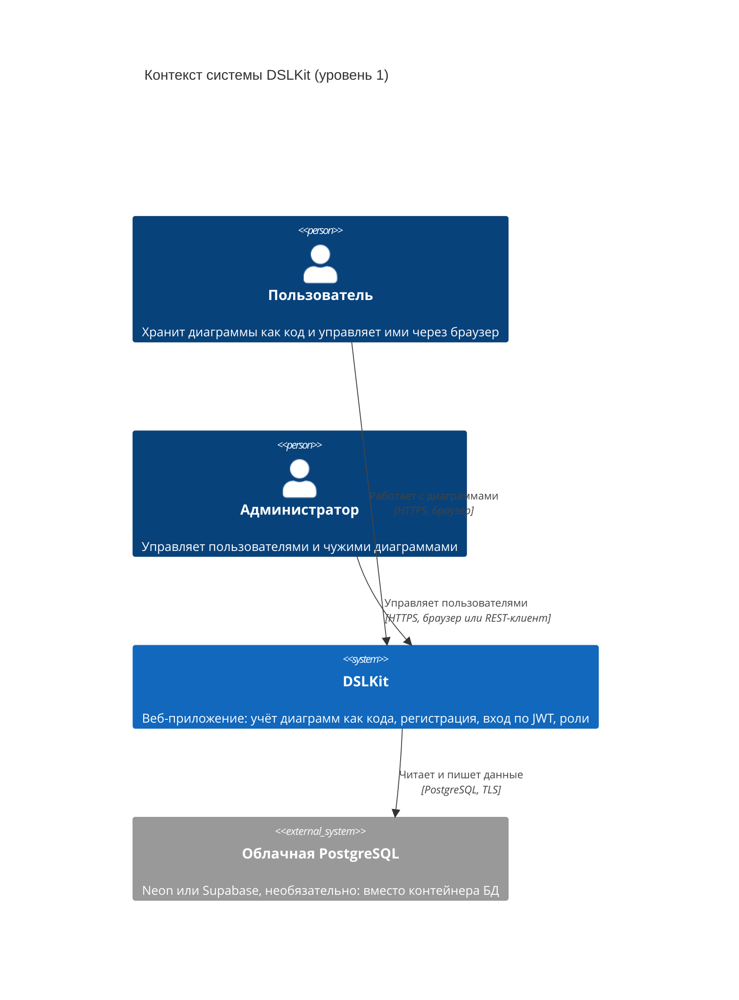

Диаграмма C4, контейнеры:

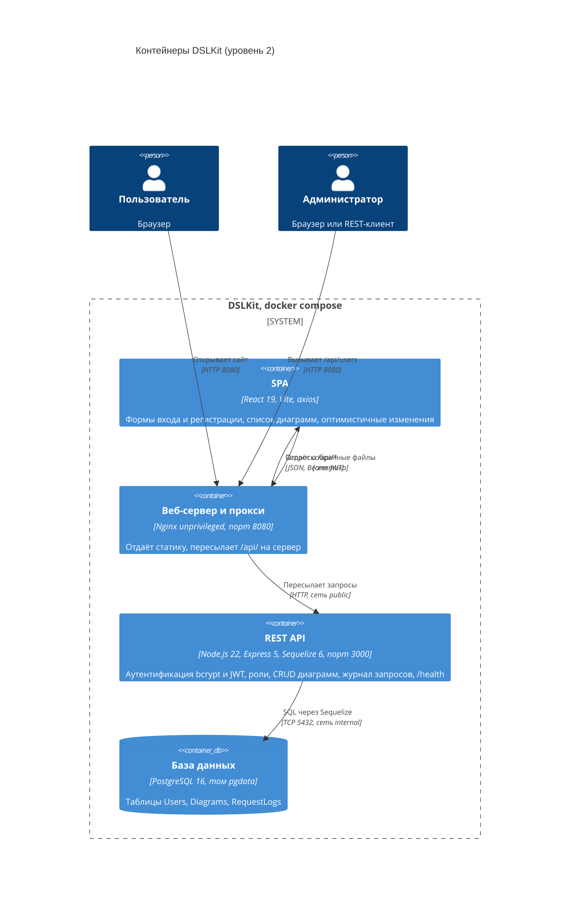

ER-диаграмма:

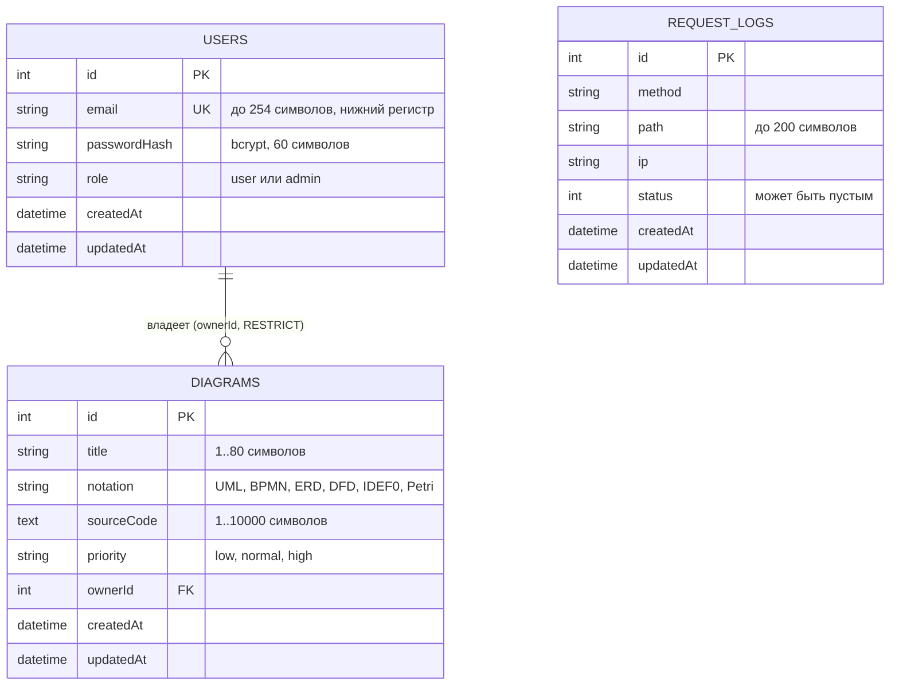

## Приложение Е (обязательное) Рекомендации по выбору бесплатных сервисов

Приложение воспроизводит рекомендации кафедры для студентов из Беларуси. Ссылка на приложение дана в подразделе 2.4.3.

Хостинг клиента: Netlify или GitHub Pages. Хостинг сервера и базы: Render или Supabase. Базы данных: PostgreSQL в Supabase, Neon или Render, MongoDB в Atlas. Непрерывная интеграция: GitHub Actions. Мониторинг ошибок: GlitchTip. Веб-аналитика: Яндекс.Метрика, Plausible или Rybbit. В этом проекте реально используются: Docker Compose (запуск стека), PostgreSQL 16 в контейнере, при необходимости Neon или Supabase как облачная база, GitHub (репозиторий). Остальные сервисы из рекомендаций кафедры (Netlify, Render, Atlas, GlitchTip, аналитика) в проекте не применялись.

## Приложение Ж (обязательное) Скриншоты и вывод тестов

Ссылка на приложение дана в подразделах 3.1 и 3.2.

[TODO: полные скриншоты всех экранов, вывод `npm test` сервера и клиента, вывод `docker compose up` и страница `/api/health`. Скриншоты до финального вида интерфейса, то есть рисунки 5–9 в тексте, подготовлены из лабораторных работ 5 и 8 и подлежат замене после приведения клиента к виду первой части дисциплины.]
