# Diagrams of the DSLKit system

These diagrams describe the DSLKit system itself: the site and the editor, the server parts, the React client, the deployment in Docker and the organisation of the work. Every diagram is made **in the service itself**: the text in the DSLKit language was typed into the real editor, drawn by its own engine in the browser and exported by its own export functions (`serializeSvg` for SVG and `rasterize` for PNG).

Each diagram has two caption variants, Russian and English: the files are in the folders `ru` and `en`.

[Русская версия](README.md)

## Contents

| No. | Kind                       | Diagram                                                | Files                                                                                                                   |
| --- | -------------------------- | ------------------------------------------------------ | ----------------------------------------------------------------------------------------------------------------------- |
| 01  | C4                         | [C4: system context of DSLKit](#01)                    | [PNG](png/en/01-c4.png), [SVG](svg/en/01-c4.svg), [code](dsl/en/01-c4.dsl)                                              |
| 02  | C4                         | [C4: containers of DSLKit](#02)                        | [PNG](png/en/02-c4.png), [SVG](svg/en/02-c4.svg), [code](dsl/en/02-c4.dsl)                                              |
| 03  | UML: use case              | [UML: use cases](#03)                                  | [PNG](png/en/03-uml-usecase.png), [SVG](svg/en/03-uml-usecase.svg), [code](dsl/en/03-uml-usecase.dsl)                   |
| 04  | UML: class                 | [UML: domain classes](#04)                             | [PNG](png/en/04-uml-class.png), [SVG](svg/en/04-uml-class.svg), [code](dsl/en/04-uml-class.dsl)                         |
| 05  | UML: object                | [UML: objects (a data snapshot)](#05)                  | [PNG](png/en/05-uml-object.png), [SVG](svg/en/05-uml-object.svg), [code](dsl/en/05-uml-object.dsl)                      |
| 06  | UML: component             | [UML: components of the editor](#06)                   | [PNG](png/en/06-uml-component.png), [SVG](svg/en/06-uml-component.svg), [code](dsl/en/06-uml-component.dsl)             |
| 07  | UML: composite structure   | [UML: composite structure of the editor page](#07)     | [PNG](png/en/07-uml-composite.png), [SVG](svg/en/07-uml-composite.svg), [code](dsl/en/07-uml-composite.dsl)             |
| 08  | UML: deployment            | [UML: deployment in Docker](#08)                       | [PNG](png/en/08-uml-deployment.png), [SVG](svg/en/08-uml-deployment.svg), [code](dsl/en/08-uml-deployment.dsl)          |
| 09  | UML: package               | [UML: packages of the site](#09)                       | [PNG](png/en/09-uml-package.png), [SVG](svg/en/09-uml-package.svg), [code](dsl/en/09-uml-package.dsl)                   |
| 10  | UML: profile               | [UML: DSLKit profile](#10)                             | [PNG](png/en/10-uml-profile.png), [SVG](svg/en/10-uml-profile.svg), [code](dsl/en/10-uml-profile.dsl)                   |
| 11  | UML: activity              | [UML: activity "Drawing a diagram"](#11)               | [PNG](png/en/11-uml-activity.png), [SVG](svg/en/11-uml-activity.svg), [code](dsl/en/11-uml-activity.dsl)                |
| 12  | UML: state machine         | [UML: states of saving the code](#12)                  | [PNG](png/en/12-uml-state.png), [SVG](svg/en/12-uml-state.svg), [code](dsl/en/12-uml-state.dsl)                         |
| 13  | UML: sequence              | [UML: sequence "Sign in and create a diagram"](#13)    | [PNG](png/en/13-uml-sequence.png), [SVG](svg/en/13-uml-sequence.svg), [code](dsl/en/13-uml-sequence.dsl)                |
| 14  | UML: communication         | [UML: communication "A request to the server"](#14)    | [PNG](png/en/14-uml-communication.png), [SVG](svg/en/14-uml-communication.svg), [code](dsl/en/14-uml-communication.dsl) |
| 15  | UML: timing                | [UML: timing diagram of autosave](#15)                 | [PNG](png/en/15-uml-timing.png), [SVG](svg/en/15-uml-timing.svg), [code](dsl/en/15-uml-timing.dsl)                      |
| 16  | UML: interaction overview  | [UML: interaction overview](#16)                       | [PNG](png/en/16-uml-overview.png), [SVG](svg/en/16-uml-overview.svg), [code](dsl/en/16-uml-overview.dsl)                |
| 17  | IDEF0                      | [IDEF0: functional model](#17)                         | [PNG](png/en/17-idef0.png), [SVG](svg/en/17-idef0.svg), [code](dsl/en/17-idef0.dsl)                                     |
| 18  | IDEF1                      | [IDEF1: information model](#18)                        | [PNG](png/en/18-idef1.png), [SVG](svg/en/18-idef1.svg), [code](dsl/en/18-idef1.dsl)                                     |
| 19  | IDEF1X                     | [IDEF1X: data model](#19)                              | [PNG](png/en/19-idef1x.png), [SVG](svg/en/19-idef1x.svg), [code](dsl/en/19-idef1x.dsl)                                  |
| 20  | IDEF3                      | [IDEF3: the sign-in process](#20)                      | [PNG](png/en/20-idef3.png), [SVG](svg/en/20-idef3.svg), [code](dsl/en/20-idef3.dsl)                                     |
| 21  | IDEF4                      | [IDEF4: object design of the server](#21)              | [PNG](png/en/21-idef4.png), [SVG](svg/en/21-idef4.svg), [code](dsl/en/21-idef4.dsl)                                     |
| 22  | IDEF5                      | [IDEF5: domain ontology](#22)                          | [PNG](png/en/22-idef5.png), [SVG](svg/en/22-idef5.svg), [code](dsl/en/22-idef5.dsl)                                     |
| 23  | DFD                        | [DFD: data flows](#23)                                 | [PNG](png/en/23-dfd.png), [SVG](svg/en/23-dfd.svg), [code](dsl/en/23-dfd.dsl)                                           |
| 24  | ERD                        | [ERD: entities and relationships](#24)                 | [PNG](png/en/24-erd.png), [SVG](svg/en/24-erd.svg), [code](dsl/en/24-erd.dsl)                                           |
| 25  | BPMN                       | [BPMN: the author working with the editor](#25)        | [PNG](png/en/25-bpmn.png), [SVG](svg/en/25-bpmn.svg), [code](dsl/en/25-bpmn.dsl)                                        |
| 26  | Petri net                  | [Petri net: sign-in attempts](#26)                     | [PNG](png/en/26-petri.png), [SVG](svg/en/26-petri.svg), [code](dsl/en/26-petri.dsl)                                     |
| 27  | Flowchart (GOST 19.701-90) | [Flowchart (GOST 19.701-90): checking the header](#27) | [PNG](png/en/27-gost.png), [SVG](svg/en/27-gost.svg), [code](dsl/en/27-gost.dsl)                                        |
| 28  | Graph                      | [Graph: how close the notations are](#28)              | [PNG](png/en/28-graph.png), [SVG](svg/en/28-graph.svg), [code](dsl/en/28-graph.dsl)                                     |
| 29  | DAG                        | [DAG: order of the checks in CI](#29)                  | [PNG](png/en/29-dag.png), [SVG](svg/en/29-dag.svg), [code](dsl/en/29-dag.dsl)                                           |
| 30  | Mind map                   | [Mind map of the project](#30)                         | [PNG](png/en/30-mindmap.png), [SVG](svg/en/30-mindmap.svg), [code](dsl/en/30-mindmap.dsl)                               |
| 31  | Organisation chart         | [Organisational structure of the work](#31)            | [PNG](png/en/31-orgchart.png), [SVG](svg/en/31-orgchart.svg), [code](dsl/en/31-orgchart.dsl)                            |
| 32  | Network scheme             | [Deployment network scheme](#32)                       | [PNG](png/en/32-network.png), [SVG](svg/en/32-network.svg), [code](dsl/en/32-network.dsl)                               |
| 33  | Decision tree              | [Decision tree: which engine to choose](#33)           | [PNG](png/en/33-decision.png), [SVG](svg/en/33-decision.svg), [code](dsl/en/33-decision.dsl)                            |
| 34  | eEPC                       | [eEPC: event-driven process chain](#34)                | [PNG](png/en/34-epc.png), [SVG](svg/en/34-epc.svg), [code](dsl/en/34-epc.dsl)                                           |

## How to look at them and open them in the editor

- Pictures: `png/ru/…`, `png/en/…` (raster with a white background, scale 2) and `svg/ru/…`, `svg/en/…` (vector).
- Source text: `dsl/ru/…`, `dsl/en/…`. Open the editor (`site/app/editor.html`, for English `site/en/app/editor.html`), paste the text into the code field, choose the engine "Own (in the browser)".
- Rebuild everything: serve the site (`node tools/serve.js site 5188`) and run `node docs/diagrams/build.mjs`; the texts are in `docs/diagrams/diagrams.mjs`, in one place for both languages.

## How the drawing was verified

- Every source was first read by the parser of the service: no errors and no warnings (`node docs/diagrams/check.mjs`).
- Then it was typed into the real editor in a browser, and the page was measured: the drawing appeared; the code in the editor equals the source; no label leaves the drawing; labels do not run over each other; a label inside a shape lies wholly inside its outline (tested against the real outline of the diamond, ellipse or rectangle); a label on a link is not hidden behind a shape; a caption under a symbol does not touch the symbol; there is no `NaN` in the drawing; every label of the source is in the drawing.
- Result of the last run: 68 of 68 drawings pass all the checks (`report.json`). The Russian variant of all 34 diagrams was looked at by eye after the last changes. The English one was looked at after the fix of the shape sizes, and after that its drawings were rebuilt from the same source structures and passed the same automatic checks.

## What the check found in the service itself

- The size of a shape was counted as seven pixels for every character, as for a rectangle. So the text in diamonds and ellipses ran over the outline, wide letters (Ш, Ж, W, M) stuck out and narrow ones left empty room. Fixed: the width of a text comes from a table of letter widths, and a diamond and an ellipse grow until the whole block of text fits inside the outline (commits `fix(notations)` in the branch `work/part1-finish`, tests `labs/08-frontend-testing/shape-fit.test.js`).
- Captions of several lines under a symbol (BPMN start and end) ran over the symbol. Fixed.
- The labels of decisions and merges in activity, state and interaction overview diagrams sat in a diamond of a fixed size of 44 by 44 and did not fit. Now the diamond grows to the label.

## Known limits of the service

- Composite structure (UML composite): parts are not drawn inside the classifier, ports are separate squares and tied to their parts only by meaning (the attributes `in=` and `of=` are not used in the drawing). The stock template of the service is drawn the same way, so diagram 07 is shown as it is.
- The shortest path of a graph (diagram 28) and the critical path of a DAG (diagram 29) are named by the service in the results panel, they are not highlighted in the drawing.
- In diagrams 20 (IDEF3) and 22 (IDEF5) the layout is automatic, some links run close to nodes.

## Diagrams

### 01. C4: system context of DSLKit

Who uses the system and which outside services it talks to. The author writes a diagram as text, the outside service Kroki draws it on request.

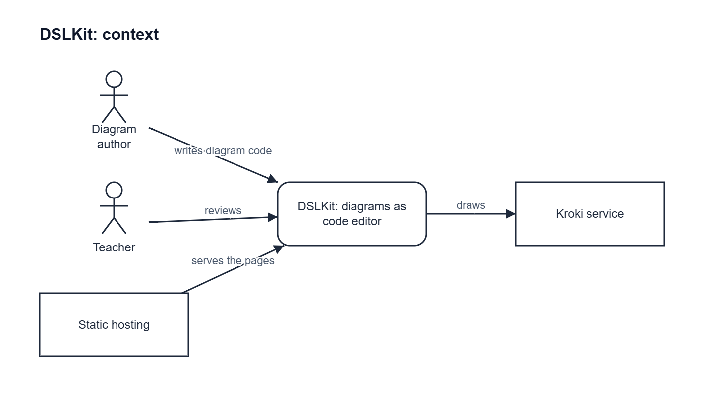

_Figure 1 – C4: system context of DSLKit. Size: 710x400._

### 02. C4: containers of DSLKit

The runnable parts of the system: the editor in the browser, the React client, the Nginx web server, the Express programming interface and the PostgreSQL database.

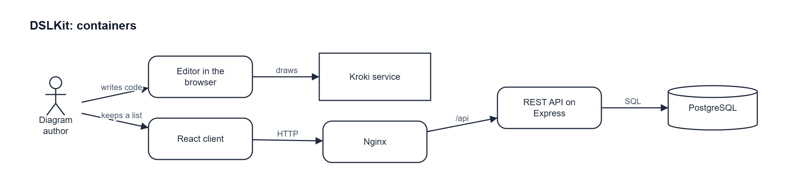

_Figure 2 – C4: containers of DSLKit. Size: 713x175._

### 03. UML: use cases

What the diagram author and the administrator can do. Signing in is needed for the list of diagrams on the server, the editor works without it.

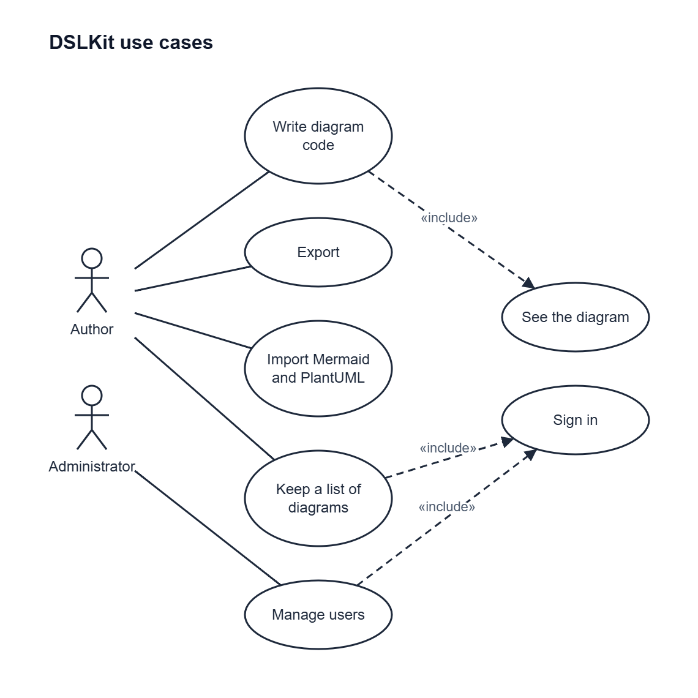

_Figure 3 – UML: use cases. Size: 570x570._

### 04. UML: domain classes

The main entities of the server: user, diagram, project and request log entry.

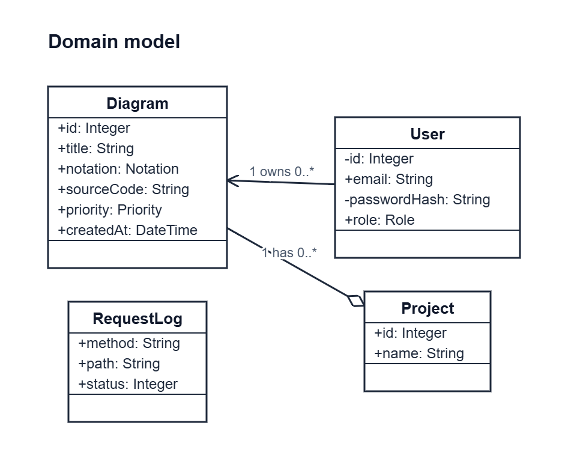

_Figure 4 – UML: domain classes. Size: 473x391._

### 05. UML: objects (a data snapshot)

Concrete objects at one moment: a user, a diagram of theirs and a project.

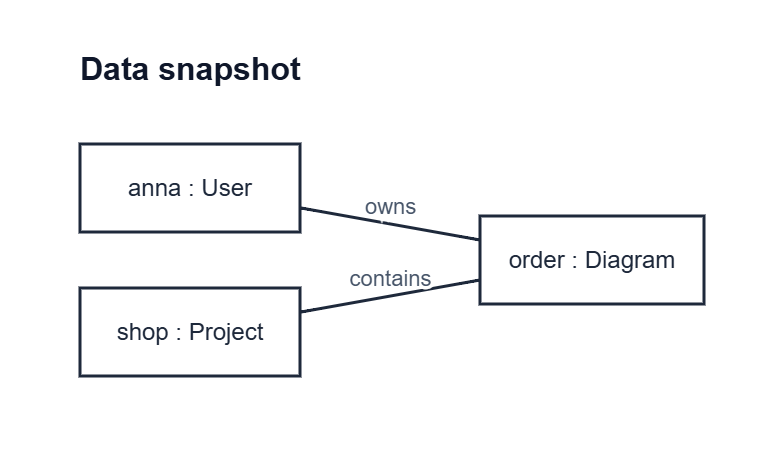

_Figure 5 – UML: objects (a data snapshot). Size: 392x228._

### 06. UML: components of the editor

The components of the editor and the interfaces between them: the parser, the drawing, the Kroki service and the storage.

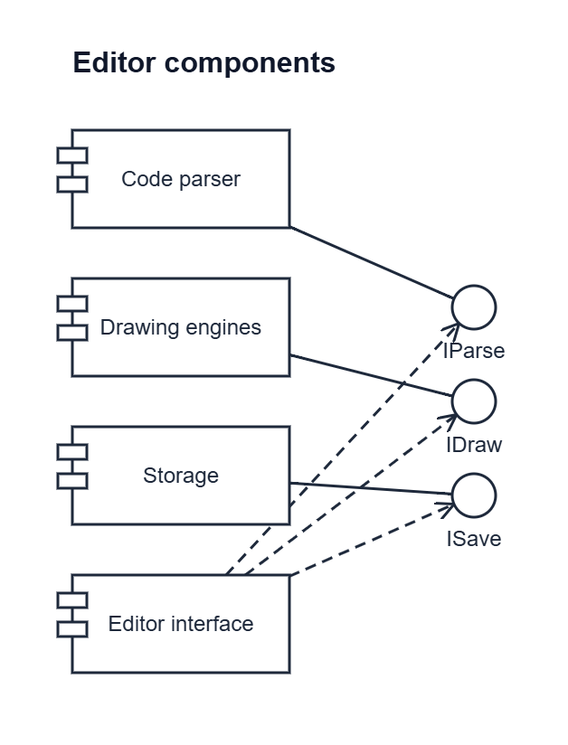

_Figure 6 – UML: components of the editor. Size: 314x412._

### 07. UML: composite structure of the editor page

The parts of the editor page and how they pass data through ports.

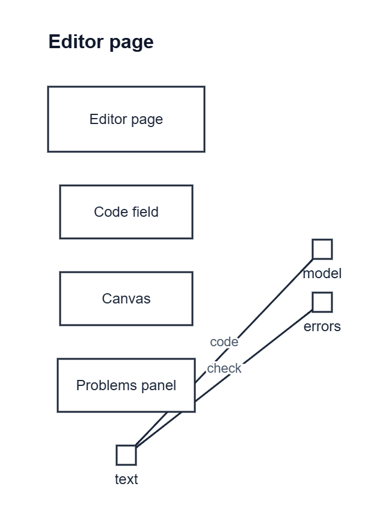

_Figure 7 – UML: composite structure of the editor page. Size: 316x426._

### 08. UML: deployment in Docker

What runs where under docker compose: the user computer opens the client on port 8080, Nginx serves the client build and passes /api to the Express server, the server talks to PostgreSQL, the data lives in the pgdata volume.

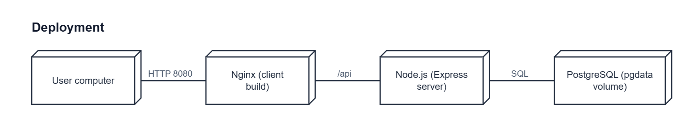

_Figure 8 – UML: deployment in Docker. Size: 713x139._

### 09. UML: packages of the site

The source folders of the site and the dependencies between them, counted from the real imports.

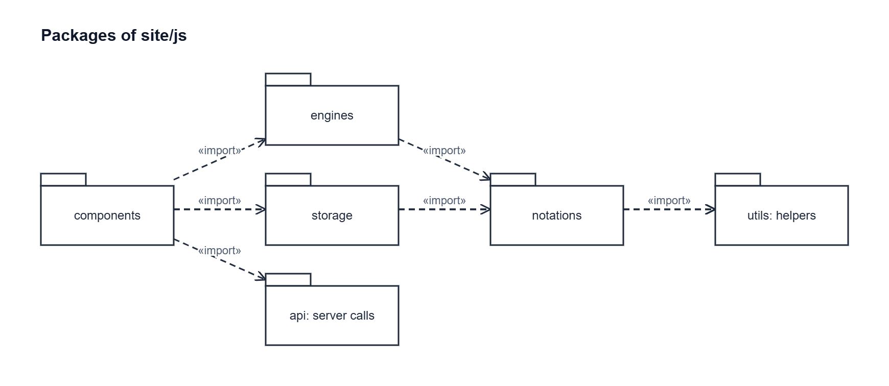

_Figure 9 – UML: packages of the site. Size: 713x310._

### 10. UML: DSLKit profile

The stereotypes that mark the classes of the system: notation, drawing engine and export format.

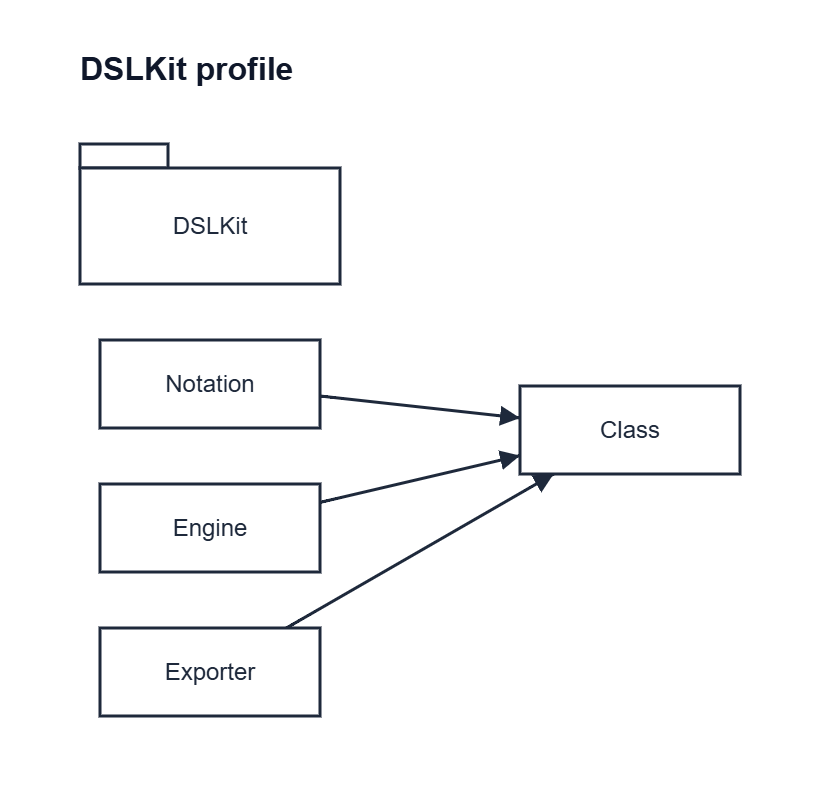

_Figure 10 – UML: DSLKit profile. Size: 410x398._

### 11. UML: activity "Drawing a diagram"

What happens between pressing "Run" and the drawing appearing: the code is checked, errors show problems, otherwise the diagram is drawn.

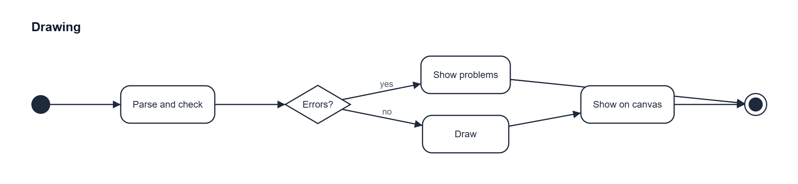

_Figure 11 – UML: activity "Drawing a diagram". Size: 713x165._

### 12. UML: states of saving the code

Autosave: after a change the code waits one second without edits and is saved in the browser.

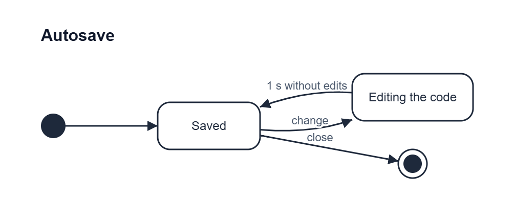

_Figure 12 – UML: states of saving the code. Size: 502x214._

### 13. UML: sequence "Sign in and create a diagram"

The exchange between client, server and database: signing in gives a token, then the create request passes the token check.

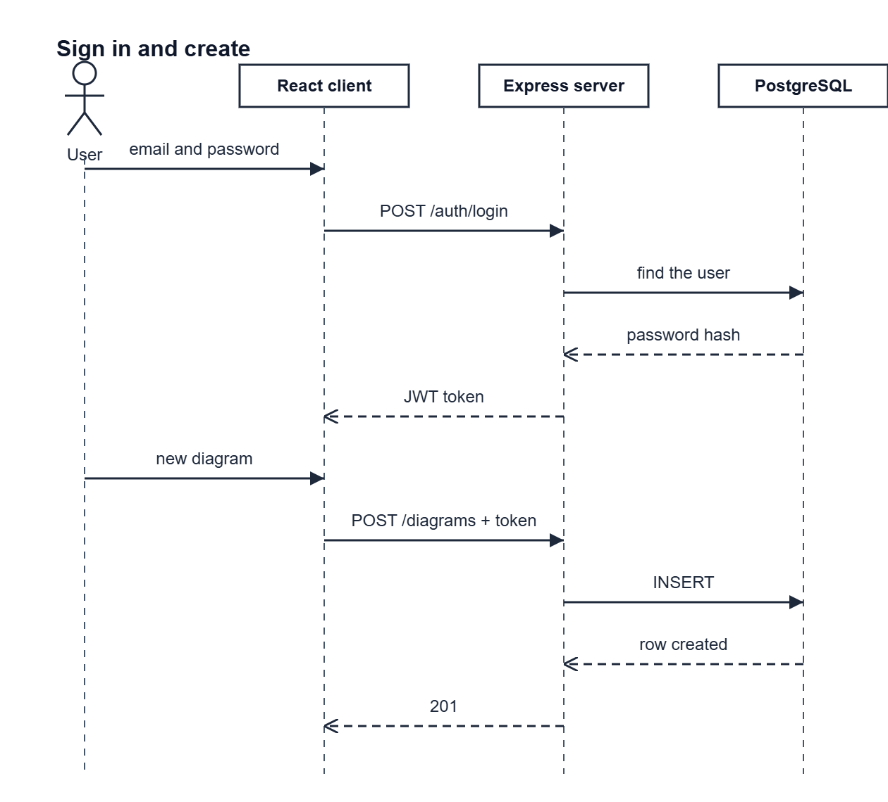

_Figure 13 – UML: sequence "Sign in and create a diagram". Size: 630x570._

### 14. UML: communication "A request to the server"

The same objects, but the links and the message numbers are shown: the order is given by the numbering.

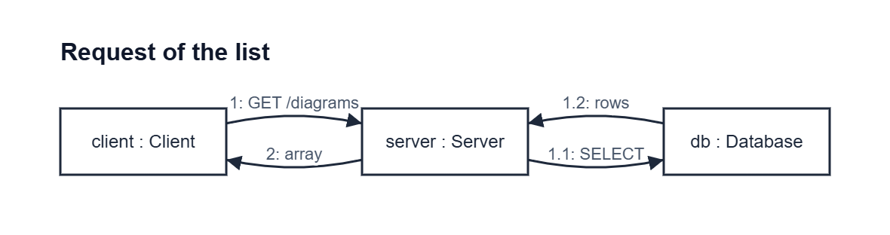

_Figure 14 – UML: communication "A request to the server". Size: 590x156._

### 15. UML: timing diagram of autosave

The states of the editor and of the "Saved" indicator over time (in tenths of a second).

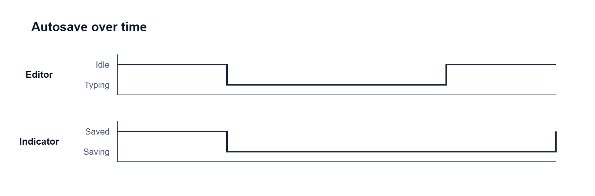

_Figure 15 – UML: timing diagram of autosave. Size: 713x236._

### 16. UML: interaction overview

The work with the server part as a chain of interactions with a sign-in check.

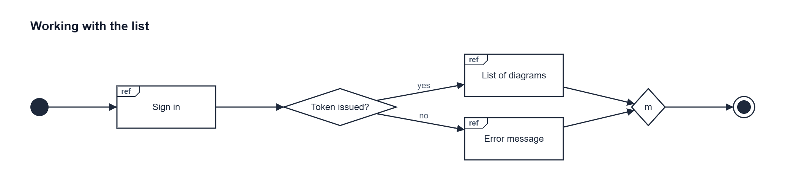

_Figure 16 – UML: interaction overview. Size: 713x174._

### 17. IDEF0: functional model

Three functions of the system with inputs, controls, outputs and mechanisms: writing, drawing and delivering the result.

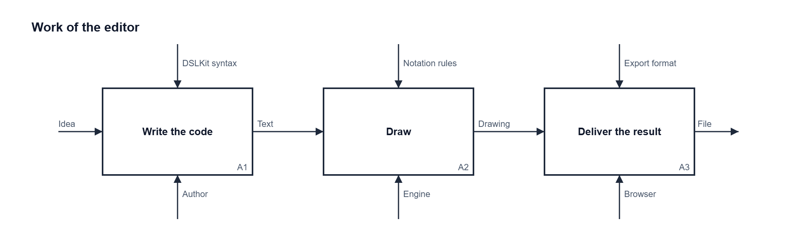

_Figure 17 – IDEF0: functional model. Size: 713x213._

### 18. IDEF1: information model

The information the system keeps and how it is linked: user, diagram and project.

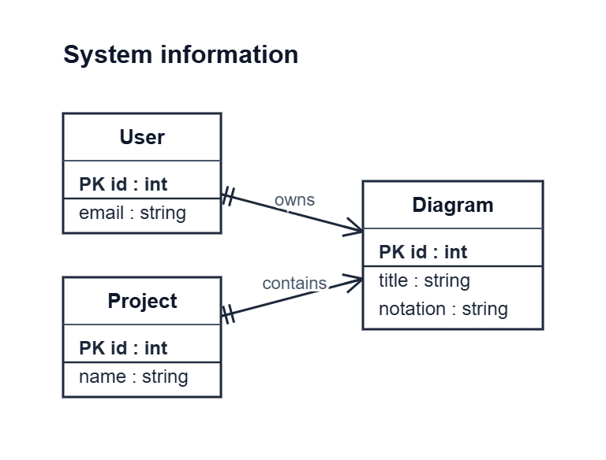

_Figure 18 – IDEF1: information model. Size: 384x292._

### 19. IDEF1X: data model

The tables of the database with primary and foreign keys: the keys of the user and the project migrate into the table of diagrams.

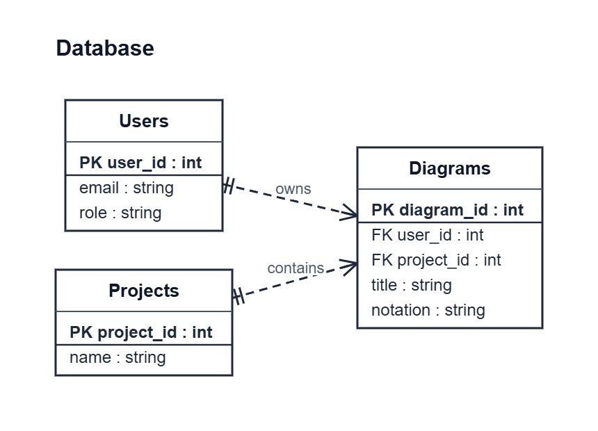

_Figure 19 – IDEF1X: data model. Size: 430x310._

### 20. IDEF3: the sign-in process

The order of work when signing in: lock check, password check, token or refusal.

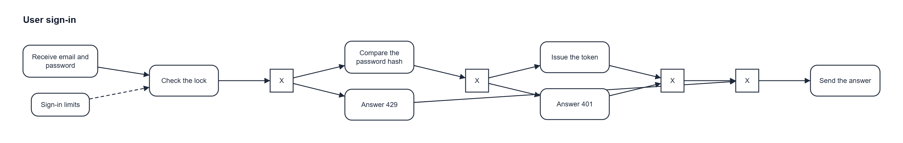

_Figure 20 – IDEF3: the sign-in process. Size: 713x113._

### 21. IDEF4: object design of the server

The layers of the server as classes: the route receives the request, the controller acts, the model stores.

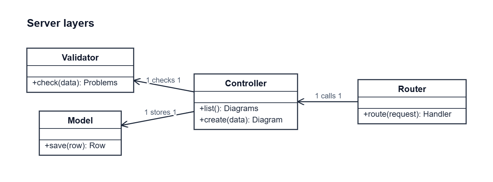

_Figure 21 – IDEF4: object design of the server. Size: 713x264._

### 22. IDEF5: domain ontology

The concepts of the domain: a diagram and its BPMN kind, the drawing engine and the drawing process; examples: "Order handling" and "Local engine".

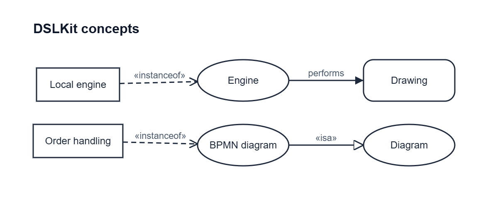

_Figure 22 – IDEF5: domain ontology. Size: 588x240._

### 23. DFD: data flows

Which data flows where: the text goes to drawing, the record is saved on the server, the outside service returns the drawing.

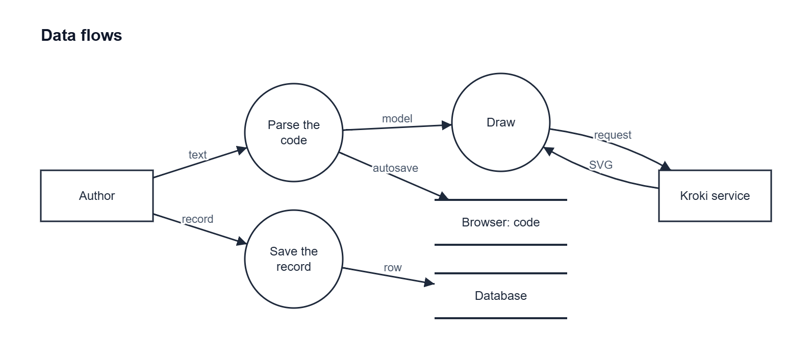

_Figure 23 – DFD: data flows. Size: 713x315._

### 24. ERD: entities and relationships

The database of the course work and labs: user, diagram, project and their one-to-many relationships.

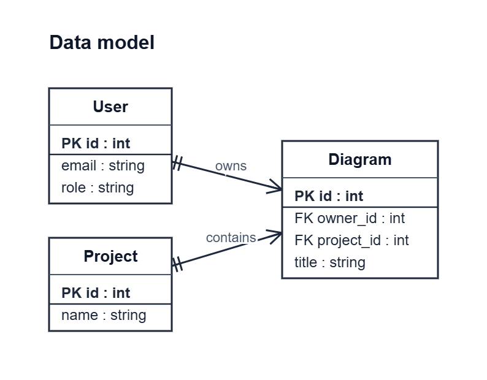

_Figure 24 – ERD: entities and relationships. Size: 397x310._

### 25. BPMN: the author working with the editor

The business process of the author: write the code, get the drawing, fix errors or export the result.

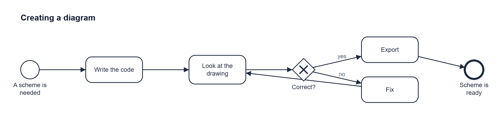

_Figure 25 – BPMN: the author working with the editor. Size: 713x175._

### 26. Petri net: sign-in attempts

Five sign-in attempts as tokens: each failure takes a token, with no tokens left the sign-in is locked.

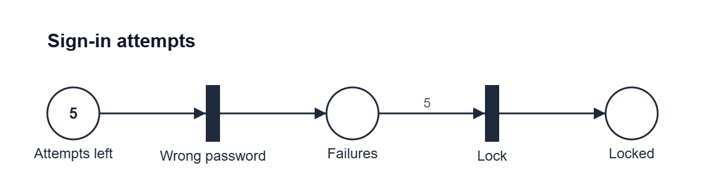

_Figure 26 – Petri net: sign-in attempts. Size: 596x160._

### 27. Flowchart (GOST 19.701-90): checking the header

The algorithm that reads the first line of the code: if the header names a known notation the body is parsed, otherwise an error is reported.

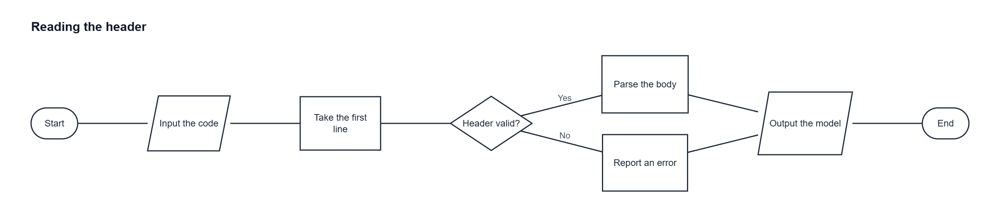

_Figure 27 – Flowchart (GOST 19.701-90): checking the header. Size: 713x159._

### 28. Graph: how close the notations are

A weighted graph: the smaller the edge weight, the easier it is to move from one notation to another. The service names the shortest path IDEF0 → BPMN → UML → C4 (length 7) in the results panel.

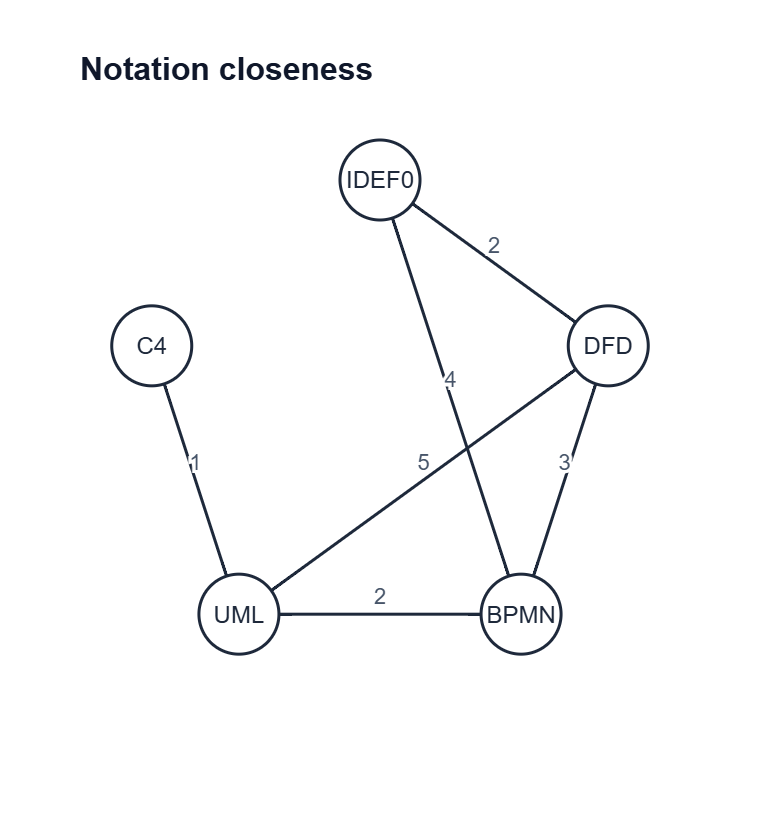

_Figure 28 – Graph: how close the notations are. Size: 380x420._

### 29. DAG: order of the checks in CI

The dependency graph of the checks before a release; durations in minutes. The service names the critical path "Install → Tests → Build → Report" (12 minutes) in the results panel.

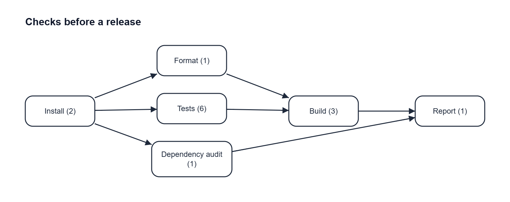

_Figure 29 – DAG: order of the checks in CI. Size: 713x283._

### 30. Mind map of the project

What the project consists of: the site, the server and client works, the course work and the diploma project.

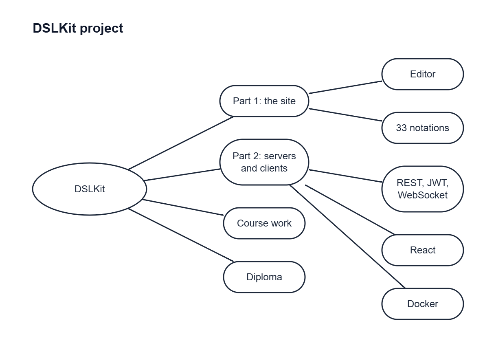

_Figure 30 – Mind map of the project. Size: 609x432._

### 31. Organisational structure of the work

Who is responsible for what in the study project: the owner, the supervisor and the lines of work.

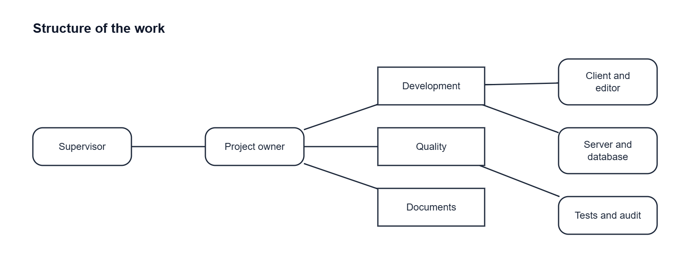

_Figure 31 – Organisational structure of the work. Size: 713x277._

### 32. Deployment network scheme

How the user computer, the web server, the application server, the database and the outside service are connected.

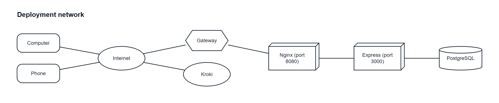

_Figure 32 – Deployment network scheme. Size: 713x149._

### 33. Decision tree: which engine to choose

A hint for the author: is a drawing needed without internet, are special formats needed, which engine fits.

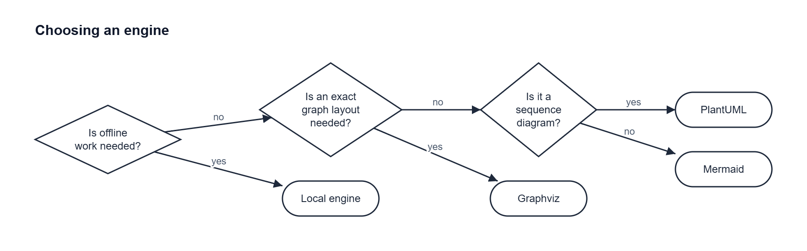

_Figure 33 – Decision tree: which engine to choose. Size: 713x222._

### 34. eEPC: event-driven process chain

The process "Diagram saved" from event to result: the code is received, checked, drawn or rejected.

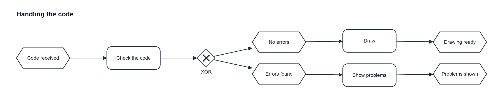

_Figure 34 – eEPC: event-driven process chain. Size: 713x147._
