# Диаграммы системы DSLKit

Здесь собраны диаграммы, которые описывают саму систему DSLKit: сайт и редактор, серверные части, клиент на React, развёртывание в Docker и организацию работы. Каждая диаграмма сделана **в самом сервисе**: текст на языке DSLKit набран в настоящем редакторе, нарисован его собственным движком в браузере и выгружен его же функциями экспорта (`serializeSvg` для SVG и `rasterize` для PNG).

Для каждой диаграммы есть два варианта подписей, русский и английский: файлы лежат в папках `ru` и `en`.

[English version](README.en.md)

## Состав

| №   | Вид                         | Диаграмма                                                  | Файлы                                                                                                                  |
| --- | --------------------------- | ---------------------------------------------------------- | ---------------------------------------------------------------------------------------------------------------------- |
| 01  | C4                          | [C4: контекст системы DSLKit](#01)                         | [PNG](png/ru/01-c4.png), [SVG](svg/ru/01-c4.svg), [код](dsl/ru/01-c4.dsl)                                              |
| 02  | C4                          | [C4: контейнеры DSLKit](#02)                               | [PNG](png/ru/02-c4.png), [SVG](svg/ru/02-c4.svg), [код](dsl/ru/02-c4.dsl)                                              |
| 03  | UML: варианты использования | [UML: варианты использования](#03)                         | [PNG](png/ru/03-uml-usecase.png), [SVG](svg/ru/03-uml-usecase.svg), [код](dsl/ru/03-uml-usecase.dsl)                   |
| 04  | UML: классы                 | [UML: классы предметной области](#04)                      | [PNG](png/ru/04-uml-class.png), [SVG](svg/ru/04-uml-class.svg), [код](dsl/ru/04-uml-class.dsl)                         |
| 05  | UML: объекты                | [UML: объекты (снимок данных)](#05)                        | [PNG](png/ru/05-uml-object.png), [SVG](svg/ru/05-uml-object.svg), [код](dsl/ru/05-uml-object.dsl)                      |
| 06  | UML: компоненты             | [UML: компоненты редактора](#06)                           | [PNG](png/ru/06-uml-component.png), [SVG](svg/ru/06-uml-component.svg), [код](dsl/ru/06-uml-component.dsl)             |
| 07  | UML: составная структура    | [UML: составная структура страницы редактора](#07)         | [PNG](png/ru/07-uml-composite.png), [SVG](svg/ru/07-uml-composite.svg), [код](dsl/ru/07-uml-composite.dsl)             |
| 08  | UML: развёртывание          | [UML: развёртывание в Docker](#08)                         | [PNG](png/ru/08-uml-deployment.png), [SVG](svg/ru/08-uml-deployment.svg), [код](dsl/ru/08-uml-deployment.dsl)          |
| 09  | UML: пакеты                 | [UML: пакеты сайта](#09)                                   | [PNG](png/ru/09-uml-package.png), [SVG](svg/ru/09-uml-package.svg), [код](dsl/ru/09-uml-package.dsl)                   |
| 10  | UML: профиль                | [UML: профиль DSLKit](#10)                                 | [PNG](png/ru/10-uml-profile.png), [SVG](svg/ru/10-uml-profile.svg), [код](dsl/ru/10-uml-profile.dsl)                   |
| 11  | UML: деятельность           | [UML: деятельность «Отрисовка диаграммы»](#11)             | [PNG](png/ru/11-uml-activity.png), [SVG](svg/ru/11-uml-activity.svg), [код](dsl/ru/11-uml-activity.dsl)                |
| 12  | UML: состояния              | [UML: состояния сохранения кода](#12)                      | [PNG](png/ru/12-uml-state.png), [SVG](svg/ru/12-uml-state.svg), [код](dsl/ru/12-uml-state.dsl)                         |
| 13  | UML: последовательность     | [UML: последовательность «Вход и создание диаграммы»](#13) | [PNG](png/ru/13-uml-sequence.png), [SVG](svg/ru/13-uml-sequence.svg), [код](dsl/ru/13-uml-sequence.dsl)                |
| 14  | UML: коммуникация           | [UML: коммуникация «Запрос к серверу»](#14)                | [PNG](png/ru/14-uml-communication.png), [SVG](svg/ru/14-uml-communication.svg), [код](dsl/ru/14-uml-communication.dsl) |
| 15  | UML: синхронизация          | [UML: временная диаграмма автосохранения](#15)             | [PNG](png/ru/15-uml-timing.png), [SVG](svg/ru/15-uml-timing.svg), [код](dsl/ru/15-uml-timing.dsl)                      |
| 16  | UML: обзор взаимодействий   | [UML: обзор взаимодействий](#16)                           | [PNG](png/ru/16-uml-overview.png), [SVG](svg/ru/16-uml-overview.svg), [код](dsl/ru/16-uml-overview.dsl)                |
| 17  | IDEF0                       | [IDEF0: функциональная модель](#17)                        | [PNG](png/ru/17-idef0.png), [SVG](svg/ru/17-idef0.svg), [код](dsl/ru/17-idef0.dsl)                                     |
| 18  | IDEF1                       | [IDEF1: информационная модель](#18)                        | [PNG](png/ru/18-idef1.png), [SVG](svg/ru/18-idef1.svg), [код](dsl/ru/18-idef1.dsl)                                     |
| 19  | IDEF1X                      | [IDEF1X: модель данных](#19)                               | [PNG](png/ru/19-idef1x.png), [SVG](svg/ru/19-idef1x.svg), [код](dsl/ru/19-idef1x.dsl)                                  |
| 20  | IDEF3                       | [IDEF3: процесс входа](#20)                                | [PNG](png/ru/20-idef3.png), [SVG](svg/ru/20-idef3.svg), [код](dsl/ru/20-idef3.dsl)                                     |
| 21  | IDEF4                       | [IDEF4: объектное проектирование сервера](#21)             | [PNG](png/ru/21-idef4.png), [SVG](svg/ru/21-idef4.svg), [код](dsl/ru/21-idef4.dsl)                                     |
| 22  | IDEF5                       | [IDEF5: онтология предметной области](#22)                 | [PNG](png/ru/22-idef5.png), [SVG](svg/ru/22-idef5.svg), [код](dsl/ru/22-idef5.dsl)                                     |
| 23  | DFD                         | [DFD: потоки данных](#23)                                  | [PNG](png/ru/23-dfd.png), [SVG](svg/ru/23-dfd.svg), [код](dsl/ru/23-dfd.dsl)                                           |
| 24  | ERD                         | [ERD: сущности и связи](#24)                               | [PNG](png/ru/24-erd.png), [SVG](svg/ru/24-erd.svg), [код](dsl/ru/24-erd.dsl)                                           |
| 25  | BPMN                        | [BPMN: работа автора с редактором](#25)                    | [PNG](png/ru/25-bpmn.png), [SVG](svg/ru/25-bpmn.svg), [код](dsl/ru/25-bpmn.dsl)                                        |
| 26  | Сеть Петри                  | [Сеть Петри: попытки входа](#26)                           | [PNG](png/ru/26-petri.png), [SVG](svg/ru/26-petri.svg), [код](dsl/ru/26-petri.dsl)                                     |
| 27  | Блок-схема ГОСТ 19.701-90   | [Блок-схема по ГОСТ 19.701-90: проверка заголовка](#27)    | [PNG](png/ru/27-gost.png), [SVG](svg/ru/27-gost.svg), [код](dsl/ru/27-gost.dsl)                                        |
| 28  | Граф                        | [Граф: связи между нотациями по близости](#28)             | [PNG](png/ru/28-graph.png), [SVG](svg/ru/28-graph.svg), [код](dsl/ru/28-graph.dsl)                                     |
| 29  | DAG                         | [DAG: порядок проверок в CI](#29)                          | [PNG](png/ru/29-dag.png), [SVG](svg/ru/29-dag.svg), [код](dsl/ru/29-dag.dsl)                                           |
| 30  | Ментальная карта            | [Ментальная карта проекта](#30)                            | [PNG](png/ru/30-mindmap.png), [SVG](svg/ru/30-mindmap.svg), [код](dsl/ru/30-mindmap.dsl)                               |
| 31  | Оргструктура                | [Организационная структура работ](#31)                     | [PNG](png/ru/31-orgchart.png), [SVG](svg/ru/31-orgchart.svg), [код](dsl/ru/31-orgchart.dsl)                            |
| 32  | Схема сети                  | [Схема сети развёртывания](#32)                            | [PNG](png/ru/32-network.png), [SVG](svg/ru/32-network.svg), [код](dsl/ru/32-network.dsl)                               |
| 33  | Дерево решений              | [Дерево решений: какой движок выбрать](#33)                | [PNG](png/ru/33-decision.png), [SVG](svg/ru/33-decision.svg), [код](dsl/ru/33-decision.dsl)                            |
| 34  | eEPC                        | [eEPC: цепочка процесса по событиям](#34)                  | [PNG](png/ru/34-epc.png), [SVG](svg/ru/34-epc.svg), [код](dsl/ru/34-epc.dsl)                                           |

## Как посмотреть и открыть в редакторе

- Рисунки: `png/ru/…`, `png/en/…` (растр с белым фоном, масштаб 2) и `svg/ru/…`, `svg/en/…` (векторные).
- Исходный текст: `dsl/ru/…`, `dsl/en/…`. Откройте редактор (`site/app/editor.html`, для английского `site/en/app/editor.html`), вставьте текст в поле кода, выберите движок «Собственный (в браузере)».
- Перестроить всё: запустить сайт (`node tools/serve.js site 5188`) и выполнить `node docs/diagrams/build.mjs`; тексты лежат в `docs/diagrams/diagrams.mjs` в одном месте для двух языков.

## Как проверена правильность отрисовки

- Каждый исходный текст сначала разобран парсером сервиса: ни ошибок, ни предупреждений (`node docs/diagrams/check.mjs`).
- Затем он набран в настоящем редакторе в браузере, и на странице измерено: рисунок появился; код в редакторе равен исходному; ни одна подпись не выходит за рисунок; подписи не налезают друг на друга; подпись внутри фигуры целиком лежит внутри её контура (проверка по настоящему контуру ромба, эллипса, прямоугольника); подпись на связи не спрятана под фигурой; подпись под значком не касается значка; в рисунке нет `NaN`; все подписи из исходного текста есть в рисунке.
- Результат последнего прогона: 68 из 68 рисунков проходят все проверки (`report.json`). Русский вариант всех 34 диаграмм просмотрен глазами после последних правок. Английский просмотрен после правки размеров фигур, а после этого его рисунки пересобраны из тех же исходных структур и прошли те же автоматические проверки.

## Что нашла проверка в самом сервисе

- Размеры фигур считались по семь пикселей на символ, как для прямоугольника. Поэтому текст в ромбах и эллипсах выходил за контур, широкие буквы (Ш, Ж, W, M) вылезали за края, а узкие оставляли пустое место. Исправлено: ширина текста считается по таблице ширин букв, а ромб и эллипс растут, пока весь блок текста не поместится внутри контура (коммиты `fix(notations)` в ветке `work/part1-finish`, тесты `labs/08-frontend-testing/shape-fit.test.js`).
- Подписи из нескольких строк под значком (начало и конец BPMN) налезали на сам значок. Исправлено.
- Метки решений и слияний в диаграммах деятельности, состояний и обзора взаимодействий были в ромбе фиксированного размера 44 на 44 и не помещались. Теперь ромб растёт под метку.

## Известные ограничения сервиса

- Составная структура (UML composite): части не рисуются внутри классификатора, порты стоят отдельными квадратами и привязаны к частям только по смыслу (атрибуты `in=` и `of=` в рисунке не используются). Так же рисует и стандартный шаблон сервиса, поэтому диаграмма 07 показана как есть.
- Кратчайший путь графа (диаграмма 28) и критический путь DAG (диаграмма 29) сервис называет в панели результатов, на рисунке они не подсвечены.
- В диаграммах 20 (IDEF3) и 22 (IDEF5) раскладка автоматическая, некоторые связи идут рядом с узлами.

## Диаграммы

### 01. C4: контекст системы DSLKit

Кто пользуется системой и с какими внешними сервисами она общается. Автор пишет диаграмму текстом, внешний сервис Kroki рисует её по запросу.

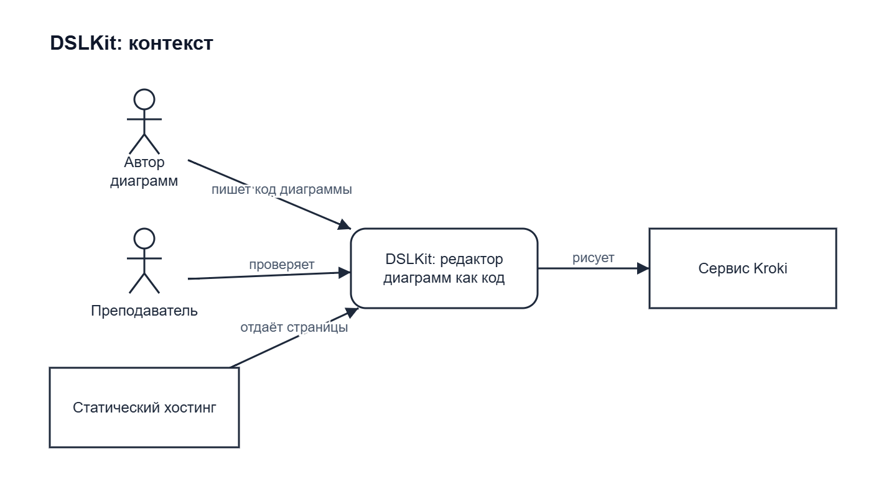

_Рисунок 1 – C4: контекст системы DSLKit. Размер: 712x400._

### 02. C4: контейнеры DSLKit

Из каких запускаемых частей состоит система: редактор в браузере, клиент на React, веб-сервер Nginx, программный интерфейс на Express и база данных PostgreSQL.

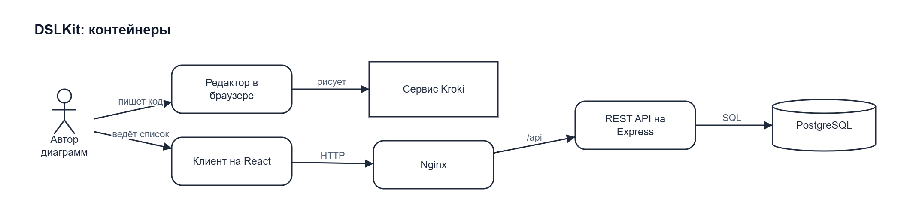

_Рисунок 2 – C4: контейнеры DSLKit. Размер: 713x175._

### 03. UML: варианты использования

Что может делать автор диаграмм и администратор. Вход нужен для списка диаграмм на сервере, редактор работает и без входа.

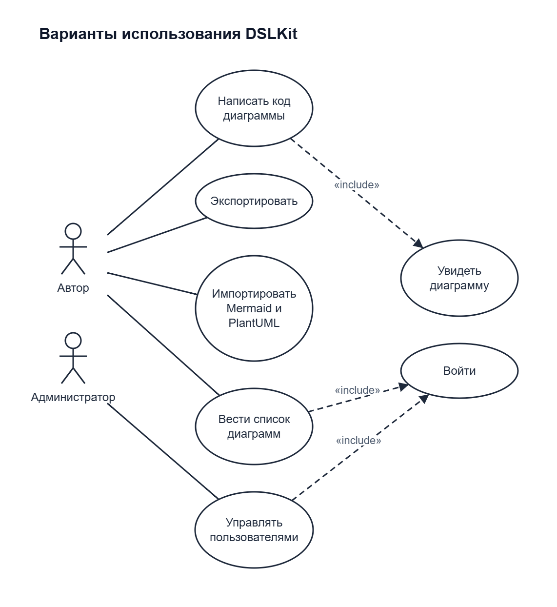

_Рисунок 3 – UML: варианты использования. Размер: 571x622._

### 04. UML: классы предметной области

Основные сущности сервера: пользователь, диаграмма, проект и запись журнала запросов.

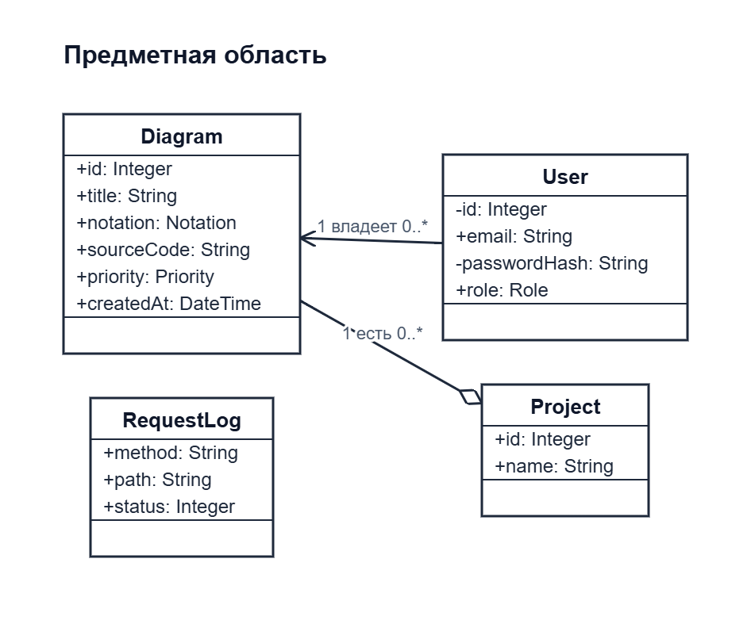

_Рисунок 4 – UML: классы предметной области. Размер: 473x391._

### 05. UML: объекты (снимок данных)

Конкретные объекты в один момент времени: пользователь, его диаграмма и проект.

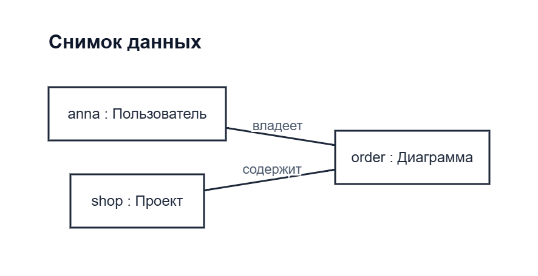

_Рисунок 5 – UML: объекты (снимок данных). Размер: 443x228._

### 06. UML: компоненты редактора

Из каких компонентов собран редактор и через какие интерфейсы они связаны: разбор кода, отрисовка, сервис Kroki и хранилище.

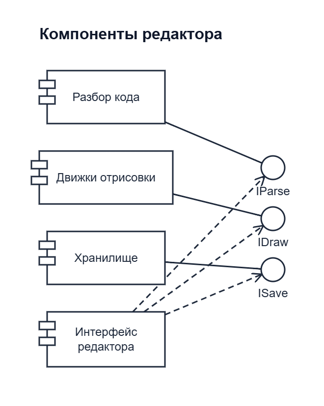

_Рисунок 6 – UML: компоненты редактора. Размер: 330x414._

### 07. UML: составная структура страницы редактора

Из каких частей состоит страница редактора и как они обмениваются данными через порты.

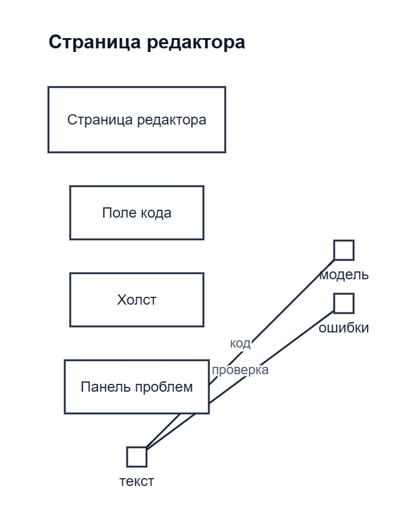

_Рисунок 7 – UML: составная структура страницы редактора. Размер: 332x426._

### 08. UML: развёртывание в Docker

Где что запущено при docker compose: компьютер пользователя открывает клиент на порту 8080, Nginx отдаёт сборку клиента и передаёт /api серверу Express, сервер работает с PostgreSQL, данные лежат в томе pgdata.

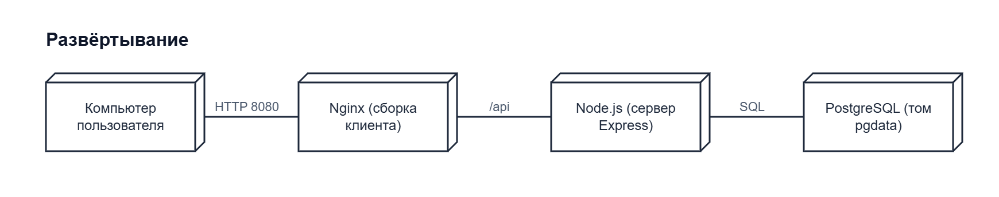

_Рисунок 8 – UML: развёртывание в Docker. Размер: 713x141._

### 09. UML: пакеты сайта

Папки исходного кода сайта и зависимости между ними, посчитанные по настоящим импортам.

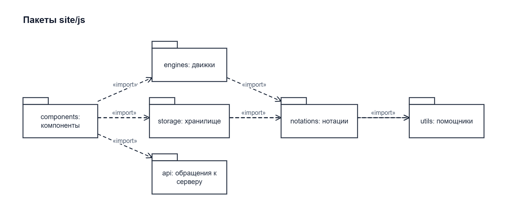

_Рисунок 9 – UML: пакеты сайта. Размер: 713x305._

### 10. UML: профиль DSLKit

Стереотипы, которыми помечены классы системы: нотация, движок отрисовки и формат экспорта.

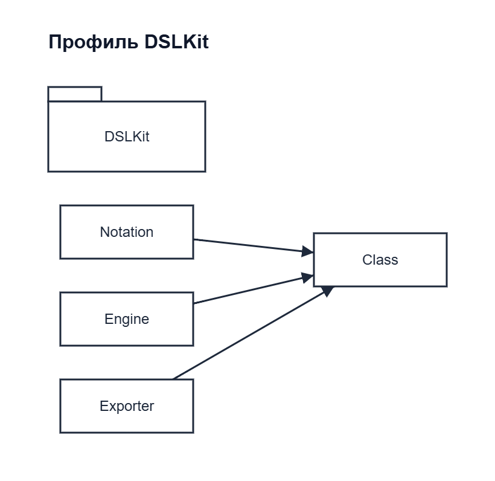

_Рисунок 10 – UML: профиль DSLKit. Размер: 410x398._

### 11. UML: деятельность «Отрисовка диаграммы»

Что происходит между нажатием «Запустить» и появлением рисунка: код проверяется, при ошибках показываются проблемы, иначе рисуется диаграмма.

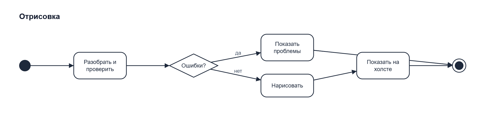

_Рисунок 11 – UML: деятельность «Отрисовка диаграммы». Размер: 713x172._

### 12. UML: состояния сохранения кода

Автосохранение: после изменения код ждёт секунду без правок и сохраняется в браузере.

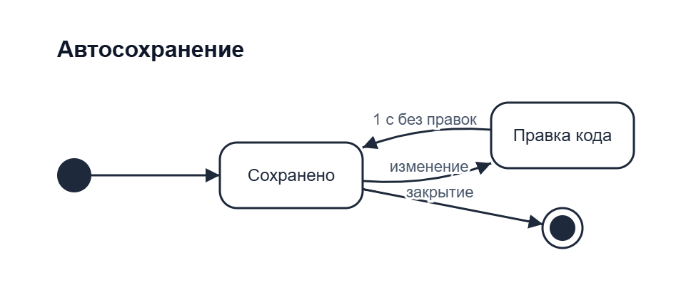

_Рисунок 12 – UML: состояния сохранения кода. Размер: 484x214._

### 13. UML: последовательность «Вход и создание диаграммы»

Обмен между клиентом, сервером и базой: вход выдаёт токен, дальше запрос создания проходит проверку токена.

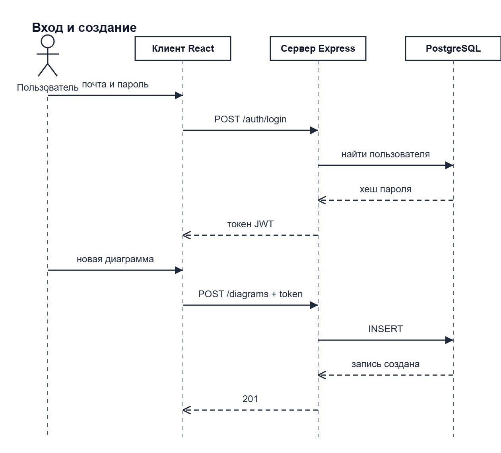

_Рисунок 13 – UML: последовательность «Вход и создание диаграммы». Размер: 630x570._

### 14. UML: коммуникация «Запрос к серверу»

Те же объекты, но показаны связи и номера сообщений: порядок задаётся нумерацией.

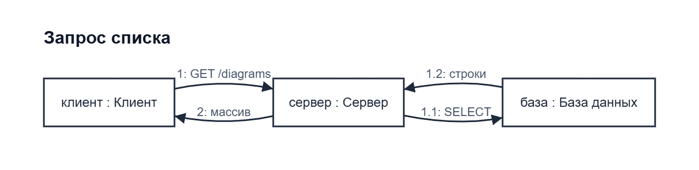

_Рисунок 14 – UML: коммуникация «Запрос к серверу». Размер: 637x156._

### 15. UML: временная диаграмма автосохранения

Состояния редактора и индикатора «Сохранено» во времени (в десятых долях секунды).

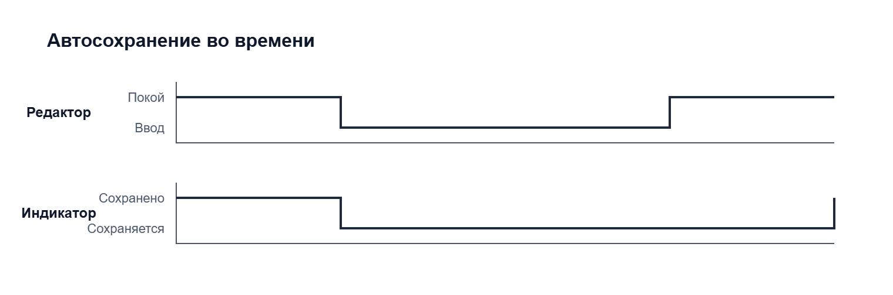

_Рисунок 15 – UML: временная диаграмма автосохранения. Размер: 713x236._

### 16. UML: обзор взаимодействий

Сценарий работы с серверной частью как цепочка взаимодействий с проверкой входа.

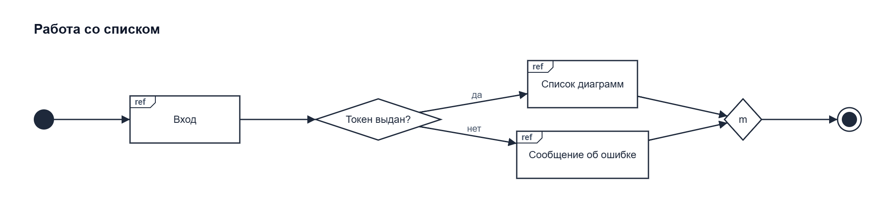

_Рисунок 16 – UML: обзор взаимодействий. Размер: 713x169._

### 17. IDEF0: функциональная модель

Три функции системы с входами, управлением, выходами и механизмами: написание, отрисовка и выдача результата.

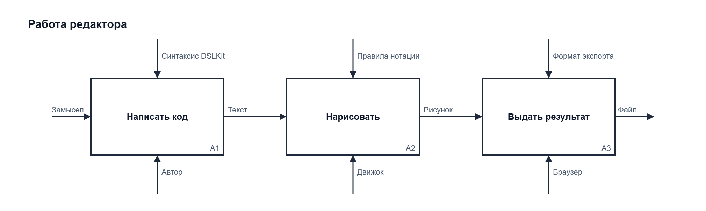

_Рисунок 17 – IDEF0: функциональная модель. Размер: 713x213._

### 18. IDEF1: информационная модель

Какую информацию система хранит и как она связана: пользователь, диаграмма и проект.

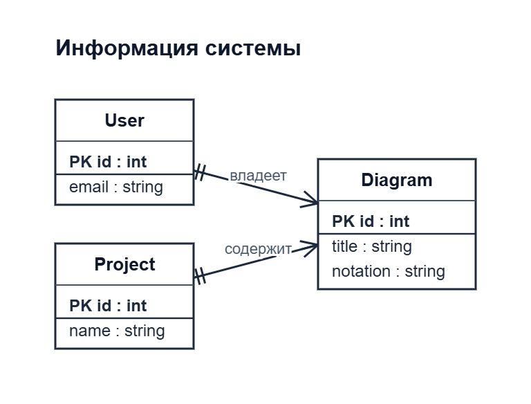

_Рисунок 18 – IDEF1: информационная модель. Размер: 384x292._

### 19. IDEF1X: модель данных

Таблицы базы с первичными и внешними ключами: ключи пользователя и проекта переходят в таблицу диаграмм.

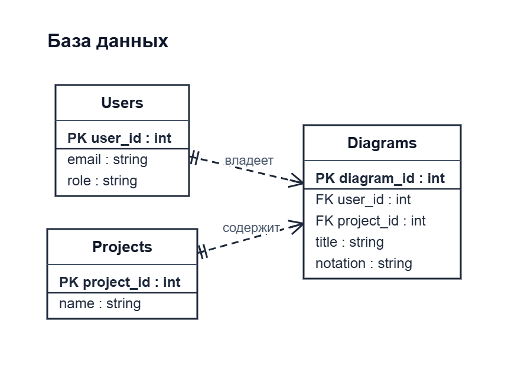

_Рисунок 19 – IDEF1X: модель данных. Размер: 430x310._

### 20. IDEF3: процесс входа

Порядок работ при входе: проверка блокировки, проверка пароля, выдача токена или отказ.

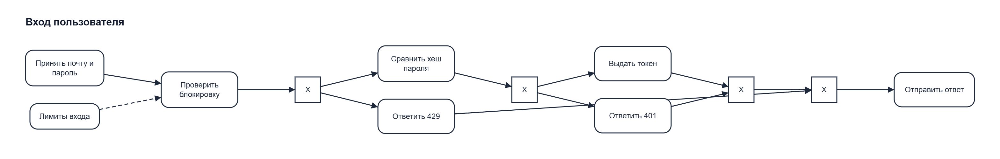

_Рисунок 20 – IDEF3: процесс входа. Размер: 713x114._

### 21. IDEF4: объектное проектирование сервера

Слои сервера как классы: маршрут принимает запрос, контроллер выполняет, модель хранит.

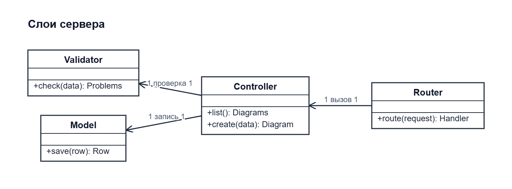

_Рисунок 21 – IDEF4: объектное проектирование сервера. Размер: 713x264._

### 22. IDEF5: онтология предметной области

Понятия предметной области: диаграмма и её вид BPMN, движок отрисовки и процесс отрисовки; примеры: «Обработка заказа» и «Свой движок».

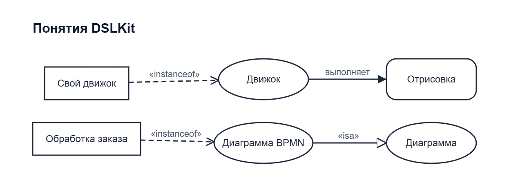

_Рисунок 22 – IDEF5: онтология предметной области. Размер: 623x240._

### 23. DFD: потоки данных

Какие данные куда текут: текст диаграммы идёт на отрисовку, запись сохраняется на сервере, внешний сервис возвращает рисунок.

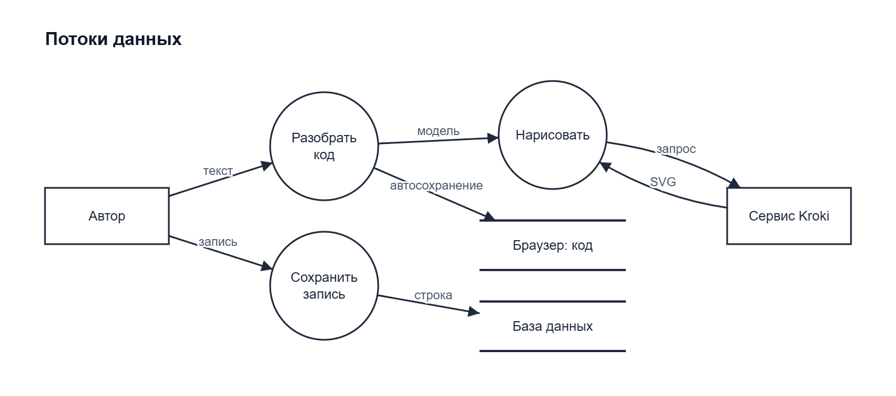

_Рисунок 23 – DFD: потоки данных. Размер: 713x315._

### 24. ERD: сущности и связи

База данных курсовой и лабораторных: пользователь, диаграмма, проект и их связи один-ко-многим.

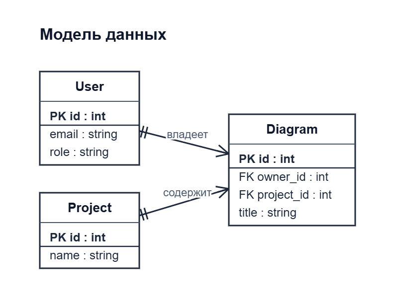

_Рисунок 24 – ERD: сущности и связи. Размер: 397x310._

### 25. BPMN: работа автора с редактором

Бизнес-процесс автора: написать код, получить рисунок, исправить ошибки или экспортировать результат.

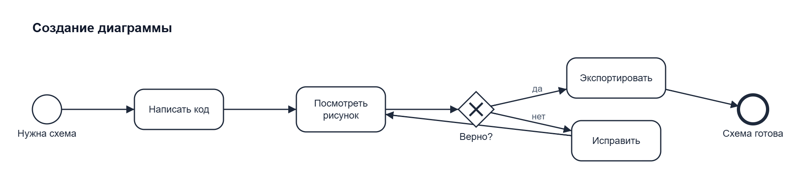

_Рисунок 25 – BPMN: работа автора с редактором. Размер: 713x173._

### 26. Сеть Петри: попытки входа

Пять попыток входа как фишки: каждая неудача забирает фишку, когда фишек нет, вход блокируется.

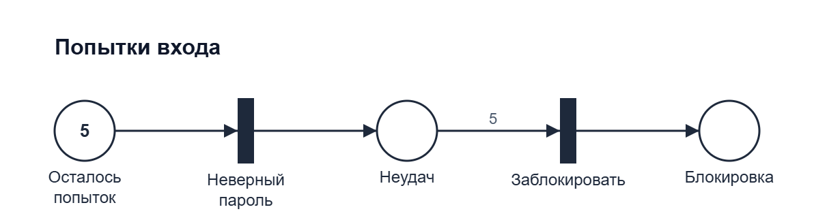

_Рисунок 26 – Сеть Петри: попытки входа. Размер: 596x160._

### 27. Блок-схема по ГОСТ 19.701-90: проверка заголовка

Алгоритм разбора первой строки кода: если заголовок указывает известную нотацию, разбирается тело, иначе выдаётся ошибка.

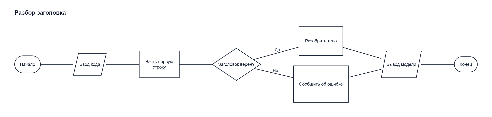

_Рисунок 27 – Блок-схема по ГОСТ 19.701-90: проверка заголовка. Размер: 713x170._

### 28. Граф: связи между нотациями по близости

Взвешенный граф: чем меньше вес ребра, тем проще перейти от одной нотации к другой. Сервис называет кратчайший путь IDEF0 → BPMN → UML → C4 (длина 7) в панели результатов.

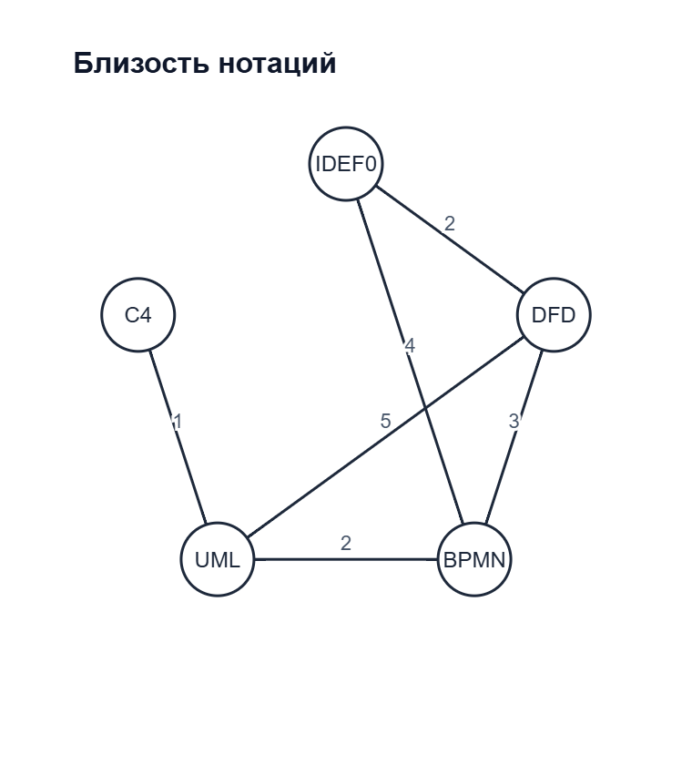

_Рисунок 28 – Граф: связи между нотациями по близости. Размер: 380x420._

### 29. DAG: порядок проверок в CI

Граф зависимостей этапов проверки перед выпуском; длительности в минутах. Критический путь «Установка → Тесты → Сборка → Отчёт» (12 минут) сервис называет в панели результатов.

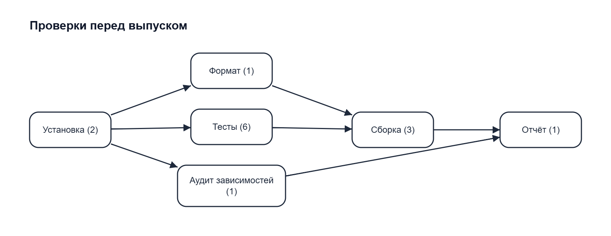

_Рисунок 29 – DAG: порядок проверок в CI. Размер: 713x276._

### 30. Ментальная карта проекта

Из чего состоит проект: сайт, серверные и клиентские работы, курсовой и дипломный проект.

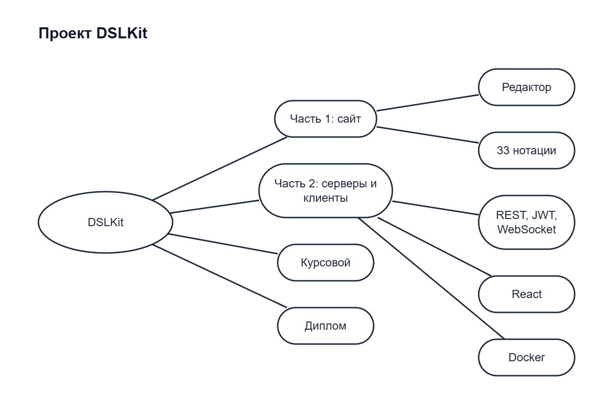

_Рисунок 30 – Ментальная карта проекта. Размер: 639x432._

### 31. Организационная структура работ

Кто за что отвечает в учебном проекте: владелица проекта, руководитель и направления работ.

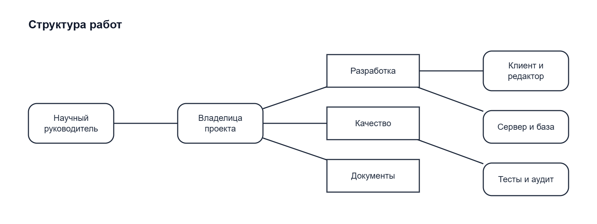

_Рисунок 31 – Организационная структура работ. Размер: 713x268._

### 32. Схема сети развёртывания

Как соединены компьютер пользователя, веб-сервер, сервер приложения, база данных и внешний сервис.

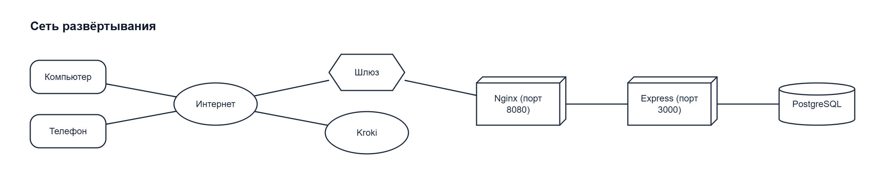

_Рисунок 32 – Схема сети развёртывания. Размер: 713x149._

### 33. Дерево решений: какой движок выбрать

Подсказка автору: нужен ли рисунок без интернета, нужны ли особые форматы, какой движок подойдёт.

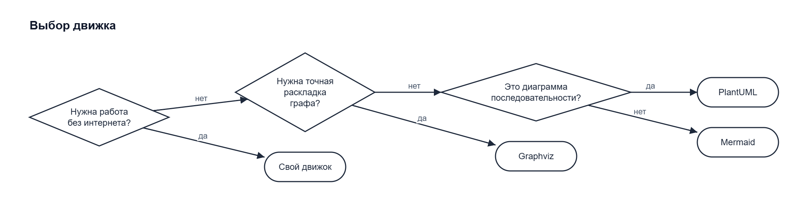

_Рисунок 33 – Дерево решений: какой движок выбрать. Размер: 713x187._

### 34. eEPC: цепочка процесса по событиям

Процесс «Диаграмма сохранена» от события до результата: код получен, проверен, нарисован или отклонён.

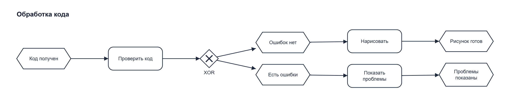

_Рисунок 34 – eEPC: цепочка процесса по событиям. Размер: 713x147._
