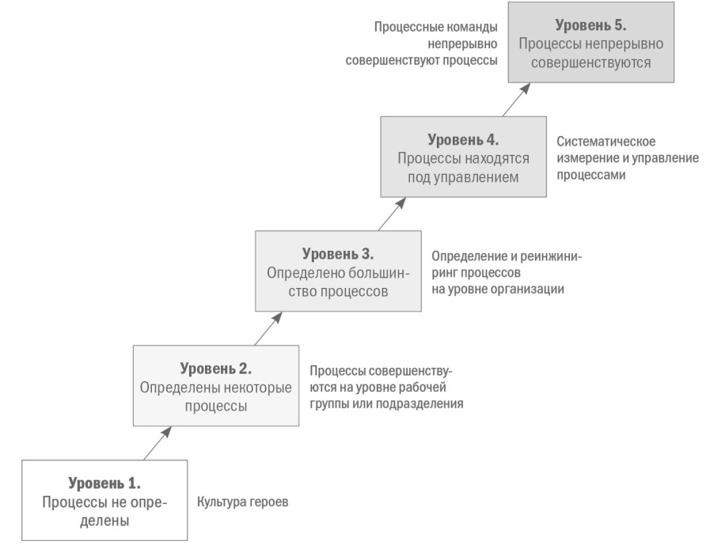
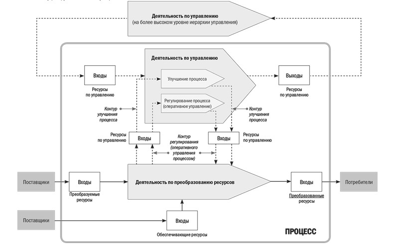
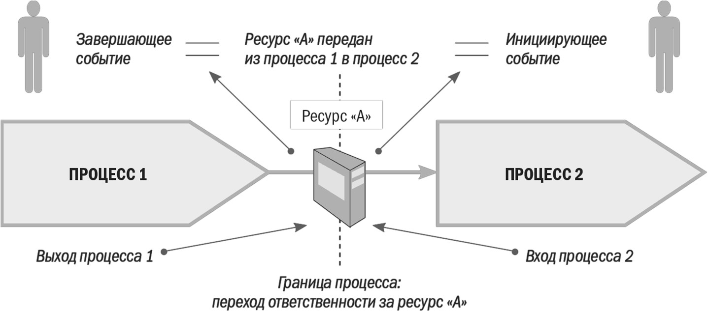
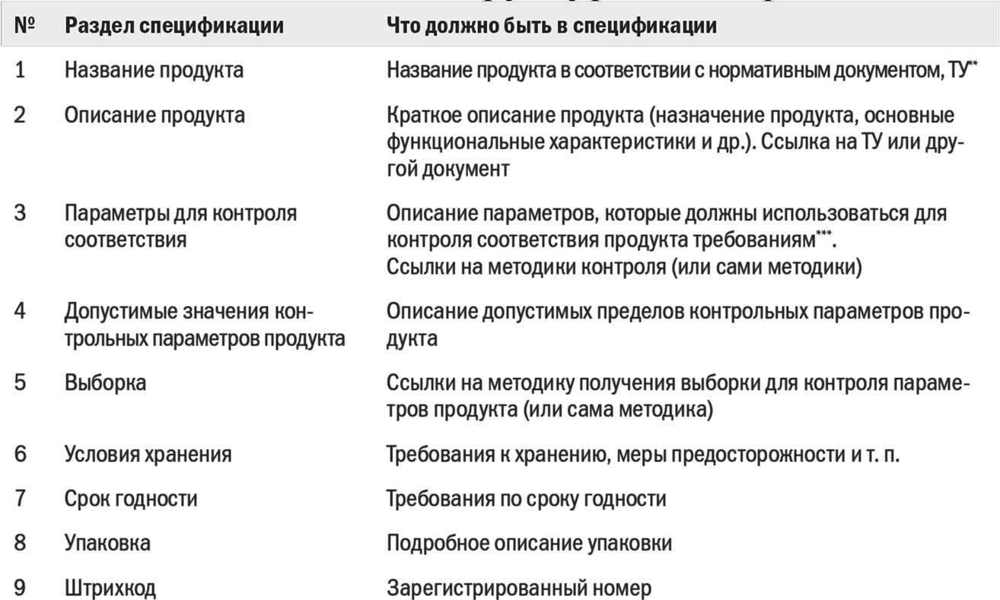
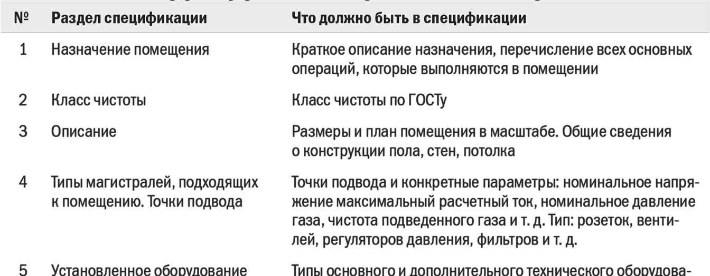
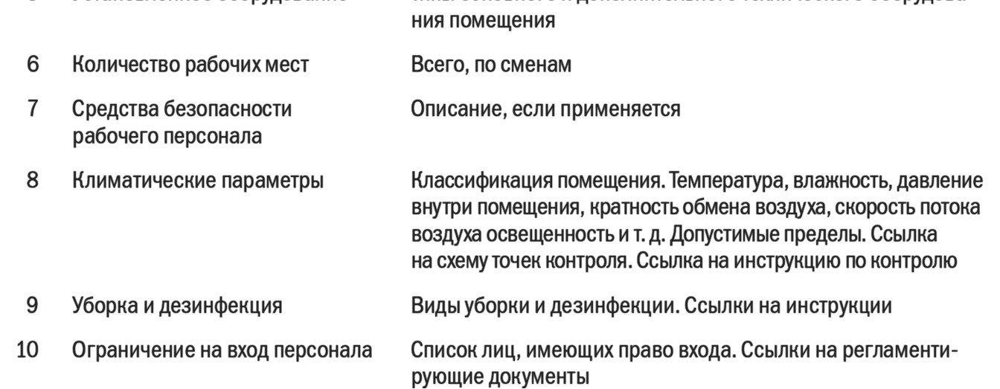
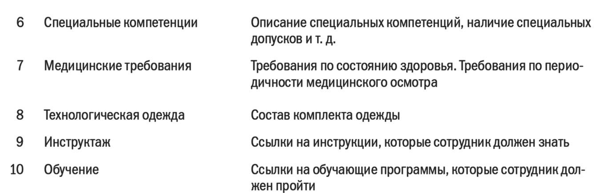
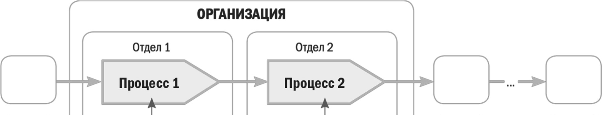
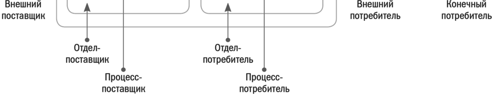

# МБП ЛЕКЦИЯ 1 - ПРОЦЕССНЫЙ ПОДХОД - ТЕРМИНЫ И ОПРЕДЕЛЕНИЯ

Оригинал: `../оригиналы/МБП ЛЕКЦИЯ 1 - ПРОЦЕССНЫЙ ПОДХОД - ТЕРМИНЫ И ОПРЕДЕЛЕНИЯ.pdf`

## Страница 1

1 
Моделирование бизнес-процессов. Лекция 1 – Процессный подход: термины и определения 
ЛЕКЦИЯ 1: ПРОЦЕССНЫЙ ПОДХОД: ТЕРМИНЫ И ОПРЕДЕЛЕНИЯ 
 
План лекции: 
1.1 Зрелость компании в области процессного управления 
1.2 Структурная схема процесса 
1.3 Границы процесса 
1.4 Спецификации на входы и выходы процесса 
1.5 Контроль входов/выходов процесса 
1.6 Окружение процесса 
1.7 Технология выполнения процесса 
 
1.1 Зрелость компании в области процессного управления 
Чтобы успешно внедрить процессный подход к управлению, руководители компании 
должны четко понимать, в чем заключается процессное управление, как будут выделяться 
и управляться процессы организации, почему такой подход эффективен.  
Концепция должна восприниматься не только интуитивно, но и формулироваться в 
конкретных терминах: 
 
бизнес-процесс (процесс); 
 
архитектура процессов; 
 
владелец процесса; 
 
описание процесса; 
 
регламентация процесса; 
 
стабильность процесса; 
 
улучшение процесса; 
 
автоматизация процесса и т.д. 
Концепция уровней зрелости процесса (Process Maturity Levels) была создана в 
Институте программной инженерии (Software Engineering Institute, SEI) при Университете 
Карнеги – Меллона в 1990-е гг. В ее основу положена работа Уотса Хамфри. Впервые 
разработанная для поддержки анализа зрелости процесса программирования (CMM), 
последняя версия, интегрированная модель технологической зрелости (Capability Maturity 
Model Integrated, CMMI), была обобщена для любого из широкого спектра процессов в 
различных организациях (рисунок 1.1). 
Приведу краткое описание каждого из уровней, указанных на рисунок 1.1. 
Уровень 1. Процессы не определены 
Организации уровня 1 не используют процессную идеологию. Часто их называют 
организациями, которые держатся на героях. При выполнении работы сотрудники 
прилагают героические усилия, чтобы успеть закончить ее вовремя и отчитаться перед 
руководством. В такой компании невозможно рассчитать, какие ресурсы требуются для 
выполнения тех или иных процессов.

## Страница 2

2 
Моделирование бизнес-процессов. Лекция 1 – Процессный подход: термины и определения 
 
Рисунок 1.1 – Обзор основных уровней зрелости по модели СММI 
 
Уровень 2. Определены некоторые процессы 
Впервые обращаясь к процессам, организации, как правило, начинают с попытки 
определить, какие из них ключевые или наиболее часто используются. На этом этапе 
руководители 
не 
представляют 
себе 
компанию 
целиком 
как 
совокупность 
взаимодействующих процессов, а фокусируются на конкретном процессе. У организаций 
уровня 2 может быть определено несколько основных процессов. 
Уровень 3. Определено большинство процессов 
В организациях уровня 3 идентифицирована основная часть процессов. Существуют 
модели (описания) ключевых бизнес-процессов. У руководства есть понимание того, как 
ими управлять. В большинстве организаций уровня 3 разработана архитектура (система) 
процессов. В случае возникновения проблем выявляются процессы, которые их вызывают. 
Затем анализируются и устраняются причины проблем. 
Уровень 4. Процессы находятся под управлением 
Организации уровня 4 вышли за пределы простого определения процессов. В них 
менеджеры проводят мониторинг и анализируют процессы с использованием системы 
показателей, принимают решения по оптимизации процессов. 
Уровень 5. Процессы непрерывно совершенствуются 
В организациях уровня 5 процессы не только находятся под управлением, но их 
постоянно совершенствуют. 
Большинство российских организаций находится на первом или на втором уровне 
зрелости, некоторые приближаются к третьему, небольшая часть – к четвертому. Очень 
мало организаций, работающих на пятом уровне.

## Страница 3

3 
Моделирование бизнес-процессов. Лекция 1 – Процессный подход: термины и определения 
 
1.2 Структурная схема процесса 
На рисунке 1.2 представлена структурная схема процесса. Она является 
универсальной и может быть использована для анализа процесса любого уровня, вплоть 
до элементарных операций. Это базовая схема для понимания сущности процесса как 
некоторой части деятельности организации. 
 
 
Рисунок 1.2 – Структурная схема процесса 
 
Процесс включает в себя деятельность по преобразованию ресурсов и деятельность 
по управлению. 
 
Процесс 
– 
устойчивая, 
целенаправленная 
совокупность 
взаимосвязанных 
видов 
деятельности, 
которая 
по определенной 
технологии преобразует входы в выходы, представляющие ценность для 
потребителя (клиента). 
 
Проще говоря, процесс – это периодически повторяемая, управляемая деятельность, 
результатом которой является некоторый ресурс, имеющий ценность для конкретного 
потребителя (клиента).

## Страница 4

4 
Моделирование бизнес-процессов. Лекция 1 – Процессный подход: термины и определения 
Под ресурсом понимается материальный или информационный 
объект, необходимый для выполнения процесса. 
 
С точки зрения состояния ресурсы могут: 
• храниться; 
• перемещаться; 
• находиться в состоянии обработки. 
 
Пример. Товар, привезенный на автомобиле к магазину, разгружают и перемещают в зону 
приемки. Очевидно, что последовательно меняются такие состояния товара-ресурса, как: 
перемещение (в автомобиле), перемещение (разгрузка), хранение (зона приемки). 
 
Пример. Маркетолог приобретает аналитический отчет по исследованию рынка, изучает 
его и делает определенное заключение по прогнозу объема продаж продукции компании. 
Данный отчет является информационным ресурсом, который сначала перемещается, потом 
хранится (в персональном компьютере маркетолога или на его рабочем столе в бумажном виде), 
потом находится в состоянии обработки (поиск информации в отчете и последующий ее анализ). 
В результате информация, содержащаяся в отчете, преобразуется в прогноз продаж. Таким 
образом, отчет нужен для выполнения работы. Этот документ является входом в процесс, 
осуществляемый маркетологом. 
 
Связь ресурса с процессом можно определить при помощи понятий «вход» и «выход».  
Если какой-либо ресурс нужен для выполнения процесса, то он может 
рассматриваться как вход с точки зрения данного процесса.  
А ресурс, преобразованный при выполнении этого процесса и получивший 
определенную ценность для потребителя, – в качестве выхода.  
Таким образом, ресурсы движутся, хранятся, перерабатываются. Их можно называть 
входами или выходами только по отношению к конкретному процессу. Выход одного 
процесса будет входом для другого. Говорить о входах и выходах безотносительно 
конкретного процесса не имеет смысла. 
На рисунке 1.2 показано, что с точки зрения процесса ресурсы могут быть 
преобразуемыми, преобразованными, обеспечивающими и ресурсами по управлению.  
 
Преобразуемый 
ресурс 
– 
тот, 
который 
подвергается 
преобразованию в ходе выполнения процесса. 
Преобразованный ресурс – тот, к которому добавлена определенная 
ценность при выполнении процесса. 
Обеспечивающий ресурс необходим для выполнения процесса, но не 
преобразуется в ходе процесса. 
Ресурс по управлению – необходимый для управления процессом. 
Вход процесса – преобразуемый ресурс или ресурс по управлению, 
необходимый для выполнения процесса, поставляемый другими 
процессами. 
Выход процесса – преобразованный при выполнении процесса ресурс.

## Страница 5

5 
Моделирование бизнес-процессов. Лекция 1 – Процессный подход: термины и определения 
Преобразуемый ресурс поступает на вход процесса. При выполнении процесса ресурс 
приобретает дополнительную ценность, становится преобразованным и поступает на 
выход процесса – внутреннему или внешнему потребителю. В свою очередь, потребитель 
может рассматривать преобразованный ресурс в качестве входа для своего процесса, то 
есть в качестве преобразуемого ресурса, и т. д. 
Для 
выполнения 
процесса 
кроме 
преобразуемых 
ресурсов 
нужны 
также 
обеспечивающие ресурсы. К их числу можно отнести оборудование, программное 
обеспечение, инфраструктуру, сотрудников. Обеспечивающие ресурсы могут: 
• периодически, по мере необходимости поставляться в процесс другими 
процессами; 
• выделяться процессу на постоянной основе. 
С точки зрения рассматриваемой модели обеспечивающие ресурсы при выполнении 
процесса не трансформируются. В реальной жизни обеспечивающие ресурсы меняются: 
• сотрудники приобретают опыт работы, стареют и т.п.; 
• оборудование изнашивается; 
• программное обеспечение морально устаревает. 
Однако при использовании данной модели указанными явлениями можно 
пренебречь. Напротив, если мы будем описывать и анализировать процессы управления 
персоналом или процессы технического обслуживания и ремонта оборудования, то 
изменение обеспечивающих ресурсов – важный фактор. Они являются для таких 
процессов основными объектами добавления ценности, поступают на выход в качестве 
преобразованных ресурсов. 
Ресурс по управлению представляет собой информацию, необходимую для 
управления. В зависимости от направления потока это может быть информация 
фактическая, плановая или содержащая управленческие решения. 
Деятельность по управлению процессом, представленная на схеме (рисунок 1.2), 
включает улучшение процесса и регулирование процесса (оперативное управление). 
Основная задача оперативного управления – поддержание процесса в стабильном 
воспроизводимом состоянии за счет выявления и устранения причин отклонений 
(вариаций). В свою очередь, улучшение процесса ориентировано на постоянное, 
целенаправленное изменение процесса на основе целей, установленных вышестоящим 
органом управления (на схеме это «Деятельность по управлению на более высоком уровне 
иерархии»). Для каждого процесса организации всегда существует иерархически 
вышестоящий орган управления. 
Чтобы управлять процессом, руководителю нужны полномочия по распоряжению 
ресурсами и информацией. На схеме показаны так называемые ресурсы по управлению. 
Они, как правило, представляют собой плановую и фактическую информацию. Например, 
от вышестоящего органа управления поступают цели и плановые показатели 
деятельности, при выполнении процесса возникает оперативная фактическая информация 
и т.д. Руководитель управляет процессом также через информационные воздействия 
(устные сообщения, информационные письма, распоряжения, приказы). 
Они являются выходами деятельности по управлению процессом.

## Страница 6

6 
Моделирование бизнес-процессов. Лекция 1 – Процессный подход: термины и определения 
Говоря об управлении процессом необходимо определить понятие «владелец 
процесса». 
 
Владелец процесса – должностное лицо, которое имеет в своем 
распоряжении выделенные ресурсы, управляет ходом процесса и несет 
ответственность за результаты и эффективность процесса. 
 
Владельцем процесса, как правило, назначается руководитель структурного 
подразделения (либо его заместитель, помощник). Существующая в компании иерархия 
управления структурными подразделениями не разрушается. Какая-либо иерархия 
владельцев процессов не создается.  
Количество ресурсов, переданных в управление владельцу процесса, и его 
ответственность за результаты процесса могут быть различными. Они меняются в 
зависимости от типа процесса, его важности для организации и т.д. 
В целом владелец процесса – это руководитель, способный как минимум: 
• проводить мониторинг хода процесса; 
• анализировать факторы, влияющие на процесс и приводящие к вариациям; 
• разрабатывать предложения по улучшению процесса и организовывать их 
обсуждения и согласования; 
• координировать (или управлять) внутренние проекты совершенствования 
процесса. 
В некоторых компаниях принята двухуровневая схема управления процессами. 
Владельцы процессов назначаются из числа руководителей верхнего уровня. При этом 
непосредственной работой с процессами (оперативным мониторингом, анализом 
отклонений и т.д.) занимаются так называемые ответственные за процесс. 
 
1.3 Границы процесса 
Понятие границ процесса является важнейшим при внедрении процессного подхода. 
Установление границ осуществляется субъективно – путем достижения договоренности 
между несколькими сторонами (поставщиками и потребителями). Для обсуждения границ 
процесса нужно сформулировать несколько определений. 
 
Границы 
процесса 
– 
событие 
(совокупность 
событий), 
инициирующее и завершающее процесс. 
Событие – наступление определенной ситуации (времени, перехода 
ответственности за ресурсы). 
Инициирующее событие – событие, при наступлении которого 
начинается процесс. 
Завершающее событие – событие, которым завершается процесс. 
 
Пусть ресурс «А» является результатом преобразования в некотором процессе 
(рисунок 1.3). С точки зрения владельца этого процесса ресурс «А» – выход. С точки

## Страница 7

7 
Моделирование бизнес-процессов. Лекция 1 – Процессный подход: термины и определения 
зрения владельца процесса-потребителя ресурс «А» – вход. В момент передачи ресурса 
«А» от одного процесса к другому происходит переход ответственности за этот ресурс 
между владельцами процессов. Факт движения ресурса, сопровождающийся переходом 
ответственности, может быть идентифицирован при помощи события. С точки зрения 
владельца первого процесса это событие завершает процесс, с точки зрения владельца 
второго процесса – инициирует его. Одно и то же событие может быть сформулировано 
по-разному при описании границ двух рассматриваемых процессов. Первый владелец 
скажет, что ресурс «А» передан, а второй – что ресурс «А» получен. Чтобы при описании 
процессов было удобнее увязывать их в единую систему, лучше определять одно событие 
и давать ему примерно такую формулировку: «Ресурс «А» передан из процесса 1 в процесс 
2». В любом случае формулировки событий должны быть обязательно согласованы между 
владельцами процессов при регламентации границ. 
 
 
Рисунок 1.3 – Границы процессов 
 
Примеры формулировки событий, связанных с движением материальных ресурсов: 
• «Товар помещен в зону хранения»; 
• «Продукция упакована и передана покупателю»; 
• «Оборудование установлено». 
Примеры формулировки событий, связанных с передачей информации: 
• «Поступил заказ клиента»; 
• «Факс отправлен»; 
Переход ответственности за ресурсы возможен и внутри процесса, по ходу 
выполнения работы различными сотрудниками. Соответствующие события могут 
использоваться для определения зон ответственности сотрудников внутри процесса. 
Рассмотрим более сложные случаи, когда событие, завершающее один процесс, не 
является событием, инициирующим другой процесс. Допустим, в одном из подразделений 
организации сотрудник подготовил отчет и поместил его на сервер. Завершающее процесс 
событие можно сформулировать так: «Отчет подготовлен и размещен на сервере». Через 
некоторое время (например, в конце месяца) сотрудник другого отдела скачивает или 
открывает на сервере и использует необходимую информацию. Событие, инициирующее 
его процесс, казалось бы, можно зафиксировать как «Получен отчет такой-то». В 
реальности отчет мог пролежать на сервере несколько дней до того момента, пока им

## Страница 8

8 
Моделирование бизнес-процессов. Лекция 1 – Процессный подход: термины и определения 
воспользовались. Как быть? Ответ в формулировке события, инициирующего второй 
процесс. Это можно сделать так: «Наступил срок подготовки сводного отчета». Далее 
сотрудник проверяет наличие отчета на сервере. Результат – следующее событие: «Отчет 
такой-то присутствует на сервере». Очевидно, что определение такого типа событий 
зависит от степени детализации при описании процесса. 
Еще пример: рассмотрим отправку какого-либо документа по корпоративной 
электронной сети. Факт отправки документа сотрудником можно описать событием 
«Документ отправлен по e-mail». Однако сотрудник, которому отправлен данный 
документ, может его получить не сразу или вообще не получить (сбой сети, случайное 
удаление и т.п.). Значит, инициировать процесс второго сотрудника будет событие 
«Получен документ по e-mail». Очевидно, что это два разных события. В данном случае 
можно: 
• использовать две разные формулировки событий, как было показано выше; 
• рассматривать 
передачу 
документа 
по 
электронной 
сети 
в 
качестве 
самостоятельного, но автоматически выполняемого процесса, имеющего своего 
владельца и т.п. 
Мы рассмотрели первую значительную группу событий, которые идентифицируются 
при проведении анализа движения ресурсов (как материальных, так и информационных).  
Вторая группа – это события, связанные с достижением некоторого времени по 
абсолютной или относительной хронологической шкале.  
Например, событие «Наступило 8 Марта» указывает на календарную дату, то есть 
привязано к календарной дате (абсолютная шкала). Событие «Прошло два рабочих дня 
после поступления заказа» указывает на наступление некоторого времени по 
относительной шкале, измеряемой в днях (начало шкалы приходится на момент 
поступления заказа). В зависимости от процесса масштаб временно́й шкалы различен: 
месяцы, дни, часы и даже минуты. 
Итак, для четкого определения границ процесса необходимо: 
• определить, какие ресурсы движутся внутрь и вовне процесса (входы и выходы); 
• определить инициирующие и завершающие события; 
• согласовать 
требования 
к 
входам/выходам 
и 
формулировки 
инициирующих/завершающих 
событий 
с 
владельцами 
соответствующих 
процессов-поставщиков и процессов-потребителей. 
 
1.4 Спецификации на входы и выходы процесса 
Требования 
к 
ресурсам, 
пересекающим 
границы 
процессов, 
могут 
быть 
зафиксированы в различных документах, например в спецификациях на входы и выходы 
процесса. Эти спецификации могут быть выполнены в виде отдельных документов или 
входить в состав регламентирующих документов по процессам. 
Спецификации 
могут 
детально 
описывать 
требования, 
которым 
должны 
удовлетворять: 
• документация; 
• сырье, вспомогательные и упаковочные материалы;

## Страница 9

9 
Моделирование бизнес-процессов. Лекция 1 – Процессный подход: термины и определения 
• полуфабрикаты; 
• готовые изделия; 
• производственные и офисные помещения, инфраструктура; 
• персонал; 
• оборудование; 
• программное обеспечение; 
• прочее. 
В спецификации необходимо фиксировать все требования, предъявляемые к объекту 
конкретным процессом (таблицы 1.1 – 1.3). Содержание спецификаций зависит от типа 
входа или выхода процесса. Ниже приводится несколько примеров структуры 
спецификаций. 
 
Таблица 1.1 – Структура спецификации для готового продукта 
 
 
Таблица 1.2 – Структура спецификации на производственные помещения

## Страница 10

10 
Моделирование бизнес-процессов. Лекция 1 – Процессный подход: термины и определения 
 
Таблица 1.3 – Структура спецификации на человеческие ресурсы (персонал) 
 
 
1.5 Контроль входов/выходов процесса 
Говоря о границах процессов, необходимо обсудить методы контроля входов и 
выходов. Существует два способа контроля: сплошной и выборочный. При сплошном 
контроле проверяется каждый ресурс (изделие, продукт, товар), поступающий на вход 
процесса. При выборочном – отбирают несколько изделий и осуществляют их контроль. 
Далее при помощи статистических методов оценивают долю несоответствующих изделий 
в их общем количестве. Ни та ни другая форма контроля не дают полной гарантии, что в 
процесс не попадет несоответствующее (дефектное) изделие.  
Перспективным способом является так называемое встраивание контроля в процесс 
таким образом, чтобы несоответствия выявлялись сразу при возникновении. В этом случае 
вероятность появления дефектных изделий на выходе процесса (то есть на входе 
соответствующего процесса-потребителя) существенно снижается. 
Одновременно с определением требований к входящим и выходящим ресурсам 
(например, в соответствующих спецификациях) желательно разработать методы контроля 
соответствия этим требованиям (спецификациям). 
Важным понятием, которое стоит использовать при работе с границами процессов, 
является «операционное определение». 
 
Операционное определение – описание требований к результату 
деятельности, позволяющее сотрудникам максимально объективным 
образом получать согласованное мнение о приемлемости этого 
результата. 
 
Типичная ситуация: руководитель ставит сотруднику задачу, а потом проверяет ее 
исполнение, при этом выражая свое неудовольствие. Сотрудник не может понять, в чем 
дело, ведь он выполнил работу в срок и качественно. Но, как оказалось, у руководителя

## Страница 11

11 
Моделирование бизнес-процессов. Лекция 1 – Процессный подход: термины и определения 
и сотрудника разные представления о приемлемости требуемого результата. Если бы 
с самого начала существовали четко сформулированные критерии приемки/проверки, 
конфликта бы не было. Такая ситуация в первую очередь выявляет недостаточную 
компетентность руководителя. 
Приведу другую типичную ситуацию. Взаимодействуя на межфункциональном 
уровне, владельцы разных процессов никак не могут договориться: при передаче 
результатов одного процесса другому постоянно возникают конфликты. Зачастую это 
связано именно с отсутствием четких операционных определений. Поэтому при 
согласовании границ процесса важно четко определить требования к ресурсам, а 
владельцы должны совместно выработать такие операционные определения, которые 
обеспечивали бы однозначное понимание: 
• физических параметров ресурсов (требований ТУ, формы, веса, цвета, упаковки); 
• информационных параметров (формы, структуры и содержания документа, 
параметров достоверности и точности информации); 
• временны́х и пространственных параметров (времени передачи, места передачи); 
• экономических параметров (затрат, себестоимости, доли наценки, цены и т.п.). 
При разработке операционных определений могут возникнуть проблемы, потому что 
у поставщика и потребителя разные: 
• показатели оценки результатов процесса (изделия, документа); 
• методики измерения этих показателей; 
• оборудование для измерения показателей; 
• условия измерения (среда, место, время). 
Говоря о контроле выходов процесса, следует упомянуть о таких понятиях, как 
верификация и валидация. В стандартах ИСО 9000 на систему менеджмента качества 
приводятся следующие определения этих терминов: 
Верификация 
(verification) 
– 
подтверждение 
(посредством 
предоставления 
объективных свидетельств) того, что установленные требования были выполнены. 
Термин «верифицировано» используется для обозначения соответствующего статуса. 
Деятельность по подтверждению может включать такие виды деятельности, как: 
• осуществление альтернативных расчетов, 
• сравнение технических условий, относящихся к новому проекту, с аналогичной 
документацией по апробированному проекту, 
• проведение испытаний и демонстраций, и 
• анализ документов до их выпуска. 
Валидация (validation) – подтверждение (посредством представления объективных 
свидетельств) того, что требования, относящиеся к конкретному предполагаемому 
использованию или применению, были выполнены. 
Термин «валидировано» используется для обозначения соответствующего статуса. 
Условия применения для конкретного применения могут быть реальными или 
смоделированными». 
Данные определения недостаточно определенны и допускают широкую трактовку. 
 Можно предложить более четкие понятия:  
• верификация – это проверка соответствия продукта установленным требованиям и

## Страница 12

12 
Моделирование бизнес-процессов. Лекция 1 – Процессный подход: термины и определения 
фиксация результатов этой проверки; 
• валидация 
– 
проверка 
способности 
продукта 
выполнять 
поставленные 
потребителем задачи (на практике выполнять свое функциональное назначение). 
 
Пример. Был подготовлен проект бизнес-плана. Его проверили на соответствие 
требованиям корпоративного шаблона. Структура документа соответствовала установленным 
в компании требованиям, то есть проект был верифицирован. Однако анализ бизнес-плана 
независимым экспертом показал, что ряд прогнозов ошибочен, часть расчетов была выполнена 
некорректно и т. д. По такому бизнес-плану невозможно было бы работать. Таким образом, при 
проведении валидации выяснилось, что бизнес-план не соответствует требованиям организации. 
 
В некоторых организациях принято валидировать процессы. Валидация процесса 
означает практическую проверку того, что процесс (при исполнении всех установленных 
требований к входам, технологии, оборудованию) выдает на выходе стабильный результат 
с приемлемым уровнем дефектов. Результаты валидации процесса обязательно 
фиксируются документально. 
Если организация не планирует проходить формальную сертификацию системы 
менеджмента качества на соответствие стандартам ИСО 9000, то термины «верификация» 
и «валидация» можно не использовать. Важно наличие четких операционных определений 
и действующих процедур контроля соответствия входов/выходов требованиям. 
 
1.6 Окружение процесса 
Продолжая обсуждать базовые определения процессного подхода, упомяну про 
окружение процесса – поставщиков и потребителей. 
 
Потребитель (клиент) – субъект, обладающий компетенциями и 
полномочиями формулировать требования к выходам процесса, 
непосредственно использующий выходы процесса в качестве ресурса для 
своего процесса. 
Внутренний потребитель – потребитель, находящийся внутри 
организации. 
Внешний 
потребитель 
– 
потребитель, 
находящийся 
вне 
организации. 
Конечный потребитель – внешний потребитель, использующий 
выходы процесса по прямому назначению. 
 
В качестве потребителя (клиента) процесса можно рассматривать владельца процесса, 
сотрудника подразделения, подразделение, процесс. При внедрении процессного подхода 
желательно сразу договориться, кого считать потребителем и как это отражать в 
документах. 
 
Пример. В компании при описании входов и выходов процесса в соответствующем 
столбце таблицы указывали сначала отдел, в котором находится потребитель, а потом, через 
запятую, – наименование процесса. Например: «Отдел маркетинга, процесс исследования

## Страница 13

13 
Моделирование бизнес-процессов. Лекция 1 – Процессный подход: термины и определения 
рынка» или «Отдел сбыта, процесс подготовки договора». 
 
Приведенные определения поясняет рисунок 1.4. Если организация входит в группу 
компаний, то ее внешними потребителями могут выступать как другие организации 
группы, так и внешние организации. Вводить дополнительные определения нежелательно, 
так как это усложняет описание и может привести к путанице. 
 
 
Рисунок 1.4 - Потребители и поставщики процесса 
 
Поставщик – субъект, предоставляющий ресурсы, необходимые для 
выполнения 
процесса. 
Поставщики 
могут 
быть 
внешними 
и 
внутренними. 
Внешний поставщик – субъект, находящийся вне организации и 
предоставляющий ресурсы, необходимые для выполнения процесса. 
Внутренний 
поставщик 
– 
субъект, 
находящийся 
внутри 
организации и предоставляющий ресурсы, необходимые для выполнения 
процесса. 
 
Поставщики, как и потребители процесса, могут быть внешними и внутренними. 
Приведем также определение исполнителя (участника) процесса. 
 
Исполнитель (участник) процесса – подразделение (должностное 
лицо), участвующее в преобразованиях входов в выходы в рамках 
процесса. 
 
1.7 Технология выполнения процесса 
Если посмотреть на структурную схему процесса (рисунок 1.2), то можно утверждать, 
что деятельность в рамках процесса в определенной своей части выполняется по 
технологии, то есть не хаотично, бессистемно. Существует несколько определений 
«технологии»: 
1. Техноло́гия – совокупность методов и инструментов для достижения желаемого 
результата; метод преобразования данного в необходимое; способ производства.

## Страница 14

14 
Моделирование бизнес-процессов. Лекция 1 – Процессный подход: термины и определения 
2. Технология – в узком смысле – способ преобразования вещества, энергии, 
информации в процессе изготовления продукции, обработки и переработки материалов, 
сборки готовых изделий, контроля качества, управления. 
3. Технология включает в себе методы, приемы, режим работы, последовательность 
операций и процедур, она тесно связана с применяемыми средствами, оборудованием, 
инструментами, используемыми материалами. 
4. Технологией, или технологическим процессом, часто называют также сами 
операции добычи, транспортировки и переработки, которые являются основой 
производственного процесса. 
Представим себе, что мы нарисовали на бумаге несколько квадратиков (они означают 
операции процесса) и соединили их стрелочками (они означают последовательность 
выполнения операций). Можно ли назвать такую картинку технологией выполнения 
процесса? Конечно, нет, этого недостаточно. Необходимо определить, какие материалы 
будут использоваться, на каком оборудовании, какие компетенции требуются от 
сотрудников, по каким показателям нужно контролировать работу и ее результаты. Только 
комплексное описание, выполненное с учетом всех нюансов, может обеспечить реальное 
выполнение работы с приемлемым результатом. Разработка такого описания, по сути, 
означает полноценное проектирование процесса. Схему на бумаге можно назвать 
алгоритмом или процедурой выполнения работы, но технологией (в практическом смысле 
этого слова) ее назвать нельзя. 
 
Пример. Чтобы заменить колесо на автомобиле, нужно: поставить машину на ручной 
тормоз, ослабить колесные болты, приподнять автомобиль, полностью отвернуть болты, снять 
колесо, поставить новое и т.д. Эту последовательность работ легко изобразить на листочке 
бумаги. Но если в нужный момент у вас не окажется баллонного ключа, а домкрат сломан, то 
схема на бумаге не поможет выполнить работу. Придется использовать подручные средства, 
например камень и бревно, чтобы поднять автомобиль. Но это будет уже совсем другая 
«технология». 
 
Некоторые специалисты различают просто процессы и процессы технологические. С 
учетом 
приведенных 
выше 
аргументов 
очевидно, 
что 
это 
некорректное 
противопоставление. У любого процесса (реального, а не бумажного) есть определенная 
технология. При этом неважно, выполняется ли этот процесс с использованием токарных 
станков или в офисе IT-компании. 
В заключение зададимся вопросом: может ли процесс выполняться без технологии? 
Безусловно. Только в этом случае его результаты каждый раз будут отличаться, а работа – 
сопровождаться различными потерями. Маловероятно, что такое выполнение процесса 
соответствует целям и ожиданиям собственников бизнеса.
