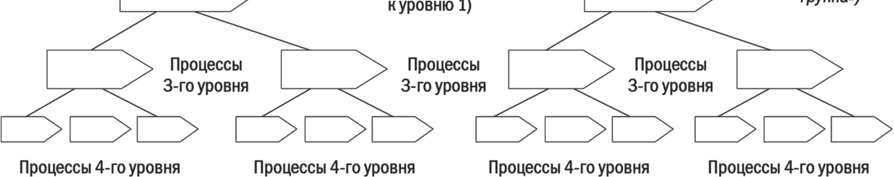
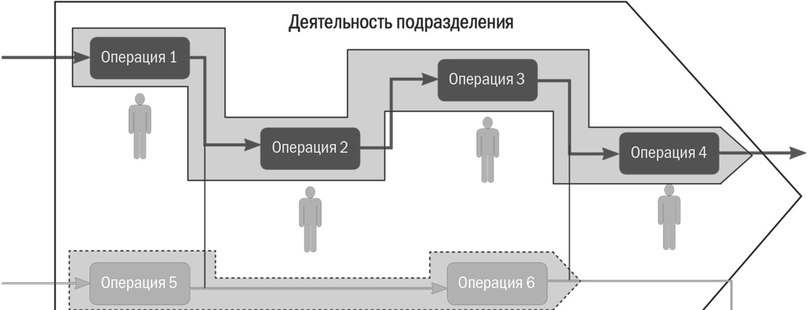
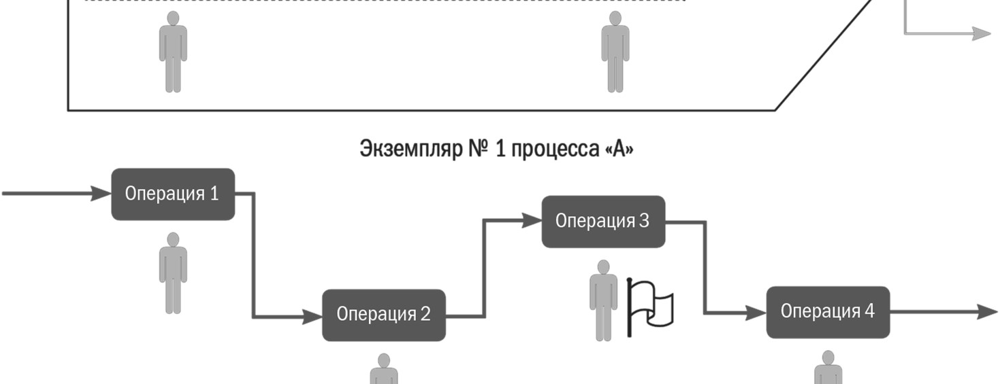
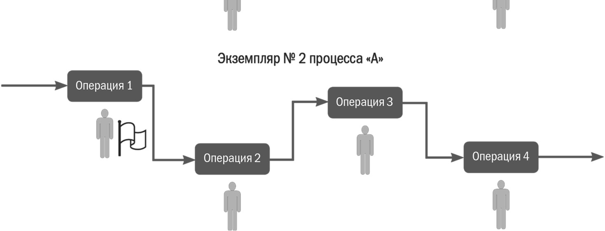
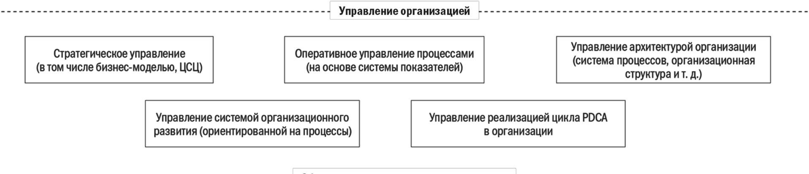
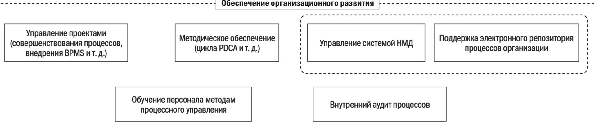
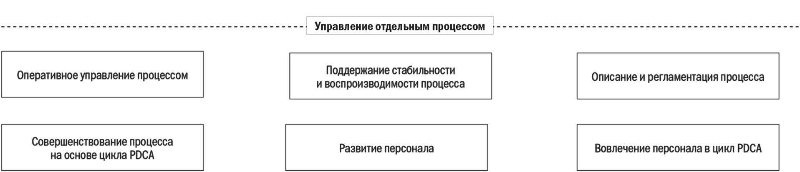

# МБП ЛЕКЦИЯ 2 - КОНЦЕПЦИЯ ВНЕДРЕНИЯ ПРОЦЕССНОГО ПОДХОДА В ОРГАНИЗАЦИИ

Оригинал: `../оригиналы/МБП ЛЕКЦИЯ 2 - КОНЦЕПЦИЯ ВНЕДРЕНИЯ ПРОЦЕССНОГО ПОДХОДА В ОРГАНИЗАЦИИ.pdf`

## Страница 1

1 
Моделирование бизнес-процессов. Лекция 2 – Концепция внедрения процессного подхода в организации 
ЛЕКЦИЯ 2: КОНЦЕПЦИЯ ВНЕДРЕНИЯ ПРОЦЕССНОГО ПОДХОДА  
В ОРГАНИЗАЦИИ 
 
План лекции: 
2.1 Классификация процессов 
2.2 Показатели для управления процессом 
2.3 Определение процессного подхода 
2.4 Концепция внедрения процессного подхода 
2.5 Принципы процессного подхода 
 
2.1 Классификация процессов 
В рамках устоявшейся практики принято выделять основные, вспомогательные и 
процессы управления. 
 
Основной процесс – процесс, преобразующий ресурсы для создания 
продукта, который используется внешними потребителями. 
Вспомогательный процесс – процесс, поставляющий на вход других 
процессов обеспечивающие ресурсы. 
Процесс управления – процесс, поставляющий на вход других 
процессов ресурсы по управлению. 
 
При построении архитектуры (системы) процессов компании категории «основной», 
«вспомогательный», «процесс управления» можно использовать для аналитических целей 
в качестве некоторых признаков, атрибутов процессов. Но категорически не 
рекомендуется создавать в процессном дереве соответствующие уровни, так как это 
излишне усложняет справочник процессов. 
Разделение всех процессов на указанные три категории имеет смысл только тогда, 
когда нужно выделить процессы, участвующие в создании продукции организации, и 
выполнить их анализ. Для построения системы процессов, последующей регламентации и 
управления важен не формальный тип процесса, а его приоритетность с точки зрения 
достижения стратегических целей организации. 
С практической точки зрения важными являются определения, используемые для 
обозначения процессов разного масштаба. При рассмотрении бизнеса организации в целом 
и построении системы процессов удобным методом является построение схем цепочек 
создания ценности. 
 
Цепочка 
создания 
ценности 
(ЦСЦ) 
– 
организованный 
и 
взаимосвязанный набор процессов, необходимых для создания и 
поставки внешним потребителями определенной группы продуктов, 
представляющих для них ценность. 
Ценность – значение, представляемое продуктом/услугой для 
удовлетворения той или иной потребности субъекта, производящего

## Страница 2

2 
Моделирование бизнес-процессов. Лекция 2 – Концепция внедрения процессного подхода в организации 
оценку. 
 
Цепочка создания ценности – это процесс, проходящий, как правило, через несколько 
организаций. Цепочки создания ценности выявляются и анализируются с точки зрения 
организации в целом, то есть цепочка – это процесс самого верхнего уровня, или, говоря 
другими словами, большого масштаба. Построение и анализ схем ЦСЦ позволяет понять, 
как устроен бизнес, и использовать это понимание для построения архитектуры 
организации (организационной структуры, системы процессов и т.д.). 
Как правило, при описании процессов организации бо́льшая их часть выделяется в 
привязке к структурным подразделениям. Поэтому практически важным является 
следующее определение: 
 
Процесс подразделения – процесс, полностью выполняющийся в 
рамках структурного подразделения. 
 
Владельцами процессов подразделений являются, как правило, начальники этих 
подразделений или их заместители, помощники. Важно подчеркнуть, что нельзя ставить 
знак равенства между деятельностью подразделения и процессом. Например, если в 
организации есть отдел сбыта, то было бы ошибкой просто назвать всю деятельность этого 
отдела «процессом сбыта». Необходимо провести анализ и выявить, какие процессы 
реально выполняются в этом отделе. 
Для системной оптимизации деятельности и налаживания межфункционального 
взаимодействия подразделений целесообразно выделять и улучшать сквозные процессы. 
 
Сквозной (межфункциональный) процесс – тот, в котором 
участвует несколько структурных подразделений организации. 
 
Тот факт, что сквозной процесс проходит через несколько различных структурных 
подразделений, скорее базовый критерий выделения сквозного процесса, чем его 
исчерпывающее определение.  
Внедрение процессного подхода предполагает определение процессов организации, 
причем на разных уровнях. В компании среднего размера может быть четыре-пять уровней 
процессной иерархии, в небольшой – вполне достаточно трех-четырех. 
При описании процессов на разных уровнях управления возникает вопрос, как 
называть процесс каждого уровня. Некоторые консультанты употребляют множество 
терминов: «макропроцесс», «бизнес-процесс», «процесс», «процедура», «функция», 
«операция», «работа», «активность» и т.п. Можно использовать всего два термина – 
«процесс» и «операция». Процессы могут быть разных уровней: на самом верхнем – 
«процесс уровня 1», на среднем – «процесс уровня 2» и т.д. Также для процессов первого 
уровня используется термин «процессная категория», а для процессов второго уровня – 
«процессная группа». 
 
Декомпозиция процесса – разделение его на составляющие части.

## Страница 3

3 
Моделирование бизнес-процессов. Лекция 2 – Концепция внедрения процессного подхода в организации 
Подпроцесс – процесс следующего уровня декомпозиции. 
 
Деятельность можно называть «подпроцессом» только в контексте рассмотрения 
процесса вышестоящего уровня. 
На рисунке 2.1 показано, как осуществляется декомпозиция процесса. При 
декомпозиции желательно разбивать его на несколько подпроцессов – от 2 до 10.  
 
 
Рисунок 2.1 – Декомпозиция процесса 
 
Процессы самого верхнего уровня можно называть «процессными категориями». 
Регламентировать 
процесс 
верхнего 
уровня 
(процессную 
категорию) 
одним 
нормативно-методическим 
документом 
нецелесообразно, 
поскольку 
полученный 
документ будет формальным, громоздким и неудобным для практического использования. 
Важно корректно разработать систему процессов на нескольких уровнях, а регламентацию 
процессов следует начинать разумно (с третьего, иногда – с четвертого уровня). 
По ходу декомпозиции мы можем дойти до уровня, на котором процессы становятся 
элементарными, их осуществляют отдельные сотрудники или они выполняются 
автоматически. В случае если дальнейшая декомпозиция процесса нецелесообразна, такой 
процесс можно называть операцией. 
 
Операция – выполняемая отдельным сотрудником часть процесса, 
дальнейшая декомпозиция которого нецелесообразна. 
 
Из операций, как правило, состоят процессы, которые выделяются при описании 
деятельности на уровне сотрудников организации. Такие процессы можно называть 
операционными процессами.  
Для 
каждого 
процесса можно 
определить 
границы, 
участников (отделы, 
сотрудников), выработать систему показателей для управления, назначить владельца и т.д. 
Но на практике встречаются обезличенные процессы, которые невозможно привязать к 
конкретному подразделению, хотя их тоже приходится описывать и регламентировать. 
Для обозначения таких процессов можно использовать понятие «процедура».

## Страница 4

4 
Моделирование бизнес-процессов. Лекция 2 – Концепция внедрения процессного подхода в организации 
Процедура – алгоритм выполнения некоторой части или процесса 
в целом. 
 
Понятие процедуры вводится для решения следующих задач: 
• описания обезличенных процессов, которые могут использоваться в различных 
подразделениях организации разными сотрудниками (примеры: «процедура 
управления 
документооборотом», 
«процедура 
управления 
договорами», 
«процедура оформления заявки» и т.п.); 
• упрощенного 
описания 
технологии 
выполнения 
процесса 
внутри 
нормативно-методических документов (описывается только алгоритм выполнения 
работы без указания требований к преобразуемым и обеспечивающим ресурсам). 
Процедуры могут разрабатываться отдельно от конкретных, уникальных процессов 
организации. Как правило, область действия таких процедур распространяется 
на организацию в целом или на ее значительную часть. 
Характерный пример обезличенных процессов – процедуры, разрабатываемые при 
внедрении системы менеджмента качества. 
 
Пример. Процедура управления договорами – типичный пример обезличенного процесса. 
В ней, как правило, описана общая последовательность разработки, согласования и утверждения 
договора. Требования процедуры должны выполнять все сотрудники организации, которые 
имеют отношение к работе с договорами. Контроль актуальности процедуры может быть 
возложен, например, на юриста. Но назначить владельца процесса «Управление договорами» 
для организации в целом нельзя. 
 
Рассмотрим рисунок 2.2. На нем представлена деятельность подразделения, внутри 
которого выделено шесть операций. Часть деятельности структурирована в виде процесса 
«А», который включает операции 1, 2, 3, 4 (другой процесс – «Б» включает операции 5 и 
6). Операции процесса «А» выполняются последовательно, то есть работа переходит от 
одного сотрудника к другому. Допустим, что в начале рабочего дня процесс «А» начал 
осуществляться и к определенному времени операции 1 и 2 были выполнены, а операция 
3 – только запущена (флажок напротив операции 3). В это время на вход операции 1 
поступил ресурс, требующий обработки, то есть процесс «А» запускается еще раз (флажок 
напротив операции 1). Как описать такую ситуацию при помощи определений? Для этого 
вводится понятие «экземпляр процесса». 
 
Экземпляр процесса – деятельность по выполнению совокупности операций 
процесса, обеспечивающая получение единичного результата процесса 
 
За день бывает запущено и выполнено несколько экземпляров процесса. Если процесс 
автоматизирован, то его владелец может в течение рабочего дня оперативно отслеживать 
(проводить мониторинг) каждый экземпляр процесса, выявляя возникшие узкие места, 
проблемы и т.п. С точки зрения управления процессом в целом больший интерес 
представляют интегральные показатели оценки процесса (за день, неделю, месяц), а не 
результаты выполнения его отдельных экземпляров.

## Страница 5

5 
Моделирование бизнес-процессов. Лекция 2 – Концепция внедрения процессного подхода в организации 
Оперировать понятием «экземпляр процесса» целесообразно только на уровне 
операционных процессов. Для более высокого уровня это понятие практически 
неприменимо. 
Использование понятия «экземпляр процесса» является важным при автоматизации 
операционных процессов при помощи систем Work Flow, BPMS. 
Рассмотрим некоторые подходы к классификации процессов. Для этого введем такое 
важное понятие, как архитектура (система процессов) организации. 
 
Архитектура 
(система 
процессов) 
– 
совокупность 
всех 
взаимосвязанных и взаимодействующих процессов организации. 
 
Внедрение процессного подхода возможно только в том случае, когда руководители 
научились видеть процессы, построили систему процессов организации. 
С практической точки зрения система процессов может быть оформлена в виде 
таблицы, где представлены: 
• процессы различных уровней (три – пять уровней в зависимости от размеров 
организации); 
• участники процессов; 
• владельцы процессов; 
• границы процессов (по входам/выходам и событиям). 
Построение системы процессов не подразумевает их комплексного описания на всех 
уровнях в виде графических схем. Важно понять структуру процессов, их границы и 
взаимосвязи. На этапе построения системы процессов детальное описание и 
регламентация нецелесообразны.  
Постепенно, по ходу внедрения процессного подхода процессы из системы процессов 
могут быть описаны и занесены в электронный репозиторий процессов организации. Часто 
такой репозиторий называют комплексной моделью организации. 
 
Модель – графическое, табличное, текстовое, символьное описание 
процесса либо их взаимосвязанная совокупность. 
Моделирование (описание) процессов – отражение в виде модели 
субъективного ви́дения реально существующих в организации процессов. 
Методика (формат, нотация) создания модели процесса – 
совокупность способов, при помощи которых объекты реального мира и 
связи между ними представляются в виде модели. 
 
Сейчас термин «моделирование процессов» вполне устоялся, хотя по большей части 
в компаниях выполняют не реальное моделирование, а простое описание процессов. В 
рамках данного курса термины «моделирование процессов» и «описание процессов» 
рассматриваются в качестве синонимов.

## Страница 6

6 
Моделирование бизнес-процессов. Лекция 2 – Концепция внедрения процессного подхода в организации 
 
Рисунок 2.2 – Экземпляры процесса 
 
2.2 Показатели для управления процессом 
Чтобы управлять процессами, нужны показатели. В рамках процессного подхода для 
каждого процесса определяется группа показателей, которые необходимы владельцу 
процесса для управления. 
 
Показатель – количественный или качественный параметр, 
характеризующий объект управления. 
 
Как правило, для каждого показателя определяют: 
• наименование и код в системе показателей организации; 
• перечень должностных лиц и организаций, получающих показатель в составе 
планов (отчетов); 
• должность лица, ответственного за достижение целевого значения показателя; 
• должность лица, ответственного за расчет показателя; 
• периодичность расчета показателя и отчетный период;

## Страница 7

7 
Моделирование бизнес-процессов. Лекция 2 – Концепция внедрения процессного подхода в организации 
• текстовое описание; 
• единицу измерения; 
• методику расчета; 
• перечень документов, содержащих информацию, необходимую для расчета 
показателя; 
• перечень плановых (отчетных) форм, включающих показатель. 
 
Можно выделить три категории показателей, необходимых для управления 
процессами. 
 
Показатель процесса – показатель, характеризующий процесс как 
объект управления. 
Показатель 
выхода 
(продукта) 
процесса 
– 
показатель, 
характеризующий выход (продукт) процесса как объект управления. 
Показатель 
удовлетворенности 
потребителя 
процесса 
– 
показатель, 
характеризующий 
степень 
удовлетворенности 
потребителя процесса выходом (продуктом) процесса. 
 
На практике зачастую показатели могут относиться сразу к нескольким категориям. 
Это вполне нормально. Важна не формальная классификация (она только помогает 
выявить нужные показатели), а реальный набор показателей для управления. 
 
Качество 
результата 
процесса 
– 
степень 
соответствия 
результатов процесса требованиям и ожиданиям потребителей. 
 
С точки зрения практики важны еще два определения: 
 
Результативность процесса – степень достижения результатов 
процесса в соответствии с установленными требованиями, в том числе 
требованиями потребителей. 
Эффективность процесса – отношение между достигнутым 
результатом и использованными ресурсами. 
 
Результативность процесса показывает отношение достигнутых фактических 
результатов по процессу к запланированным. Эффективность, в свою очередь, 
характеризует расход ресурсов различного вида для получения результатов процесса. 
 
2.3. Определение процессного подхода 
После рассмотрения всех необходимых определений осталось дать определение 
процессного подхода. 
 
Процессный подход к управлению – построение в- компании

## Страница 8

8 
Моделирование бизнес-процессов. Лекция 2 – Концепция внедрения процессного подхода в организации 
системы процессов, управление этими процессами для получения 
наилучших результатов, повышения эффективности и обеспечения 
удовлетворенности потребителей. 
 
Определение процессного подхода выглядит весьма просто, но на практике внедрить 
его нелегко. Необходимо построить систему процессов («увидеть процессы организации») 
и начать реально управлять этими процессами. 
Главная цель управления процессами – успешное развитие организации путем 
совершенствования процессов. Процессное управление позволяет обеспечить: 
• ориентацию на потребителя, повышение качества продуктов и услуг организации; 
• рост объемов продаж, увеличение прибыли; 
• постоянное повышение эффективности деятельности организации; 
• прозрачность, управляемость организации с точки зрения собственников и 
менеджеров верхнего уровня; 
• развитие новой культуры управления (управление, основанное на фактах, 
уважение к людям и т.д.); 
• вовлеченность персонала в улучшения, комфортность работы; 
• возможность тиражирования стандартных процессов; 
• возможность успешно развиваться и долго сохранять лидерство на рынке. 
Основой для совершенствования процессов является цикл PDCA. Цикл PDCA 
(Plan-Do-Check-Act) – цикл непрерывного улучшения процессов Шухарта – Деминга 
 
2.4 Концепция внедрения процессного подхода 
Прежде чем приступить к внедрению процессного подхода, собственникам и 
руководителям организации необходимо разработать концепцию внедрения процессного 
подхода и закрепить ее документально. Концепция может, например, включать перечень 
элементов, которые должны быть реализованы в системе управления, построенной при 
внедрении процессного подхода. Также в рамках концепции могут быть сформулированы 
принципы процессного управления в компании. 
С моей точки зрения, внедрение процессного подхода в организации означает, что: 
• создана и постоянно совершенствуется система процессов; границы процессов и 
ответственность руководителей процессов четко определены; 
• создана и постоянно совершенствуется система показателей (метрик) для 
управления процессами; целевые значения для ряда показателей устанавливаются в 
рамках системы стратегического управления; 
• руководители всех уровней осуществляют оперативное управление процессами на 
основе системы показателей; процессы управления регламентированы; 
• процессы поддерживаются в стабильном и воспроизводимом состоянии; 
• руководители всех уровней непрерывно совершенствуют свои процессы; 
• создана и активно используется система регламентации процессов, исполнение 
регламентов контролируется; электронный репозиторий процессов и база НМД 
поддерживаются в актуальном состоянии;

## Страница 9

9 
Моделирование бизнес-процессов. Лекция 2 – Концепция внедрения процессного подхода в организации 
• создана и постоянно совершенствуется корпоративная культура, ориентированная 
на совершенствование процессов и развитие; персонал организации вовлечен в 
деятельность по непрерывному совершенствованию процессов; 
• постоянно внедряются новые, более эффективные технологии выполнения 
процессов, осуществляется автоматизация процессов (в том числе при помощи BPMS). 
Приведенный перечень требований характеризует концепцию внедрения процессного 
подхода, которую можно условно назвать «Совершенствование процессов». Один из ее 
важнейших 
элементов 
– 
создание 
в 
организации 
культуры 
непрерывного 
совершенствования процессов, основанной на вовлечении руководителей и сотрудников 
всех уровней. 
Практическая реализация перечисленных выше требований – непростая задача, 
предъявляющая к собственникам и руководителям организации высокие требования. 
В первую очередь от них требуется уверенность в возможности трансформации 
организации на принципах процессного подхода. 
Во-вторых, они должны быть не только администраторами, но и лидерами, готовыми 
повести за собой людей. 
В-третьих, необходимо изменить отношение к персоналу, сделать организацию более 
социально ориентированной. Собственникам и руководителям желательно перестать 
рассматривать прибыль как единственную цель бизнеса. Организация становится 
системой, ориентированной на совершенствование людей, развитие общества в целом. 
Многим собственникам бизнеса эти требования могут показаться неадекватными. Те из 
них, кто рассматривает организацию лишь как источник доходов, как свою абсолютную 
собственность (вещь, с которой можно делать все что угодно), а людей – как бросовый, 
возобновляемый ресурс, никогда не будут заинтересованы во внедрении процессного 
подхода по концепции «Совершенствование процессов». 
В-четвертых, руководители организации должны знать методики процессного 
управления. 
Рассмотрим подробнее, какие изменения должны произойти в организации при 
внедрении процессного подхода по концепции «Совершенствование процессов». На 
рисунке 2.2 показаны элементы (процессы), которые должны быть созданы или изменены. 
На рисунке 2.2 показаны три уровня: управление организацией, обеспечение 
организационного обеспечения и управление отдельными процессами. 
Изменения, возникающие при внедрении процессного подхода на уровне организации 
в целом, представлены в таблице 2.1.

## Страница 10

10 
Моделирование бизнес-процессов. Лекция 2 – Концепция внедрения процессного подхода в организации 
 
Рисунок 2.2 – Требования в рамках концепции «Совершенствование процессов» 
 
Рассмотрим краткое описание работы системы управления, построенной в 
организации при внедрении процессного подхода по принципу «Совершенствование 
процессов». 
В рамках системы стратегического управления определяется как стратегия, так и 
архитектура процессов, необходимые для реализации этой стратегии. Утвержденные 
стратегические цели разворачиваются до уровня процессов путем декомпозиции целей и 
показателей. На верхних уровнях (первый – второй уровни процессов) целевые значения 
показателей устанавливаются в рамках системы стратегического планирования. 
Показатели процессов нижних уровней (начиная с третьего) могут устанавливаться 
владельцами процессов вышестоящего уровня. Не имеет значения, какую именно систему 
декомпозиции целей использует организация. Главное, чтобы для каждого процесса были 
определены адекватные показатели, их целевые значения и ограничения (сверху и снизу). 
Кроме того, руководители компании определяют пути развития системы 
организационного развития, формируют план развития этой системы и выделяют 
необходимые ресурсы. Они могут расходоваться на зарплату сотрудникам отдела 
развития, 
приобретение 
необходимой 
методической 
информации, 
программных 
продуктов, обучение и т.п. 
Еще одна важная задача руководства – организация выполнения цикла PDCA на всех 
уровнях управления. Для этого необходимо определить ключевые процессы (которые 
должны быть улучшены при помощи цикла PDCA в первую очередь), обучить владельцев 
процессов, создать возможности для вовлечения персонала в улучшения (система 
обучения, система стимулирования, развитие внутренних коммуникаций и обмена

## Страница 11

11 
Моделирование бизнес-процессов. Лекция 2 – Концепция внедрения процессного подхода в организации 
опытом, прочее). 
Кроме решения стратегических задач руководители занимаются оперативным 
управлением организацией и при этом обязательно планируют и контролируют показатели 
процессов (на первом-втором, в отдельных случаях – на третьем уровне), анализируют 
причины выхода показателей процессов за установленные плановые (нормативные) 
границы, рассматривают предложения нижестоящих руководителей по корректирующим 
действиям и улучшениям процессов, выделяют необходимые ресурсы и т.п. Иными 
словами, руководители верхнего уровня должны быть реально вовлечены в цикл 
оперативного управления процессами на основе системы показателей. Если они этого не 
сделают, то система работать не будет. 
В компании создано и активно функционирует подразделение по организационному 
развитию. Сотрудники этого подразделения осуществляют методическую поддержку 
проекта внедрения процессного подхода, в том числе организуют обучение сотрудников 
методам 
управления 
процессами. 
Кроме 
того, 
они 
координируют 
проекты 
организационного развития. Часть из них может управляться непосредственно 
сотрудниками подразделения организационного развития. К числу проектов развития 
относятся проекты по описанию, оптимизации и регламентации процессов, внедрению 
BPM-системы и т.д. 
Основная задача подразделения организационного – поддержание в актуальном 
состоянии 
электронного 
репозитория 
процессов 
организации 
и 
системы 
нормативно-методической документации. Для этого в штат подразделения включены 
соответствующие специалисты. 
Еще одна задача этого подразделения – проведение внутренних аудитов, в ходе 
которых проверяется исполнение требований нормативно-методических документов, 
выявляются проблемы, связанные с реализацией процессов. Результаты аудитов активно 
используют для совершенствования процессов. 
Важнейшая часть работы системы – оперативное управление процессами на уровне 
их владельцев. Владелец планирует процесс по определенной системе показателей. Для 
каждого показателя процесса установлено целевое (или номинальное) значение и 
допустимые границы его изменения. По ходу процесса владелец контролирует его, 
используя различные инструменты – строит графики изменения показателей, проводит 
расчеты и строит контрольные карты Шухарта и т.д. Мониторинг выявляет отклонения. 
Владелец процесса анализирует их причины, разрабатывает и выполняет мероприятия по 
их устранению. 
Владельцы процессов периодически контролируют исполнение требований НМД по 
своему процессу, корректируют регламенты процессов, обучают сотрудников работе по 
новым регламентам. В организации активно развивается культура работы по регламентам. 
Владельцы 
процессов 
вовлечены 
в 
деятельность 
по 
непрерывному 
совершенствованию процессов на основе цикла PDCA. Они анализируют процессы, 
выявляют 
потери, 
разрабатывают 
и 
реализуют 
проекты 
(мероприятия) 
по 
совершенствованию процессов. Лучшая практика выполнения работы закрепляется в 
нормативно-методических документах, которые становятся основной базой для 
совершенствования деятельности по процессу.

## Страница 12

12 
Моделирование бизнес-процессов. Лекция 2 – Концепция внедрения процессного подхода в организации 
Активно ведется работа по обучению сотрудников лучшим методам работы, 
вовлечению в деятельность по непрерывному совершенствованию процессов. 
Система 
в 
целом 
работает 
слаженно, 
комплексно. 
Руководители 
ставят 
стратегические цели и выделяют ресурсы. Система организационного развития 
обеспечивает совершенствование архитектуры компании и системы управления. 
Владельцы поддерживают процессы в стабильном и воспроизводимом состоянии, активно 
выполняют проекты по их совершенствованию. 
Руководство компании постоянно проводит мониторинг работы всех элементов 
системы (рисунок 2.2) на всех уровнях управления. Деятельность владельцев процессов по 
управлению процессами находится под контролем. Руководство поддерживает владельцев 
процессов, помогает им осваивать методы процессного подхода, вовлекает их в 
деятельность по совершенствованию процессов. 
Практическая реализация приведенных выше требований означает, что по ходу 
внедрения должны быть созданы и регламентированы соответствующие (или изменены 
уже существующие) процессы организации. Для этого руководству нужно выделить 
требуемые ресурсы. Особенно следует отметить необходимость создания системы 
организационного развития, которая может включать: 
• подразделение по организационному развитию (отдел развития, центр активного 
развития, управление стандартизацией процессов и качеством и т.п.); 
• регламентированные процессы по обеспечению организационного развития. 
Как правило, у руководителей верхнего уровня не хватает времени на решение задач 
внутреннего организационного развития. Они занимаются проблемами выживания и 
расширения бизнеса. Кроме того, они недостаточно владеют инструментами внутреннего 
организационного развития, например методиками описания и регламентации процессов. 
Поэтому наличие в компании профессионалов, поддерживающих организационное 
развитие, является обязательным условием успешного внедрения процессного подхода. 
Руководителям следует осмыслить изложенные выше рекомендации по структуре 
элементов системы и создать свою, уникальную концепцию внедрения процессного 
подхода в организации. Возможно, какие-то из приведенных элементов стоит объединить, 
выделить другие элементы и т.п. Важно, чтобы руководство понимало смысл каждого 
элемента и их взаимосвязь в рамках системы. 
 
2.5 Принципы процессного подхода 
Прежде чем приступить к внедрению процессного подхода, следует сформулировать 
его принципы. В результате получится перечень принципов, понятных собственникам и 
руководителям организации, которые нужно закрепить документально. Например, 
включить их в такие документы, как: «Методика управления процессами организации», 
«Руководство по процессам», «Концепция внедрения процессного подхода» и т.п. 
Руководители всех уровней компании должны понять и принять принципы 
процессного подхода, руководствоваться ими в своей каждодневной деятельности, 
довести до сотрудников (это наилучший способ распространения идеологии процессного 
подхода в организации).

## Страница 13

13 
Моделирование бизнес-процессов. Лекция 2 – Концепция внедрения процессного подхода в организации 
Ориентация на удовлетворение потребителей 
Каждый процесс в компании нужно сориентировать на удовлетворение нужд 
потребителей (внутренних и/или внешних). При внедрении процессного подхода для 
каждого процесса выявляются потребители, их требования к продуктам/услугам. 
Результаты 
выполнения процесса следует 
четко 
определить 
и зафиксировать 
документально на основе выявленных требований. 
Системный подход 
Деятельность компании должна рассматриваться руководителями как совокупность 
взаимосвязанных процессов, требующих управления ими как системой. Отсутствие 
системного ви́дения процессов приводит к принятию неэффективных управленческих 
решений, разрушающих организацию как систему, снижающих ее эффективность. 
Выделение и управление сквозными процессами 
Для обеспечения эффективного межфункционального взаимодействия выделяются и 
совершенствуются сквозные процессы. Проблемы взаимодействия подразделений 
устраняют, выделяя, анализируя, оптимизируя и управляя сквозными процессами 
организации и стыкуя процессы подразделений по входам/выходам. 
Четкие границы 
Для каждого процесса необходимо определить границы (по входам/выходам 
и инициирующим/завершающим событиям). Входы/выходы и события должны быть 
согласованы для всех взаимодействующих процессов организации. 
Измеримость процессов 
Любой процесс в организации и его результаты должны быть измеримы. Для этого 
используется система показателей. Для каждого показателя разрабатывается методика 
расчета, определяются источники получения необходимых данных. Любой руководитель 
должен оценивать результативность и эффективность своих процессов, а- также 
удовлетворенность потребителей. 
Принятие 
эффективных 
управленческих 
решений 
основывается 
на анализе 
достоверной фактической информации и прогнозировании хода и результатов процесса. 
Поддержание стабильности и воспроизводимости процессов 
Руководителям нужно поддерживать процессы в стабильном и воспроизводимом 
состоянии. Для этого идентифицируются вариации процесса, выявляются и устраняются 
их причины путем выполнения мероприятий (проектов) по совершенствованию 
процессов. 
Непрерывное совершенствование 
Каждый 
процесс 
в 
организации 
должен 
подвергаться 
непрерывному 
совершенствованию. Совершенствование процессов – неизменная цель всякого 
руководителя. Любой процесс может и должен быть улучшен. При улучшении процессов 
необходимо внедрять новые технологии и современные средства автоматизации 
процессов.
