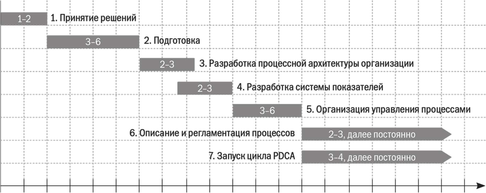
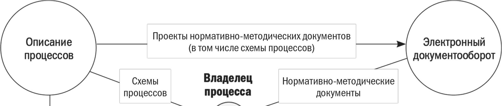
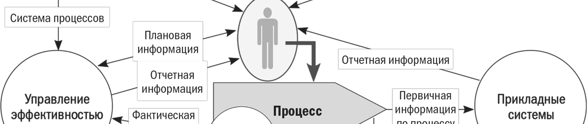
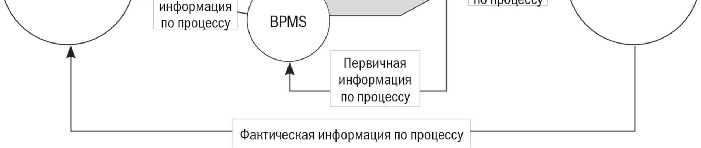
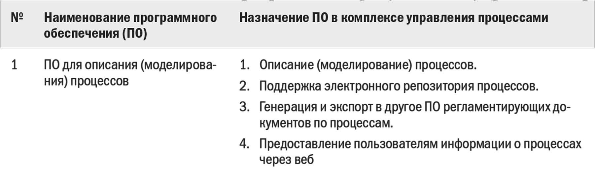
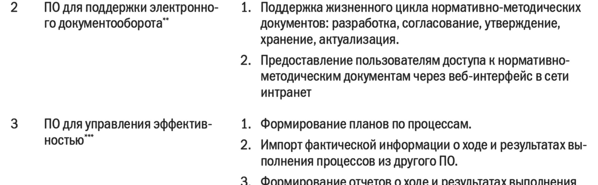
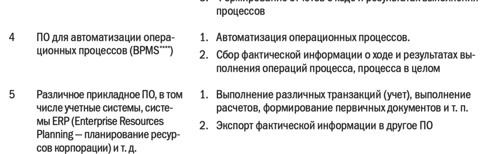

# МБП ЛЕКЦИЯ 3 - ПРОЕКТ ВНЕДРЕНИЯ ПРОЦЕССНОГО ПОДХОДА В ОРГАНИЗАЦИИ

Оригинал: `../оригиналы/МБП ЛЕКЦИЯ 3 - ПРОЕКТ ВНЕДРЕНИЯ ПРОЦЕССНОГО ПОДХОДА В ОРГАНИЗАЦИИ.pdf`

## Страница 1

1 
Моделирование бизнес-процессов. Лекция 3 – Проект внедрения процессного подхода в организации 
ЛЕКЦИЯ 3: ПРОЕКТ ВНЕДРЕНИЯ ПРОЦЕССНОГО ПОДХОДА В 
ОРГАНИЗАЦИИ 
 
План лекции: 
3.1 Этапы проекта внедрения процессного подхода 
3.2 Принятие решений. 
3.3 Подготовка. 
3.4 Разработка процессной архитектуры организации. 
3.5 Разработка системы показателей для управления процессами. 
3.6 Организация управления процессами. 
3.7 Описание и регламентация процессов. 
3.8 Запуск цикла PDCA. 
3.9 Автоматизация процессного управления 
 
3.1 Этапы проекта внедрения процессного подхода 
Рассмотрим 
этапы 
внедрения 
процессного 
подхода 
по 
концепции 
«Совершенствование 
процессов». 
Подчеркну, 
что 
перечень 
этапов 
носит 
рекомендательный характер. Для каждой конкретной организации и сам перечень, и 
содержание этапов обязательно корректируются в зависимости от поставленных целей и 
специфики внешних и внутренних условий. Руководство компании может принять 
решение выполнять какие-то этапы одновременно, а какие-то – объединить. Главное, 
чтобы состав этапов проекта был логичным и понятным собственникам и руководителям 
организации. 
Проект внедрения процессного подхода состоит из следующих этапов: 
1. Принятие решений. 
2. Подготовка. 
3. Разработка процессной архитектуры организации. 
4. Разработка системы показателей для управления процессами. 
5. Организация управления процессами. 
6. Описание и регламентация процессов. 
7. Запуск цикла PDCA. 
 
График Ганта проекта внедрения процессного подхода показан на рисунке 3.1.

## Страница 2

2 
Моделирование бизнес-процессов. Лекция 3 – Проект внедрения процессного подхода в организации 
 
Рисунок 3.1 – График Ганта проекта внедрения процессного подхода 
 
3.2 Принятие решений 
На этапе принятия решений основная задача руководства – изучение и понимание 
концепции внедрения процессного подхода. Им необходимо формализовать свое ви́дение 
того, что означает внедрение процессного подхода применительно к их компании. Это 
видение должно быть по возможности согласовано с ее собственниками. В итоге полезно 
разработать документ, который содержал бы: 
• основные определения процессного похода; 
• цели внедрения процессного подхода; 
• принципы процессного управления; 
• концепцию внедрения процессного подхода в организации; 
• стратегический план внедрения процессного подхода в организации. 
Называть этот документ можно по разному, например «Концепция внедрения 
процессного подхода в организации “Х”». 
 
3.3 Подготовка 
На основе утвержденной «Концепции внедрения процессного подхода» на этапе 
подготовки выполняются следующие работы: 
• создание 
подразделения 
организационного развития и 
обеспечение его 
необходимой инфраструктурой и оборудованием; 
• подбор людей, в первую очередь руководителя проекта; 
• разработка основных методических документов по проекту; 
• разработка плана выполнения проекта (или устава проекта); 
• обучение персонала на различных уровнях; 
• издание приказа о начале проекта. 
Подразделение организационного развития может состоять из нескольких человек, 
например начальника отдела и одного-двух аналитиков по процессам (специалистов). 
Начальник такого подразделения, как правило, и является руководителем проекта 
внедрения процессного похода. В крупной компании курировать проект может кто-то из 
заместителей генерального директора, например директор по развитию. Отдел

## Страница 3

3 
Моделирование бизнес-процессов. Лекция 3 – Проект внедрения процессного подхода в организации 
организационного развития включает начальника и четверых-пятерых сотрудников. В 
средней и небольшой организации он может состоять из двух-трех человек. Для работы 
подразделения 
организационного 
развития 
подготавливают 
соответствующую 
инфраструктуру (помещение и оборудование), закупают необходимое программное 
обеспечение. 
Важный аспект подготовки к внедрению – привлечение квалифицированного, 
опытного руководителя проекта (начальника отдела организационного развития) и 
специалистов по процессам. Эти люди будут разрабатывать основные методические 
документы, учить сотрудников, координировать работу по проекту, описывать и 
регламентировать ключевые процессы, определять показатели (метрики) для процессов, 
разрабатывать важнейшие нормативно-методические документы, вести документооборот 
и т.д. Важно понимать, что экономия при подборе сотрудников в отдел организационного 
развития недопустима. К сожалению, зачастую руководители не готовы платить высокие 
зарплаты людям, которые занимаются развитием, и подыскивают на рынке труда молодые, 
неопытные кадры. Прием сотрудников в отдел лучше осуществлять поэтапно: начать 
с руководителя, а потом, по мере подготовки инфраструктуры и четкого обозначения 
ближайших задач по проекту, набирать специалистов. 
Подразделение организационного развития (или методическая группа) разрабатывает 
комплект методических документов по проекту, к числу которых относятся: 
• положение об отделе организационного развития (методической группе); 
• положение о рабочей группе; 
• методика управления процессами организации; 
• стандарт описания процессов (соглашение о моделировании); 
• формы планов и отчетов для оперативного управления процессами (то есть формы 
для использования показателей/метрик по процессам); 
• формы нормативно-методических документов, которые будут использоваться для 
регламентации процессов; 
• процедура управления внутренними нормативно-методическими документами; 
• план (устав) проекта; 
• программы обучения руководителей и специалистов на различных уровнях. 
Работа по методическому обеспечению проекта может занять от двух до четырех 
месяцев в зависимости от количества документов, глубины и качества их проработки 
и скорости согласования руководителями компании. Подчеркну, что важна не 
длительность этого этапа как таковая, а комплекс тщательно продуманных, 
взаимоувязанных методических документов: 
• обеспечивающих возможность внедрения процессного подхода; 
• снижающих риск неудачного выполнения проекта. 
Обучение персонала – важнейшая задача подготовительного этапа. Полезно 
проводить обучение на трех уровнях: 
• собственники и руководители организации; 
• подразделение организационного развития или методическая группа; 
• руководители среднего звена и специалисты.

## Страница 4

4 
Моделирование бизнес-процессов. Лекция 3 – Проект внедрения процессного подхода в организации 
Подготовительный этап завершается утверждением всех разработанных документов, 
в первую очередь плана проекта внедрения процессного подхода. В рамках 
подготовительного этапа обычно проводится первичное обучение руководителей и 
специалистов. 
 
3.4 Разработка процессной архитектуры организации 
Процессная архитектура, или, иными словами, система процессов организации, – 
основа системного внедрения процессного подхода. По ходу формализации система 
процессов может быть представлена в виде таблицы, которая включает следующие 
столбцы: 
1. Порядковый номер в таблице. 
2. Наименование процесса. 
3. Руководитель, ответственный за выполнение процесса (владелец процесса). 
4. Участники процесса (перечень подразделений или должностей). 
5. Входы процесса. 
6. Выходы процесса. 
Обычно процессы в такой таблице показывают на трех-четырех уровнях. На первом 
и втором описание входов и выходов делается укрупненным (либо вообще не делается). 
Подробное описание входов/выходов и событий целесообразно приводить начиная с 
процессов третьего уровня. 
Построить систему процессов означает взглянуть на деятельность организации 
по-новому – увидеть процессы, которые в ней выполняются.  
Разработка процессной архитектуры (системы процессов) позволяет: 
• определить границы процессов; устранить зоны безответственности и зоны 
пересечения ответственности (дублирования); 
• увидеть реальную картину документированности деятельности организации 
(какой процесс какими документами регламентирован); спланировать работу по 
регламентации процессов (определить недостающие документы или документы, 
которые требуют пересмотра, расставить приоритеты, спланировать разработку и 
т.п.); 
• получить основу для разработки показателей (метрик) для управления процессами; 
• сформировать 
базу 
для 
создания 
электронного 
репозитория 
процессов 
организации 
(с 
последующим 
описанием 
процессов 
при 
помощи 
специализированного средства моделирования); 
• получить основу для тиражирования процессов в регионах; 
• получить основу для бенчмаркинга процессов с другими организациями отрасли; 
• прочее. 
Этап завершается согласованием системы процессов всеми руководителями верхнего 
уровня. 
 
3.5 Разработка системы показателей для управления процессами 
Этап разработки системы показателей исключительно важен для внедрения

## Страница 5

5 
Моделирование бизнес-процессов. Лекция 3 – Проект внедрения процессного подхода в организации 
процессного управления. Значимость разработки и практического использования 
показателей для управления процессами многократно превышает важность описания и 
регламентации процессов. Более того, если руководители не управляют своими 
процессами на основе системы показателей, то инструмент регламентации процессов в 
большинстве случаев будет использоваться формально, существующие регламенты – 
постоянно нарушаться и т.п. 
При разработке системы показателей для управления процессами учитываются 
следующие аспекты: 
• наличие у организации формализованной стратегии, в том числе стратегических 
целей и показателей их достижения; 
• необходимость увязки стратегических целей с показателями для управления 
процессами; 
• ориентация системы показателей на повышение операционной эффективности 
процессов и удовлетворенности внутренних и внешних клиентов; 
• необходимость агрегирования (декомпозиции, каскадирования) показателей при 
переходе от процесса одного уровня к другому. 
Показатели, разработанные на этом этапе, не окончательные. По мере их 
практического использования они могут пересматриваться, дополняться или, наоборот, 
устраняться. 
Этап разработки показателей заканчивается утверждением: 
• системы показателей для управления процессами организации; 
• форм планов и отчетов, которые руководители (владельцы процессов) будут 
использовать для оперативного управления процессами; 
• определением допустимых границ и целевых значений показателей. 
 
3.6 Организация управления процессами.  
Этап организации управления процессами – ключевой с точки зрения внедрения 
процессного подхода по концепции «Совершенствование процессов». 
Организация управления процессами означает, что владельцы процессов: 
• планируют выполнение своих процессов с использованием установленных 
показателей (метрик); 
• оперативно проводят мониторинг хода и результатов выполнения процессов; 
• выявляют отклонения от нормального (стабильного) хода процесса (другими 
словами, идентифицируют вариации процесса); 
• анализируют причины отклонений (вариаций), разрабатывают и осуществляют 
мероприятия (проекты) по устранению причин отклонений (вариаций); 
• разрабатывают и реализуют проекты по совершенствованию процессов. 
На этапе организации управления процессами необходимо научить руководителей 
управлять процессами при помощи показателей, передать им методы мониторинга 
процесса, поиска и анализа причин отклонений, планирования и выполнения проектов 
развития. 
По ходу этапа должны быть выполнены несколько циклов по управлению процессами

## Страница 6

6 
Моделирование бизнес-процессов. Лекция 3 – Проект внедрения процессного подхода в организации 
(два-три месяца), в течение которых руководители осваивают соответствующие 
инструменты управления. По итогам этих циклов следует провести внутренний аудит, 
который должен показать, в какой степени руководители освоили эти методы, какие 
возникли проблемы, что нужно скорректировать в работе и т.д. 
 
3.7 Описание и регламентация процессов 
Описание и регламентация процессов – один из мощных инструментов процессного 
подхода. Однако рекомендуется описывать и регламентировать процессы постепенно, по 
мере возможности их оптимизации и практического внедрения регламентирующих 
документов. В большинстве компаний, которые сразу пытались описать большое 
количество процессов, полученные документы практически не удалось использовать. К 
сожалению, иногда целые отделы работают «в корзину», создавая описания и 
нормативно-методические документы, которые руководители просто не способны 
переварить (внимательно прочитать, оптимизировать, согласовать, внедрить на практике) 
за время, ограниченное рамками проекта. 
По сути, описание и регламентация процессов – это не разовый этап, не эпизод в 
жизни компании, а постоянно действующая система, позволяющая сотрудникам 
работать по стандартам и поддерживающая эти стандарты в актуальном состоянии. 
Поэтому этап описания и регламентации может считаться выполненным, когда: 
• внедрена процедура управления нормативно-методической документации; НМД 
организации поддерживается в актуальном состоянии; 
• создан, частично наполнен информацией (описание процессов) и используется 
электронный репозиторий процессов организации; 
• владельцы процессов освоили инструмент описания и регламентации процессов; 
• владельцы процессов осуществляют периодический контроль исполнения 
требований НМД по своим процессам; 
• владельцы 
процессов 
используют 
НМД 
в 
качестве 
инструмента 
для 
совершенствования процессов и обучения персонала; 
• начала формироваться культура работы по стандартам, изменилось отношение 
сотрудников к документации по процессам. 
 
3.8 Запуск цикла PDCA.  
На этапе запуска цикла PDCA руководство компании должно добиться, чтобы: 
• собственники и руководители организации были вовлечены в этот цикл: 
– постоянно анализировали результативность и эффективность выполняемых 
проектов по совершенствованию процессов; 
– выделяли необходимые ресурсы для выполнения проектов по совершенствованию 
процессов; 
– анализировали достижение целей по совершенствованию процессов, периодически 
корректировали эти цели (с учетом корректировки стратегии, требований клиентов и т. д.); 
– поддерживали и развивали систему организационного развития (анализ 
эффективности, планирование развития, выделение ресурсов);

## Страница 7

7 
Моделирование бизнес-процессов. Лекция 3 – Проект внедрения процессного подхода в организации 
– организовывали постоянное обучение персонала; 
– создавали механизмы, необходимые для вовлечения персонала в деятельность по 
улучшению процессов; 
• владельцы процессов: 
– анализировали свои процессы; 
– разрабатывали мероприятия (проекты) по улучшению процессов и внедряли их; 
– развивали свой персонал, вовлекали его в деятельность по совершенствованию 
процессов. 
Запуск цикла PDCA в организации можно считать успешным, когда выполнены как 
минимум все эти требования. 
 
3.9 Автоматизация процессного управления 
Эффективная эксплуатация системы процессного управления в крупной или средней 
компании возможна только при использовании современных средств автоматизации. На 
рисунок 3.2 показан комплекс программных продуктов, который можно использовать 
в организации для поддержки управления процессами. 
 
 
Рисунок 3.2 – Автоматизация процессного управления: комплекс программных продуктов 
 
Набор программных продуктов, необходимых для комплексного управления 
процессами, показан в таблице 3.1.

## Страница 8

8 
Моделирование бизнес-процессов. Лекция 3 – Проект внедрения процессного подхода в организации 
Таблица 3.1 – Комплекс программных продуктов для управления процессами 
 
** В данном случае рассматривается только часть возможностей такой системы. 
*** Сейчас ПО такого типа принято называть Business Performance Management. 
**** Здесь – Business Process Management System. 
 
Сейчас на рынке представлено множество инструментальных средств описания 
(моделирования) процессов, начиная от простых и относительно дешевых средств и 
заканчивая дорогостоящими, комплексными и многофункциональными системами. В 
небольшой организации можно создавать схемы процессов в MS Visio и хранить их в виде 
отдельных файлов на диске компьютера. Связь между отдельными схемами в этом случае 
обеспечивается вручную при помощи установленных правил и требований по работе со 
схемами процессов. 
В средних и крупных компаниях количество схем процессов может оказаться весьма 
значительным. Ручная обработка и поддержание в актуальном состоянии множество схем, 
находящихся в разных файлах, трудоемка и неэффективна. Управление комплексом 
взаимосвязанных схем процессов (описаний, моделей) – самостоятельная сложная задача, 
которую можно решить только при помощи специализированного программного 
обеспечения для описания (моделирования) процессов.

## Страница 9

9 
Моделирование бизнес-процессов. Лекция 3 – Проект внедрения процессного подхода в организации 
Схемы процессов (созданные в специализированном программном обеспечении для 
описания процессов) включаются в нормативно-методические документы, которые 
регламентируют 
процессы. 
Практическое 
использование 
большого 
количества 
регламентирующих документов – сложная задача. Поэтому в крупных и средних 
компаниях удобнее всего решать ее при помощи специализированного программного 
обеспечения, например системы электронного документооборота (СЭД). В рамках данной 
системы 
поддерживается 
жизненный 
цикл 
каждого 
документа: 
согласование, 
утверждение, уведомление пользователей об изменениях, хранение, актуализация, 
использование и т.д. Кроме того, такая система может поддерживать рабочий 
документооборот, то есть движение различных документов, возникающих при 
выполнении деятельности по процессу (письма, распоряжения, счета, справки, прочее). 
Регламенты, поддерживаемые системой электронного документооборота, должны 
постоянно использоваться руководителями для контроля исполнения требований к 
процессам, совершенствования процессов, тиражирования стандартов работы, обучения 
новых сотрудников и т.д. 
Для организации управления процессами необходимо обеспечить возможность 
планирования процессов по ряду показателей и последующего их мониторинга с 
использованием оперативной фактической информации. Конечно, формировать планы и 
отчеты по показателям процессов можно вручную в файлах MS Excel. Но гораздо 
эффективнее делать это при помощи специализированного программного обеспечения. 
Программные продукты для формирования планов, сбора и представления фактической 
информации в виде удобных аналитических отчетов получили название систем 
управления эффективностью (Business Performance Management System). Порядок их 
работы можно кратко описать так: при выполнении процессов возникают первичные 
фактические данные, которые фиксируются различными прикладными системами 
(учетные системы, производственные системы, системы ERP и т.д.). Система управления 
эффективностью получает эти данные, хранит их в специализированной базе данных и 
предоставляет для руководителей удобный доступ к ним при помощи информационных 
панелей управления, формирует необходимые отчеты. Таким образом, руководители 
получают плановую и фактическую информацию, необходимую для оперативного 
управления процессами. 
Набор программных продуктов для организации управления процессами может быть 
различным. Его состав зависит от функциональных возможностей систем, интегрируемых 
в общий программный комплекс.
