# МБП ЛЕКЦИЯ 4 - РАЗРАБОТКА СИСТЕМЫ ПРОЦЕССОВ ОРГАНИЗАЦИИ

Оригинал: `../оригиналы/МБП ЛЕКЦИЯ 4 - РАЗРАБОТКА СИСТЕМЫ ПРОЦЕССОВ ОРГАНИЗАЦИИ.pdf`

## Страница 1

1 
Моделирование бизнес-процессов. Лекция 4 – Разработка системы процессов организации 
ЛЕКЦИЯ 4: РАЗРАБОТКА СИСТЕМЫ ПРОЦЕССОВ ОРГАНИЗАЦИИ 
 
План лекции: 
4.1 Определение системы процессов организации 
4.2 Цели разработки системы процессов организации 
4.3 Различные подходы к построению системы процессов организации. 
 
4.1 Определение системы процессов организации 
Приведем определение системы процессов. 
 
Система процессов (архитектура процессов)- – совокупность всех 
взаимосвязанных и взаимодействующих процессов организации. 
 
Описание системы процессов организации означает создание модели, в которой в 
структурированном виде представлена информация обо всех процессах организации. 
Построение системы процессов не означает комплексного описания процедур 
(алгоритмов) выполнения всех процессов на всех уровнях управления, то есть создания так 
называемой комплексной модели процессов. Речь здесь идет только о дереве процессов. 
Для компании среднего размера можно разработать систему процессов за два-три месяца, 
в то время как описание всех процессов на операционном уровне займет несколько лет (в 
зависимости от количества выделенных ресурсов), что нецелесообразно. Описывать 
нужно только те процессы, которые предполагается оптимизировать и регламентировать. 
 Система процессов может быть описана в файле MS Excel или в виде специального 
справочника в инструментальном средстве моделирования процессов. 
Как правило, система процессов организации представляет собой иерархический 
справочник процессов следующего вида: 
 
1. Процессная категория (1-й уровень). 
 1.1. Процессная группа (2-й уровень). 
 1.1.1. Процесс (3-й уровень). 
 1.1.1.1. Операционный процесс (4-й уровень). 
 1.1.1.1.1. Операция (5-й уровень). 
 1.1.1.1.1.1. Транзакция (6-й уровень). 
 
В таблице 4.1 представлены основные определения, которые можно использовать при 
формировании системы процессов организации. 
  
Таблица 4.1 – Определения уровней деятельности в системе процессов организации

## Страница 2

2 
Моделирование бизнес-процессов. Лекция 4 – Разработка системы процессов организации 
 
 
Пример. Система процессов торгово-производственной компании представлена в 
виде графической схемы на рисунке 4.1. Эта компания занимается производством и 
реализацией промышленной продукции. 
 
 
Рисунок 4.1 – Пример представления системы процессов организации  
в виде графической схемы 
Система процессов может строиться сразу в виде иерархического справочника 
процессов. Другой возможный вариант – описание модели деятельности компании на

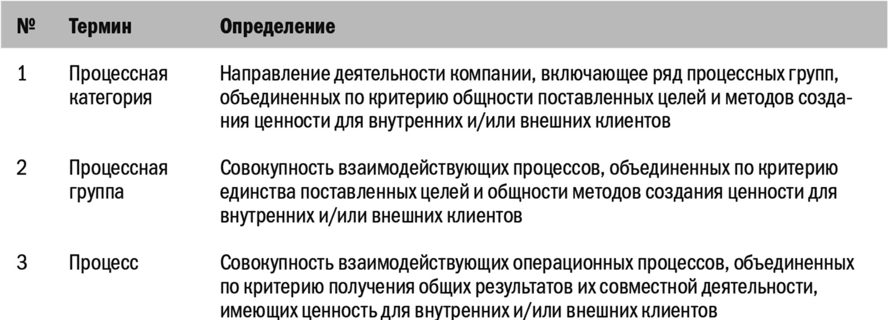

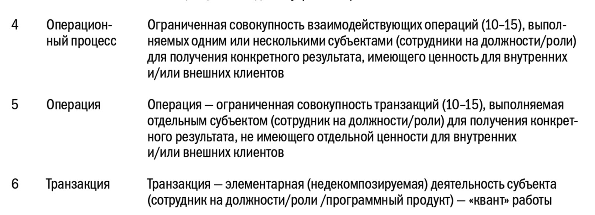

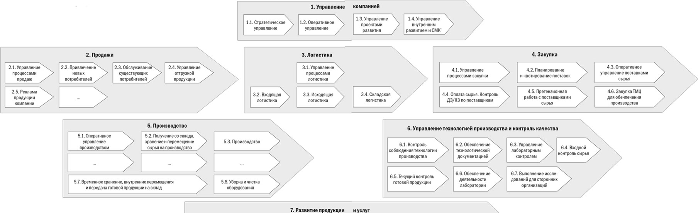

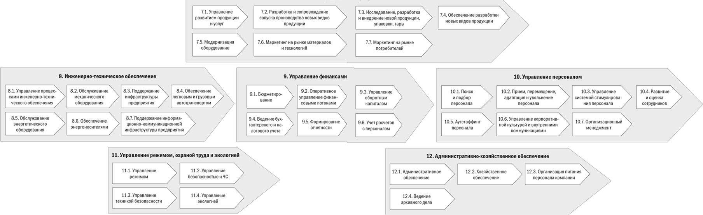

## Страница 3

3 
Моделирование бизнес-процессов. Лекция 4 – Разработка системы процессов организации 
верхнем уровне в некоторой нотации с последующим представлением в виде 
иерархического справочника. Если речь идет о построении системы процессов для 
действующей организации, то полезно разрабатывать систему процессов сразу в виде 
справочника, не формируя графическую модель верхнего уровня. Форма справочника 
более понятна большинству руководителей. Далеко не все топ-менеджеры могут 
воспринимать сложные графические модели структурного типа (например, в нотации 
IDEF0). 
После того как система процессов в виде иерархического справочника построена, при 
необходимости могут быть созданы модели деятельности в виде графических схем. На 
уровнях 1–3 целесообразно использовать структурные типы моделей (например, IDEF0). 
С уровня 4 (для небольших компаний – с уровня 3), как правило, описание выполняют при 
помощи схем в формате Work Flow.  
Как правило, на уровне операционных процессов в системе процессов компании 
определяются и согласуются между собой входы/выходы процессов. Вопрос определения 
и согласования входов/выходов не такой простой, как кажется. Дело в том, что 
определение входов/выходов – весьма неоднозначная и ресурсоемкая задача. Если есть 
уверенность в том, что система процессов построена адекватно (а это зависит от методики 
и опыта бизнес-аналитиков), то входы/выходы могут быть корректно определены уже на 
следующем этапе – описания бизнес-процессов. Конечно, при этом в систему придется 
вносить некоторые изменения. Но система процессов – не застывшая, а живая, 
развивающаяся модель деятельности организации. Поэтому не стоит бояться вносить в нее 
изменения. Важно определить и регламентировать правила их внесения. 
Для описания системы процессов организации можно использовать MS Excel. 
 Форма представления системы процессов в MS Excel показана на рисунке 4.2. 
Каждая процессная категория находится на отдельном листе файла. 
  
 
Рисунок 4.2 – Представление системы процессов в виде таблицы MS Excel 
 
При формировании дерева процессов и описании его в виде таблицы (рисунок 4.2) 
возникает вопрос – как правильно показывать входы/выходы для процессов? Для нижнего 
уровня (четвертого и, возможно, третьего) ответ очень прост: следует описывать 
конкретные документы (бумажные, электронные) и материальные потоки. Но что делать 
при описании входов/выходов для процессов верхнего уровня (первый-второй, иногда

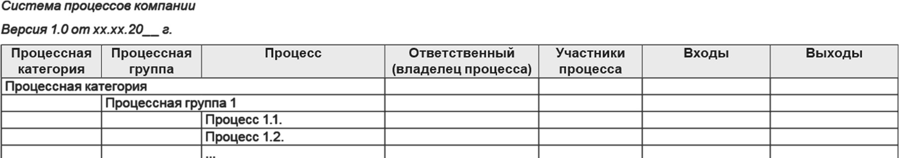

## Страница 4

4 
Моделирование бизнес-процессов. Лекция 4 – Разработка системы процессов организации 
третий)? Существует как минимум три основных варианта: 
1. Агрегировать информационные и материальные потоки и показывать их в 
обобщенном виде, соответствующем уровню процессов. 
2. Не показывать входы/выходы на тех уровнях процессов, где нужно делать 
агрегирование (то есть там, где невозможно или слишком сложно показывать потоки 
реальных документов/материалов). 
3. Дублировать описание входов/выходов в виде списка, повторяя все входы/выходы, 
определенные для процессов нижних уровней. 
Первый вариант предполагает, что бизнес-аналитики, проектирующие систему 
процессов 
организации, 
достаточно 
квалифицированы, 
чтобы 
выполнять 
декомпозицию/агрегирование как процессов, так и потоков ресурсов (информационных и 
материальных). Если в этом есть сомнения, то лучше оставлять ячейки с описанием 
входов/выходов для процессов верхнего уровня пустыми (вариант 2), заполняя их только 
для детальных процессов конкретными наименованиями документов/материалов. Третий 
вариант – наименее удобный, так как ведет к дублированию большого количества 
информации в таблице и усложнению ее восприятия. 
На первых стадиях внедрения процессного управления использование таблицы в MS 
Excel – самый простой и удобный вариант. Для небольших компаний дерево процессов в 
MS Excel вполне может использоваться постоянно, без переноса в какую-либо другую 
систему.  
 
4.2 Цели разработки системы процессов организации 
Практика показывает, что задача создания адекватной системы процессов актуальна 
для организаций различного масштаба: от крупных холдингов до небольших частных 
компаний.  
Построение системы процессов организации означает упорядочение ее деятельности 
в виде процессов. Древовидная структура процессов и согласованные границы позволяют 
четко определить зоны ответственности руководителей на всех уровнях управления, 
исключить зоны безответственности и зоны размытой ответственности (пересечения 
ответственности). Четкое определение зон ответственности руководителей позволяет 
организовать оперативное управление процессами, не дожидаясь их подробного описания 
и регламентации. Сказанное иллюстрирует рисунке 4.3. В ситуации 1 процессы не 
выделены и не управляются. В ситуации 2 процессы выделены, границы процессов четко 
определены, руководители приступили к организации управления процессами на основе 
системы показателей. В ситуации 3 процессы регламентированы, оперативно управляются 
и совершенствуются на основе цикла PDCA.

## Страница 5

5 
Моделирование бизнес-процессов. Лекция 4 – Разработка системы процессов организации 
 
Рисунок 4.3 – Упорядочение деятельности организации в виде процессов 
 
Управление процессами означает, что для каждого из них разработаны и 
используются показатели. Если не создать систему процессов, то не к чему будет 
привязывать эти показатели (не будет идентифицированных объектов управления). Если 
система процессов будет построена некорректно (например, состав и границы выделенных 
процессов окажутся неадекватны реальной деятельности), то организация управления 
такими «процессами» – бессмысленное занятие. Поэтому корректно построенная система 
процессов – это основа для успешного внедрения процессного подхода. 
В целом система процессов организации обеспечивает достижение следующих целей: 
• упорядочение деятельности организации в виде процессов, анализ существующей 
организационной структуры и обоснование возможных и целесообразных направлений ее 
реорганизации; 
• организация управления процессами, в том числе создание основы для разработки 
системы показателей для управления процессами; 
• четкое определение зон ответственности руководителей, исключение зон 
безответственности, зон дублирования ответственности; 
• четкое определение границ процессов по входам/выходам и событиям; 
• повышение эффективности межфункционального взаимодействия подразделений за 
счет определения, описания и оптимизации сквозных процессов; 
• создание основы для последующего системного описания и регламентации 
процессов; 
• создание основы для успешного внедрения различных средств автоматизации 
деятельности; 
• прочее. 
 
4.3 Различные подходы к построению системы процессов организации 
Существует несколько методик построения системы процессов: 
• структурный подход; 
• продуктовый подход; 
• CBM IBM (Component Business Model компании IBM);

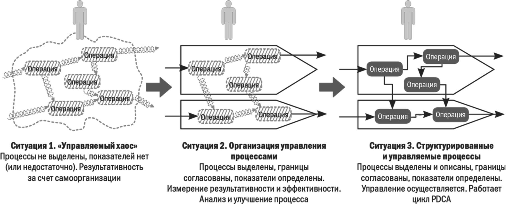

## Страница 6

6 
Моделирование бизнес-процессов. Лекция 4 – Разработка системы процессов организации 
• методика построения системы процессов на основе анализа модели цепочек 
создания ценности (ЦСЦ); 
• смешанные подходы. 
Рассмотрим каждый из указанных подходов подробнее. 
Структурный подход наиболее прост и понятен для руководителей и сотрудников 
компании. Процессы определяются в рамках границ существующих структурных 
подразделений. Они так же имеют иерархическое представление. Плюс подхода – его 
простота, минус – искаженный взгляд на процессную модель в целом. Дело в том, что 
организационная структура развивается исторически, причем с ориентацией на 
субъективный человеческий фактор (структура строится под людей). Поэтому 
определение системы процессов на основе организационной структуры – это риск 
получить дерево функций, определенных «под людей» вместо дерева реальных 
бизнес-процессов, которые должны выполняться. 
Также 
есть 
риск 
потерять 
важнейшие 
сквозные 
(межфункциональные) 
бизнес-процессы. Их фрагменты найдут отражение в справочнике процессов каждого 
подразделения, но в целом ви́дение сквозных процессов в системе будет отсутствовать.  
Однако 40–80 % операционных процессов (в зависимости от специфики конкретного 
подразделения и степени проектной ориентированности организации в целом) не являются 
сквозными. Иными словами, их нецелесообразно определять как сквозные, так как они 
полностью выполняются внутри соответствующих подразделений. Вышеизложенное 
иллюстрирует рисунке 4.4. 
 
 
Рисунок 4.4 – Процессы структурного подразделения 
 
На рисунок 4.4 процессы 1–4 условно можно назвать структурными или

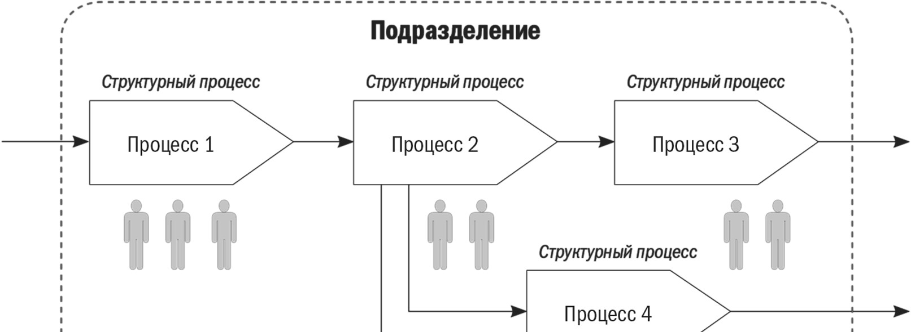

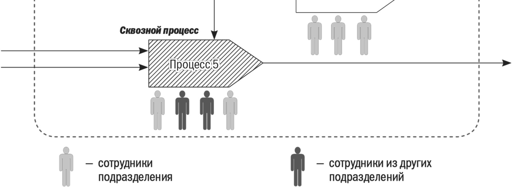

## Страница 7

7 
Моделирование бизнес-процессов. Лекция 4 – Разработка системы процессов организации 
сегментированными. Они выполняются целиком в одном подразделении. Это видно по 
составу участников. Только процесс 5 – сквозной, поскольку в нем участвуют сотрудники 
нескольких структурных подразделений. Такие сквозные (кросс-функциональные) 
процессы интегрируют деятельность подразделения в деятельность организации в 
целом. Если разделить процесс 5 на несколько частей, каждая из которых выполняется в 
отдельном подразделении, и показать на схеме процессов этого подразделения только ту 
часть, которую выполняют его сотрудники, то это и будет сегментированный подход. При 
структурном (сегментированном) подходе сквозные процессы не выделяются, то есть 
информация о них теряется. В этом состоит главный минус сегментированного подхода. 
 Структурные подразделения взаимодействуют, получая ресурсы и передавая 
результаты выполнения внутренних операционных процессов друг другу. Анализ 
взаимодействия сотрудников, находящихся в различных подразделениях, помогает 
выявлять сквозные процессы. Несущественно, в какую именно часть системы будет 
включен сквозной операционный процесс. Важно корректно определить его границы и 
состав участников. 
Принципам выделяются процессы внутри структурного подразделения: 
• количество процессов составляет не более 10–12; 
• каждый процесс должен заканчиваться результатом, имеющим ценность для 
деятельности подразделения и/или компании; 
• процессы должны быть сопоставимы по масштабу; 
• технология создания продуктов/услуг. 
 
Продуктовый подход к построению системы процессов организации предполагает, 
что иерархический справочник процессов строится на основе определения перечня 
продуктов/услуг и последующей декомпозиции процессов по каждому продукту/услуге. 
При этом рассматриваются процессы, необходимые для создания соответствующих 
продуктов/услуг. 
Системы процессов, полностью основанные на продуктовом способе построения, на 
практике встречаются редко. Один из наиболее наглядных примеров – процессная модель 
деятельности банка. Приведу ее фрагмент: 
 
 1. Основные процессы. 
 1.1. Обслуживание физических лиц. 
 1.1.1. Расчетно-кассовое обслуживание физических лиц. 
 1.1.1.1. Текущие счета физических лиц. 
 1.1.1.1.1. Открытие текущего счета для физического лица. 
 1.1.1.1.2. Прием взносов на счет. 
 1.1.1.1.3. Проведение выплат со счета. 
 1.1.1.1.4. Взимание комиссии со счета. 
 1.1.1.1.5. Оформление доверенности на распоряжение счетом. 
 1.1.1.1.6. Оформление доверенности на распоряжение счетом. 
 1.1.1.2. Расчетное обслуживание. 
 1.1.1.3. Кассовое обслуживание. 
 1.1.1.4. Валютный контроль и валютные операции. 
 1.1.1.5. Денежные переводы по системам.

## Страница 8

8 
Моделирование бизнес-процессов. Лекция 4 – Разработка системы процессов организации 
 1.1.2. Вклады. 
 1.1.3. Кредитование физических лиц. 
 1.1.4. Банковские карты для физических лиц. 
 1.1.5. Индивидуальные банковские ячейки (сейфы) для физических лиц. 
 1.1.6. … 
 1.2. Обслуживание юридических лиц. 
 1.3. Работа на финансовых и межбанковских рынках. 
 2. Вспомогательные процессы… 
  
Плюс такого подхода – его кажущаяся простота: процессы выделяются на основе 
построения иерархического справочника продуктов и услуг, а на нижнем уровне – на 
основе анализа технологии создания элементарного продукта/услуги. Но если 
внимательно присмотреться к полученной структуре процессов, заметим ряд 
существенных минусов: 
• большое количество уровней иерархии справочника процессов (реальные 
операции процессов появляются только на шестом уровне иерархии!); 
• не выделяются сквозные процессы; 
• в модели не прослеживаются цепочки создания ценности, на которых держится 
весь бизнес (вместо этого представлена мозаика элементарных услуг); 
• возможное дублирование (например, процесс «Взимание комиссии» может быть 
типовым и запускаться с разными параметрами при оказании различных услуг; при 
рассматриваемом подходе он появляется несколько раз в разных частях системы); 
• при внедрении новых продуктов/услуг придется перекраивать всю систему 
процессов. 
Если на каждую услугу (продукт) разрабатывать свой регламент, то база нормативных 
документов компании (банка) усложнится и станет неудобной для работы. 
В примере с банком есть еще один недостаток, не связанный с продуктовым 
подходом. Это применение в классификаторе понятия «основные процессы» (еще 
выделяют «вспомогательные» и «управленческие» процессы). Категории «основной» или 
«вспомогательный» не должны использоваться при построении иерархического 
справочника процессов, так как это порождает процессные псевдоуровни, усложняющие 
структуру. При помощи понятий «основной» или «вспомогательный» можно 
характеризовать процессы, причем на любом уровне иерархии. Кроме них могут вводиться 
и другие характеристики процессов: степень автоматизации, эффективность, важность для 
достижения целей бизнеса и т.д. Но они не могут служить основой для построения системы 
процессов компании. 
 Приведу еще один фрагмент из рассматриваемой модели банка: 
  
1. Управленческие процессы 
 1.1. Управление финансами. 
 1.2. Управление персоналом. 
 1.3. Управление маркетингом 
 1.3.1. … 
 1.3.2. … 
 1.3.3. …

## Страница 9

9 
Моделирование бизнес-процессов. Лекция 4 – Разработка системы процессов организации 
 1.3.4. Управление продуктами. 
 1.3.4.1. Разработка и внедрение продуктов и услуг. 
 1.3.4.1.1. … 
  
Обратите внимание, что процесс «Разработка и внедрение продуктов и услуг» попал 
на четвертый (!) уровень иерархии. Эта категория должна быть в системе процессов для 
современных компаний (независимо от профиля бизнеса). В качестве примера рассмотрим 
систему процессов крупной компании, которая выделяла значительные ресурсы на 
развитие продуктового ряда. 
 
Пример. Процессы создания новых продуктов торгово-производственной компании 
 В крупной торгово-производственной компании в рамках категории «Развитие продукции 
и услуг» выделена процессная группа «Разработка новых и изменение текущих продуктов»: 
 3. Разработка новых и изменение текущих продуктов. 
 3.1. Управление разработкой новых и изменением текущих продуктов. 
 3.2. Поиск и отбор идей по новым продуктам. 
 3.3. Управление портфелем проектов по новым продуктам/изменениям текущих 
продуктов. 
 3.4. Управление проектом по разработке нового продукта/изменению текущего продукта. 
 3.5. Выполнение исследований по новому продукту/изменениям текущего продукта. 
 3.6. Проработка идеи нового продукта/изменения текущего продукта. 
 3.7. Разработка нового продукта/измененного текущего продукта. 
 3.8. Подготовка производства продукта. 
 3.9. Запуск производства продукта. 
 3.10. Вывод продукта на рынок. 
 3.11. Управление нормативно-технологической документацией. 
 
Как видим, процессная группа «разработка новых продуктов…» довольно масштабна 
с точки зрения количества и сложности входящих в нее процессов. Адекватная методика 
построения системы процессов компании не должна допускать ситуаций, когда 
важнейшие процессы оказываются на четвертом уровне процессной иерархии. 
Вывод: продуктовый принцип можно применять только на низком (третий или 
четвертый) уровне детализации процессов. Для построения системы процессов в целом 
данный подход неудобен. 
 
Система процессов компании по методу CBM IBM. Подход CBM (Component 
Business Model) компании IBM довольно интересен (таблица 4.2).  
Для построения системы процессов компании в рамках модели CBM нужно: 
• определить ключевые компетенции компании (в области производства, 
продуктов/услуг, отношений с потребителями и т.д.); 
• для каждой компетенции и для каждого уровня управления определить так 
называемые компоненты; 
• выполнить процессную декомпозицию каждой компоненты на два-четыре уровня 
вниз.

## Страница 10

10 
Моделирование бизнес-процессов. Лекция 4 – Разработка системы процессов организации 
Таблица 4.2 – Построение системы процессов компании на основе метода CBM 
 
 
 
В результате разработки по методу CBM получается иерархический справочник 
процессов, основанный на компетенциях и уровнях управления. 
 В модели CBM компоненты, по сути, это группы процессов. Привязка компонент к 
уровню управления весьма субъективна, как и сами уровни. Уровни управления – узкое 
место CBM из-за отсутствия однозначных критериев отнесения к ним компонент. Можно 
встретить модели, в которых компоненты привязывались к нескольким уровням 
управления. 
Основная идея подхода CBM – структурирование ключевых процессов компании. 
Метод CBM предлагает определять не все процессы, а только ключевые по компонентам, 
необходимым для поддержания и развития основных компетенций бизнеса. 
Как правило, после построения таблицы вида 4.2 определяют текущий уровень 
эффективности выделенных компонент. Затем путем цветового кодирования отображают 
в таблице состояние системы. Часть процессов (компонент) выделяют желтым или 
оранжевым фоном (низкая эффективность), часть – голубым (высокая эффективность) и 
т.п. Цветовое кодирование удобно использовать для формирования презентаций, 
представляемых руководителям компании. По ходу выполнения проекта на схеме 
изменяют цвета для оптимизированных (автоматизированных) процессов. 
При построении модели по методу CBM не возникает уверенности, что она включает 
все процессы, действительно важные для поддержания эффективности и развития бизнеса. 
Лучше построить полную систему процессов, а потом определить приоритеты 
(характеристики процессов) по оптимизации – регламентации – автоматизации, чем иметь 
неполную картину бизнеса. 
 
Построение системы процессов на основе анализа цепочек создания ценности. 
Как само понятие ЦСЦ, так и выбор метода ее описания при помощи графических схем 
неоднозначны. Схемы ЦСЦ используются в качестве эскизных моделей. Они позволяют 
понять, как работает бизнес с процессной точки зрения. 
Главная цель построения и анализа схем ЦСЦ при разработке системы процессов 
состоит в определении процессных категорий и групп. ЦСЦ строятся на основе

## Страница 11

11 
Моделирование бизнес-процессов. Лекция 4 – Разработка системы процессов организации 
процессного 
взгляда, 
поэтому 
полученная 
система 
процессов 
оказывается 
ориентированной на процессы, а не на организационную структуру. Пример схемы ЦСЦ 
показан на рисунке 4.5 (обратим внимание, что на схеме есть только основные, 
системообразующие потоки информации и материальных ресурсов). 
 
 
Рисунок 4.5 – Пример схемы ЦСЦ 
Схема цепочки ценности «Реализация в розницу» 
От отгрузки со склада производителей до клиента 
 
При построении системы процессов с использованием схем ЦСЦ выполняются 
следующие действия:  
• определяются и группируются основные продукты/услуги компании; 
• для каждой группы продуктов/услуг разрабатывается схема ЦСЦ (обычно 
один-два листа формата А4); 
• выполняется анализ схем ЦСЦ, дополнение их процессными группами в части 
управления и т.д.; дополнительно разрабатываются схемы ЦСЦ для процессов 
управления компанией и вспомогательных (обеспечивающих) процессов; 
• выполняется анализ всех разработанных эскизных схем ЦСЦ; определяются 
процессные категории и группы для системы процессов компании; 
• выполняется анализ деятельности структурных подразделений компании; 
определяются и группируются процессы в рамках структурных подразделений; 
определяются сквозные процессы; 
• процессы 
(операционные 
процессы), 
определенные 
в 
подразделениях,

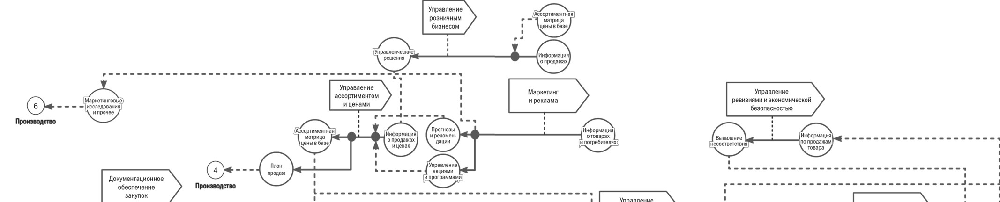

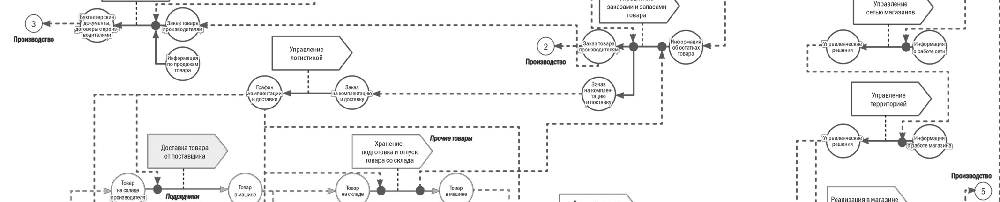

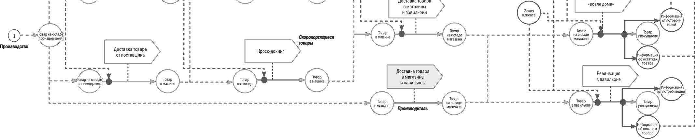

## Страница 12

12 
Моделирование бизнес-процессов. Лекция 4 – Разработка системы процессов организации 
распределяются по процессным группам и категориям с учетом разработанных 
ЦСЦ; 
• выполняется анализ полученного иерархического справочника процессов; 
• выполняется определение границ процессов на операционном уровне (по 
входам/выходам); 
• уточняется распределение процессов по процессным группам и категориям, состав 
и границы процессов; уточняются ответственные и состав участников процессов; 
• выполняется согласование системы процессов компании. 
  
На рисуноке 4.5 показаны примеры схемы ЦСЦ для части бизнеса торговой компании 
– «Реализация товара в розницу». Схема выполнена в MS Visio с применением 
специальной нотации, разработанной и используемой нашей группой консультантов. 
Фактически на схеме представлены группы процессов и основные связи между ними. 
Рассмотренный подход дает возможность построить систему процессов компании, 
которая: 
• является полной (то есть охватывает весь бизнес компании); 
• на верхнем и среднем уровне ориентирована на процессы; 
• на среднем и нижнем уровне узнаваема руководителями и специалистами (то есть 
состав процессов на этих уровнях соответствует реальной деятельности; в системе 
практически нет надуманных процессов); 
• на 
операционном 
уровне 
модель 
содержит 
информацию 
о 
сквозных 
(кросс-функциональных) процессах. 
Недостаток подхода – некоторая субъективность перехода от процессного взгляда на 
уровне ЦСЦ к структурному взгляду на уровне операционных процессов (хотя любая 
модель организации в определенной степени субъективна). При разнесении процессов 
(операционных процессов) по группам важно определить сквозные процессы. 
Корректность определения процессов на операционном уровне во многом зависит от 
опыта специалистов, выполняющих данную работу. Можно ли определить операционный 
(в том числе сквозной) процесс без его детального описания? Безусловно, да. Сложность 
и в какой-то степени искусство формирования системы процессов компании как раз и 
заключается в том, чтобы по возможности корректно определить структуру процессов без 
формирования детальных графических схем. 
  
Важно отметить, что система процессов компании – это рабочий инструмент ее 
руководителей. Ее нельзя утвердить раз и навсегда приказом генерального директора. 
Система должна постоянно совершенствоваться и помогать решать такие задачи, как: 
• оптимизация модели бизнеса; 
• совершенствование организационной структуры; 
• описание и регламентация бизнес-процессов; 
• управление бизнес-процессами; 
• автоматизация бизнес-процессов.
