# МБП ЛЕКЦИЯ 5 - ОПИСАНИЕ БИЗНЕС-ПРОЦЕССОВ ОРГАНИЗАЦИИ

Оригинал: `../оригиналы/МБП ЛЕКЦИЯ 5 - ОПИСАНИЕ БИЗНЕС-ПРОЦЕССОВ ОРГАНИЗАЦИИ.pdf`

## Страница 1

1 
Моделирование бизнес-процессов. Лекция 5 – Описание бизнес-процессов организации 
ЛЕКЦИЯ 5: ОПИСАНИЕ БИЗНЕС-ПРОЦЕССОВ ОРГАНИЗАЦИИ 
 
План лекции: 
5.1 Цели описания бизнес-процессов организации 
5.2 Что нужно для успешного описания процессов в масштабах организации? 
5.3 Объектная модель организации 
5.4 Структурные модели процессов организации 
5.5 Модели процессов на операционном уровне 
 
5.1 Цели описания бизнес-процессов организации 
В рамках данного курса термины «описание» и «моделирование» процессов 
используется в качестве синонимов, а также часто будет употребляться слово «нотация». 
Как правило, нотация – это система условных обозначений, принятая в какой-либо 
области знаний или деятельности, в частности при моделировании процессов. Сами по 
себе условные обозначения не дают возможности корректно построить схему 
бизнес-процесса. Поэтому нотацию рассматривается шире – как методику создания схем 
бизнес-процессов с использованием принятой системы условных обозначений. 
Понятие «модель процесса» имеет более широкий смысл, чем «схема процесса». 
Схема процесса – это графическое изображение процесса в определенном формате, а 
модель процесса – это его комплексное описание (в том числе и схема). Под термином 
«среда моделирования процессов» понимается специализированное программное 
обеспечение для описания процессов. 
В современной организации практически невозможно обойтись без описания 
процессов. По-разному, с неодинаковой степенью детализации, но это делают все. В одних 
компаниях деятельность по описанию выполняется бессистемно. Схемы создаются без 
использования утвержденных внутренних стандартов. Файлы со схемами хранятся у 
нескольких пользователей на разных компьютерах. В других компаниях установлены 
современные средства моделирования процессов, утверждены внутренние стандарты 
описания (моделирования). Информация о процессах хранится в промышленных базах 
данных. У всех этих компаний есть одно общее – их руководители и сотрудники ощутили 
необходимость и ценность описания и регламентации процессов. 
Цели описания процессов зависят от размера организации и сути поставленных задач. 
Прежде чем сформулировать цели описания процессов, рассмотрим несколько 
практических ситуаций, представленных в таблице 5.1 
Как правило, с увеличением численности сотрудников в организации используются 
более четкие, формальные методики описания процессов и соответствующие инструменты 
– средства моделирования. Бывают и исключения, когда в компании из 100 человек 
методики описания процессов четко сформулированы и используются, а в крупной, 
солидной организации они находятся в зачаточном состоянии и бессистемно применяются 
отдельными специалистами (например, в департаменте управления рисками).

## Страница 2

2 
Моделирование бизнес-процессов. Лекция 5 – Описание бизнес-процессов организации 
Таблица 5.1 – Возможные ситуации с описанием процессов 
 
 
Сформулируем цели описания процессов для организаций разного размера. 
Небольшая организация (10–100 человек) 
 Возможные цели описания процессов (моделирования) в небольшой организации: 
 1. Четкое 
определение 
зон 
ответственности 
руководителей 
по 
ключевым 
направлениям деятельности. 
 2. Описание деятельности в формализованном виде для регламентации ключевых 
процессов организации: сбыт, закупки, бюджетирование, управление проектами и т.д. 
Использование 
описаний 
процессов 
при 
создании 
документов: 
инструкции 
по выполнению процессов, положения о взаимодействии. 
 3. Анализ и улучшение деятельности. 
 4. Подготовка к автоматизации деятельности, в том числе процессов. 
 5. Первые шаги по созданию культуры процессного управления у сотрудников 
(обучение процессному ви́дению). 
  
Средняя организация (100–1000 человек) 
 Возможные цели описания процессов (моделирования) в организации среднего 
размера: 
 1. Четкое определение зон ответственности руководителей на всех уровнях 
управления. 
 2. Оптимизация взаимодействия структурных подразделений за счет стыковки 
процессов по входам/выходам.

## Страница 3

3 
Моделирование бизнес-процессов. Лекция 5 – Описание бизнес-процессов организации 
 3. Системное описание процессов в формализованном виде. Централизованное 
хранение и актуализация моделей процессов. Постоянное использование моделей 
процессов для регламентации: регламенты выполнения процессов, инструкции 
по выполнению процессов, положения о взаимодействии и т.д. 
 4. Тиражирование стандартов деятельности (например, в филиалы). 
 5. Обучение сотрудников. 
 6. Автоматизация процессов. 
 7. Анализ и улучшение деятельности. 
 8. Развитие культуры процессного управления у сотрудников. 
  
Крупная организация (> 1000 человек) 
 Возможные цели описания процессов (моделирования) в крупной организации: 
 1. Четкое определение зон ответственности руководителей на всех уровнях. 
 2. Оптимизация взаимодействия структурных подразделений за счет стыковки 
процессов по входам/выходам. 
 3. Создание системы процессов организации. Системное описание процессов 
в формализованном виде на нескольких уровнях (создание так называемой объектной 
модели организации). Централизованное хранение (в промышленной базе данных) 
и актуализация моделей процессов. 
 4. Автоматизация создания регламентирующих документов (при помощи выгрузки 
из 
среды 
моделирования 
на 
основе 
стандартных 
шаблонов). 
Формирование 
нормативно-методических документов: регламенты выполнения процессов, инструкции 
по выполнению процессов, положения о подразделениях, должностные инструкции. 
Формирование других отчетов: штатное расписание, карточки должности, карта грейдов, 
цели и показатели для управления процессами и т. д. 
 5. Описание и регламентация процессов управления на всех уровнях. 
 6. Анализ возможных изменений (реализация сценариев «что если?») в модели 
организации: 1) создание нового подразделения с передачей ему операций процессов 
других подразделений; 2) ликвидация подразделения с передачей его процессов другим 
подразделениям. 
 7. Тиражирование стандартов деятельности (например, в филиалы). 
 8. Выполнение внутреннего аудита. 
 9. Подбор 
персонала 
(на 
основе 
подробной 
информации 
о выполняемых 
сотрудником процессах). 
 10. Обучение сотрудников. 
 11. Автоматизация процессов. 
 12. Анализ и улучшение деятельности. 
 13. Управление знаниями о деятельности организации. 
 14. Вовлечение руководителей и сотрудников подразделений в работу по описанию 
и стандартизации деятельности организации. 
 15. Развитие культуры процессного управления у сотрудников.

## Страница 4

4 
Моделирование бизнес-процессов. Лекция 5 – Описание бизнес-процессов организации 
5.2 Что нужно для успешного описания процессов в масштабах организации? 
Любой сотрудник вполне способен описать несложный процесс. Однако полученная 
схема будет лишь в некоторой степени отражать реальность. Можно долго спорить о 
преимуществах той или иной нотации (методики) для описания данного процесса. Но с 
точки зрения моделирования процессов в масштабах компании эти вопросы и споры будут 
несущественны. Выбор нотации, как и другие частные вопросы, не определяет успех 
работы по описанию и регламентации процессов организации в целом. Эту задачу можно 
решить только в случае системного, комплексного подхода, учитывающего множество 
различных факторов. 
 Рассмотрим основные аспекты, которые должны знать и учитывать руководители 
при построении в организации системы работы по описанию (моделированию) 
бизнес-процессов. 
 
5.2.1 Формулировка целей описания процессов. Прежде всего необходимо четко 
определить цели описания процессов. Нечеткость или неадекватность целей приведет к 
некорректному выбору средств их достижения. В результате деньги и время организации 
будут потрачены впустую. 
 
Пример. В торговой компании среднего размера директор поставил задачу сотруднику за 
три месяца подробно описать шесть ее основных процессов. При этом конкретные требования к 
результату (формат описания, степень детализации процессов и т. д.) установлены не были. В 
итоге удалось описать лишь незначительную часть процессов, а сотрудник перешел работать в 
другую организацию. Очевидно, что цели описания процессов были поставлены руководителем 
некорректно. 
  
Цели описания процессов должны быть четко сформулированы в проектном 
документе. Возможными целями описания могут быть: 
• анализ и последующая оптимизация процессов; 
• разработка регламентирующих документов; 
• подготовка к автоматизации процессов; 
• прочее. 
В 2011 году компания BPTrends провела исследования в области моделирования 
бизнес-процессов. Респондентами стали представители почти 16 000 зарегистрированных 
участников сообщества BPTrends и посетители соответствующего сайта (Северная 
Америка – 36 %, Европа – 32 % и т.д.). Поскольку деятельность BPTrends охватывает весь 
диапазон вопросов, составляющих часть понятия «бизнес-процесс», к исследованию были 
привлечены управленцы и практики, заинтересованные в комплексном подходе к 
процессному управлению. 
В исследовании BPTrends приводится интересная диаграмма, представленная на 
рисунке 5.1. По сути, на ней показаны цели моделирования (описания) бизнес-процессов.

## Страница 5

5 
Моделирование бизнес-процессов. Лекция 5 – Описание бизнес-процессов организации 
 
Рисунок 5.1 – Как вы используете моделирование бизнес-процессов? 
 
На 
первом 
месте 
(81 %) 
стоит 
пункт 
«Вместе 
с 
реинжинирингом 
и 
совершенствованием процессов». Это означает, что около 81 % компаний используют 
моделирование как средство для описания, анализа и оптимизации бизнес-процессов. 
На втором месте – пункт «Для передачи информации о процессе». Иными словами, 
это использование описания процессов для последующей регламентации, размещения 
информации о процессах на портале организации и т. п. 
 
5.2.2 Нотация моделирования процессов. Руководителям нужно определиться с 
требованиями к описанию процессов, в том числе выбрать нотации для создания моделей. 
Следует выявить внутренних потребителей и понять их запросы. Например, 
руководителям подразделений нужно будет использовать описания процессов для 
формирования регламентирующих документов. Департамент по работе с персоналом 
заинтересован в выгрузке из системы моделирования должностных инструкций. Важно 
понимать, что описание процесса в среде моделирования содержит гораздо больше 
информации, чем показано на его графической схеме (независимо от нотации). Но именно 
эта информация необходима при регламентации, формировании отчетов и т.д. 
При выборе нотации полезно обратить внимание на следующее. Если описание 
процессов делается для создания регламентирующих документов, то схемы процессов 
должны быть просты и интуитивно понятны сотрудникам организации, информативны 
при минимальном наборе используемых графических символов. Нет смысла усложнять 
графическое представление – полезную информацию вполне можно вывести в 
нормативно-методические документы в виде таблиц и текста. Выбранная нотация должна 
быть понятна большинству сотрудников без специального обучения и длительного 
освоения. Конечно, можно заставить людей описывать процессы в любых нотациях 
(например, в UML) при помощи совершенно разных средств моделирования, но затраты 
на внедрение таких нотаций/систем обычно значительны. Чрезмерно сложная нотация и

## Страница 6

6 
Моделирование бизнес-процессов. Лекция 5 – Описание бизнес-процессов организации 
средство моделирования сделают методы процессного управления доступными для узкого 
круга профессионалов из отдела организационного развития или IT-отдела, а 
преимущества процессного подхода не будут реализованы в полной мере. 
Если предполагается описывать процессы исключительно в целях последующей 
автоматизации, то лучше всего использовать нотацию BPMN (Business Process Modeling 
Notation). 
Сформулируем простые критерии для выбора нотации моделирования процессов на 
операционном уровне: 
• в нотации представлен минимально необходимый набор графических элементов 
для описания процессов типа Work Flow (поток работ); 
• быстрота и низкая трудоемкость создания графических схем для целей 
регламентации; 
• схемы процессов просты и понятны всем сотрудникам даже без специального 
обучения; 
• простота в обучении (нет необходимости привлекать дорогостоящих специалистов 
со стороны – обучение можно проводить силами сотрудников отдела 
организационного развития); 
• схемы процессов являются кросс-функциональными, что удобно для описания 
сквозных процессов организации. 
 
5.2.3 Репозиторий и среда моделирования процессов. Представьте, что вам 
поручили разработать регламент выполнения какого-то процесса компании. Ситуация 
складывается удачно – у вас стоит MS Visio. Вы создаете новый файл, начинаете рисовать 
схему процесса, затем сохраняете ее, включаете в регламент, согласуете его с 
руководителями и т.п. Через два месяца нужно сделать еще один документ по той же 
процедуре. Кроме вас еще несколько руководителей и специалистов компании время от 
времени мастерят регламенты процессов. В результате в организации появляется 
множество схем, описанных в различных форматах и инструментах. Они хаотично 
хранятся в файлах на компьютерах разных пользователей. Как можно оценить такое 
положение дел? Неужели так работать удобно? Скорее всего, нет. Сложившуюся ситуацию 
можно охарактеризовать так: 
• процессы моделируют разные сотрудники без всякой координации; 
• единого стандарта моделирования процессов нет; 
• единого места для хранения схем процессов нет; 
• внесение изменений в регламентирующие документы требует ручной работы; 
• доступ сотрудников к информации по процессам затруднен; 
• информация, формализованная в схемах и описаниях процессов, быстро 
устаревает. 
С ростом количества схем процессов ситуация становится угрожающей. Руководство 
компании понимает полезность описания, анализа и регламентации процессов, но не 
готово развивать и поддерживать такую работу, осознавая запутанность существующей 
практики моделирования и регламентации процессов. 
 В таких условиях нужен электронный репозиторий бизнес-процессов, ведь нельзя с

## Страница 7

7 
Моделирование бизнес-процессов. Лекция 5 – Описание бизнес-процессов организации 
самой ценной для компании информацией обходиться как с мусором. 
Если в вашей компании полный порядок, означает ли это, что: 
• создан и используется единый стандарт для описания бизнес-процессов; 
• все схемы процессов хранятся в специализированной базе данных; 
• выполняется описание процессов в специализированной системе с последующей 
автоматической генерацией (выгрузкой) регламентирующих документов в MS 
Word или MS Excel; 
• в базе данных в привязке к процессам можно хранить любую нужную информацию 
(формы документов, показатели, фотографии, документы с техническими 
характеристиками в формате PDF и т.д.); 
• обеспечен легкий и быстрый доступ сотрудников к информации по процессам 
(например, через внутренний портал)? 
Ответы «да» говорят о том, что в компании создан электронный репозиторий 
бизнес-процессов. Он может быть сформирован с использованием среды моделирования 
бизнес-процессов. 
  
Репозиторий – это специализированный программный продукт, 
позволяющий создавать, хранить, актуализировать и использовать 
любую информацию о бизнес-процессах компании. 
  
Безусловно, репозиторий бизнес-процессов полезен – это база знаний о деятельности 
компании. Если она будет полной и актуальной, то обеспечит возможность: 
• быстро актуализировать модели бизнес-процессов; 
• с минимальными трудозатратами формировать регламентирующие документы: 
 – регламенты выполнения бизнес-процессов; 
 – регламенты управления бизнес-процессами; 
 – технологические инструкции; 
 – положения о подразделениях; 
 – должностные инструкции сотрудников; 
 – прочее; 
• быстрый и легкий доступ к информации по процессам через интерфейс; 
• возможность использовать накопленные знания для автоматизации; 
• возможность использовать информацию о процессах для обучения новых 
сотрудников; 
• прочее. 
Если у компании несколько филиалов, то в репозитории можно накапливать 
информацию и обмениваться опытом эффективного выполнения процессов в разных 
регионах и городах. 
 Создание электронного репозитория бизнес-процессов – это инвестиция в будущее 
компании. Внедряя репозиторий, вы: 
• выполняете описание, анализ и улучшаете бизнес-процессы организации; 
• приучаете руководителей и специалистов мыслить категориями процессов 
(другими словами, создаете в компании культуру процессного управления);

## Страница 8

8 
Моделирование бизнес-процессов. Лекция 5 – Описание бизнес-процессов организации 
• делаете систему управления прозрачной; 
• получаете возможность со временем избавиться от «незаменимых персонажей» 
(«разгерметизировать» деятельность отделов и сотрудников). 
Репозиторий предоставляет широкий спектр возможностей. Но их использование 
требует упорной работы по внедрению процессных технологий. Успех зависит 
от последовательного и твердого желания собственников и топ-менеджмента компании 
использовать эти технологии. 
 
Пример. Вы описываете процесс обслуживания оборудования. Для ряда операций 
нужно вывести в регламент текстовое описание, фотографии агрегатов, список 
используемых расходных материалов и т.д. Это легко сделать, используя возможности 
среды моделирования. После внесения информации в систему готовый регламент 
обслуживания оборудования генерируется в виде файла MS Word за считанные минуты. 
  
Теперь предположим, что при выполнении технического обслуживания отмечена 
возможность более быстрого и технологичного выполнения какой-то операции. Мастер и 
механик обсуждают эту ситуацию, формализуют знания и заносят информацию в 
репозиторий процессов. В дальнейшем сотрудники другой смены (других филиалов, 
новые сотрудники и т.д.) смогут не только ознакомиться с регламентом выполнения 
процесса, но и посмотреть рекомендации по наиболее эффективному способу выполнения 
работы. Со временем этот способ можно будет внести в регламент в качестве 
обязательного. 
Описанная ситуация годится для любого бизнес-процесса независимо от объекта 
деятельности. 
Говоря о практическом использовании репозитория, следует отметить, что: 
• для поддержания репозитория требуются квалифицированные специалисты; 
• работать с репозиторием нужно по определенным, четко установленным правилам. 
Качество информации в репозитории зависит от квалификации сотрудников, 
моделирующих 
процессы. 
Кроме 
того, 
эту 
информацию 
нужно 
постоянно 
актуализировать. 
Руководство 
компании 
должно понимать: 
можно купить 
программу 
для 
бизнес-моделирования, потратив некоторую сумму, но купить репозиторий нельзя, его 
нужно создать и поддерживать силами организации.  
Важно знать основные возможности среды моделирования процессов, которую 
предполагается использовать для создания репозитория. Современные программные 
продукты, предназначенные для описания процессов, как правило, хранят информацию в 
промышленной базе данных (например, в СУБД MS SQL-Server). Эти системы позволяют 
создавать сложные, иерархические справочники процессов, подразделений и должностей, 
документов. С системой могут одновременно работать несколько пользователей. 
Информация о внесенных изменениях сохраняется. 
При помощи среды моделирования процессов формируется так называемая объектная 
модель организации. Она должна постоянно поддерживаться в актуальном состоянии. 
Ценность модели в том, что она позволяет формировать регламентирующие документы

## Страница 9

9 
Моделирование бизнес-процессов. Лекция 5 – Описание бизнес-процессов организации 
разного типа и другие необходимые отчеты, дающие ответ почти на любой вопрос о 
деятельности организации. Модель деятельности компании становится прозрачной для 
руководителей. Сотрудникам доступна информация о процессах (графические схемы, 
описания входов/выходов, требования к срокам и т.д.). 
Потенциал среды моделирования должен быть адекватен поставленным задачам. У 
более сложных и дорогих систем больше возможностей, но не все они востребованы в 
организации, в том числе из-за отсутствия подходящих специалистов. Даже в самих 
компаниях, поставляющих системы моделирования, количество профессионалов, глубоко 
разбирающихся в функционале системы и умеющих его использовать, весьма ограничено. 
Найти таких специалистов на рынке непросто. Поэтому мощные функциональные 
возможности среды моделирования могут оказаться ненужными. 
Но и покупка слишком простого или морально устаревшего программного 
обеспечения для моделирования процессов может привести к снижению эффективности 
деятельности по описанию и регламентации процессов организации. 
 
5.2.4 Методики описания процессов. Чтобы успешно выполнить проект по 
созданию системы работы по описанию процессов, нужны нормативно-методические 
документы (методики, стандарты), среди которых: 
• стандарт 
описания 
бизнес-процессов 
(«Соглашение 
о 
моделировании 
бизнес-процессов»); 
• стандарт управления изменениями модели организации; 
• инструкция по администрированию среды моделирования; 
• прочее. 
К сожалению, вопрос методического обеспечения проекта не всегда учитывается 
руководителями, принимающими решения о приобретении и внедрении среды 
моделирования процессов. 
 
5.2.5 Наличие необходимых специалистов. Важнейший фактор успешного 
внедрения – наличие в организации нескольких специалистов, которые могут: 
• разрабатывать и изменять систему процессов организации; 
• согласовывать процессы по входам/выходам; 
• проводить интервью, получать и структурировать информацию по процессам; 
• описывать процессы в нужных нотациях в среде моделирования; 
• настраивать среду моделирования, в том числе формировать шаблоны отчетов для 
выгрузки регламентирующих документов; 
• управлять изменениями объектной модели организации; 
• обучать сотрудников организации принципам и методам описания процессов; 
• прочее. 
Разработка и внедрение в организации системы описания процессов – довольно 
сложный и длительный (3–6 месяцев) проект, для успешного выполнения которого 
руководители организации должны выделить адекватные человеческие и финансовые 
ресурсы.

## Страница 10

10 
Моделирование бизнес-процессов. Лекция 5 – Описание бизнес-процессов организации 
5.3 Объектная модель организации 
Моделирование организации предполагает определение и подробное описание таких 
объектов, как: 
• процессы; 
• владельцы/исполнители процессов (подразделения, должности, бизнес-роли); 
• ресурсы: документы, файлы, ТМЦ (товарно-материальные ценности); 
• инициирующие и завершающие события; 
• термины; 
• цели и показатели деятельности; 
• физические лица, занимающие соответствующие должности; 
• прочее. 
Каждый из этих объектов обладает рядом атрибутов. Например, для него могут быть 
определены название, тип, текстовое описание, требования к срокам. 
По ходу моделирования объекты контактируют между собой, и эти связи также могут 
иметь определенный тип и соответствующие атрибуты. 
В результате моделирования появляется объектная модель организации – 
упорядоченная совокупность объектов, связанных между собой определенными 
способами. 
Четкая структура этой модели и наличие связей позволяют в дальнейшем получать 
любые регламентирующие документы (регламенты, инструкции, положения) и 
необходимые отчеты. 
Объектная модель реализуется только в виде соответствующей базы данных. Ее 
структуру, разработанную для решения задач бизнес-моделирования, можно называть 
метамоделью организации. 
На рисунке 5.2 показано, как в результате деятельности по моделированию с 
использованием метамодели получается комплексная объектная модель организации. 
  
 
Рисунок 5.2 – Связь объектной модели и метамодели организации

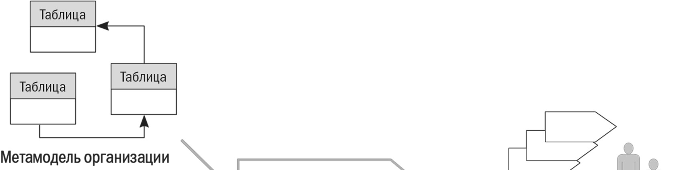

## Страница 11

11 
Моделирование бизнес-процессов. Лекция 5 – Описание бизнес-процессов организации 
Метамодель организации, по сути, – это совокупность связанных таблиц СУБД 
(системы управления базы данных), и она может расширяться по мере необходимости. 
Например, для такого класса объектов, как должность, можно дополнительно определить 
следующие атрибуты: 
• наименование должности; 
• лицо, назначающее сотрудника на данную должность; 
• лицо, осуществляющее представление на данную должность; 
• показатели оценки эффективности; 
• прочее. 
Для успешного внедрения системы описания процессов нужны квалифицированные 
специалисты, способные грамотного осуществлять изменения (доработки) в метамодели 
организации. 
 
5.4 Структурные модели процессов организации 
Рассмотрим особенности использования структурных моделей при описании 
процессов организации. 
Под структурной будем понимать модель, включающую в себя упорядоченный по 
определенному принципу набор процессов (групп процессов) с указанием основных 
связей между ними. 
Основное назначение структурной модели – показать, как устроен бизнес 
организации, раскрыть информацию об основных группах процессов и их взаимосвязях. 
Структурная модель не показывает последовательность выполнения процессов во 
времени. 
 Структурные модели можно использовать локально (не в системе процессов 
организации) для схематичного описания состава процессов, декомпозированных на 
следующий уровень. 
Для формирования структурных моделей используются соответствующие нотации: 
IDEF0, ARIS Value Added Chain, модель цепочек создания ценности и др. 
Структурные модели процессов, как правило, применяются для: 
• описания, анализа бизнес-модели организации и определения возможных 
направлений ее реорганизации; 
• разработки системы бизнес-процессов организации по принципу «сверху вниз»; 
• системного 
описания 
процессов, 
которые 
необходимо 
автоматизировать 
(например, в ERP-системе); 
• описания состава процессов, декомпозированных на следующий уровень 
(несистемное, фрагментарное использование). 
Рассмотрим деятельность торговой компании (розничная торговля продуктами 
питания). На рисунке 5.3 показан пример структурной модели процессов, выполненной без 
использования специализированной нотации на основе анализа цепочек создания 
ценности, осуществляемых компанией.

## Страница 12

12 
Моделирование бизнес-процессов. Лекция 5 – Описание бизнес-процессов организации 
 
Рисунок 5.3 - Пример структурной модели торговой компании 
 
На рисунке 5.3 видно, что в модели выделено семь групп процессов. Цель ее 
построения – демонстрация возможного варианта определения и группировки процессов 
торговой компании. Такая модель может быть представлена руководителям верхнего 
уровня для согласования. В дальнейшем модель используется при построении системы 
процессов организации. 
На рисунке 5.4 та же модель, что и на рисунке 5.3, только выполненная в стандарте 
IDEF0. 
Анализируя рисунок 5.4, надо отметить, что многочисленные стрелки, которые 
обычно представлены на схемах IDEF0, не так уж важны руководителям бизнеса для 
понимания и использования модели. Менеджеры крупной торговой компании, 
проработавшие в бизнесе много лет, хорошо представляют себе основные результаты 
работы каждого структурного подразделения (ассортиментная матрица, план продаж и 
закупок и т.п.). Поэтому загромождение структурной схемы стрелками скорее 
развлечение, а не деятельность бизнес-аналитика, полезная для управления. Нужно 
стремиться минимизировать количество стрелок, сохраняя при этом информативность 
схемы.

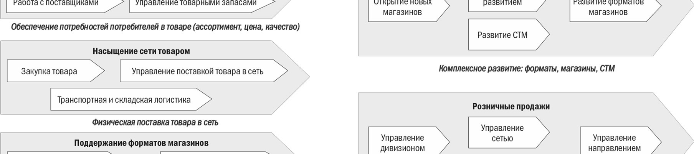

## Страница 13

13 
Моделирование бизнес-процессов. Лекция 5 – Описание бизнес-процессов организации 
 
Рисунок 5.4 – Пример структурной модели процессов торговой компании. Стандарт IDEF0 
 
Однако в случае проектирования компании с нуля проработка основных связей на 
структурной схеме очень полезна. Но такие случаи на практике встречаются редко. 
Вопрос пользы структурных моделей для решения задач бизнес-моделирования 
спорный. Построение сложной, многоуровневой системы процессов организации в одной 
модели IDEF0 (или в другой нотации) излишне. Если соблюдать все формальные правила, 
то в такой модели может получиться семь-восемь уровней декомпозиции. Реальную же 
ценность для последующего описания и регламентации имеют один-два нижних уровня, 
где выполняются конкретные операции и осуществляется реальный документооборот. 
Именно на этих уровнях процессы можно описать в формате Work Flow и при помощи 
этих описаний сформировать регламенты работы сотрудников («регламент процесса», 
«инструкция по выполнению процесса» и т.п.). Вопрос в том, как разработать адекватный 
реальному бизнесу иерархический справочник процессов. Если можно обойтись без 
сложной (понятной только бизнес-аналитику) структурной модели процессов, то и не 
нужно ее создавать. 
  
Пример. В крупной, давно работающей компании построение сложной 
структурной модели может не принести ожидаемого результата. Дело в том, что 
топ-менеджмент вряд ли решится перекраивать весь бизнес по модели в IDEF0. А с точки 
зрения регламентации на операционном уровне все верхние уровни (3–5-й) в модели 
IDEF0 бесполезны. 
Другое дело, если нужно спроектировать новый бизнес. Эта работа выполняется по 
принципу «сверху вниз», так как действующих процессов и самой компании пока нет. 
Анализ структуры и связей процессов на верхнем и среднем уровнях полезен для 
принятия решений о структуре будущей организации и закреплении групп процессов за 
подразделениями.

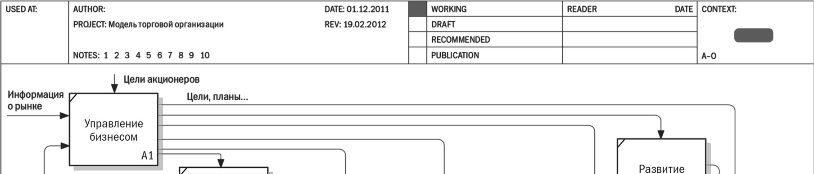

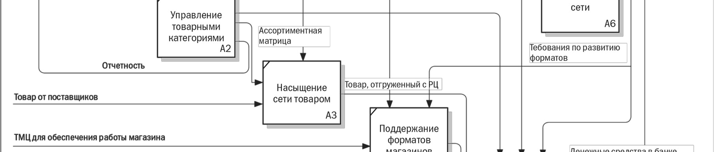

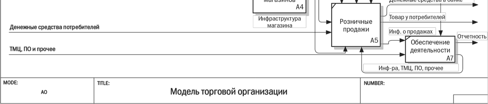

## Страница 14

14 
Моделирование бизнес-процессов. Лекция 5 – Описание бизнес-процессов организации 
  
Итак, структурная модель процессов нужна: 
• бизнес-аналитикам для понимания деятельности организации и создания 
адекватной системы процессов (в первую очередь для корректного перехода 
к процессам уровня Work Flow – регламентируемым или автоматически 
исполняемым в BPMS процессам); 
• руководителям организации для: 
 – уточнения зон ответственности, целей и задач их деятельности; 
 – анализа и совершенствования архитектуры бизнеса; 
• руководителям и бизнес-аналитикам при проектировании нового бизнеса. 
Среди руководителей компаний желающие работать со структурной графической 
моделью процессов верхнего уровня встречаются редко. Поэтому многоуровневая 
структурная модель (например, в IDEF0) – удел узкого круга бизнес-аналитиков. В лучшем 
случае руководители используют диаграмму первого уровня, которую размещают на 
стенде с нормативно-методической документацией. 
 
5.5 Модели процессов на операционном уровне 
Рассмотрим модели процессов на операционном уровне. Они отображают 
последовательность выполнения операций процесса (подпроцессов) во времени. Их 
обычно называют «модели Work Flow». 
Сейчас существует множество нотаций типа Work Flow, при помощи которых можно 
описывать процессы операционного уровня. Рассмотрим основу формирования моделей и 
некоторые важные аспекты их применения. 
 
5.5.1. Нотации типа Work Flow. На рисунке 5.5 показаны основные элементы, 
которые используются практически во всех современных нотациях Work Flow. Можно 
выделить пять основных: 
1. События. 
2. Операторы логики (по-другому их называют: блоки решения, ветвления/развилки, 
шлюзы). 
 3. Операции процесса. 
 4. Стрелки типа «Связь предшествования». 
 5. Стрелки типа «Поток объектов». 
События служат для определения границ процесса. Они могут указывать на его 
начало и завершение. Кроме того, возможны промежуточные события, возникающие по 
ходу выполнения процесса. Примеры именования событий: «Поступила заявка клиента на 
отгрузку продукции», «Утвержден план проекта», «Подписана накладная», «8.00 
понедельника» и т.п. Как видно на рисунке 5.5, в различных нотациях события показаны 
при помощи разных условных обозначений.

## Страница 15

15 
Моделирование бизнес-процессов. Лекция 5 – Описание бизнес-процессов организации 
 
Рисунок 5.5 – Основные элементы нотации Work Flow 
 
Операторы логики служат для описания ситуаций, связанных с ветвлением процесса. 
Оно может произойти по разным причинам (например, принятие решения, проверка 
условия). Операторы логики бывают трех типов: логическое «И», логическое 
исключающее «ИЛИ», логическое неисключающее «ИЛИ». На рисунке 5.6 приведен 
пример использования операторов логики при построении схемы типа Work Flow 
(графические обозначения операторов логики на схеме условные). 
 
 
Рисунок 5.6 – Использование операторов логики

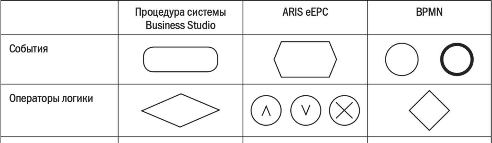

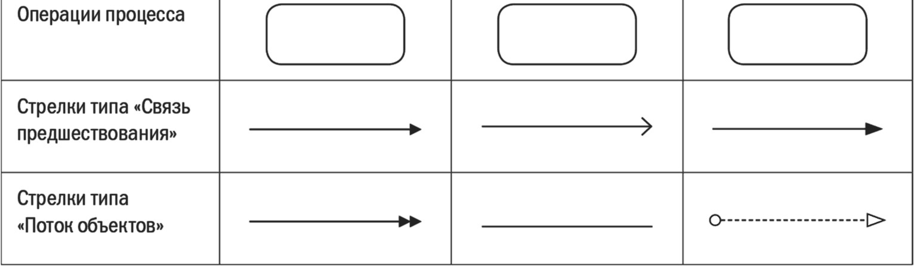

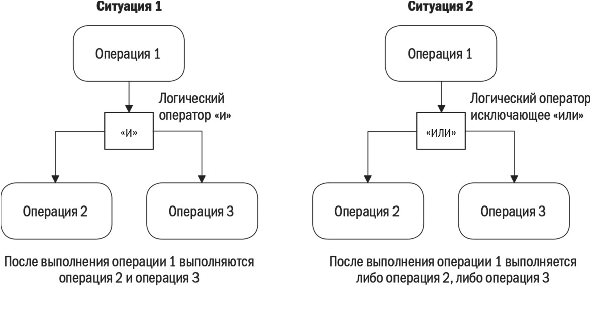

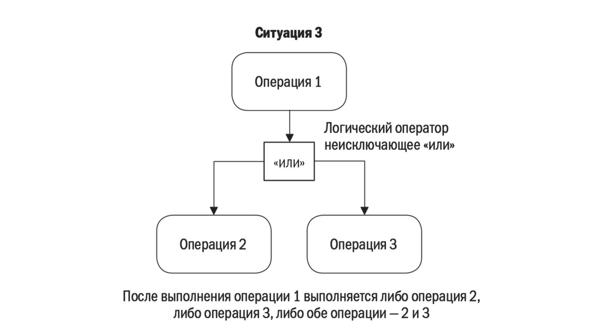

## Страница 16

16 
Моделирование бизнес-процессов. Лекция 5 – Описание бизнес-процессов организации 
Важный элемент схемы Work Flow – связи. Они представлены при помощи стрелок 
определенного вида. Первый тип – стрелки «Связь предшествования». Без них построение 
модели типа Work Flow невозможно. Стрелка «Связь предшествования», связывающая две 
операции, показывает, что вторая операция начинает выполняться только после 
завершения 
первой. 
Можно 
сказать, 
что 
стрелки 
«Связь 
предшествования» 
демонстрируют развертку процесса во времени. 
 Стрелки «Поток объектов» используются на схемах типа Work Flow для описания 
потоков документов и информации. 
За 
счет 
использования 
событий, 
операторов 
логики 
и 
стрелок 
«Связь 
предшествования» на схеме Work Flow можно показать сложную логику выполнения 
процесса во времени. 
 
5.5.2 Простая блок-схема. Нотация «Простая блок-схема» в самом доступном и часто 
используемом варианте содержит всего несколько элементов: 
• процесс; 
• решение; 
• ручная операция (реже); 
• документ; 
• данные; 
• стрелка (для отображения связей между объектами схемы). 
При помощи этой нотации можно показать потоки данных, если необходимо 
описывать процессы для автоматизации. 
На рисунке 5.7 показан пример применения простой блок-схемы в одной из компаний. 
Применены все пять типов элементов. Тем не менее схема выглядит вполне читаемой и 
понятной пользователю – сотруднику компании. 
Преимущества простой блок-схемы: 
• простота формирования графических схем процессов; 
• интуитивная понятность схем сотрудникам (даже без специального обучения); 
• минимальная потребность в обучении сотрудников; 
• наличие доступных инструментов для описания процессов (MS Visio, MS Word). 
Однако, как это часто бывает на практике, если нотация используется без 
утвержденного внутреннего стандарта и специализированного средства моделирования, 
компания получает множество нестандартно оформленных схем, которые содержатся в 
различных файлах. Поддерживать такой массив информации в связном состоянии и 
отслеживать 
изменения 
сложно. 
Требуется 
большой 
объем 
ручного 
труда 
бизнес-аналитиков. Поэтому, выбирая нотацию «Простая блок-схема», необходимо 
заранее разработать: 
• внутренний стандарт использования этой нотации; 
• внутренний стандарт формирования, хранения и актуализации файлов со схемами 
процессов.

## Страница 17

17 
Моделирование бизнес-процессов. Лекция 5 – Описание бизнес-процессов организации 
 
Рисунок 5.7 – Пример схемы в нотации «Простая блок-схема»

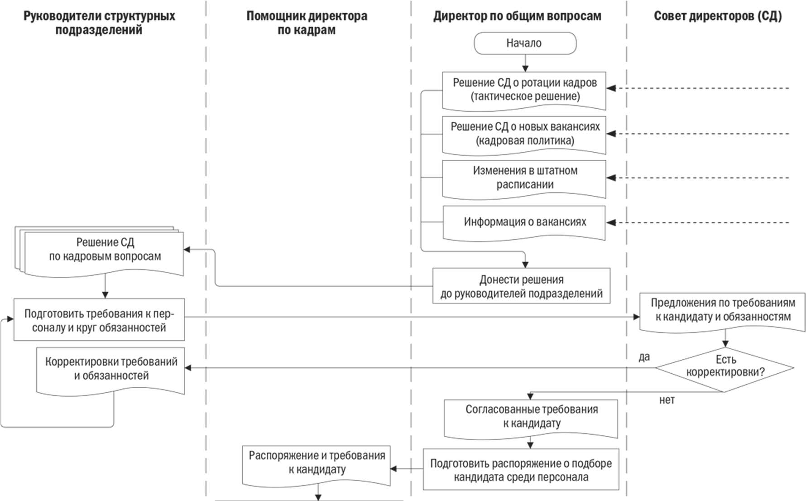

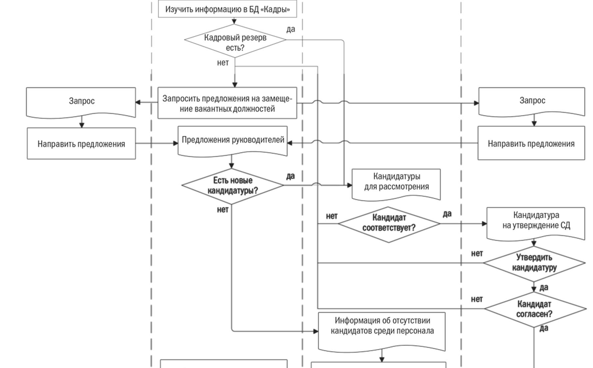

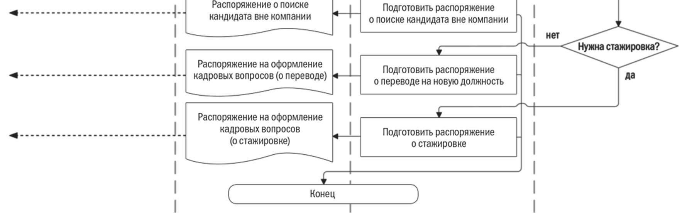

## Страница 18

18 
Моделирование бизнес-процессов. Лекция 5 – Описание бизнес-процессов организации 
5.5.3 Нотация ARIS eEPC. Нотация eEPC является частью общей методологии ARIS, 
в рамках которой организация рассматривается с четырех позиций: 
• организационной,  
• функциональной,  
• структуры данных, 
• бизнес-процессов.  
При этом каждая из позиций разделяется на три подуровня: описание требований, 
описание спецификации, описание внедрения. Для описания бизнес-процессов 
предлагается использовать около 80 типов моделей, каждая из которых принадлежит тому 
или иному аспекту. 
 ARIS eEPC относится к нотациям Work Flow. Особенности нотации – наличие 
элементов типа «Событие» и операторов логики «И», неисключающее «ИЛИ», 
исключающее «ИЛИ». 
В качестве примера рассмотрим процесс, представленный на рисунке 5.8, который 
начинается с события «Поступил заказ клиента». Оно инициирует операцию «Выполнить 
учет заказа в системе», которую проводит менеджер отдела сбыта. Для работы он 
использует систему учета заказов. Результат операции отображается событием «Учет 
заказа выполнен». После этого менеджер по сбыту осуществляет операцию «Выполнить 
анализ на соответствие номенклатуре». Ее результат – два альтернативных события: 
«Заказ соответствует номенклатуре» и «Заказ не соответствует номенклатуре». Процесс 
ветвится. Для отображения ветвления процесса используется символ логического 
исключающего «ИЛИ». 
 
 
Рисунок 5.8 – Схема процесса в нотации ARIS eEPC 
 
Операция «Уведомить клиента о невозможности выполнения заказа» может 
выполняться в двух случаях: если заказ не соответствует номенклатуре или если 
производство невозможно. Для отображения на схеме процесса этих вариантов

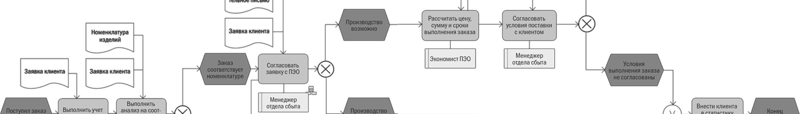

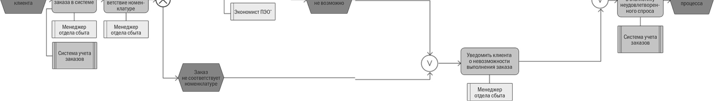

## Страница 19

19 
Моделирование бизнес-процессов. Лекция 5 – Описание бизнес-процессов организации 
используется символ логического «ИЛИ». 
Нотация ARIS eEPC содержит большое количество графических элементов. Поэтому 
при выполнении проектов создаются так называемые методические фильтры (в рамках 
соглашений по моделированию), которые ограничивают количество типов элементов, 
доступных пользователям при создании схем процессов.  
Следует отметить, что типичная схема в ARIS eEPC: 
• не годится для автоматизации в системе класса BPM (Business Process Management) 
(нужно применять дополнительный транслятор, переводящий ее в нотацию BPMN, 
с последующей ручной доработкой); 
• сложна для восприятия рядовыми сотрудниками (их нужно учить правилам 
использования логических операторов и корректному чтению схем, которые их 
содержат). 
Итак, нотация ARIS eEPC не предназначена для описания автоматически 
исполняемых процессов и неудобна для восприятия из-за своей сложности. 
Моделирование в ARIS eEPC не дает значительных преимуществ ни для автоматизации, 
ни для регламентации. Это классическая, формально правильная, но неудобная для 
восприятия нотация. 
Несмотря на перечисленные проблемы, применение нотации ARIS eEPC и 
соответствующего средства моделирования, безусловно, позволяет создать в организации 
качественную, комплексную процессную модель. Многие крупные и средние компании 
используют ARIS eEPC для описания и регламентации бизнес-процессов.  
 
5.5.4 Нотация BPMN. BPMN – система условных обозначений (нотация) и модель 
для описания и подготовки к автоматизации бизнес-процессов. 
Разработана она компанией Business Process Management Initiative и поддерживается 
Object Management Group после слияния организаций в 2005 году. Предыдущая версия 
BPMN – 1.2, последняя версия – 2.0. 
Нотация BPMN появилась относительно недавно. Она ориентирована на описание так 
называемых исполняемых процессов, то есть процессов, которые поддерживаются 
системами автоматизации операционных процессов – BPM. 
Рассмотрим пример. В торговой компании есть отдел продаж, деятельность которого 
заключается в получении и обработке заявок клиентов, выставлении счетов и т. п. 
Структура процессов отдела следующая: 
• получение заявок клиентов; 
• обработка заявки и выставление счета (процесс выполняется по одинаковой 
процедуре несколькими менеджерами отдела); 
• формирование графика доставки; 
• обработка ждущих (отложенных) заявок; 
• контроль остатков, рассылка информационных писем клиентам; 
• изменение статуса товара в базе; 
• обработка отказов. 
На рисунке 5.9 показан процесс «Обработка заявки и выставление счета клиенту», 
описанный в нотации BPMN. Схема на рисунке 5.9 содержит три объекта типа Gateway,

## Страница 20

20 
Моделирование бизнес-процессов. Лекция 5 – Описание бизнес-процессов организации 
восемь – типа Event и четыре операции (действия, задачи). Как видим, процесс совсем 
несложный, но количество условных обозначений, нужных для его описания, значительно. 
 
 
Рисунок 5.9 – Фрагмент модели процесса в нотации BPMN 2.0 
 
К нотации BPMN специалисты относятся по-разному. Для профессионалов, 
описывающих процессы с целью автоматизации, она весьма удобна. Более того, сейчас 
BPMN, очевидно, нет альтернативы. Но для руководителей и сотрудников организации, не 
обладающих компетенциями в области бизнес-моделирования, эта нотация слишком 
сложна. Применение BPMN в масштабах компании требует значительных затрат на 
обучение сотрудников, создание у них навыков моделирования. Это сложнее, чем при 
использовании более простой и понятной нотации. Поэтому выбирать BPMN можно в 
случае, если: 
• руководители готовы тратить деньги на обучение и развитие культуры 
бизнес-моделирования в организации; 
• руководители сами готовы активно осваивать нотацию BPMN; 
• предполагается активно использовать схемы процессов в BPMN для автоматизации 
операционных процессов. 
 
5.5.5 Нотация «Процедура» среды моделирования Business Studio. Сейчас одним 
из распространенных инструментов бизнес-моделирования стала среда Business Studio. В 
этой системе реализованы четыре нотации: IDEF0, «Процесс», «Процедура», eEPC. 
Нотация IDEF0 используется для построения моделей верхнего уровня, а 
«Процедура» и eEPC – для создания моделей типа Work Flow. 
Рассмотрим подробнее нотацию «Процедура» (см. рис. 4.6.7), так как она наиболее 
проста и удобна для описания бизнес-процессов организации. Основные элементы 
нотации – это:

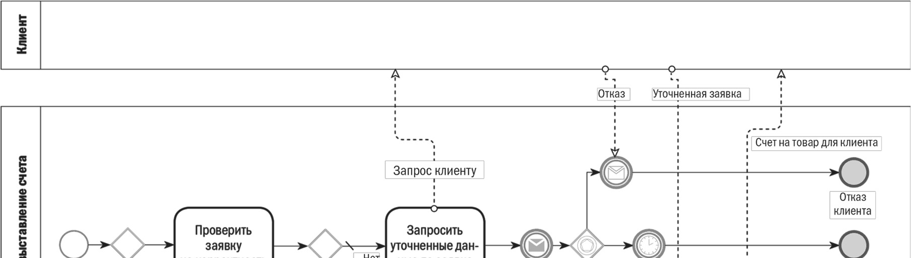

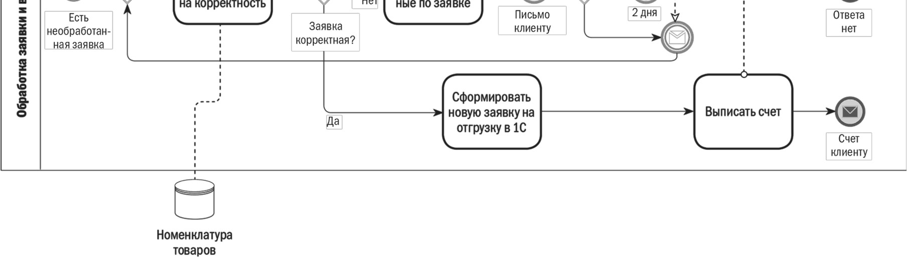

## Страница 21

21 
Моделирование бизнес-процессов. Лекция 5 – Описание бизнес-процессов организации 
 • операция («Действие» в терминологии Business Studio); 
 • событие; 
• блок «Решение»; 
 • стрелка типа «Связь предшествования»; 
 • стрелка типа «Поток объектов»; 
 • междиаграммная ссылка (МДС); 
 • сноска (текстовый комментарий); 
 • дорожки. 
 
 
Рисунок 5.10 – Схема процесса в нотации «Процедура»  
среды моделирования Business Studio 
 
Схема процесса в нотации «Процедура» при кажущейся простоте весьма 
информативна и удобна для описания. Можно сформулировать следующие преимущества 
этой нотации (в случае ее использования в Business Studio): 
• представлен минимально необходимый набор графических элементов для

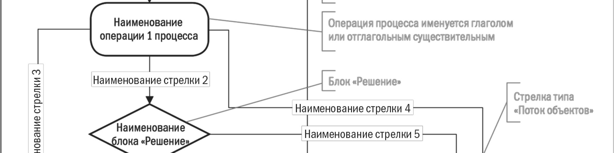

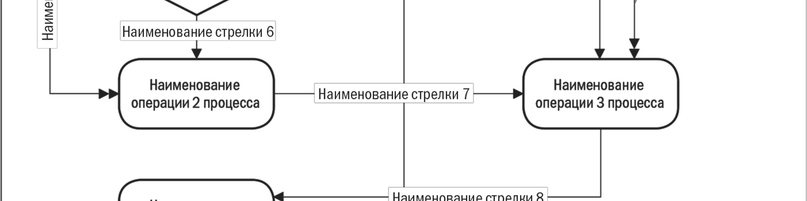

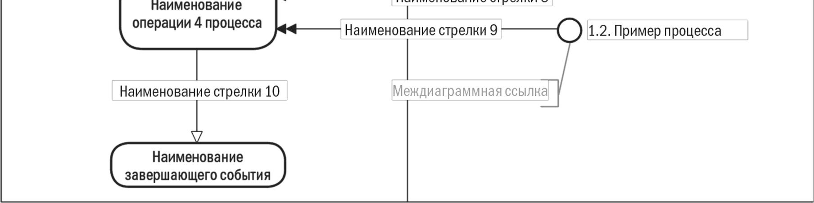

## Страница 22

22 
Моделирование бизнес-процессов. Лекция 5 – Описание бизнес-процессов организации 
описания процессов типа Work Flow (поток работ); 
• быстрота создания графических схем для целей регламентации; 
• возможность повышения информативности схем процессов за счет гибкого 
использования событий и именованных стрелок (одновременно с возможностью привязки 
документов к стрелкам и последующей выгрузки информации в регламентирующие 
документы); 
• схемы процессов просты и понятны всем сотрудникам даже без специального 
обучения; 
• простота в обучении (нет необходимости привлекать дорогостоящих специалистов 
со стороны – обучение можно проводить силами сотрудников отдела организационного 
развития); 
• схемы процессов являются кросс-функциональными, что удобно для описания 
сквозных процессов компании; 
• можно выгружать и редактировать схемы в MS Visio (при необходимости). 
Среда моделирования Business Studio позволяет быстро создавать процессную модель 
компании. Информацию о процессах можно выгружать из системы в виде 
регламентирующих документов в требуемом формате.
