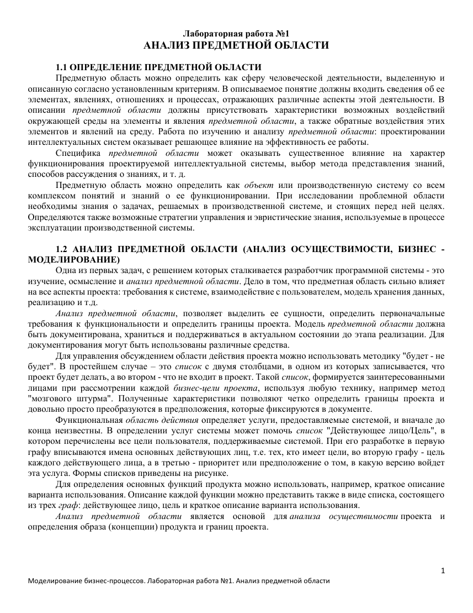
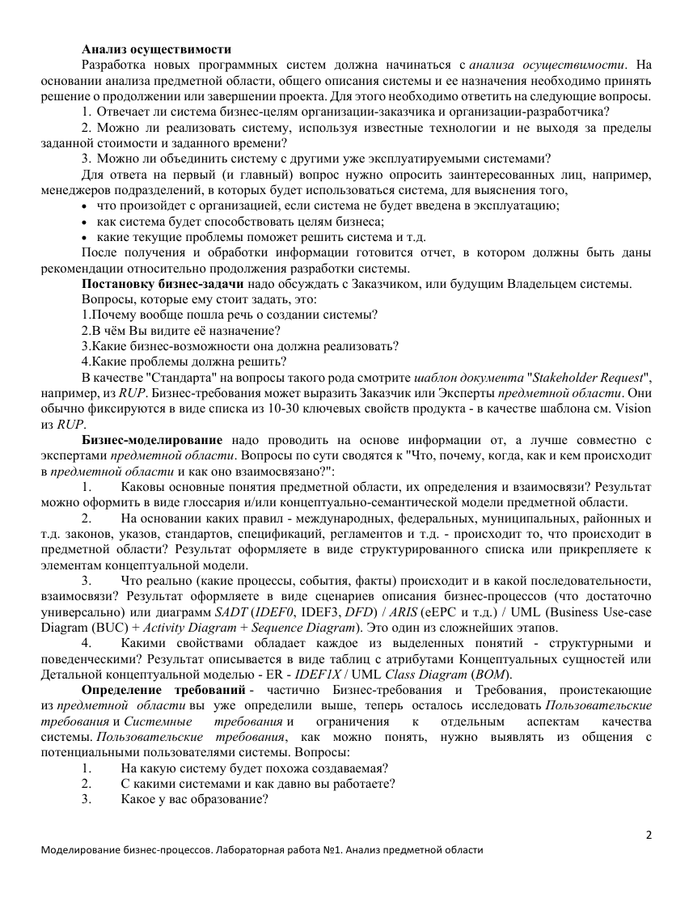
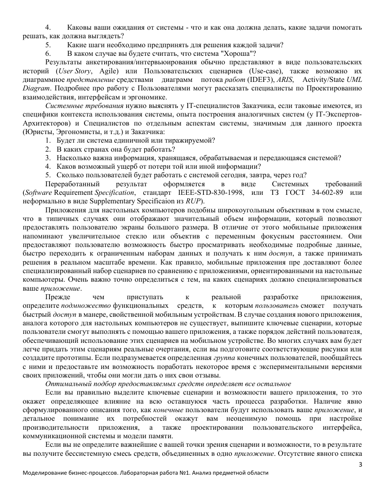
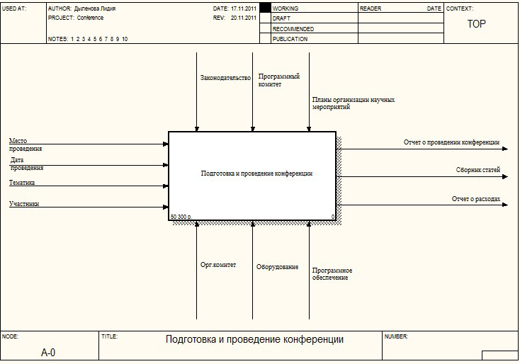
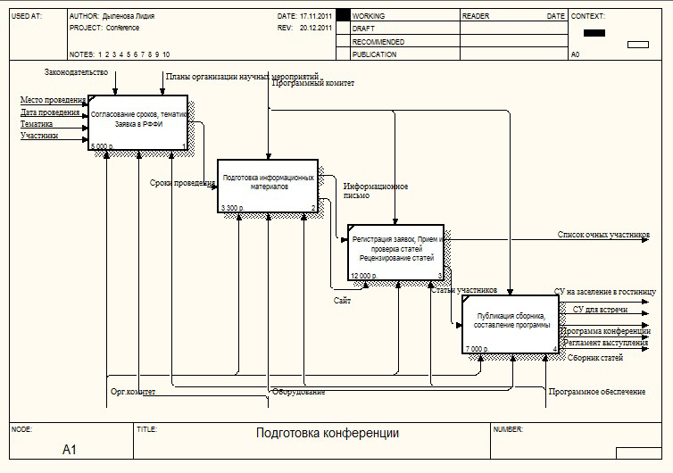
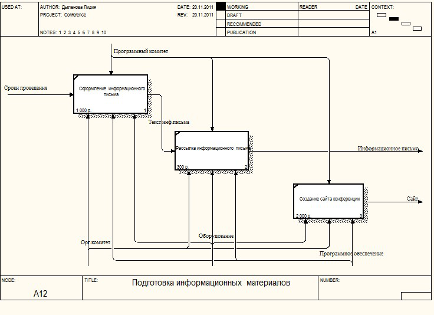
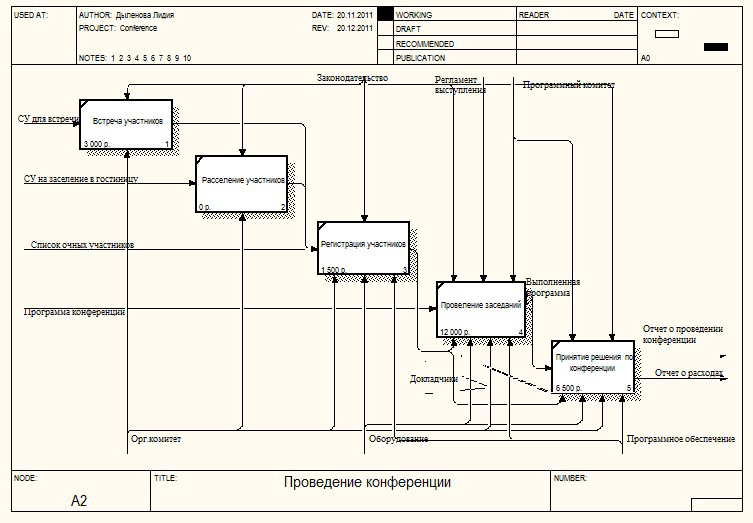

# МБП ЛР1 - Анализ предметной области

Оригинал: `../оригиналы/МБП ЛР1 - Анализ предметной области.pdf`

## Страница 1

1 
Моделирование бизнес-процессов. Лабораторная работа №1. Анализ предметной области 
Лабораторная работа №1 
АНАЛИЗ ПРЕДМЕТНОЙ ОБЛАСТИ 
 
1.1 ОПРЕДЕЛЕНИЕ ПРЕДМЕТНОЙ ОБЛАСТИ 
Предметную область можно определить как сферу человеческой деятельности, выделенную и 
описанную согласно установленным критериям. В описываемое понятие должны входить сведения об ее 
элементах, явлениях, отношениях и процессах, отражающих различные аспекты этой деятельности. В 
описании предметной области должны присутствовать характеристики возможных воздействий 
окружающей среды на элементы и явления предметной области, а также обратные воздействия этих 
элементов и явлений на среду. Работа по изучению и анализу предметной области: проектировании 
интеллектуальных систем оказывает решающее влияние на эффективность ее работы. 
Специфика предметной области может оказывать существенное влияние на характер 
функционирования проектируемой интеллектуальной системы, выбор метода представления знаний, 
способов рассуждения о знаниях, и т. д. 
Предметную область можно определить как объект или производственную систему со всем 
комплексом понятий и знаний о ее функционировании. При исследовании проблемной области 
необходимы знания о задачах, решаемых в производственной системе, и стоящих перед ней целях. 
Определяются также возможные стратегии управления и эвристические знания, используемые в процессе 
эксплуатации производственной системы. 
 
1.2 АНАЛИЗ ПРЕДМЕТНОЙ ОБЛАСТИ (АНАЛИЗ ОСУЩЕСТВИМОСТИ, БИЗНЕС - 
МОДЕЛИРОВАНИЕ) 
Одна из первых задач, с решением которых сталкивается разработчик программной системы - это 
изучение, осмысление и анализ предметной области. Дело в том, что предметная область сильно влияет 
на все аспекты проекта: требования к системе, взаимодействие с пользователем, модель хранения данных, 
реализацию и т.д. 
Анализ предметной области, позволяет выделить ее сущности, определить первоначальные 
требования к функциональности и определить границы проекта. Модель предметной области должна 
быть документирована, храниться и поддерживаться в актуальном состоянии до этапа реализации. Для 
документирования могут быть использованы различные средства. 
Для управления обсуждением области действия проекта можно использовать методику "будет - не 
будет". В простейшем случае – это список с двумя столбцами, в одном из которых записывается, что 
проект будет делать, а во втором - что не входит в проект. Такой список, формируется заинтересованными 
лицами при рассмотрении каждой бизнес-цели проекта, используя любую технику, например метод 
"мозгового штурма". Полученные характеристики позволяют четко определить границы проекта и 
довольно просто преобразуются в предположения, которые фиксируются в документе. 
Функциональная область действия определяет услуги, предоставляемые системой, и вначале до 
конца неизвестны. В определении услуг системы может помочь список "Действующее лицо/Цель", в 
котором перечислены все цели пользователя, поддерживаемые системой. При его разработке в первую 
графу вписываются имена основных действующих лиц, т.е. тех, кто имеет цели, во вторую графу - цель 
каждого действующего лица, а в третью - приоритет или предположение о том, в какую версию войдет 
эта услуга. Формы списков приведены на рисунке. 
Для определения основных функций продукта можно использовать, например, краткое описание 
варианта использования. Описание каждой функции можно представить также в виде списка, состоящего 
из трех граф: действующее лицо, цель и краткое описание варианта использования. 
Анализ предметной области является основой для анализа осуществимости проекта и 
определения образа (концепции) продукта и границ проекта.

## Страница 2

2 
Моделирование бизнес-процессов. Лабораторная работа №1. Анализ предметной области 
Анализ осуществимости 
Разработка новых программных систем должна начинаться с анализа осуществимости. На 
основании анализа предметной области, общего описания системы и ее назначения необходимо принять 
решение о продолжении или завершении проекта. Для этого необходимо ответить на следующие вопросы. 
1. Отвечает ли система бизнес-целям организации-заказчика и организации-разработчика? 
2. Можно ли реализовать систему, используя известные технологии и не выходя за пределы 
заданной стоимости и заданного времени? 
3. Можно ли объединить систему с другими уже эксплуатируемыми системами? 
Для ответа на первый (и главный) вопрос нужно опросить заинтересованных лиц, например, 
менеджеров подразделений, в которых будет использоваться система, для выяснения того, 
 что произойдет с организацией, если система не будет введена в эксплуатацию; 
 как система будет способствовать целям бизнеса; 
 какие текущие проблемы поможет решить система и т.д. 
После получения и обработки информации готовится отчет, в котором должны быть даны 
рекомендации относительно продолжения разработки системы. 
Постановку бизнес-задачи надо обсуждать с Заказчиком, или будущим Владельцем системы. 
Вопросы, которые ему стоит задать, это: 
1.Почему вообще пошла речь о создании системы? 
2.В чём Вы видите её назначение? 
3.Какие бизнес-возможности она должна реализовать? 
4.Какие проблемы должна решить? 
В качестве "Стандарта" на вопросы такого рода смотрите шаблон документа "Stakeholder Request", 
например, из RUP. Бизнес-требования может выразить Заказчик или Эксперты предметной области. Они 
обычно фиксируются в виде списка из 10-30 ключевых свойств продукта - в качестве шаблона см. Vision 
из RUP. 
Бизнес-моделирование надо проводить на основе информации от, а лучше совместно с 
экспертами предметной области. Вопросы по сути сводятся к "Что, почему, когда, как и кем происходит 
в предметной области и как оно взаимосвязано?": 
1. 
Каковы основные понятия предметной области, их определения и взаимосвязи? Результат 
можно оформить в виде глоссария и/или концептуально-семантической модели предметной области. 
2. 
На основании каких правил - международных, федеральных, муниципальных, районных и 
т.д. законов, указов, стандартов, спецификаций, регламентов и т.д. - происходит то, что происходит в 
предметной области? Результат оформляете в виде структурированного списка или прикрепляете к 
элементам концептуальной модели. 
3. 
Что реально (какие процессы, события, факты) происходит и в какой последовательности, 
взаимосвязи? Результат оформляете в виде сценариев описания бизнес-процессов (что достаточно 
универсально) или диаграмм SADT (IDEF0, IDEF3, DFD) / ARIS (eEPC и т.д.) / UML (Business Use-case 
Diagram (BUC) + Activity Diagram + Sequence Diagram). Это один из сложнейших этапов. 
4. 
Какими свойствами обладает каждое из выделенных понятий - структурными и 
поведенческими? Результат описывается в виде таблиц с атрибутами Концептуальных сущностей или 
Детальной концептуальной моделью - ER - IDEF1X / UML Class Diagram (BOM). 
Определение требований - частично Бизнес-требования и Требования, проистекающие 
из предметной области вы уже определили выше, теперь осталось исследовать Пользовательские 
требования и Системные 
требования и 
ограничения 
к 
отдельным 
аспектам 
качества 
системы. Пользовательские требования, как можно понять, нужно выявлять из общения с 
потенциальными пользователями системы. Вопросы: 
1. 
На какую систему будет похожа создаваемая? 
2. 
С какими системами и как давно вы работаете? 
3. 
Какое у вас образование?

## Страница 3

3 
Моделирование бизнес-процессов. Лабораторная работа №1. Анализ предметной области 
4. 
Каковы ваши ожидания от системы - что и как она должна делать, какие задачи помогать 
решать, как должна выглядеть? 
5. 
Какие шаги необходимо предпринять для решения каждой задачи? 
6. 
В каком случае вы будете считать, что система "Хороша"? 
Результаты анкетирования/интервьюирования обычно представляют в виде пользовательских 
историй (User Story, Agile) или Пользовательских сценариев (Use-case), также возможно их 
диаграммное представление средствами 
диаграмм 
потока работ (IDEF3), ARIS, 
Activity/State UML 
Diagram. Подробнее про работу с Пользователями могут рассказать специалисты по Проектированию 
взаимодействия, интерфейсам и эргономике. 
Системные требования нужно выяснять у IT-специалистов Заказчика, если таковые имеются, из 
специфики контекста использования системы, опыта построения аналогичных систем (у IT-Экспертов-
Архитекторов) и Специалистов по отдельным аспектам системы, значимым для данного проекта 
(Юристы, Эргономисты, и т.д.) и Заказчика: 
1. Будет ли система единичной или тиражируемой? 
2. В каких странах она будет работать? 
3. Насколько важна информация, хранящаяся, обрабатываемая и передающаяся системой? 
4. Каков возможный ущерб от потери той или иной информации? 
5. Сколько пользователей будет работать с системой сегодня, завтра, через год? 
Переработанный 
результат 
оформляется 
в 
виде 
Системных 
требований 
(Software Requirement Specification, стандарт IEEE-STD-830-1998, или ТЗ ГОСТ 34-602-89 или 
неформально в виде Supplementary Specificaion из RUP). 
Приложения для настольных компьютеров подобны широкоугольным объективам в том смысле, 
что в типичных случаях они отображают значительный объем информации, который позволяют 
предоставлять пользователю экраны большого размера. В отличие от этого мобильные приложения 
напоминают увеличительное стекло или объектив с переменным фокусным расстоянием. Они 
предоставляют пользователю возможность быстро просматривать необходимые подробные данные, 
быстро переходить к ограниченным наборам данных и получать к ним доступ, а также принимать 
решения в реальном масштабе времени. Как правило, мобильные приложения пре доставляют более 
специализированный набор сценариев по сравнению с приложениями, ориентированными на настольные 
компьютеры. Очень важно точно определиться с тем, на каких сценариях должно специализироваться 
ваше приложение. 
Прежде 
чем 
приступать 
к 
реальной 
разработке 
приложения, 
определите подмножество функциональных 
средств, 
к 
которым пользователь сможет 
получать 
быстрый доступ в манере, свойственной мобильным устройствам. В случае создания нового приложения, 
аналога которого для настольных компьютеров не существует, выпишите ключевые сценарии, которые 
пользователи смогут выполнять с помощью вашего приложения, а также порядок действий пользователя, 
обеспечивающий использование этих сценариев на мобильном устройстве. Во многих случаях вам будет 
легче придать этим сценариям реальные очертания, если вы подготовите соответствующие рисунки или 
создадите прототипы. Если подразумевается определенная группа конечных пользователей, пообщайтесь 
с ними и предоставьте им возможность поработать некоторое время с экспериментальными версиями 
своих приложений, чтобы они могли дать о них свои отзывы. 
Оптимальный подбор предоставляемых средств определяет все остальное 
Если вы правильно выделите ключевые сценарии и возможности вашего приложения, то это 
окажет определяющее влияние на всю оставшуюся часть процесса разработки. Наличие явно 
сформулированного описания того, как конечные пользователи будут использовать ваше приложение, и 
детальное 
понимание 
их 
потребностей 
окажут 
вам 
неоценимую 
помощь 
при 
настройке 
производительности 
приложения, 
а 
также 
проектировании 
пользовательского 
интерфейса, 
коммуникационной системы и модели памяти. 
Если вы не определите важнейшие с вашей точки зрения сценарии и возможности, то в результате 
вы получите бессистемную смесь средств, объединенных в одно приложение. Отсутствие явного списка

## Страница 4

4 
Моделирование бизнес-процессов. Лабораторная работа №1. Анализ предметной области 
основных функций приложения или разделения функций на группы в соответствии с их приоритетами 
приведет к тому, что пользовательский интерфейс не будет оптимизирован для эффективного решения 
ключевых задач. Например, если ожидается, что пользователь в основном будет заинтересован во вводе 
данных, то вы должны оптимизировать пользовательский интерфейс таким образом, чтобы обеспечить 
как можно более точное и надежное выполнение операций ввода. И наоборот, если ввод данных 
используется лишь изредка, то вариант пользовательского интерфейса ввода, оптимизированного не 
самым идеальным образом, может оказаться вполне допустимым, что позволит перебросить ресурсы 
проектирования и разработки на другие направления. Лишь только если группой разработчиков будут 
идентифицированы, перечислены и согласованы наиболее важные сценарии, эксплуатационные 
характеристики приложения могут быть настроены для их выполнения должным образом, 
а конечные пользователи не будут лишены важных для них средств из-за недосмотра. 
Чтобы процесс разработки мог быть успешно завершен, составьте список ключевых требовании, 
которым должно удовлетворять приложение, и возможноестей, которые оно должно обеспечивать, и 
пусть этот список будет первым разделом вашего основного документа проекта. 
 
1.3 АНАЛИЗА ПРЕДМЕТНОЙ ОБЛАСТИ НА ПРИМЕРЕ ПРОВЕДЕНИЯ КОНФЕРЕНЦИИ 
Для построения модели предметной области и дальнейшей разработки технического задания 
необходимо провести анализ предметной области и выявить класс задач, которые решаются при 
подготовке конференции. Анализ предметной области дает представление об объектах предметной 
области, их характеристиках, взаимодействии и процессах, происходящих в результате этого 
взаимодействия. 
Конференция — форма организации научной деятельности, при которой исследователи (не 
обязательно учёные или студенты) представляют и обсуждают свои работы. Обычно заранее (в 
информационном письме либо стендовом объявлении) сообщается о теме, времени и месте проведении 
конференции. Затем начинается сбор тезисов докладов и иногда оргвзносов. 
Проведением конференции, как правило, занимается заранее сформированный организационный 
комитет. 
Руководство предприятия принимает решение о проведении конференции, формируются 
программный и организационный комитеты. Затем оргкомитет пишет информационное письмо для 
возможных участников конференции, в котором указываются название конференции, тематика, 
приблизительный список участников, сроки проведения, дата окончания приема тезисов, дата окончания 
регистрации, требования к оформлению тезисов. После этого информационное письмо рассылается всем 
возможным участникам конференции. 
Участники отсылают свои тезисы оргкомитету конференции, на что последний уведомляет 
участников о том, что тезисы приняты либо отклонены. После приема тезисов от всех возможных 
участников верстается и издается сборник тезисов. Оргкомитет рассылает официальные приглашения 
участникам, чьи тезисы не были отклонены. В приглашениях указывается точная информация о 
приглашенных участниках, гостиницах для проживания во время проведения конференции, 
мероприятиях (культурная программа конференции). Затем производится сбор подтверждений об очном 
участии в конференции и при необходимости бронирование гостиницы. На этом этапе оргкомитету 
необходимо оформить заявку в Российский фонд фундаментальных исследований (в случае проведения 
научной конференции) для получения финансирования. 
После сбора оргкомитетом подтверждений программный 
комитет уточняет программу 
конференции, после чего программа издается. 
Перед началом конференции подготавливаются помещения для заседаний, проверяется техника. По 
прибытии участников конференции на место ее проведения они регистрируются организационным 
комитетом. 
По результатам проведения конференции ее участниками принимется решение по конференции, 
оргкомитет формирует отчет о проведении.

## Страница 5

5 
Моделирование бизнес-процессов. Лабораторная работа №1. Анализ предметной области 
1.4 ФУНКЦИОНАЛЬНАЯ МОДЕЛЬ ПРЕДМЕТНОЙ ОБЛАСТИ 
Методология функционального моделирования IDEF0 (ICAM (Integrated Computer Aided 
Manufacturing) DEFinition) имеет выраженную функциональную направленность: IDEF0-функции 
системы исследуются независимо от объектов, обеспечивающих их выполнение. Наиболее часто IDEF0 
применяется как технология исследования и проектирования систем на логическом уровне [3]. 
Основными этапами конференции являются: 
o Подготовка: 
 Подача заявки в РФФИ; 
 Согласование сроков, тематики конференции; 
 Подготовка информационных материалов; 
 Прием статей; 
 Регистрация заявок 
 Публикация сборника статей и программы; 
o Проведение: 
 Встреча участников и размещение их в гостинице; 
 Регистрация участников; 
 Проведение заседаний; 
 Принятие решения по конференции. 
Работы выполняются в соответствии с планами организации научных мероприятий и 
законодательством РФ. 
В зависимости от организации, проводящей конференцию, работы могут выполняться в иной 
последовательности. Также возможно добавление некоторых видов деятельности. 
На рисунках 1.1-1.4 показана функциональная модель конференции. 
Увидеть иерархию работ и посмотреть всю диаграмму целиком можно на рисунке 5, где показана 
диаграмма дерева узлов. 
 
Рисунок 1.1 - Контекстная диаграмма

## Страница 6

6 
Моделирование бизнес-процессов. Лабораторная работа №1. Анализ предметной области 
 
Рисунок 1.2 – Диаграмма процесса "Подготовка конференции"

## Страница 7

7 
Моделирование бизнес-процессов. Лабораторная работа №1. Анализ предметной области 
 
Рисунок 1.3 – Диаграмма процесса "Подготовка информационных материалов" 
 
Рисунок 1.4 – Диаграмма процесса "Проведение конференции"

## Страница 8

8 
Моделирование бизнес-процессов. Лабораторная работа №1. Анализ предметной области 
 
ИНДИВИДУАЛЬНОЕ ЗАДАНИЕ 
1. Выбрать предметную область, для автоматизации процессов в которой будет 
разрабатываться система 
2. Построить организационную структуру организации 
3. Построить функциональную модель системы 
Примеры предметных областей для выбора: 
 
учет работы туристического агентства; 
 
учет работы станции технического обслуживания; 
 
интернет-магазин продажи компьютерной техники; 
 
система учета выполнения задач; 
 
автоматизация кадровой работы; 
 
автоматизация работы библиотеки.
