# МБП ЛР2 - Моделирование бизнес-процессов Нотация BPMN

Оригинал: `../оригиналы/МБП ЛР2 - Моделирование бизнес-процессов Нотация BPMN.pdf`

## Страница 1

Лабораторная работа №3. Моделирование бизнес-процессов. Нотация BPMN 
 
Нотация BPMN (Business Process Model and Notation - модель бизнес-процессов и нотация) 
используется для описания процессов нижнего уровня. Диаграмма процесса в нотации BPMN 
представляет собой алгоритм выполнения процесса. На диаграмме могут быть определены события, 
исполнители, материальные и документальные потоки, сопровождающие выполнение процесса. Каждый 
процесс может быть декомпозирован на более низкие уровни. Декомпозиция может производиться в 
нотациях BPMN или EPC. При декомпозиции процесса BPMN, расположенного на диаграмме SADT, 
стрелки с диаграммы SADT на диаграмму BPMN не переносятся. 
Главное назначение и практическое применение. Нотация BPMN нужна для подробного 
описания логики выполнения бизнес-процесса, в том числе для отражения деталей процессов, таких как: 
события, исполнители каждого из действий, используемые и создаваемые документы и другие объекты, 
использующиеся в качестве входных данных для тех или иных действий или создающиеся в результате 
их выполнения. 
BPMN позволяет описать бизнес-логику выполнения действий в виде наглядной диаграммы, а 
также 
запустить 
отрисованный 
бизнес-процесс 
на 
исполнение. 
Для 
этого 
используются 
специализированные системы BPMS (Business Process Modelling System), поддерживающие эту нотацию. 
BPMS-системы могут автоматически перевести схему бизнес-процесса в исполняемый код и 
создать веб-приложение, которое будет обрабатывать данные, введённые пользователями и сторонними 
сервисами. Это соответствует концепции Low Code/No Code (создание программного обеспечения без 
разработки кода) и отлично подходит для автоматизации офисных процессов. 
Технически такая возможность реализуется за счёт перевода BPMN-диаграмм в документы 
формата BPEL (Business Process Execution Language). BPEL-документы представляют собой инструкции 
исполнения бизнес-процессов для веб-сервисов. 
Таким образом, BPMN используется в следующих случаях: 
 Когда нужно детально и наглядно показать последовательность и логику взаимосвязи 
действий, событий, исполнителей и объектов бизнес-процесса 
 Когда требуется запустить схему бизнес-процесса на исполнение в BPMS-системах 
Уровни моделирования. В зависимости от целей построения BPMN-диаграмм, различают 3 
уровня моделирования: 
 Описательное моделирование, когда нужно показать успешный путь выполнения бизнес-
процесса, например, чтобы согласовать его с бизнес-пользователем. Здесь применяются самые простые 
элементы нотации, а сама диаграмма намеренно максимально упрощается. 
 Аналитическое моделирование используется, когда нужно полностью показать все 
варианты выполнения бизнес-процесса, включая логические ветвления и альтернативы. Такая диаграмма 
обычно создаётся для опытных пользователей и бизнес-аналитиков с помощью расширенного алфавита 
нотации, включая не только её базовые самые простые элементы, но и более сложные. 
 Исполняемое моделирование предназначено для запуска на исполнение в BPMS-движке, 
чтобы создать веб-приложение. Здесь может использоваться всё многообразие алфавита этой нотации, 
включая добавление специальных параметров и скриптов, создаваемых разработчиками. 
 
В нотации BPMN выделяют пять основных категорий элементов: 
o элементы потока (события, процессы и шлюзы); 
o данные (объекты данных и базы данных); 
o соединяющие элементы (потоки управления, потоки сообщений и ассоциации); 
o зоны ответственности (пулы и дорожки); 
o артефакты (сноски). 
Описание назначения графических символов, используемых в нотации BPMN приведено в 
Таблице 1.

## Страница 2

Название
Графический символ
Описание
Процесс 
(Задача, 
Подпроцесс) 
 
 
Блок представляет собой процесс - действие или набор действий, 
выполняемых над исходным объектом (документом, 
материальным объектом и прочим) с целью получения заданного 
результата. 
Внутри блока помещается наименование процесса. 
Временная последовательность выполнения процессов задается 
расположением процессов на диаграмме слева направо (сверху 
вниз на вертикальной диаграмме процесса BPMN). 
Процессы BPMN подразделяются на задачи и подпроцессы. 
 
Задача - это простое действие (или операция), которое не имеет 
дальнейшей декомпозиции в рамках рассматриваемого процесса. 
Задачи подразделяются на типы, каждый из которых (за 
исключением абстрактной задачи) обозначается своим маркером 
в левом верхнем углу блока задачи: 
- Абстрактная задача (задача с неопределенным типом); 
- Пользовательская задача (задача, которую выполняет человек 
при содействии других людей или программного обеспечения); 
- Сервисная задача (задача, предназначенная для оказания услуги, 
которая может являться как web-сервисом, так и 
автоматизированным приложением); 
- Отправка сообщений (задача, суть которой заключается в 
отправлении сообщения внешнему участнику за пределы 
рассматриваемого процесса); 
- Получение сообщений (задача, суть которой заключается в 
получении сообщения от внешнего участника, находящегося за 
пределами рассматриваемого процесса); 
- Ручное выполнение (задача, выполнение которой подразумевает 
действия человека и исключает использование каких-либо 
автоматизированных механизмов исполнения или приложений); 
- Бизнес-правило (задача, суть которой заключается в выполнении 
бизнес-правила); 
- Задача-сценарий (задача, суть которой заключается в 
выполнении некоторого сценария (или скрипта) - некоторой 
автоматической операции). 
По умолчанию создается Задача с типом "Абстрактная задача". 
На Рис.2 изображена задача с типом "Отправка сообщений". 
 
 
Рисунок 2. Задача 
 
Подпроцесс - это декомпозированный процесс, включенный в 
состав рассматриваемого процесса, который описан более 
подробно на своей диаграмме. На диаграмме подпроцесс 
обозначается блоком со знаком "плюс" в центре нижней части 
фигуры. Подпроцессы подразделяются на типы:

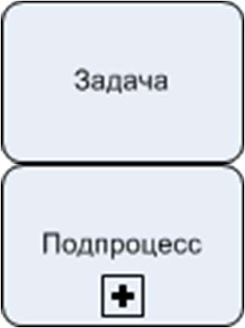

## Страница 3

- Подпроцесс (подпроцесс с неопределенным типом); 
- Событийный подпроцесс (подпроцесс, не имеющий входящих и 
исходящих потоков управления. Событийный подпроцесс 
запускается всякий раз, когда его стартовое событие запускается 
во время выполнения родительского процесса); 
- Транзакция (подпроцесс, состоящий из набора процессов, 
которые в совокупности представляют некий неделимый процесс: 
либо весь процесс выполняется полностью, либо не выполняется 
вообще. Транзакции используются тогда, когда необходимо 
выполнить несколько процессов, но при каких-то 
исключительных ситуациях необходимо «откатить» выполняемые 
процессы); 
- Ad-Hoc процесс (подпроцесс, представляющий собой группу 
процессов, взаимодействие между которыми не поддаются строго 
регламентированным правилам. Определяется только набор 
процессов, однако, их последовательность и количество 
выполнений определяются исполнителями этих процессов). 
По умолчанию создается подпроцесс с типом "Подпроцесс". 
На Рис.3 изображен событийный подпроцесс. 
 
Рисунок 3. Подпроцесс 
 
Для процессов BPMN (и для задач, и для подпроцессов) 
предусмотрено обозначение циклического выполнения. Для 
процесса BPMN можно задать следующие типы циклов: 
- Стандартный цикл (используется, когда количество циклов 
заранее неизвестно. Процесс будет выполняться в цикле, пока 
верно некоторое условие); 
- Многоэкземплярный параллельный цикл (используется, когда 
количество циклов известно заранее. При этом экземпляры 
процесса будут выполняться параллельно); 
- Многоэкземплярный последовательный цикл (используется, 
когда количество циклов известно заранее. При этом экземпляры 
процесса будет выполняться последовательно). 
 
Для процесса BPMN можно задать специальный тип процесса 
- Компенсация. Некоторые процессы могут приводить к 
нежелательным результатам, которые следует отменить. 
Процессы-компенсации как раз предусмотрены для отмены 
результатов выполнения некоторого процесса. Процессы-
компенсации не должны иметь входящих и исходящих потоков 
управления и могут соединяться входящей ассоциацией с 
граничным событием с типом "Компенсация". Пример 
соединения события и процесса с типом "Компенсация" 
специальным типом соединения "Ассоциация" см. в описании к 
символу "Ассоциация", приведенному в данной таблице ниже.

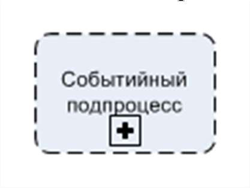

## Страница 4

Событие 
 
 
 
Событие - состояние, которое является существенным для целей 
управления бизнесом и оказывает влияние или контролирует 
дальнейшее развитие одного или более бизнес-процессов. 
Внутри блока помещается наименование события. 
При выполнении процесса могут происходить различные 
события, оказывающие влияние на ход процесса: старт процесса, 
его завершение, смена статуса документа, получение сообщения и 
многое другое. Но событие – элемент необязательный, поэтому на 
диаграмме процесса в нотации BPMN его может и не быть. 
Если же события возникают при выполнении процесса, то они 
разделяются на 2 категории: возникающие из-за какой-то 
причины и инициирующие какой-то результат. И причина 
возникновения события, и результат, который инициирует 
событие, называются триггером. События, обрабатывающие 
триггер, который привел к их возникновению, 
называются обработчиками. События, которые инициируют 
триггер (или некий результат), называются инициаторами. 
По типу триггера события делятся на следующие типы: 
Неопределенное (без триггера), Сообщение, Таймер, Условие, 
Сигнал, Множественное, Параллельное множественное, 
Эскалация, Ошибка, Ссылка, Компенсация, Завершение. Триггер 
обозначается специальным маркером внутри события. 
События-обработчики - это все стартовые и некоторые 
промежуточные события. Если встречается событие-обработчик, 
то процесс ожидает наступления этого события, т.е. ожидает 
появления причины возникновения этого события. На диаграмме 
триггер внутри события, являющегося обработчиком, 
показывается незакрашенным. 
События-инициаторы – это некоторые промежуточные события 
(включая промежуточное событие с типом "Неопределенное") и 
все конечные события. Если встречается событие-инициатор, то 
процесс просто выполняется дальше и ничего не ожидает. На 
диаграмме триггер внутри события, являющегося инициатором, 
показывается закрашенным. 
На Рис.4 изображены различные типы событий: 
- Событие 1 - стартовое событие с типом триггера "Сообщение"; 
- Событие 2 - промежуточное событие (обработчик) с типом 
триггера "Таймер"; 
- Событие 3 - промежуточное событие (инициатор) с типом 
триггера "Сигнал"; 
- Событие 4 - конечное событие с типом триггера "Сообщение". 
Рисунок 4 
 
Промежуточные события (обработчики) могут присоединяться к 
границе процесса. Такие события называются граничными. 
Граничное событие изображает событие, возникающее при 
выполнении процесса, к границе которого это событие 
присоединено. Причем граничное событие может прервать

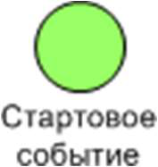

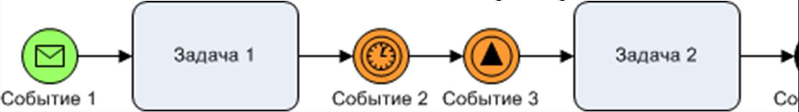

## Страница 5

выполнение процесса - граничное прерывающее, и не 
прерывать - граничное непрерывающее. Граничное 
непрерывающее событие изображается пунктирными линиями. 
На Рис.5 изображено использование граничного прерывающего 
события. Если при выполнении Процесса 1 возникнет Событие 2, 
то выполнение Процесса 1 прервется и на текущей диаграмме 
дальнейшее выполнение процесса будет происходить по потоку, 
исходящему от граничного события, т.е. начнется выполнение 
Процесса 3. 
 
 
Рисунок 5. Граничное прерывающее событие 
 
На Рис.6 изображено использование граничного непрерывающего 
события. Если при выполнении Процесса 1 возникнет Событие 2, 
то выполнение Процесса 1 продолжится. На текущей диаграмме 
дальнейшее выполнение процесса будет происходить по потоку, 
исходящему от граничного события, т.е. начнется выполнение 
Процесса 3. А также после выполнения Процесса 1 начнет 
выполняться Процесс 2 
 
 
Рисунок 6. Граничное непрерывающее событие
Параллельны
й шлюз 
 
Параллельный шлюз (AND, "И") используется для обозначения 
слияния/ветвления потоков управления в рамках процесса. 
На Рис.7 параллельный шлюз используется для ветвления 
потоков управления или создания параллельных веток 
выполнения процесса: после выполнения Процесса 1 запустится 
выполнение и Процесса 2, и Процесса 3.

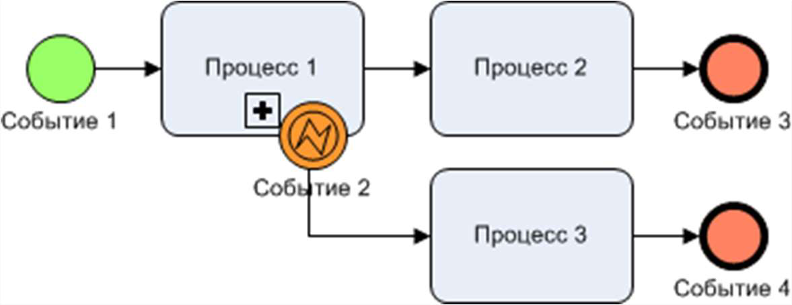

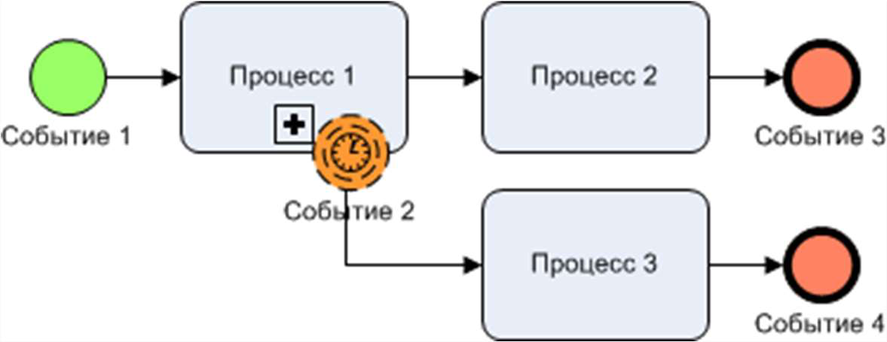

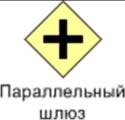

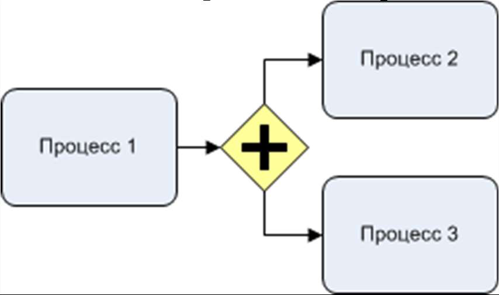

## Страница 6

Рисунок 7 
 
На Рис.8 параллельный шлюз используется для слияния потоков 
управления или синхронизации параллельных веток выполнения 
процесса. Выполнение Процесса 3 запустится только тогда, когда 
выполнится и Процесс 1, и Процесс 2. 
 
Рисунок 8 
Эксклюзивн
ый шлюз 
 
Эксклюзивный шлюз (XOR, "Исключающее ИЛИ") используется 
для ветвления потока управления на несколько альтернативных 
потоков, когда выполнение процесса зависит от выполнения 
некоторого условия. 
Символ "Эксклюзивный шлюз" может содержать внутренний 
маркер, выполненный в виде "X", но это не является 
обязательным. По умолчанию эксклюзивный шлюз добавляется 
на диаграмму с маркером. Для шлюза можно указывать 
наименование. 
Условия на диаграмме задаются при помощи условных потоков 
управления, исходящих из шлюза. При использовании 
эксклюзивного шлюза можно продолжить выполнение процесса 
только по одному из возможных условных потоков управления. 
Среди потоков управления, исходящих из эксклюзивного шлюза, 
допускается использование потока управления по умолчанию: 
если ни одно из условий не выполняется, дальнейшее выполнение 
процесса продолжится по потоку управления по умолчанию. 
На Рис.9 после выполнения Процесса 1 дальнейшее выполнение 
процесса может продолжиться только по одному потоку, 
исходящему из шлюза: 
- если Условие 1 верно, то выполнится только Процесс 3; 
- если Условие 2 верно, то выполнится только Процесс 4; 
- если ни Условие 1, ни Условие 2 не верны, то выполнится 
только Процесс 2.

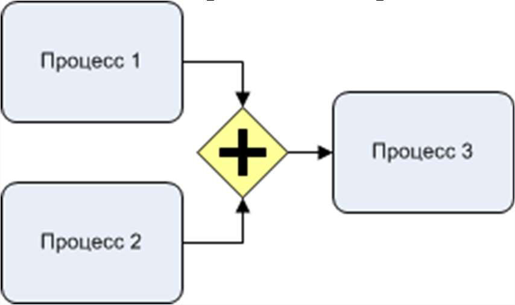

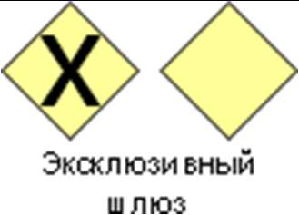

## Страница 7

Рисунок 9 
 
Эксклюзивный шлюз может использоваться и для слияния 
потоков управления. В данном случае шлюз просто пропускает 
через себя все потоки управления без синхронизации. 
На Рис.10 Процесс 3 будет выполнен дважды: после выполнения 
Процесса 1 и после выполнения Процесса 2. 
 
Рисунок 10
Неэксклюзивный 
шлюз 
 
Неэксклюзивный шлюз (OR, "ИЛИ") используется для ветвления 
потока управления на несколько потоков, когда выполнение 
процесса зависит от выполнения условий. При этом каждое из 
указанных условий является независимым, и дальнейшее 
выполнение процесса может продолжиться сразу по нескольким 
потокам управления, если условия будут выполнены. 
Для шлюза можно указывать наименование. 
Условия на диаграмме задаются при помощи условных потоков 
управления, исходящих из шлюза. Среди потоков управления, 
исходящих из неэксклюзивного шлюза, допускается 
использование потока управления по умолчанию: если ни одно 
из условий не выполняется, дальнейшее выполнение процесса 
продолжится по потоку управления по умолчанию. На Рис.11 
после выполнения Процесса 1 дальнейшее выполнение процесса 
может продолжиться по любому потоку, исходящему из шлюза, 
если условие, заданное на этом потоке, выполняется: 
- если Условие 1 верно, то выполнится Процесс 3; 
- если Условие 2 верно, то выполнится Процесс 4; 
- если ни Условие 1, ни Условия 2 не верны, то выполнится 
только Процесс 2.

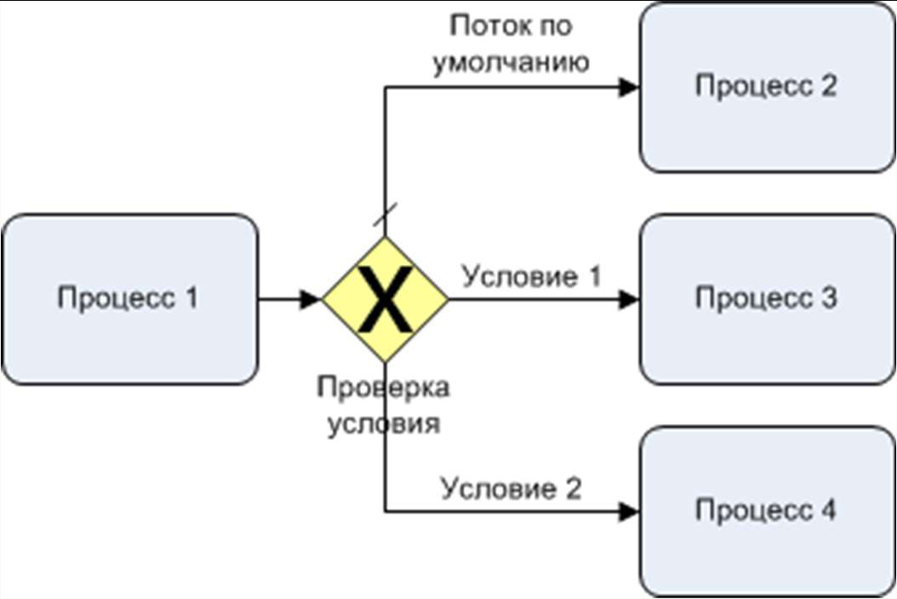

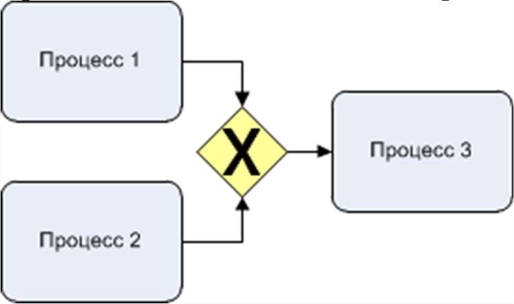

## Страница 8

Рисунок 11 
 
Показать ветвление потоков управления подобно 
неэксклюзивному шлюзу можно при помощи условных потоков 
управления (Рис.20). 
Неэксклюзивный шлюз может использоваться для слияния 
потоков управления. В данном случае шлюз может 
использоваться для синхронизации. На Рис.12 Процесс 3 будет 
выполнен только тогда, когда выполнится и Процесс 1, и Процесс 
2. 
 
Рисунок 12
Комплексны
й шлюз 
 
Комплексный шлюз используется для ветвления потока 
управления на несколько потоков, когда выполнение процесса 
зависит от выполнения условий. По своему действию 
комплексный шлюз аналогичен неэксклюзивному шлюзу. 
Для шлюза можно указывать наименование. 
На Рис.13 после выполнения Процесса 1 дальнейшее выполнение 
процесса может продолжиться по любому потоку, исходящему из 
шлюза, если условие, заданное на этом потоке, выполняется: 
- если Условие 1 верно, то выполнится Процесс 2; 
- если Условие 2 верно, то выполнится Процесс 3; 
- если Условие 3 верно, то выполнится Процесс 4.

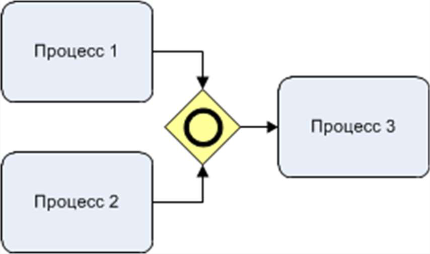

## Страница 9

Рисунок 13
Эксклюзивн
ый шлюз по 
событиям 
 
Эксклюзивный шлюз по событиям (XOR, "Исключающее ИЛИ") 
используется для ветвления потока управления на несколько 
альтернативных потоков, когда дальнейшее выполнение процесса 
зависит от возникновения некоторого события-обработчика, 
следующего после шлюза. Отдельно взятое событие, обычно с 
типами "Получение сообщения" или "Таймер", определяет выбор 
только одного маршрута, по которому будет проходить 
дальнейшее выполнение процесса: событие, идущее после шлюза 
и возникшее первым, определяет дальнейший ход выполнения 
процесса. На Рис.14 после выполнения Процесса 1 дальнейшее 
выполнение процесса может продолжиться только по одной 
ветке, исходящей из шлюза: 
- если первым возникло Событие 1, то выполнится только 
Процесс 2; 
- если первым возникло Событие 2, то выполнится только 
Процесс 3. 
 
Рисунок 14 
 
Существует 2 типа шлюзов по событиям, которые могут быть 
использованы в начале процесса: 
- эксклюзивный шлюз по событиям (для запуска процесса) 
(Рис.15); 
- параллельный шлюз по событиям (для запуска процесса) 
(Рис.16). 
В случае, когда шлюз по событиям используется для запуска 
процесса, у него не должно быть входящих связей. 
Эксклюзивный шлюз по событиям (для запуска процесса) 
аналогичен обычному эксклюзивному шлюзу по событиям: 
событие, идущее после шлюза и возникшее первым, определяет

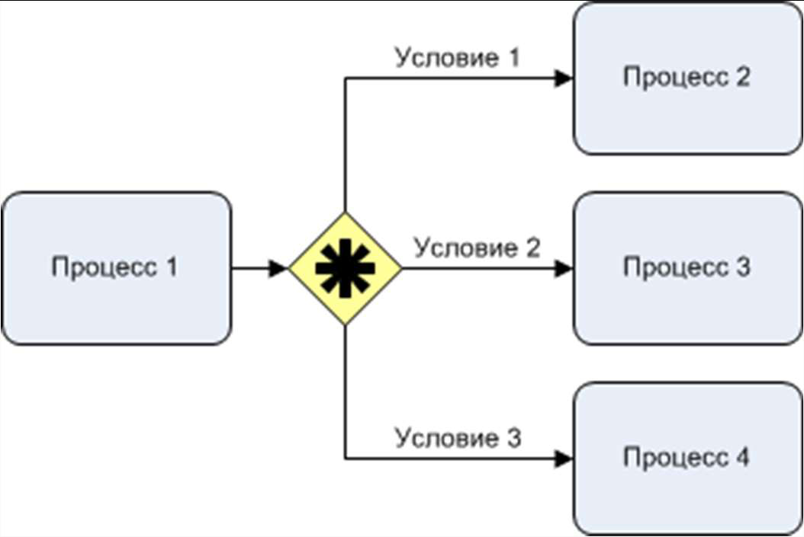

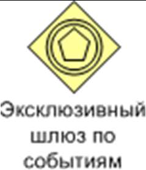

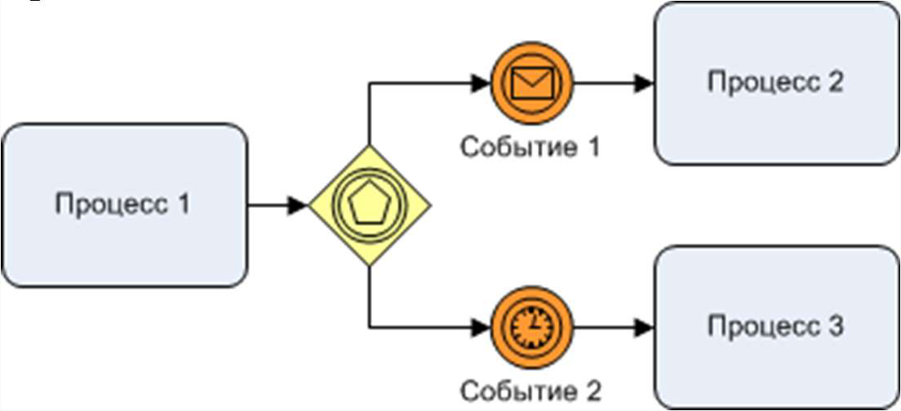

## Страница 10

дальнейший ход выполнения процесса. 
На Рис.15 выполнение процесса начнется с возникновения одного 
из событий, идущих после шлюза: 
- если первым возникнет Событие 1, то дальнейшее выполнение 
процесса будет осуществляться только по потоку управления, 
исходящему из этого события, т.е. выполнится Процесс 1; 
- если первым возникнет Событие 2, то дальнейшее выполнение 
процесса будет осуществляться только по потоку управления, 
исходящему из этого события, т.е. выполнится Процесс 2. 
 
Рисунок 15 
 
При использовании параллельного шлюза по событиям (для 
запуска процесса) выполнение процесса запускается по всем 
возникшим событиям, идущим после шлюза. 
На Рис.16 Процесс 1 и Процесс 2 будут выполнены, если 
возникнут события, идущие перед этими процессами. 
 
Рисунок 16
Поток 
управления 
 
Стрелка используется для связи элементов потока BPMN 
(событий, процессов, шлюзов). Поток управления отображает ход 
выполнения процесса. При необходимости поток может быть 
именованным. 
Стандартный поток управления является неконтролируемым, т.е. 
на поток не воздействуют никакие условия, и поток не проходит 
через шлюзы. Простейшими примерами неконтролируемого 
потока управления могут служить отдельно взятый поток 
управления, связывающий два процесса (Рис.17), или потоки 
управления, сходящиеся в процессе (Рис.18) или расходящийся от 
него (Рис.19). 
 
Рисунок 17

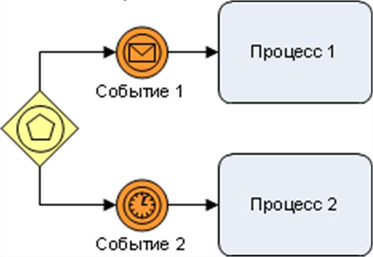

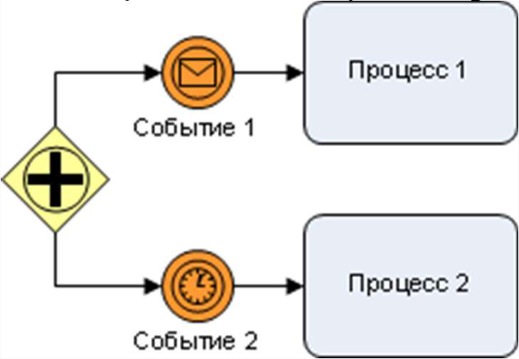

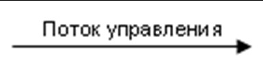

## Страница 11

Рисунок 18 
 
 
Рисунок 19
Условный 
поток 
управления 
Стрелка используется для отображения потока управления и 
используется тогда, когда необходимо показать, что по 
рассматриваемому потоку будет происходить дальнейшее 
выполнение процесса только в том случае, если выполнится 
условие, указанное в названии потока. В случае, если условный 
поток управления является исходящим от процесса, то у 
основания линии изображается небольшой ромбик (Рис.20). Если 
же условный поток управления является исходящим от шлюза, то 
никакого ромбика у основания линии не будет (см. Рис.9). 
 
Рисунок 20
Поток 
управления 
по 
умолчанию 
Стрелка используется для отображения потока управления и 
используется тогда, когда необходимо показать, что по 
рассматриваемому потоку будет происходить дальнейшее 
выполнение процесса только в том случае, если не выполнилось 
ни одно из условий, заданных на условных потоках управления, 
исходящих из процесса или эксклюзивного/неэксклюзивного 
шлюза. Для изображения таких потоков управления используется 
диагональная черточка, располагающиеся у основания линии.

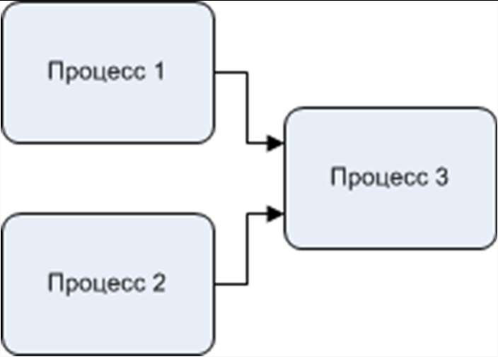

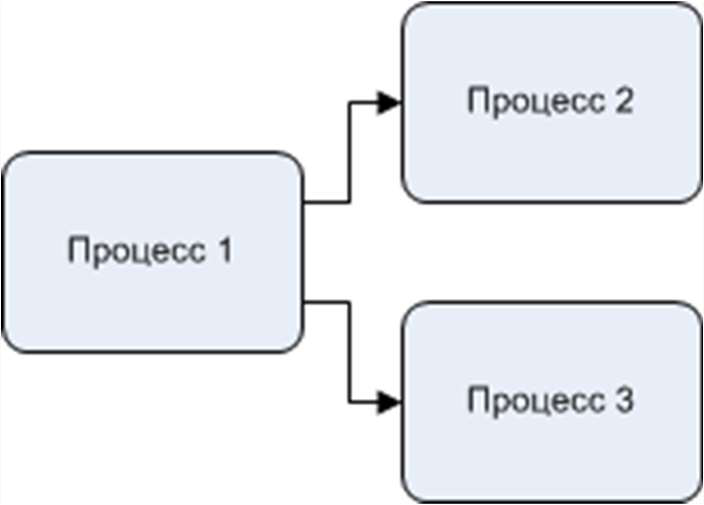

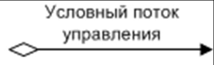

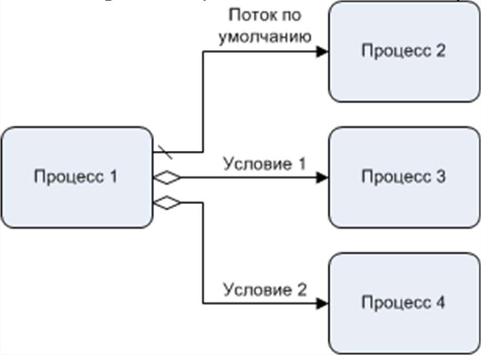

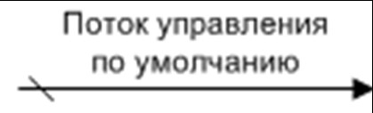

## Страница 12

При необходимости поток управления по умолчанию может быть 
именованным (см. Рис.20).
Поток 
сообщений 
Стрелка используется для отображения межпроцессного 
взаимодействия - для связи элементов потока со свернутыми 
пулами. При необходимости поток может быть именованным. 
Поток сообщений не отображает ход выполнения процесса, а 
показывает передачу сообщений или объектов из одного процесса 
в другой процесс или внешнюю ссылку. На Рис.21 представлено 4 
примера использования потоков сообщений: 
- поток сообщений представляет механизм запуска процесса: 
Поток сообщений 1 выходит из внешнего процесса (или внешней 
ссылки) и входит в стартовое Событие 1. В качестве события 
может выступать и промежуточное событие-обработчик, но в 
этом случае поток сообщений будет инициировать лишь 
возникновение события, а не запуск процесса; 
- поток сообщений используется для передачи сообщений или 
объектов из внешнего процесса (или внешней ссылки) в один из 
процессов рассматриваемого процесса: Поток сообщений 2 
выходит из Процесса 2 и входит в Задачу 1; 
- поток сообщений используется для передачи сообщений или 
объектов из одного процесса рассматриваемого процесса во 
внешний процесс (или внешнюю ссылку): Поток сообщений 3 
выходит из Задачи 2 и входит во внешний процесс (или внешнюю 
ссылку); 
- передача сообщения (или объекта) во внешний процесс (или 
внешнюю ссылку) инициируется конечным событием: Поток 
сообщений 4 выходит из конечного События 2 и входит во 
внешний процесс (или внешнюю ссылку). В качестве события 
может выступать и промежуточное событие-инициатор. 
 
Рисунок 21
Ассоциация 
Стрелка используется для отображения связи объектов данных и 
баз данных с процессами. Связь может быть направленной и 
ненаправленной в зависимости от соединяемых элементов и типа 
связи.

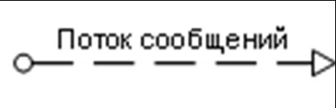

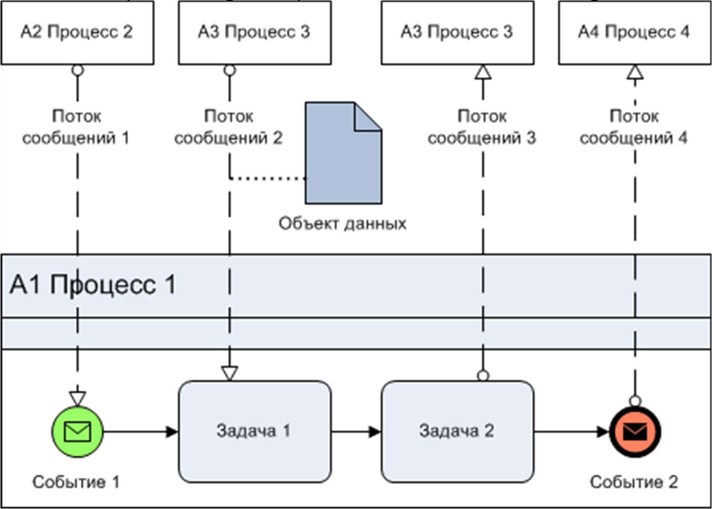

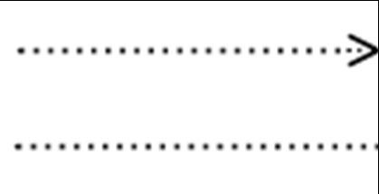

## Страница 13

На Рис.22 Объект данных передается из Процесса 1 в Процесс 3. 
При этом при помощи ассоциаций устанавливается 2 связи: связь 
процесса с объектом данных и связь объекта данных с процессом. 
При наведении связи между двумя элементами предлагается 
выбрать тип связи. 
 
Рисунок 22 
 
Если объект данных передается между двумя последовательно 
соединенными процессами, то можно использовать одну 
ассоциацию, которая строится в направлении от объекта данных к 
потоку управления, связывающему два процесса (Рис.23). После 
добавления ассоциации последовательно будет предложено 
выбрать типы связи: тип связи процесса с объектом данных и тип 
связи объекта данных с процессом. 
 
Рисунок 23 
 
Подобно ассоциации, связанной с потоком управления, объекты 
данных можно присоединять ассоциацией к потокам сообщений. 
При этом также будет создано две связи: связь процесса с 
объектом данных и связь объекта данных с процессом. Выбрать 
тип соответствующей связи также будет предложено 
последовательно (Рис.24).

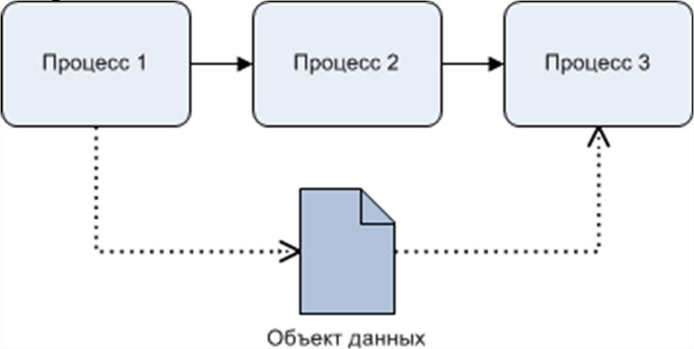

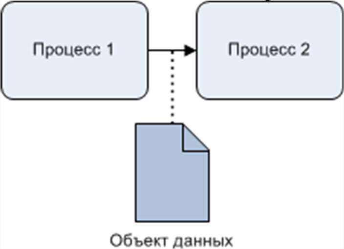

## Страница 14

Рисунок 24 
Возможные типы связей, которые могут быть выбраны при 
установлении связей двух элементов при помощи ассоциации 
приведены ниже в Табл.2 - Табл.6  
Ассоциации также используются для отображения обработчика 
компенсации, т.е. когда процесс с типом "Компенсация" 
используется для компенсации выполнения другого процесса. В 
этом случае промежуточное событие с типом "Компенсация" 
присоединяется к границам процесса для того, чтобы указывать 
на то, что этому процессу может потребоваться компенсация. В 
то же время событие соединяется ассоциацией с процессом, 
который будет компенсировать выполнение первого процесса 
(Рис.25). 
 
Рисунок 25
Пул 
Пул предназначен для отображения потока рассматриваемого 
процесса. Содержимое пула - это и есть тот процесс, диаграмма 
которого рассматривается. На диаграмме развернутый пул может 
быть только один.
Дорожка 
Дорожка предназначена для отображения исполнителей задач и 
подпроцессов процесса BPMN (оргединиц или объектов 
деятельности). Внутри блока помещается наименование 
исполнителя.

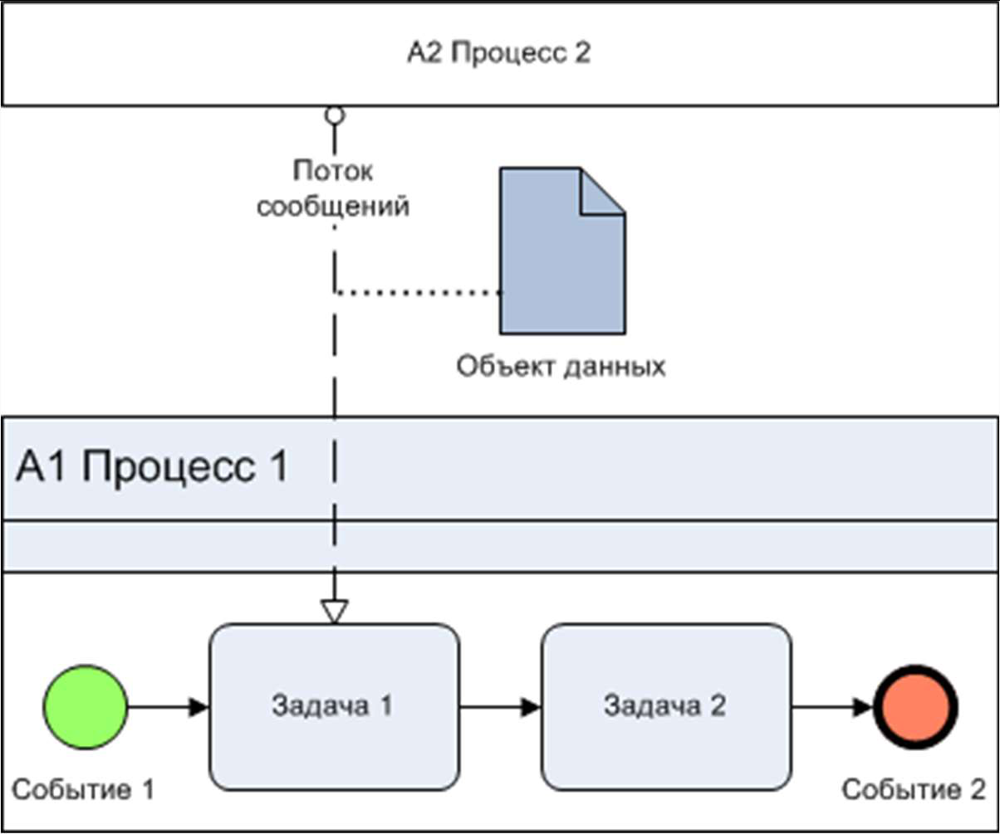

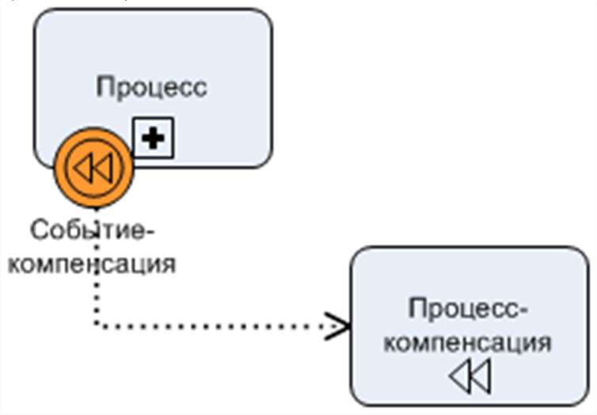

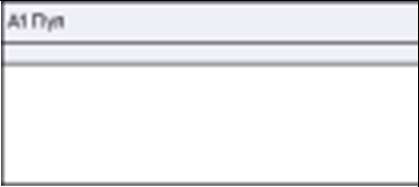

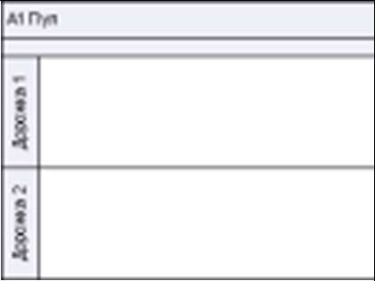

## Страница 15

Свернутый 
пул 
Символ, обозначающий внешний (по отношению к текущей 
диаграмме) процесс или внешнюю ссылку. Внутри блока 
помещается наименование внешнего процесса или внешней 
ссылки. 
Свернутый пул используется для указания взаимосвязей 
процесса: 
- обозначает процесс или внешнюю ссылку, откуда поступил или 
куда передается поток сообщений; 
- обозначает предыдущий или следующий процесс по отношению 
к диаграмме рассматриваемого процесса. 
На Рис.26 показано, что сдаточная документация поступает в 
процесс "Организация итогового собрания по проекту" из 
процесса "Внесение сдаточной документации в папку проекта". 
 
Рисунок 26 
 
На Рис.27 показано, что после окончания Процесса 1 Событие 2 
инициирует отправку сообщения в Процесс 2.

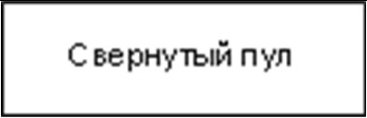

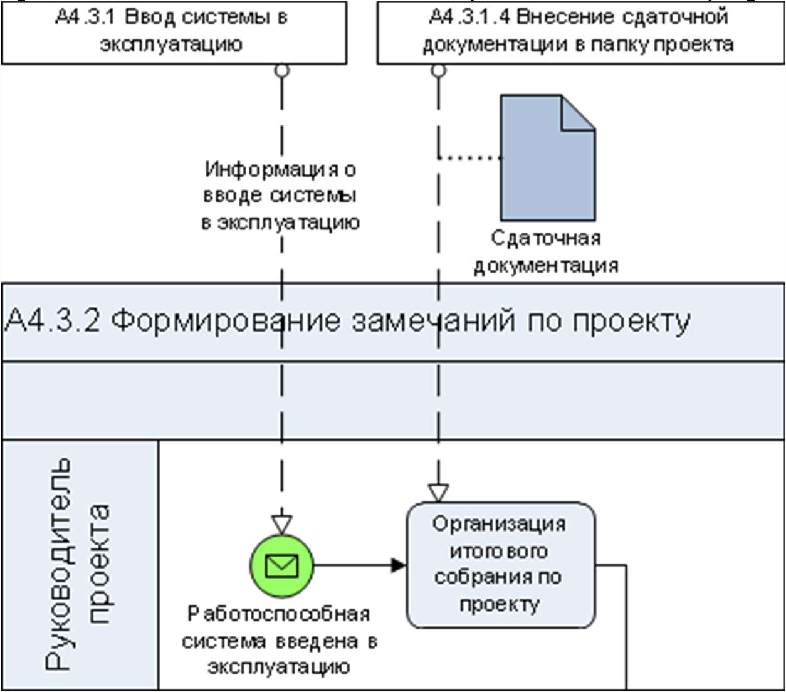

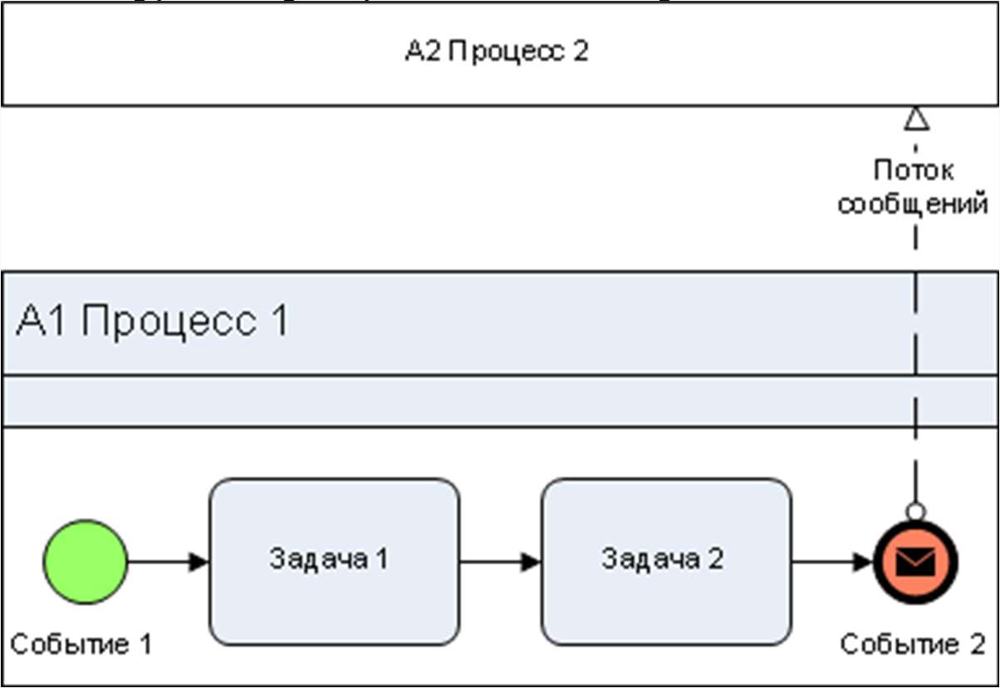

## Страница 16

Рисунок 27. Диаграмма Процесса 1 
На диаграмме Процесса 2 (Рис.28) показано, что поток 
сообщений, поступающий из Процесса 1, инициирует Событие 2, 
запускающее выполнение Процесса 2. 
 
Рисунок 28. Диаграмма Процесса 2
Документы 
Используется для отображения на диаграмме документов, 
сопровождающих выполнение процесса. Рядом с блоком 
размещается наименование документа. 
В качестве объекта данных может использоваться объект 
справочников: Бумажный документ, Электронный документ. 
Программны
е продукты 
Используется для отображения на диаграмме программных 
продуктов, сопровождающих выполнение процесса. Рядом с 
блоком размещается наименование продукта. 
Базы данных 
Используется для отображения на диаграмме базы данных, 
сопровождающей выполнение процесса. Рядом с символом 
размещается наименование базы данных. 
Материальн
ые объекты 
Используется для отображения на диаграмме материальных 
объектов, сопровождающих выполнение процесса. Рядом с 
символом размещается наименование объекта. 
Прочее 
Используется для отображения на диаграмме объектов 
справочника Прочее, сопровождающих выполнение процесса. 
Рядом с символом размещается наименование объекта. 
Сноска 
 
Выносной символ, предназначенный для нанесения текстовых 
комментариев. 
Символ может быть использован на диаграммах процессов в 
любых нотациях.

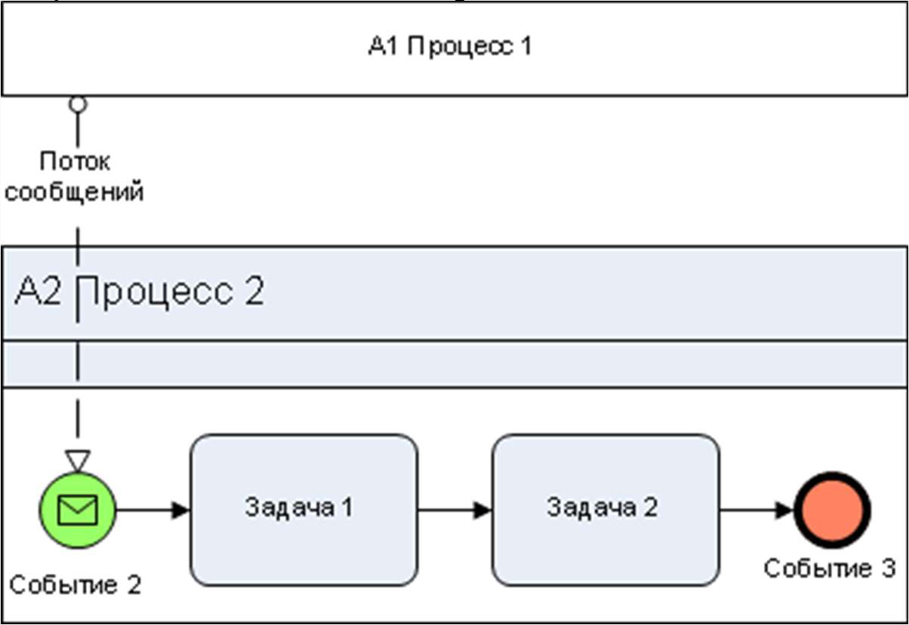

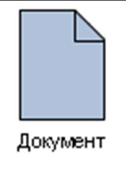

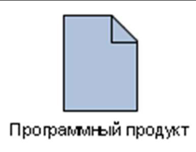

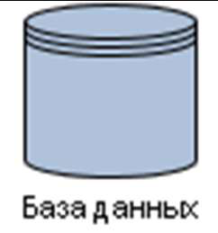

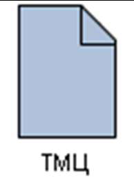

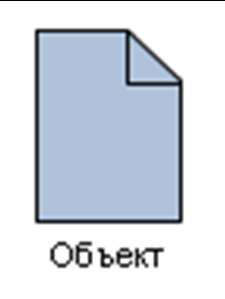

## Страница 17

Пример диаграммы процесса в нотации BPMN приведен на Рис.29: 
 
Рисунок 29. Пример диаграммы процесса в нотации BPMN 
Типы связей, которые могут быть наведены между элементами на диаграмме BPMN, перечислены в 
таблицах (Табл. 2 - Табл. 8). При необходимости перечень типов связей может быть изменен. 
 
Элемент, с 
которым 
устанавливается 
связь 
Тип 
связи 
Назначение связи 
Пример использования связи 
База данных 
изменяет Связь используется, если 
необходимо отобразить, 
что в рамках выполнения 
процесса в базу данных 
вносятся изменения.
 
имеет на 
выходе 
Связь используется, если 
необходимо отобразить, 
что база данных передается 
из одного процесса в 
другой.
создает 
на 
выходе 
Связь используется, если 
необходимо отобразить, 
что в результате 
выполнения процесса 
создается новая база 
данных.

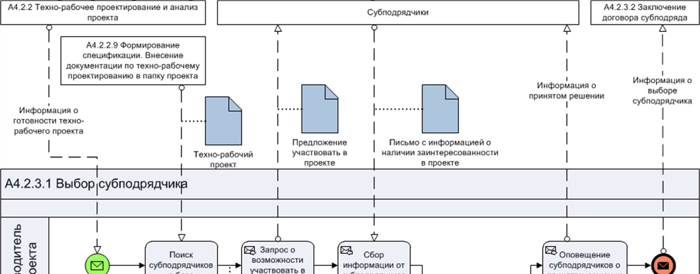

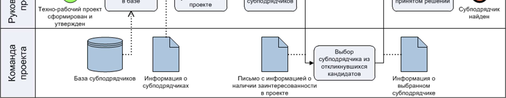

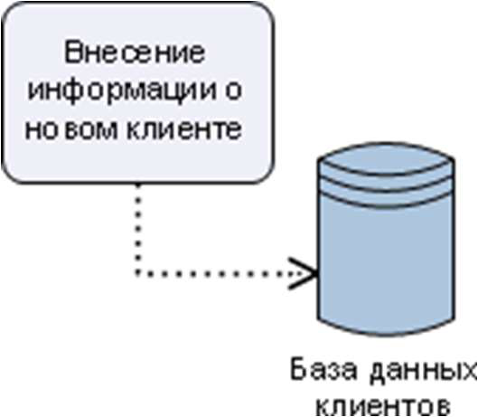

## Страница 18

Документ 
изменяет Связь используется, если 
необходимо отобразить, 
что в рамках выполнения 
процесса в документ 
вносятся изменения.
имеет на 
выходе 
Связь используется, если 
необходимо отобразить, 
что документ передается из 
одного процесса в другой.
создает 
на 
выходе 
Связь используется, если 
необходимо отобразить, 
что в результате 
выполнения процесса 
создается новый документ. 
Информация 
изменяет Связь используется, если 
необходимо отобразить, 
что в рамках выполнения 
процесса изменяется 
информация.
 
имеет на 
выходе 
Связь используется, если 
необходимо отобразить, 
что информация передается 
из одного процесса в 
другой.
создает 
на 
выходе 
Связь используется, если 
необходимо отобразить, 
что в результате 
выполнения процесса 
появляется информация.
Материальный 
объект 
изменяет Связь используется, если 
необходимо отобразить, 
что в рамках выполнения 
процесса изменяется 
материальный объект.
 
имеет на 
выходе 
Связь используется, если 
необходимо отобразить, 
что материальный объект 
передается из одного 
процесса в другой.
создает 
на 
выходе 
Связь используется, если 
необходимо отобразить, 
что в результате 
выполнения процесса 
формируется материальный 
объект.
Программный 
продукт 
изменяет Связь используется, если 
необходимо отобразить, 
что в рамках выполнения

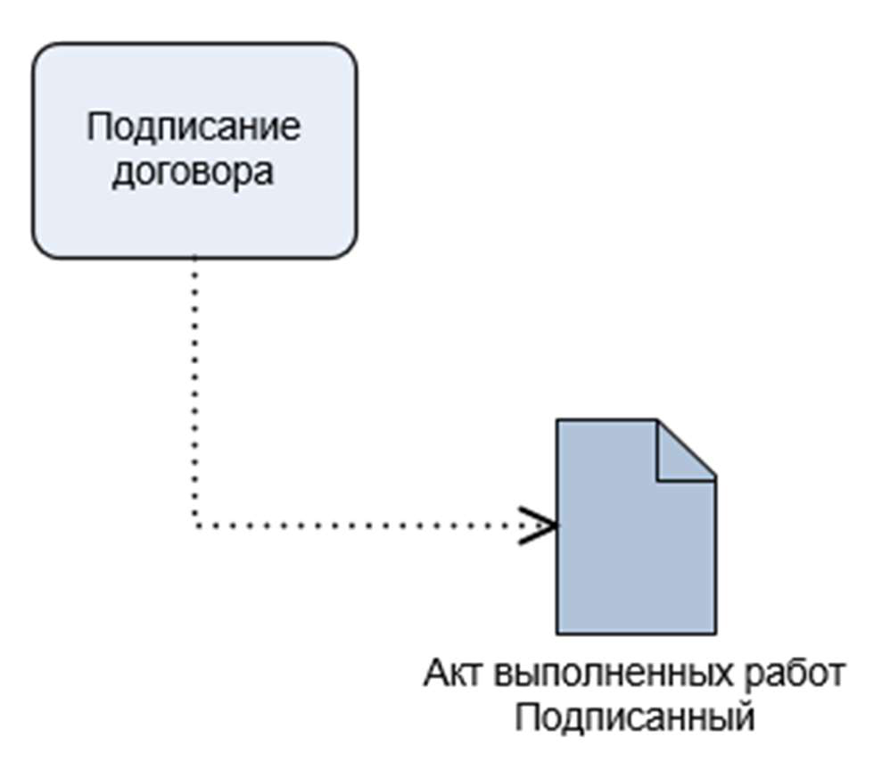

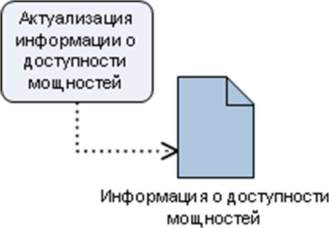

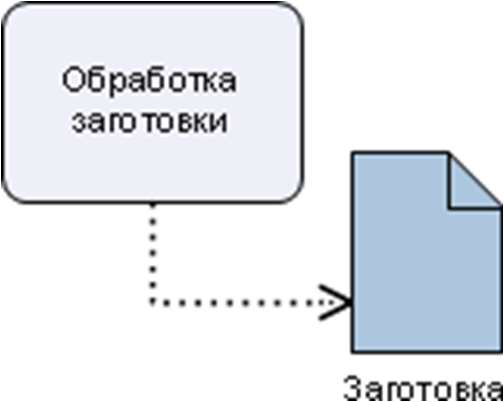

## Страница 19

процесса изменяется 
Информационная система, 
ее модуль или функция.
 
имеет на 
выходе 
Связь используется, если 
необходимо отобразить, 
что Информационная 
система, ее модуль или 
функция передается из 
одного процесса в другой.
создает 
на 
выходе 
Связь используется, если 
необходимо отобразить, 
что в результате 
выполнения процесса 
создается Информационная 
система, ее модуль или 
функция.
Таблица 2. Типы связей Процесса с Функциональными объектами 
Элемент, с 
которым 
устанавливается 
связь 
Тип связи 
Назначение связи 
Пример использования 
связи 
Процесс 
поддерживает Связь используется, если необходимо 
отобразить, что процесс выполняется с 
использованием информационной 
системы, ее модуля или функции. 
выполняет 
Связь используется, если необходимо 
отобразить, что процесс выполняется 
непосредственно информационной 
системой, ее модулем или функцией. 
Таблица 3. Типы связей Программного продукта 
Элемент, с 
которым 
устанавливается 
связь 
Тип связи 
Назначение связи 
Пример использования 
связи 
Процесс 
предоставляет 
входные данные 
для 
Связь используется, если необходимо 
отобразить, что выполнение процесса 
осуществляется с использованием 
документа. 
Таблица 4. Типы связей Документа

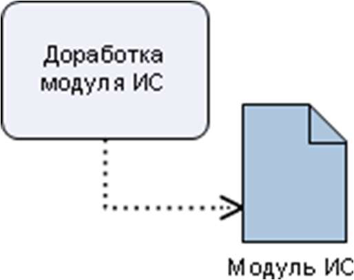

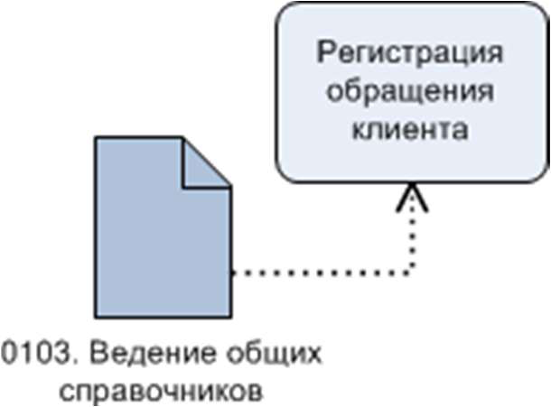

## Страница 20

Элемент, с 
которым 
устанавливается 
связь 
Тип 
связи 
Назначение связи 
Пример использования 
связи 
Процесс 
выполняет Связь используется, если необходимо 
отобразить, что выполнение процесса 
осуществляется непосредственно базой 
данных. 
Таблица 5. Типы связей Базы данных 
Элемент, с 
которым 
устанавливается 
связь 
Тип связи 
Назначение связи 
Пример использования 
связи 
Процесс 
используется Связь используется, если необходимо 
отобразить, что выполнение процесса 
осуществляется с использованием 
информации. 
является 
входом для 
Связь используется, если необходимо 
отобразить, что информация, 
поступившая на вход процесса, в 
результате выполнения процесса 
преобразуется в другую информацию, 
документ или объект. 
Таблица 6. Типы связей Информации 
Элемент, с 
которым 
устанавливается 
связь 
Тип связи 
Назначение связи 
Пример использования 
связи 
Процесс 
используется Связь используется, если необходимо 
отобразить, что выполнение процесса 
осуществляется с использованием 
материальных объектов.

## Страница 21

является 
входом для 
Связь используется, если необходимо 
отобразить, что материальные объекты, 
поступившие на вход процесса, в 
результате выполнения процесса 
преобразуются из одного состояния в 
другое. 
выполняет 
Связь используется, если необходимо 
отобразить, что выполнение процесса 
осуществляется непосредственно 
материальным объектом. 
Таблица 7. Типы связей Материальных объектов 
Элемент, с 
которым 
устанавливается 
связь 
Тип 
связи 
Назначение связи 
Пример использования 
связи 
Процесс 
выполняет Связь используется, если необходимо 
отобразить, что выполнение процесса 
осуществляется объектом справочника 
«Прочее». 
Таблица 8. Типы связей объектов Прочее 
 
Правила построения диаграмм. 
Рассмотрим пример бизнес-процесса обработки заявки.

## Страница 22

Стартовым событием в нашем процессе является поступление заявки от клиента. Обратите 
внимание, что клиент на диаграмме показан в виде свернутого пула: мы не видим никаких действий в 
пуле клиента, потому что для рассматриваемого процесса он представляет собой чёрный ящик, от 
которого приходят и уходят потоки сообщений, без подробностей обработки. 
Чтобы распределить действия по областям ответственности разных ролей, можно использовать 
дорожки в рамках одного или нескольких пулов. В рамках одного пула переход между действиями 
выполняется через поток управления, показываемый сплошной линией, а между собой пулы общаются 
друг с другом через поток сообщений, обозначаемый пунктирной линией. 
 
Обозначение действий по областям ответственности разных ролей 
 
После действия «Направить клиенту коммерческое предложение (КП)» на диаграмме используется 
логический оператор ИЛИ (событийный XOR), после которого возможен один из двух вариантов: 
1. Если прошло 5 дней, что показано событием с триггером таймер, и ответа от клиента нет, заявке 
присваивается статус «Отказ» в CRM-системе и наступает финишное событие «Заявка 
закрыта». 
 
2. Если же ответ от клиента получен и 5 дней ещё не прошло, процесс движется дальше в 
зависимости от данных в этом ответе. 
 
Таким образом либо заявке присваивается статус «Отказ» или выполняется свернутая задача 
«Сформировать проект договора», детали которой показаны на отдельной диаграмме.

## Страница 23

Рекомендации по использованию BPMN. Такая вариативность, когда схема одного и тоже же 
процесса может выглядеть по-разному у нескольких аналитиков, является скорее недостатком нотации, 
чем достоинством. Поэтому при использовании BPMN в качестве корпоративного стандарта описания 
бизнес-процессов следует ограничить алфавит этой нотации, определив во внутреннем соглашении, какие 
элементы допустимо использовать, и что именно они будут означать в практическом применении. 
Принимая во внимание три уровня моделирования BPMN и избыточный алфавит этой нотации, 
можно сделать вывод, что при проектировании диаграмм «для людей» (без запуска на выполнение 
в BPMS-системах) следует намеренно ограничить количество используемых элементов: 
 
Использовать только пользовательские и ручные задачи — без сценариев, сервисов и бизнес-
правил, отправки и получения сообщений 
 
Использовать только свернутые подпроцессы, раскрывая их детали на отдельной диаграмме 
 
Использовать только XOR и AND, без событийных шлюзов и OR, так как разница между 
исключающим и не исключающим ИЛИ понятна не всем пользователям 
 
Использовать события с типом простое, таймер, сообщение и останов 
 
Для упрощения восприятия диаграммы стоит придерживаться правил наименования: 
 
Внешних контрагентов показывать как закрытые, они же — свёрнутые пулы (пулы, в которых 
нет действий) 
 
Называть закрытые пулы ролями или бизнес-единицами, а открытые — процессами 
 
Называть дорожки также, как роль, должность или структурное подразделение 
 
Называть действия (задачи) в стиле Глагол-Существительное, например, «Проверить счёт», 
«Подтвердить заявку», «Оформить договор» 
 
Называть события как свершившийся факт в прошедшем времени, к примеру, «Поступила 
заявка», «Прошло 3 дня» 
 
Подписывать исходящие из XOR стрелки, например, «Да» и «Нет», а также отмечать поток 
по умолчанию 
Также рекомендуется: 
 
Показывать успешное и неуспешное завершение процесса разными финишными событиями 
 
Не выводить поток управления за пределы подпроцесса 
 
Взаимодействие между разными пулами показывать через поток сообщений (пунктирной 
стрелкой), который не может присоединяться к шлюзам, в отличие от потока управления 
Наконец, при разработке любой диаграммы нужно помнить о главном правиле аналитика: 
независимо от нотации, ваша схема должна быть МАКСИМАЛЬНО простой и понятной читателю БЕЗ 
знания тонкостей процессного моделирования! 
В целом алгоритм разработки BPMN-диаграммы можно представить как набор следующих 7 
шагов: 
1. Определить границы процесса, т. е. стартовое и конечное события, участников и полезный 
результат 
2. Описать «счастливый» путь (happy path), который ведёт к созданию полезного результата 
(продукта) 
3. Добавить условия и альтернативные потоки 
4. Добавить неуспешные завершения 
5. Добавить артефакты (объекты и хранилища данных) 
6. Раскрыть на новых связанных диаграммах свёрнутые подпроцессы 
7. Добавить промежуточные событийные потоки к внешним пулам 
 
Пример построения диаграммы по текстовому описанию 
Рассмотрим пример процессов работы с клиентской заявкой, представленной двумя пулами: 
«Обработка заявки» и «Заключение договора». 
Клиент является внешним участником этих бизнес-процессов, то есть чёрным ящиком, поэтому он 
показан свёрнутым пулом. Общение между пулами реализовано через потоки сообщений.

## Страница 24

Процесс начинается с момента, когда клиент оставил заявку на сайте (то есть поступление заявки 
является триггером процесса, его стартовым событием). На основании заявки, в которой указаны 
подробности заказа, менеджер формирует коммерческое предложение (КП). Далее менеджер озвучивает 
КП по телефону или направляет на email, или же делает и то, и другое — в зависимости от пожеланий 
клиента и указанных в заявке контактных данных. 
Узнав подробности коммерческого предложения, клиент принимает решение о продолжении 
сотрудничества или отказе от него. Если клиент не согласился на условия КП, на этом процесс работы с 
ним заканчивается, а заявке присваивается статус «Отказ». 
Если же клиента устраивают все условия, он сообщает менеджеру о намерении заключить договор 
и передаёт нужные для этого данные. Менеджер формирует новую версию проекта договора и отправляет 
его на согласование клиенту. При отсутствии возражений клиент подписывает договор. После этого 
договор считается заключённым, и на этом бизнес-процесс заканчивается, и запускается процесс оплаты, 
описанный на отдельной диаграмме. 
При наличии возражений к проекту договора клиент вносит в него изменения и снова направляет 
менеджеру. Менеджер формирует новый проект договора и снова отправляет клиенту на согласование, 
то есть идёт возврат к ранее выполняемой задаче.

## Страница 25

Пример построения диаграммы процесса «Заключения договора» 
 
 
ИНДИВИДУАЛЬНОЕ ЗАДАНИЕ 
По выбранной предметной области и на основе декомпозиции процессов выбрать 
один из процессов и выполнить его моделирование в нотации BPMN. 
Для 
построения 
можно 
использовать 
онлайн-редактор 
https://www.lucidchart.com/pages/ru/bpmn

