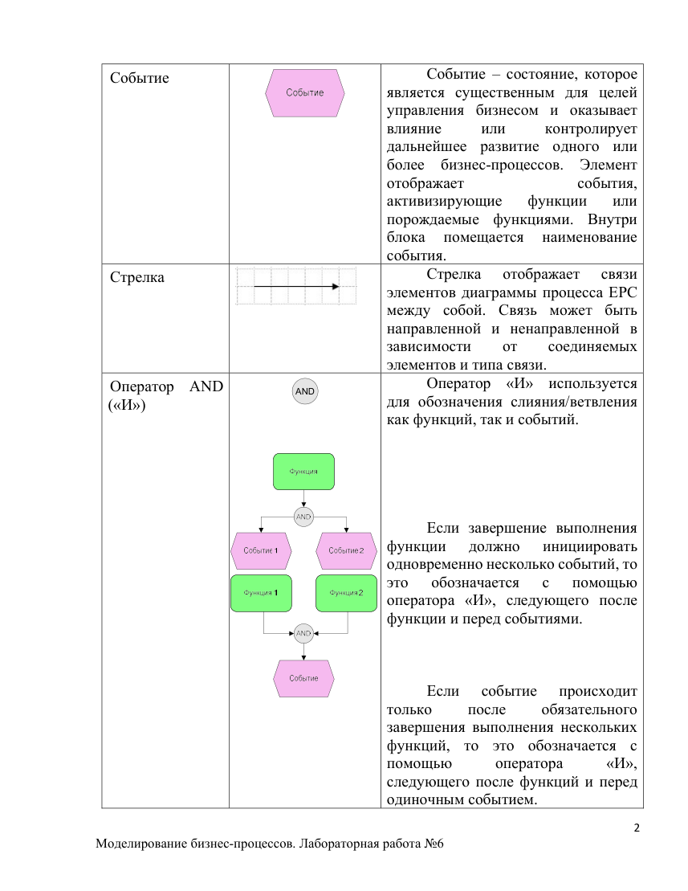
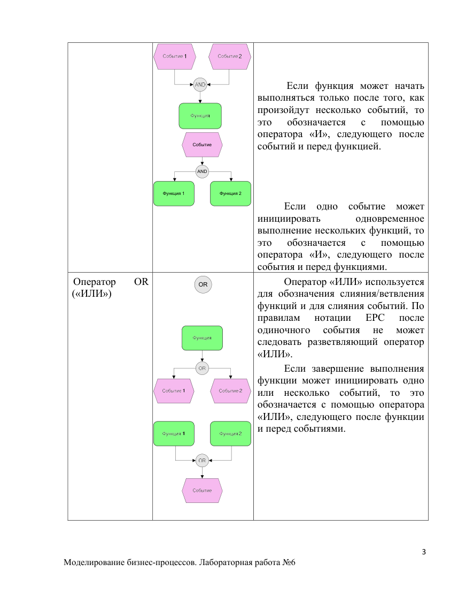
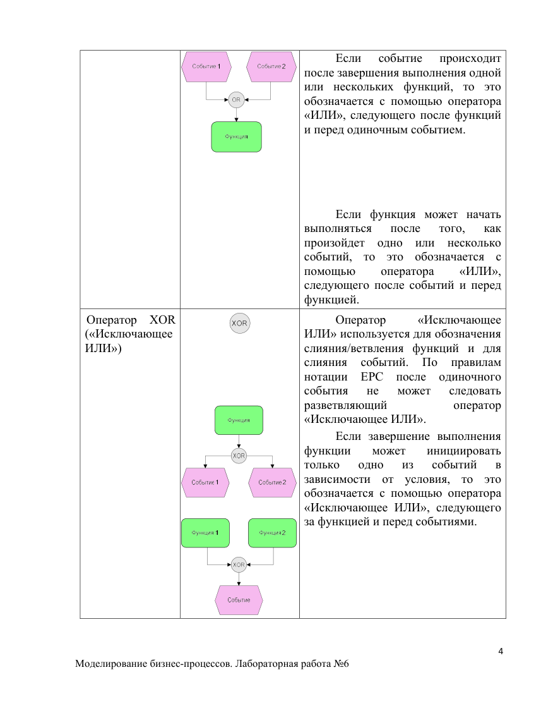
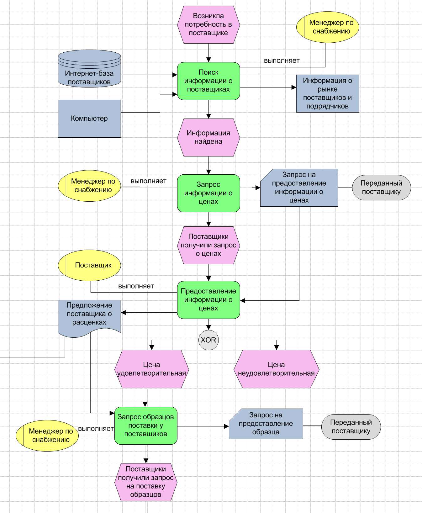
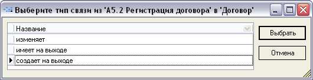
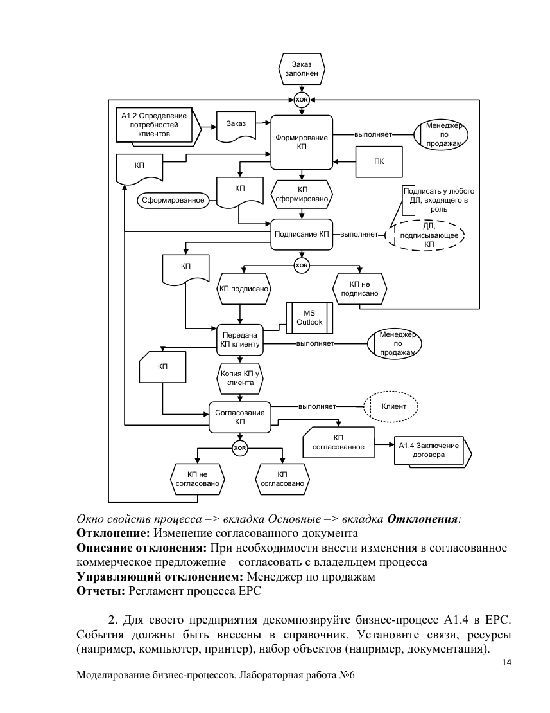

# МБП ЛР3 - Моделирование бизнес-процессов Нотация EPC

Оригинал: `../оригиналы/МБП ЛР3 - Моделирование бизнес-процессов Нотация EPC.pdf`

## Страница 1

1 
Моделирование бизнес-процессов. Лабораторная работа №6 
Лабораторная работа №6. Моделирование бизнес-процессов. Нотация 
EPC 
 
Цель работы: Приобрести навыки использования и применения нотации 
EPC посредством программного продукта Business Studio. 
Нотация EPC (Event-Driven Process Chain – событийная цепочка процессов) 
используется для описания процессов нижнего уровня. Диаграмма процесса в 
нотации EPC, представляет собой упорядоченную комбинацию событий и 
функций. Для каждой функции могут быть определены начальные и конечные 
события, участники, исполнители, материальные и документальные потоки, 
сопровождающие её, а также проведена декомпозиция на более низкие уровни. 
Декомпозиция может производиться только в нотации EPC. 
Графические символы, принятые в данной нотации, перечислены в таблице 
7.1 
 
Таблица 7.1 
Графические символы нотации EPC 
 
Название 
Графический 
символ 
Описание 
Функция 
 
Блок 
представляет 
собой 
функцию– 
действие 
или 
набор 
действий, 
выполняемых 
над 
исходным объектом (документом, 
ТМЦ и прочим) с целью получения 
заданного результата.  
Внутри 
блока 
помещается 
наименование функции. 
Временная 
последовательность 
выполнения 
функций задается расположением 
функций на диаграмме процесса 
сверху вниз.

## Страница 2

2 
Моделирование бизнес-процессов. Лабораторная работа №6 
Событие 
 
Событие – состояние, которое 
является существенным для целей 
управления бизнесом и оказывает 
влияние 
или 
контролирует 
дальнейшее развитие одного или 
более бизнес-процессов. Элемент 
отображает 
события, 
активизирующие 
функции 
или 
порождаемые функциями. Внутри 
блока 
помещается 
наименование 
события.
Стрелка 
 
Стрелка 
отображает 
связи 
элементов диаграммы процесса EPC 
между собой. Связь может быть 
направленной и ненаправленной в 
зависимости 
от 
соединяемых 
элементов и типа связи.
Оператор AND 
(«И») 
AND 
 
 
Оператор «И» используется 
для обозначения слияния/ветвления 
как функций, так и событий. 
 
 
 
 
 
Если завершение выполнения 
функции 
должно 
инициировать 
одновременно несколько событий, то 
это 
обозначается 
с 
помощью 
оператора «И», следующего после 
функции и перед событиями.  
 
 
 
Если 
событие 
происходит 
только 
после 
обязательного 
завершения выполнения нескольких 
функций, то это обозначается с 
помощью 
оператора 
«И», 
следующего после функций и перед 
одиночным событием.

## Страница 3

3 
Моделирование бизнес-процессов. Лабораторная работа №6 
Событие
AND
Функция 1
Функция 2
 
 
 
 Если функция может начать 
выполняться только после того, как 
произойдут несколько событий, то 
это 
обозначается 
с 
помощью 
оператора «И», следующего после 
событий и перед функцией. 
 
 
 
 
Если одно событие может 
инициировать 
одновременное 
выполнение нескольких функций, то 
это 
обозначается 
с 
помощью 
оператора «И», следующего после 
события и перед функциями.
Оператор 
OR 
(«ИЛИ») 
OR 
 
 
 
Оператор «ИЛИ» используется 
для обозначения слияния/ветвления 
функций и для слияния событий. По 
правилам 
нотации 
EPC 
после 
одиночного 
события 
не 
может 
следовать разветвляющий оператор 
«ИЛИ». 
Если завершение выполнения 
функции может инициировать одно 
или несколько событий, то это 
обозначается с помощью оператора 
«ИЛИ», следующего после функции 
и перед событиями.

## Страница 4

4 
Моделирование бизнес-процессов. Лабораторная работа №6 
Если 
событие 
происходит 
после завершения выполнения одной 
или нескольких функций, то это 
обозначается с помощью оператора 
«ИЛИ», следующего после функций 
и перед одиночным событием.  
 
 
 
 
Если функция может начать 
выполняться 
после 
того, 
как 
произойдет одно или несколько 
событий, то это обозначается с 
помощью 
оператора 
«ИЛИ», 
следующего после событий и перед 
функцией.  
Оператор XOR 
(«Исключающее 
ИЛИ») 
 
 
 
 
 
 
Оператор 
«Исключающее 
ИЛИ» используется для обозначения 
слияния/ветвления функций и для 
слияния 
событий. 
По 
правилам 
нотации EPC после одиночного 
события 
не 
может 
следовать 
разветвляющий 
оператор 
«Исключающее ИЛИ». 
Если завершение выполнения 
функции 
может 
инициировать 
только 
одно 
из 
событий 
в 
зависимости от условия, то это 
обозначается с помощью оператора 
«Исключающее ИЛИ», следующего 
за функцией и перед событиями.

## Страница 5

5 
Моделирование бизнес-процессов. Лабораторная работа №6 
Если 
событие 
происходит 
сразу после завершения выполнения 
либо одной функции, либо другой, то 
это 
обозначается 
с 
помощью 
оператора «Исключающее ИЛИ», 
следующего после функций и перед 
одиночным событием.  
 
 
 
 
 
 
Если функция может начать 
выполняться сразу после того, как 
произойдет либо одно событие, либо 
другое, 
то 
это 
обозначается 
с 
помощью оператора «Исключающее 
ИЛИ», 
следующего 
после 
нескольких 
событий 
и 
перед 
функцией.  
 
Интерфейс 
процесса 
 
 
 
 
 
 
 
 
 
Элемент, 
обозначающий 
внешний (по отношению к текущей 
диаграмме) процесс или функцию. 
Используется 
для 
указания 
взаимосвязи процессов: 
 
обозначает предыдущий или 
следующий процесс по отношению к 
диаграмме 
рассматриваемого 
процесса; 
 
обозначает 
процесс, 
откуда 
поступил или куда передается объект.
Внутри 
блока 
помещается 
наименование внешнего процесса.

## Страница 6

6 
Моделирование бизнес-процессов. Лабораторная работа №6 
 
 
После окончания Процесса 1 (и 
наступления Событие 1)  начинает 
выполняться Процесс 2.  
 
 
 
 
 
 
Перед началом Процесса 2 был 
завершен 
Процесс 
1, 
инициировавший Событие 1. 
Бумажный 
документ 
 
Используется для отображения 
на диаграмме бумажных документов, 
сопровождающих 
выполнение 
функции. Внутри блока помещается 
наименование бумажного документа.
Электронный 
документ 
 
Используется для отображения 
на 
диаграмме 
электронных 
документов, 
сопровождающих 
выполнение функции. Внутри блока 
помещается 
наименование 
электронного документа. 
ТМЦ 
 
Используется для отображения 
на диаграмме товарно-материальных 
ценностей (ТМЦ), сопровождающих 
выполнение функции. Внутри блока 
помещается наименование ТМЦ. 
Информация 
 
Используется для отображения 
на 
диаграмме 
информационных 
потоков, 
сопровождающих 
выполнение функции. Внутри блока 
помещается 
наименование 
информационного потока.

## Страница 7

7 
Моделирование бизнес-процессов. Лабораторная работа №6 
Информационна
я система 
 
Используется для отображения 
на 
диаграмме 
информационной 
системы, 
поддерживающей 
выполнение функции. Внутри блока 
помещается 
наименование 
информационной системы. 
Модуль 
информационно
й системы 
 
Используется для отображения 
на 
диаграмме 
модуля 
информационной 
системы, 
поддерживающего 
выполнение 
функции. Внутри блока помещается 
наименование 
модуля 
информационной системы. 
Функция 
информационно
й системы 
 
Используется для отображения 
на 
диаграмме 
функции 
информационной 
системы, 
поддерживающей 
выполнение 
функции. Внутри блока помещается 
наименование 
функции 
информационной системы. 
База данных 
 
Используется для отображения 
на 
диаграмме 
базы 
данных, 
сопровождающей 
выполнение 
функции. Внутри блока помещается 
наименование базы данных. 
Термин 
 
 
 
Используется для отображения 
на 
диаграмме 
терминов, 
используемых 
в 
организации 
и 
сопровождающих 
выполнение 
функции. Внутри блока помещается 
наименование термина 
Набор объектов 
 
Используется для отображения 
на диаграмме наборов объектов, 
сопровождающих 
выполнение 
функции. Внутри блока помещается 
наименование набора объектов.

## Страница 8

8 
Моделирование бизнес-процессов. Лабораторная работа №6 
Прочее 
 
Используется для отображения 
на диаграмме потоков объектов, 
которые нельзя отнести ни к одной из 
предопределенных 
групп 
справочника 
«Объекты 
деятельности». 
Внутри 
блока 
помещается наименование прочего 
объекта. 
 
Правила моделирования процессов в нотации EPC 
 
1) Диаграмма функции EPC должна начинаться как минимум одним 
стартовым событием (стартовое событие может следовать за интерфейсом 
процесса) и завершаться как минимум одним конечным событием (конечное 
событие может предшествовать интерфейсу процесса). 
2) События и функции по ходу выполнения процесса должны чередоваться. 
Решения о дальнейшем ходе выполнения процесса принимаются функциями. 
3) Рекомендуемое количество функций на диаграмме – не более 20. Если 
количество функций диаграммы значительно превышает 20, то существует 
вероятность, что неправильно выделены процессы на верхнем уровне и 
необходимо произвести корректировку модели. 
4) События и функции должны содержать строго по одной входящей и 
одной исходящей связи, отражающей ход выполнения процесса. 
5) События и операторы, окружавшие функцию на вышележащей 
диаграмме (рис. 7.1), должны быть начальными/результирующими событиями и 
операторами на диаграмме декомпозиции функции (рис. 7.2).  
6) На диаграмме не должны присутствовать объекты без единой связи. 
7) Каждый оператор слияния должен обладать хотя бы двумя входящими 
связями и только одной исходящей, оператор ветвления – только одной входящей 
связью и хотя бы двумя исходящими. Операторы не могут обладать 
одновременно несколькими входящими и исходящими связями.  
8) Если оператор обладает входящей связью от элемента «событие», то он 
должен обладать исходящей связью к элементу «функция» и наоборот.

## Страница 9

9 
Моделирование бизнес-процессов. Лабораторная работа №6 
 
Рис. 7.1 Диаграмма процесса, 
 на которой встречается Функция 1 
 
 
 
Рис. 7.2. Диаграмма  
декомпозиции Функции 1 
 
9) За одиночным событием не должны следовать операторы «OR (ИЛИ)» 
или «XOR (Исключающее ИЛИ)». 
10) Операторы могут объединять или разветвлять только функции или 
только события. Одновременное объединение/ветвление функции и события 
невозможно. 
11) Оператор, разветвляющий ветки, и оператор, объединяющий эти ветки, 
должны совпадать. Допускается также ситуация, когда оператор ветвления «И», 
оператор объединения – «ИЛИ».  
Пример недопустимой ситуации (рис. 7.3):

## Страница 10

10 
Моделирование бизнес-процессов. Лабораторная работа №6 
 
Рис. 7.3. Недопустимая ситуация 
Для декомпозиции бизнес-процесса необходимо в навигаторе выбрать в 
контекстном меню (правая кнопка мыши) данного процесса «Преобразовать в 
EPC». 
На рис. 7.4. показан пример декомпозиции функции (нотация Event-Driven 
Process Chain).

## Страница 11

11 
Моделирование бизнес-процессов. Лабораторная работа №6 
 
Рис. 7.4. Диаграмма в нотации EPC

## Страница 12

12 
Моделирование бизнес-процессов. Лабораторная работа №6 
Работа с диаграммой нотации EPC 
 
Для добавления существующих элементов на диаграмму можно 
пользоваться механизмом Drag&Drop, то есть «перетаскивать» их из Навигатора 
или из форм справочников. 
При декомпозиции функции часто возникает необходимость перенести все 
элементы, связанные с ней на диаграмме вышележащей функции. При первом 
открытии 
диаграммы 
декомпозируемой 
функции 
выдается 
сообщение 
«Перенести элементы, связанные с декомпозируемой функцией?» Если ответить 
«Да», то на диаграмме автоматически будут созданы все элементы, связанные с 
декомпозируемой функцией на вышележащей диаграмме. При этом если событие 
соединено с функцией посредством операторов, то переносятся все операторы и 
связи, наведенные между событием и операторами. 
Впоследствии можно перенести все связанные элементы с помощью кнопки на 
Панели инструментов 
 «Переместить контекст функции с вышележащей 
диаграммы». 
 
Создание связей 
 
При добавлении связи между двумя элементами на диаграмме будет 
выдано окно для выбора типа связи между этими элементами (рис. 7.5). Если в 
справочнике типов связей между данными элементами существует только одна 
запись – будет автоматически создана связь с этим типом.  
 
 
 
Рис. 7.5. Выбор типа связи 
 
На стрелках можно отобразить тип связи с помощью кнопки на Панели 
инструментов 
 «Показать/убрать все типы связей на диаграмме». 
Типы связей можно задавать в справочниках типов, вызвать справочник 
можно с помощью пункта Главного меню «Справочники - > Типы связей». С 
помощью параметра «Видимость типа связи» осуществляется управление

## Страница 13

13 
Моделирование бизнес-процессов. Лабораторная работа №6 
отображением типа связи на диаграмме. Если опция включена, то тип связи будет 
показан на диаграммах всегда. 
 
Именование новых элементов 
 
Если при вводе названия для нового элемента на диаграмме ему 
присваивается имя уже существующего элемента справочника, будет выдано 
окно с вопросом об использовании существующего элемента. Если ответить «Да» 
- новый элемент будет заменен на существующий, если «Нет» - будет создан 
новый одноименный элемент в справочнике. 
 
Субъекты на диаграмме EPC 
 
С помощью связей функции с субъектами определяются исполнители, 
владельцы и участники процесса. При создании связи функции с субъектом на 
диаграмме 
EPC 
он 
автоматически 
попадает 
в 
список 
«Субъекты» 
соответствующей функции. 
 
Контрольные вопросы 
1. Что собой представляет диаграмма процесса в нотации EPC? 
2. С чего должна начинаться и чем завершаться диаграмма функции EPC? 
3. Какое рекомендуемое количество функций на диаграмме, что может 
произойти в случае превышения этого количества? 
4. Для чего используется оператор «Исключающее ИЛИ»? После чего 
оператор «Исключающее ИЛИ» не может следовать? 
5. Дайте определение интерфейса процесса, для чего он используется? 
 
Варианты заданий 
1. Построить модель процесса «Подготовка КП» (нотация EPC (Event-Driven 
Process Chain)) 
Навигатор –> вкладка Процессы  
Статусы для документа КП: «Сформированное» и «Согласованное» 
создаются в справочнике «Термины» (Навигатор –> вкладка Объекты 
деятельности –> Термины). 
«КП» - создается в справочнике Электронный документ (Навигатор –> 
вкладка Объекты деятельности –> Документы –> Электронный документ) 
«ПК» - создается в справочнике ТМЦ (Навигатор –> вкладка Объекты 
деятельности –> ТМЦ) 
«MS Outlook» - создается в справочнике Программные продукты (Навигатор –
> вкладка Объекты деятельности –> Программные продукты)

## Страница 14

14 
Моделирование бизнес-процессов. Лабораторная работа №6 
Заказ 
заполнен
Формирование 
КП
КП 
сформировано
Подписание КП
КП подписано
КП не 
подписано
XOR
XOR
Передача 
КП клиенту
Копия КП у 
клиента
Согласование 
КП
XOR
КП не 
согласовано
КП 
согласовано
Клиент
ДЛ, 
подписывающее 
КП
выполняет
выполняет
Заказ
A1.2 Определение 
потребностей 
клиентов
КП
КП
A1.4 Заключение 
договора
MS 
Outlook
ПК
КП
Сформированное
Подписать у любого 
ДЛ, входящего в 
роль 
Менеджер 
по 
продажам
выполняет
Менеджер 
по 
продажам
выполняет
КП
КП 
согласованное
 
Окно свойств процесса –> вкладка Основные –> вкладка Отклонения: 
Отклонение: Изменение согласованного документа 
Описание отклонения: При необходимости внести изменения в согласованное 
коммерческое предложение – согласовать с владельцем процесса 
Управляющий отклонением: Менеджер по продажам 
Отчеты: Регламент процесса EPC  
 
2. Для своего предприятия декомпозируйте бизнес-процесс A1.4 в EPC. 
События должны быть внесены в справочник. Установите связи, ресурсы 
(например, компьютер, принтер), набор объектов (например, документация).

