# МБП ЛР4 - Проектирование системы целей и показателей

Оригинал: `../оригиналы/МБП ЛР4 - Проектирование системы целей и показателей.pdf`

## Страница 1

1 
Моделирование бизнес-процессов. Лабораторная работа №2 
Лабораторная работа №2. Проектирование системы целей и 
показателей 
 
Цель работы: Научиться формализовать стратегию компании, изучить 
сбалансированную систему показателей ССП как инструмент представления про-
цесса реализации стратегии. 
 
2.1 Особенности применения ССП 
Предположим, что целями некой компании являются увеличение прибыль-
ности и увеличение капитализации. Понятно, что одна цель противоречит другой. 
Для определения оптимального баланса между этими целями эксперты должны 
принять решение, насколько надо увеличить прибыльность и насколько капита-
лизацию, и зафиксировать это решение в виде двух значений показателей. Для 
достижения первой цели руководство компании принимает решение больше про-
давать и меньше тратить. Для достижения второй - вложить деньги в закупку но-
вого оборудования и отладку нового процесса производства, то есть потратить 
больше на инвестиции. Сокращение затрат на одни статьи расхода и увеличение 
затрат на другие статьи напрямую связано с учетом и измерением соответствую-
щих показателей. Системы учета затрат превосходно с этим справляются. Но где 
получить информацию о том, как больше продать? Для этого необходимо оцени-
вать такие нематериальные активы, как продвижение на рынок нового продукта, 
потенциальные возможности, лояльность клиентов, опыт, заинтересованность и 
гибкость работников. Все это вряд ли найдет свое отражение в бухгалтерском 
балансе.  
Кроме того, сосредоточение внимания только на финансовых показателях 
дает картину состояния предприятия в прошлом без учета динамики изменения 
этого состояния и возможности сделать прогноз на будущее. Поэтому требуются 
нефинансовые показатели, которые позволят оценить перспективы состояния 
предприятия в будущем. Следовательно, необходимо использовать систему ком-
плексного учета всех показателей – сбалансированную систему показателей.  
Сбалансированная система показателей дополняет систему финансовых 
параметров уже свершившегося прошлого, а также:  
 указывает, откуда берется рост доходов; 
 указывает, какие клиенты его обеспечивают и почему; 
 выявляет те ключевые бизнес-процессы, на усовершенствовании кото-
рых должна сосредоточиться компания, чтобы как можно лучше донести свое 
уникальное предложение до потребителя; 
 помогает направить инвестиции и сориентировать в этом направлении 
работу с персоналом, развитие внутренних систем компании, корпоративной 
культуры и климата.

## Страница 2

2 
Моделирование бизнес-процессов. Лабораторная работа №2 
Таким образом любая модель разработки стратегии может претендовать на 
полноту только в том случае, если в ней содержатся ответы на вопросы, касаю-
щиеся разных сфер деятельности компании. При формулировании стратегии на 
основе ССП деятельность компании рассматривается в рамках четырех перспек-
тив (рисунок 2.1):  
 финансы; 
 клиенты; 
 внутренние бизнес-процессы; 
 обучение и развитие. 
 
 
Рисунок 2.1 – Перспективы сбалансированной системы показателей 
Работа по разработке сбалансированной системы показателей начинается с 
обсуждения топ-менеджерами проблемы определения конкретных стратегиче-
ских целей на основе имеющегося видения и стратегии. Например, финансовые 
цели включают в себя определение баланса между противоречащими друг другу 
требованиями собственников: увеличить капитализацию предприятия и увели-
чить доходность предприятия. Та часть стратегии, которая посвящена клиентам, 
определяет сегменты рынка, в которых предприятие намеревается вести конку-
рентную борьбу за клиента. Здесь решается вопрос о балансе противоречащих 
требований к продукту: Цена - Качество.  
Как только установлены финансовые и клиентские цели, компания разра-
батывает цели для внутренних бизнес-процессов. Традиционные системы оценки 
деятельности фокусируют внимание на снижении стоимости, улучшении каче-
ства и сокращении временного цикла всех существующих процессов. Треуголь-
ник противоречий: Быстро-Дешево-Качественно. ССП отражает найденный экс-
пертами 
оптимальный 
баланс 
между 
этими 
противоречиями 
в 
виде

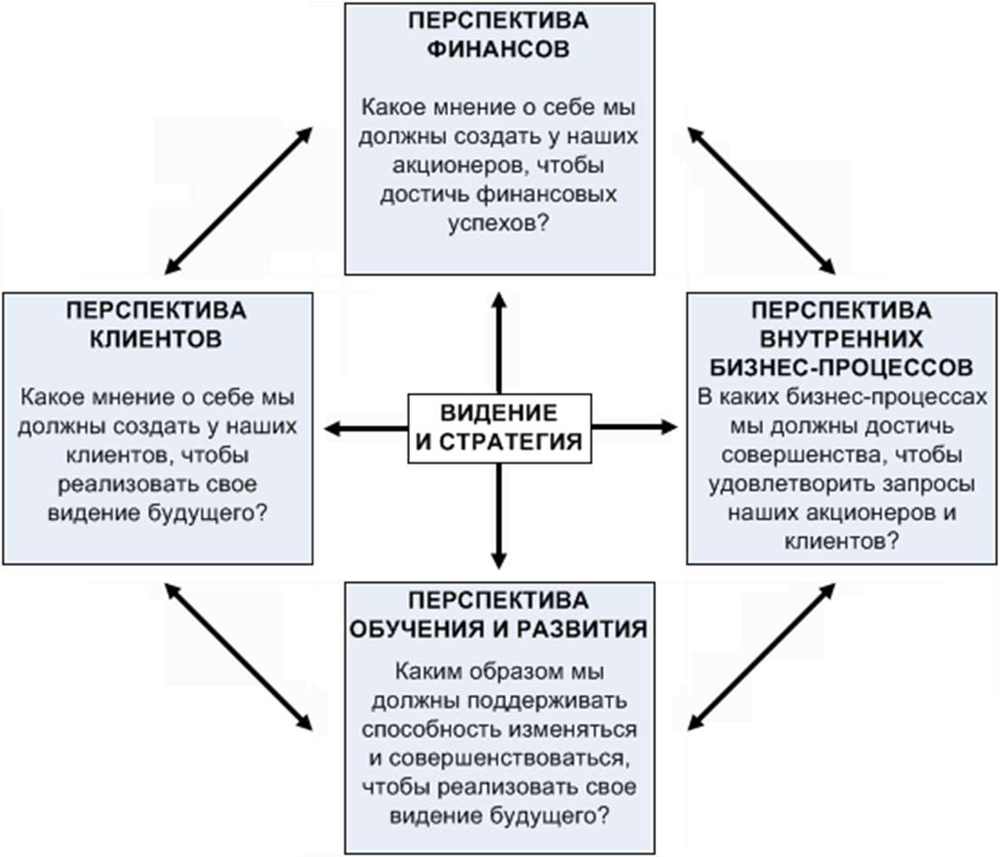

## Страница 3

3 
Моделирование бизнес-процессов. Лабораторная работа №2 
формулировки сбалансированных показателей. Так же как уравновешиваются 
чаши весов, так уравновешиваются показатели целей.  
Что же касается последнего компонента ССП, а именно обучения и разви-
тия, то, несомненно, серьезные инвестиции в переподготовку, информационные 
технологии и системы, а также в усовершенствование организационных проце-
дур, жизненно необходимы, если предприятие не находится в стадии завершения 
своей деятельности. Эти инвестиции в людей, системы и процедуры станут гене-
раторами больших инноваций и модернизации внутренних бизнес-процессов на 
пользу клиентам и, в конечном счете, акционерам. Однако затраты на обучение 
должны окупиться результатом. Поэтому должен быть найден баланс между за-
тратами на обучение и полученным от этого эффектом.  
Суть ССП заключается в формулировании стратегии в нескольких пер-
спективах, постановке стратегических целей и измерении степени достижения 
данных целей при помощи показателей. Слово "сбалансированный" (Balanced) в 
названии методологии означает учет баланса между противоречащими друг 
другу целями: («Быстро-Дешево-Качественно» или «Увеличить прибыль-Увели-
чить капитализацию»). Кроме того, учитывается баланс между значимостью фи-
нансовых и нефинансовых показателей. То есть мы не можем инвестировать весь 
имеющийся бюджет в программы по увеличению клиентской базы, финансируя 
обучение персонала по остаточному принципу. Успех в достижении целей обес-
печивается благодаря реализации сбалансированной стратегии. Далее ССП про-
ецируется на всю организацию путем разработки индивидуальных целей в рам-
ках уже разработанных корпоративных стратегий и стимулирует понимание ра-
ботниками своего места в стратегии компании.  
От правильно и понятно сформулированной стратегии может зависеть 
очень многое в развитии компании. Важно понимать, что хорошо разработанная 
стратегия лишь полдела. Ее еще надо удачно реализовать.  
Основное назначение ССП – обеспечение разработки сбалансированных 
показателей и контроль выполнения стратегии. ССП является составной частью 
системы управления организации и может являться ее основным ядром.  
При помощи ССП удается сделать реализацию стратегии регулярной дея-
тельностью всех подразделений, управляемой с помощью планирования, учета, 
контроля и анализа сбалансированных показателей, а также мотивации персонала 
на их достижение.  
 
2.2 Преимущества применения ССП 
Необходимое условие создания ССП – это разработка стратегии компа-
нии. Сама по себе разработка стратегии компании – очень важный этап развития, 
и начало такого процесса говорит о зрелости компании и достаточно высоких ее 
достижениях. Но без наличия в ней четкой стратегии разработка ССП невоз-
можна. Поэтому желание внедрить ее у себя, желание лучше понять свой бизнес

## Страница 4

4 
Моделирование бизнес-процессов. Лабораторная работа №2 
и его перспективы с неизбежностью влечет за собой необходимость разработки 
стратегии. Работа над разработкой миссии и стратегических целей позволит 
взглянуть со стороны на деятельность каждого из направлений компании, позво-
лит оценить потенциал каждого направления и обнаружить реально существую-
щие проблемы, которым до определенного момента не придавалось особого зна-
чения. Систематизация этих проблем позволит разработать конкретные шаги по 
их устранению.  
Контроль реализации стратегии. Одна из основных проблем менеджмента 
– контроль. Дойдя до разработки стратегии, а иногда и до реализации, предприя-
тия сталкиваются с необходимостью оценить успешность своих усилий, тем бо-
лее что процесс разработки стратегии цикличен. Как раз в этот момент и возни-
кает проблема оценки конкретного изменения – положительно ли оно или отри-
цательно, и с чем его нужно сравнивать. При отсутствии соответствующих пока-
зателей эти вопросы повисают в воздухе. ССП же позволяет конкретизировать 
ситуацию и отслеживать конкретные изменения, параллельно корректируя стра-
тегию.  
Простота восприятия исполнителями. Простота и наличие четких логиче-
ских взаимосвязей между перспективами ССП позволяют добиться понимания 
процессов, происходящих в компании, на уровне всех исполнителей.  
Ускорение внедрения системы менеджмента качества. Сбалансированная 
система показателей является инструментом, с помощью которого может быть 
ускорено внедрение системы менеджмента качества.  
Интеграция ССП в СМК позволяет:  
 перейти от стратегии к совокупности бизнес-процессов, требующих вни-
мания, и обоснованно применить к этим процессам всю мощь методов улучше-
ния деятельности; 
 связать политику в области качества со стратегией; 
 определить причинно-следственную совокупность целей в области каче-
ства для процессов и показатели выполнения этих целей; 
 определить мероприятия, ресурсы, сроки и ответственность, необходи-
мые для реализации установленных целей. 
Доведение стратегии компании до конкретных целей для каждого сотруд-
ника. При успешном внедрении ССП у персонала появляется четкий ориентир в 
деятельности. Причем не просто в виде плана, спущенного сверху, а в осознании 
своей роли в организации, и через это осознание они приходят к сознательному 
вовлечению в выполнение стратегических целей компании в целом, как своих 
личных.  
Улучшение системы мотивации персонала. ССП оказывает влияние на 
улучшение системы мотивации, поскольку сформулированные для сотрудников 
цели влияют на их поведение. При правильном определении целей сотрудники

## Страница 5

5 
Моделирование бизнес-процессов. Лабораторная работа №2 
начинают понимать свой вклад в достижение стратегических целей компании, 
тем самым повышается вероятность реализации разработанной стратегии.  
 
2.3 Трудности применения ССП 
Размытость внедрения ССП. Очень трудно оценить сам процесс внедре-
ния ССП в организации, так как для получения объективных результатов требу-
ются годы. За это время многое в деятельности компании меняется. Внедрение 
на первом этапе, то есть разработка стратегических целей для топ-менеджмента, 
проходит достаточно быстро и четко, а вот продвижение дальше обрастает про-
блемами, так как требует большого объема подготовительной и разъяснительной 
работы. Причем в данном случае обязательно участие руководителя соответству-
ющего подразделения.  
Отсутствие быстрых результатов. Получение оцениваемых результатов 
деятельности по ССП возможно только в течение нескольких лет собственно ре-
ализации стратегического плана. Поэтому серьезной проблемой может стать не-
понимание топ-менеджментом целей внедрения ССП в условиях быстроизменя-
ющейся рыночной ситуации.  
Невозможность разработки ССП без инициативы топ-менеджмента. 
При разработке ССП для отдельного подразделения компании достоинства ССП 
не используются в рамках всей организации, и в результате получается гораздо 
меньший эффект, тем более, что любое подразделение организации взаимодей-
ствует с целым рядом других подразделений и, несомненно, зависит от качества 
их работы.  
Трудность оценки важности ключевых показателей. Выбор ключевых по-
казателей – достаточно ответственный и неоднозначный процесс. Особенно это 
становится очевидным, когда происходит определение нефинансовых показате-
лей. Финансовые показатели в компаниях отслеживаются постоянно, а вот опре-
деление нефинансовых показателей, тем более на первом этапе, достаточно 
сложно из-за их неоднозначности. При оценке показателей имеет смысл распо-
ложить их по степени значимости в каждой из четырех перспектив и оставить не 
более пяти ключевых и наиболее важных из них по каждой перспективе. (Не пу-
тать с системой СМК, где могут быть сотни показателей). 
 
2.4 Основные принципы разработки и внедрения ССП 
Эффективность сбалансированной системы показателей зависит от каче-
ства ее внедрения. Внедрение ССП осуществляется в четыре этапа:  
 подготовка к разработке ССП; 
 разработка ССП; 
 каскадирование ССП; 
 контроль выполнения стратегии.

## Страница 6

6 
Моделирование бизнес-процессов. Лабораторная работа №2 
2.4.1 Подготовка к разработке ССП. На этапе подготовки к построению 
ССП необходимо разработать стратегию, определить перспективы и принять ре-
шение, для каких организационных единиц и уровней нужно разработать ССП.  
Важно всегда помнить, что ССП – это концепция внедрения существующих 
стратегий, а не разработки принципиально новых стратегий. Необходимо сначала 
завершить разработку стратегии, а потом приступать к созданию сбалансирован-
ной системы показателей.  
При определении подразделений, для которых будет разрабатываться ССП, 
нужно учитывать следующее: чем больше подразделений предприятия управля-
ются стратегически с помощью одной ССП, тем лучше можно каскадировать (де-
композировать, передавать) важные цели с верхнего уровня на нижние.  
Одним из важных мероприятий при подготовке к разработке ССП является 
выбор перспектив. Рассмотрение различных перспектив при формировании и ре-
ализации стратегии является характерной чертой концепции сбалансированной 
системы показателей и ее ключевым элементом. Формулирование стратегиче-
ских целей, подбор показателей и разработка стратегических мероприятий по не-
скольким перспективам призваны обеспечить всестороннее рассмотрение дея-
тельности компании.  
Компании, формулирующие свою стратегию слишком односторонне, не-
обязательно отклоняются только в сторону финансов. Встречаются компании, 
которые слишком ориентированы на клиента и забывают о своих финансовых 
целях. Некоторые компании могут быть чрезмерно ориентированы на свои биз-
нес-процессы и не обращают внимания на рыночные аспекты. Равноправное рас-
смотрение нескольких перспектив позволяет избежать такой несбалансированно-
сти.  
Итак, исходными предпосылками разработки ССП являются:  
 перспективы ССП; 
 информированная и мотивированная команда высшего руководства; 
 стратегия, являющаяся «зрелой» для разработки ССП. 
2.4.2 Разработка ССП. На этом этапе разрабатывается ССП для одной ор-
ганизационной единицы. Это может быть компания в целом, подразделение или 
отдел.  
При этом разработка ССП осуществляется путем выполнения следующих 
шагов:  
 конкретизация стратегических целей; 
 связывание стратегических целей причинно-следственными цепочками 
– построение стратегической карты; 
 выбор показателей и определение их целевых значений; 
 определение связи показателей с бизнес-процессами; 
 разработка стратегических мероприятий.

## Страница 7

7 
Моделирование бизнес-процессов. Лабораторная работа №2 
Стратегические цели имеют статус решающих и ключевых целей компа-
нии. Чтобы спланировать и обеспечить процесс реализации целей, для каждой из 
них разрабатываются соответствующие финансовые и нефинансовые показатели, 
по которым, в свою очередь, определяются целевые, плановые и фактические 
значения. Достижение разработанных целей призвана обеспечить реализация 
стратегических мероприятий. По каждому стратегическому мероприятию опре-
деляются сроки его реализации, бюджет и четкая ответственность.  
Результат данного этапа обеспечивает единое понимание стратегии и явля-
ется исходным пунктом для постоянного мониторинга внедрения стратегии. 
Только после информирования о ССП в организации, передачи целей на нижние 
уровни (каскадирование), создания адекватной системы планирования и отчетно-
сти и адаптации систем руководства и мотивации сотрудников, ССП становится 
концепцией менеджмента.  
На этапе разработки ССП необходимо учитывать, что стратегические цели, 
а не их показатели, составляют ядро сбалансированной системы показателей. 
Лучшие показатели бесполезны, если положенные в их основу цели не описы-
вают надлежащим образом стратегию, ведущую к устойчивому конкурентному 
преимуществу.  
2.4.3 Каскадирование ССП. Каскадирование ведет к повышению качества 
стратегического управления во всех вовлеченных организационных единицах, 
поскольку цели и стратегические мероприятия из вышестоящих подразделений 
могут быть последовательно переданы в ССП нижестоящих организационных 
единиц – это вертикальная интеграция целей. Тем самым повышается вероят-
ность, что стратегические цели всего предприятия или крупных подразделений 
будут достигнуты.  
При каскадировании стратегия, указанная в корпоративной ССП (рисунок 
2.2), распространяется на все уровни управления.

## Страница 8

8 
Моделирование бизнес-процессов. Лабораторная работа №2 
 
Рисунок 2.2 – Пример стратегической карты корпоративного уровня 
Затем стратегические цели, показатели, целевые значения и действия по со-
вершенствованию конкретизируются и адаптируются в подразделениях и отде-
лах. Т.е. корпоративная ССП должна быть увязана с ССП подразделений, отделов 
и с индивидуальными планами работы сотрудников. На основе ССП своего под-
разделения каждый отдел разрабатывает собственную ССП (рисунок 2.3), кото-
рая должна быть согласована с корпоративной ССП.  
 
 
Рисунок 2.3 – Стратегическая карта Отдела снабжения 
Затем при участии начальника отдела каждый сотрудник разрабатывает 
свой индивидуальный план работы. Этот план больше ориентирован на достиже-
ние реальных результатов на рабочем месте, а не на задания или действия по усо-
вершенствованию.

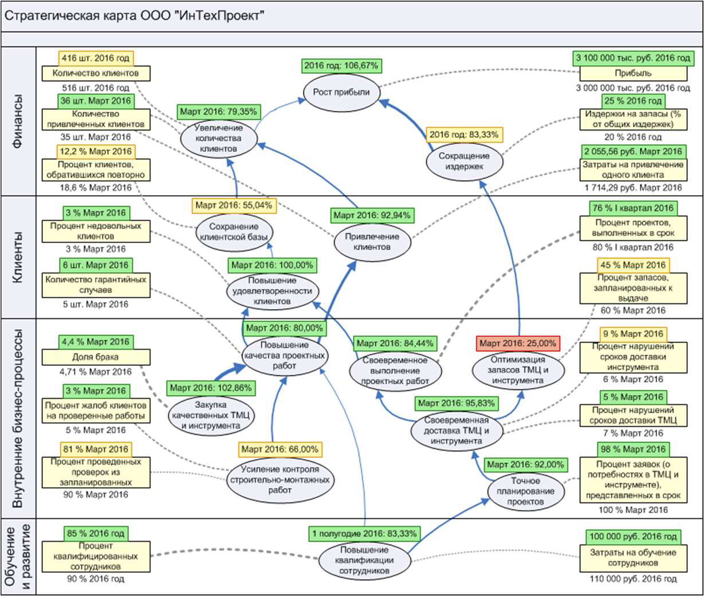

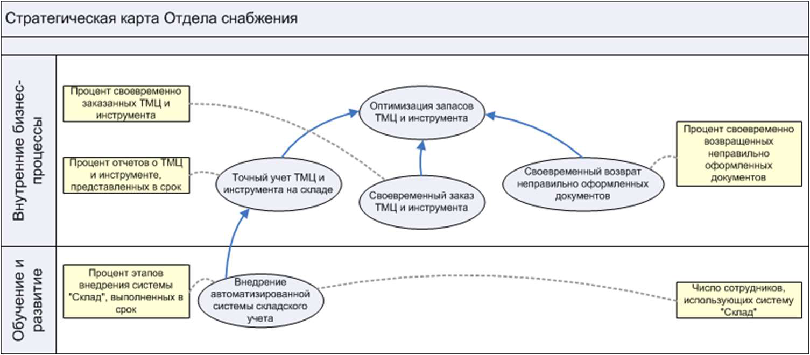

## Страница 9

9 
Моделирование бизнес-процессов. Лабораторная работа №2 
На рисунке 2.4 представлено каскадирование ССП, при реализации кото-
рого устанавливается мост между последовательными уровнями организацион-
ной иерархии. При этом корпоративная стратегия последовательно спускается 
вниз.  
 
 
Рисунок 2.4 – Процесс каскадирования ССП 
Степень подробности декомпозиции сбалансированных систем показате-
лей «сверху вниз» зависит от организационной структуры и размера компании. 
Каждое подразделение включает в свою систему показателей только те задачи и 
показатели результативности общей (корпоративной) ССП, на которые оно ока-
зывает влияние.  
2.4.4 Контроль выполнения стратегии. Если бы внедрение ССП заканчи-
валось разработкой стратегических целей, причинно-следственных цепочек, по-
казателей, целевых значений и стратегических мероприятий для одной организа-
ционной единицы, это означало бы лишь одноразовое сильное фокусирование на 
стратегию. Чтобы обеспечить долгосрочную реализацию стратегии, сформули-
рованной в ССП, необходимо интегрировать ССП в систему управления.  
Внедрение ССП сегодня тесно связано с автоматизацией. Внедрение, 
например, с помощью MS Excel, или вообще без какой-либо информационной 
поддержки возможно лишь на начальных этапах либо в небольших организациях. 
Если компания собирается разрабатывать сбалансированные системы показате-
лей для нескольких структурных подразделений и периодически их уточнять и 
корректировать, то без использования преимуществ информационных техноло-
гий не обойтись.  
Как правило, основная проблема, с которой сталкиваются предприятия, ре-
шившие внедрить у себя данную методологию реализации стратегии, не в том, 
как автоматизировать создание дерева целей и показателей или построение стра-
тегической карты, а в том, как в автоматическом режиме постоянно обеспечивать

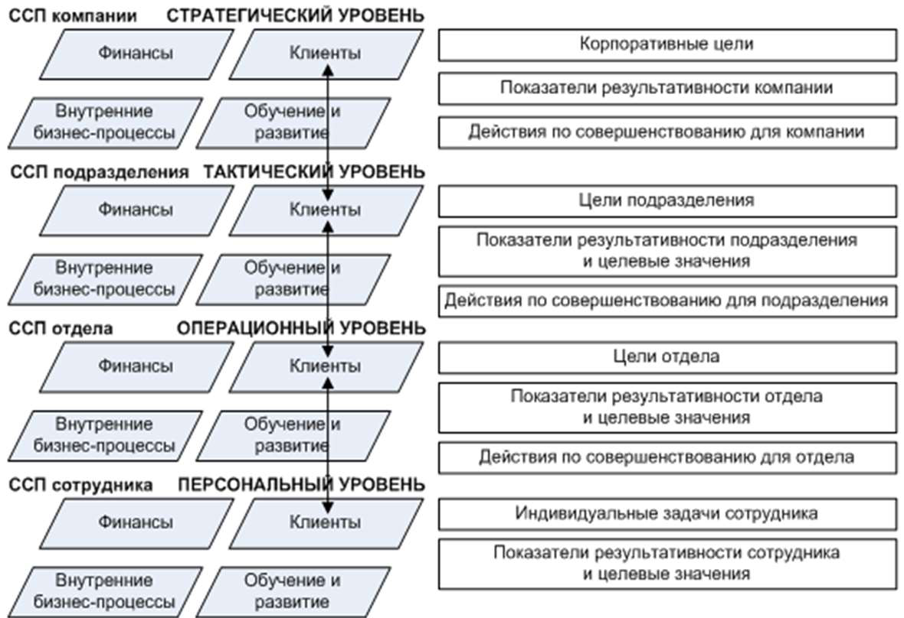

## Страница 10

10 
Моделирование бизнес-процессов. Лабораторная работа №2 
ССП свежими данными и поддерживать ее в рабочем состоянии. Программный 
продукт Business Studio как раз и предназначен для решения проблем, связанных 
с автоматизацией внедрения ССП.  
Лишь с завершением этапа внедрения сбалансированная система показате-
лей действует как концепция менеджмента, а не только как система показателей.  
 
2.5 Особенности, которые необходимо учитывать, при разработке и 
внедрении ССП 
2.5.1 Конкретизация стратегических целей. Для построения системы 
стратегического управления необходимо декомпозировать (разбить, структури-
ровать) стратегию компании на конкретные стратегические цели, детально отоб-
ражающие различные стратегические аспекты. При интеграции индивидуальных 
целей могут быть установлены причинно-следственные связи между ними таким 
образом, чтобы полный набор целей отображал стратегию компании.  
Стратегические цели описывают планируемые результаты. Каждая страте-
гическая цель связана с одной из перспектив развития организации.  
Не следует определять слишком большое число стратегических целей для 
корпоративного уровня организации. Максимум 25 целей будет достаточно. На 
такое же количество целей следует ориентироваться при проектировании страте-
гических карт для подразделений.  
Необходимо выбрать наиболее важные цели, основываясь на следующих 
критериях:  
 цели должны быть измеримыми; 
 на достижение целей можно влиять; 
 цели приемлемы для различных групп людей в организации и согласо-
ваны с общей целью организации. 
Слишком большое число целей в системе показателей свидетельствует о 
неспособности организации сосредоточить свое внимание на главном, а также 
означает то, что сформулированные цели не являются стратегическими для того 
организационного уровня, на котором разрабатывается система показателей. Раз-
работке тактических и оперативных целей должно уделяться внимание в систе-
мах показателей подразделений низших уровней организационной структуры.  
2.5.2 Связывание стратегических целей причинно-следственными це-
почками. Определение и документирование причинно-следственных связей 
между отдельными стратегическими целями является одним из основных эле-
ментов ССП. Устанавливаемые причинно-следственные связи отражают наличие 
зависимостей между отдельными целями.  
Стратегические цели не являются независимыми и оторванными друг от 
друга, наоборот, они тесно друг с другом связаны и влияют друг на друга. Дости-
жение одной цели служит достижению другой и так далее, до главной цели орга-
низации. Связи между различными целями ясно видны благодаря причинно-

## Страница 11

11 
Моделирование бизнес-процессов. Лабораторная работа №2 
следственной цепи. Те из них, которые не вносят вклада в реализацию главной 
цели, исключаются из рассмотрения.  
Причинно-следственная цепь – удобный инструмент для доведения ССП 
до нижестоящих организационных уровней. Для графического отображения вза-
имосвязи стратегических целей и перспектив применяют стратегическую карту.  
2.5.3 Выбор показателей и определение их целевых значений. Показа-
тель представляет собой измеритель степени достижения стратегической цели. 
Использование показателей призвано конкретизировать разработанную в ходе 
стратегического планирования систему целей и сделать разработанные цели из-
меримыми. Показатели можно идентифицировать только тогда, когда суще-
ствует ясность в отношении целей. Выбор подходящих показателей – это второ-
степенный вопрос, поскольку даже наилучшие показатели не помогут компании 
достичь успеха, если неверно сформулированы цели. Рекомендуется использо-
вать не более двух или трех показателей для каждой из стратегических целей. 
Причем всего показателей в ССП должно быть 100-200, не более. Около 80% всех 
показателей должны быть нефинансовыми.  
Оптимальным соотношением числа показателей для целей каждой из пер-
спектив на стратегической карте является такое соотношение:  
 финансы – 4-5 показателей (22%); 
 клиенты – 4-5 показателей (22%); 
 внутренние бизнес-процессы – 8-10 показателей (34%); 
 обучение и развитие – 4-5 показателей (22%). 
Без наличия целевых значений показатели, разработанные для измерения 
стратегических целей, не имеют смысла. Определение целевых значений показа-
телей вызывает сложности не только при разработке ССП. Принципиальная 
сложность определения целевого значения того или иного показателя состоит в 
том, чтобы найти реально достижимый уровень.  
Как правило, ССП разрабатывается на период, соответствующий долго-
срочному периоду стратегического планирования (3-5 лет). При этом целевые 
значения на долгосрочный период определяют у отсроченных показателей. Од-
нако реализация стратегии осуществляется непрерывно, поэтому необходимо 
иметь показатели, которые бы диагностировали нам тенденцию движения к наме-
ченной цели в данный конкретный момент – опережающие показатели. Введение 
промежуточных показателей позволяет оценить скорость приближения к наме-
ченной цели.  
Содержание краткосрочных планов детализируется по периодам (кварта-
лам, месяцам, неделям, дням) и выражается в виде плановых значений показате-
лей. Показатели и их целевые значения предоставляют менеджменту своевремен-
ные сигналы, основанные на отклонениях реального положения вещей от плано-
вого, т.е. полученные фактические количественные результаты сравниваются с 
запланированными.

## Страница 12

12 
Моделирование бизнес-процессов. Лабораторная работа №2 
2.5.4 Определение связи показателей с бизнес-процессами. Как было 
сказано выше, показатель – это измеритель, показывающий степень достижения 
цели. Однако это и средство для оценки результативности и эффективности биз-
нес-процесса. Показатели в ССП служат как для оценки результативности биз-
нес-процессов, так и для оценки степени достижения цели одновременно.  
2.5.5 Определение стратегических мероприятий. В случаях, когда стра-
тегические цели не могут быть достигнуты путем выполнения регулярной дея-
тельности (в рамках бизнес-процессов компании), достижение стратегических 
целей осуществляется через реализацию соответствующих стратегических меро-
приятий. «Стратегические мероприятия» – это общее понятие для всех меропри-
ятий, проектов, программ и инициатив, которые реализуются для достижения 
стратегических целей.  
Распределение проектов компании по целям сбалансированной системы 
создает ясность в понимании того, какой вклад вносит тот или иной проект в до-
стижение стратегических целей. Если проекты не вносят значительного вклада в 
достижение стратегических целей, их следует рассмотреть на предмет, какой 
вклад они вносят в достижение базовых целей. Если то или иное стратегическое 
мероприятие не вносит существенного вклада в достижение базовых целей, то 
необходимость его реализации крайне сомнительна.  
2.5.6 Сбор, оценка и анализ информации о выполнении стратегии. 
Внедрение ССП – процесс, требующий значительного времени, часть из которого 
уходит на отлаживание системы и ее поддержку. Для улучшения ССП высшее 
руководство и ответственные должны постоянно проводить анализ и оценку де-
ятельности организации.  
Стратегические цели характеризуются высокой степенью актуальности для 
компании, и эта актуальность должна оцениваться как минимум ежегодно. При 
этом необходимо оценивать:  
 пригодны ли выбранные показатели для оценки степени достижения вы-
работанных целей? 
 насколько прост расчет значений показателей? 
 достигли ли структурные подразделения целевых значений выработан-
ных показателей? 
 достигнуты ли целевые значения показателей корпоративных целей? 
 какой вклад вносит рассматриваемое структурное подразделение в до-
стижение целей верхних уровней? 
Оценка показателей заключается, прежде всего, в том, чтобы понять воз-
можность расчета фактического значения показателя на основе данных отчетного 
периода. Кроме того, необходимо проводить сравнения план-факт по значениям 
выработанных показателей с выяснением причин отклонений. Такой анализ со-
провождается либо корректировкой целевого значения показателя, либо

## Страница 13

13 
Моделирование бизнес-процессов. Лабораторная работа №2 
разработкой корректирующих мероприятий, направленных на достижение уста-
новленного ранее целевого значения.  
ССП нижнего уровня всегда должна оцениваться на предмет содействия 
достижению целей верхнего уровня.  
Кроме того, целесообразно прогнозировать целевые значения показателей 
на длительный период времени.  
Мероприятия также должны подвергаться анализу, а именно необходимо 
оценивать:  
 были ли реализованы все мероприятия согласно утвержденному плану? 
 были ли при этом соблюдены бюджет времени и финансовые ресурсы? 
 повлияла ли реализация мероприятий на достижение целей? 
Если разработанные ранее мероприятия еще не окончены, их следует за-
вершить. При необходимости должны быть разработаны новые мероприятия. 
 
2.6 Разработка ССП и контроль выполнения стратегии с применением 
Business Studio 
2.6.1 Объекты ССП. Все основные данные, относящиеся к ССП, хранятся 
в иерархических справочниках Навигатора в подразделе «Цели и показатели» 
раздела «Управление» (Навигатор → вкладка Управление → Цели и показатели) 
(рисунок 2.5).  
 
 
Рисунок 2.5 – Иерархические справочники ССП 
Иерархический справочник «Перспективы стратегической карты» позво-
ляет ввести перспективы, по которым группируются стратегические цели ССП. 
Чаще всего используют четыре перспективы (рисунок 2Error! Reference source 
not found..6), однако, всегда можно добавить новую перспективу. 
 
 
Рисунок 2.6 – Справочник «Перспективы стратегической карты»

## Страница 14

14 
Моделирование бизнес-процессов. Лабораторная работа №2 
Иерархический справочник «Цели» позволяет ввести стратегические цели 
ССП. Цели можно сгруппировать по папкам, например, с названиями перспектив 
(рисунок 2.7).  
 
 
Рисунок 2.7 – Справочник «Цели» 
Показатели степени достижения стратегических целей хранятся в иерархи-
ческом справочнике «Показатели». Показатели могут быть сгруппированы по 
папкам или по показателям, рассчитываемым на основе других показателей (ри-
сунок 2.8).

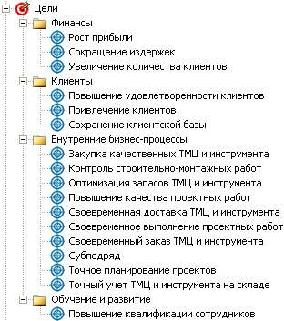

## Страница 15

15 
Моделирование бизнес-процессов. Лабораторная работа №2 
 
Рисунок 2.8 – Справочник «Показатели» 
Стратегические карты, являющиеся графическим отображением взаимо-
связи перспектив, стратегических целей и их показателей, хранятся в иерархиче-
ском справочнике «Стратегические карты» (рисунок 2.9).  
 
 
Рисунок 2.9 – Справочник «Стратегические карты» 
Иерархический справочник «Проекты» позволяет ввести перечень меро-
приятий, направленных на достижение стратегических целей (рисунок 2.10).

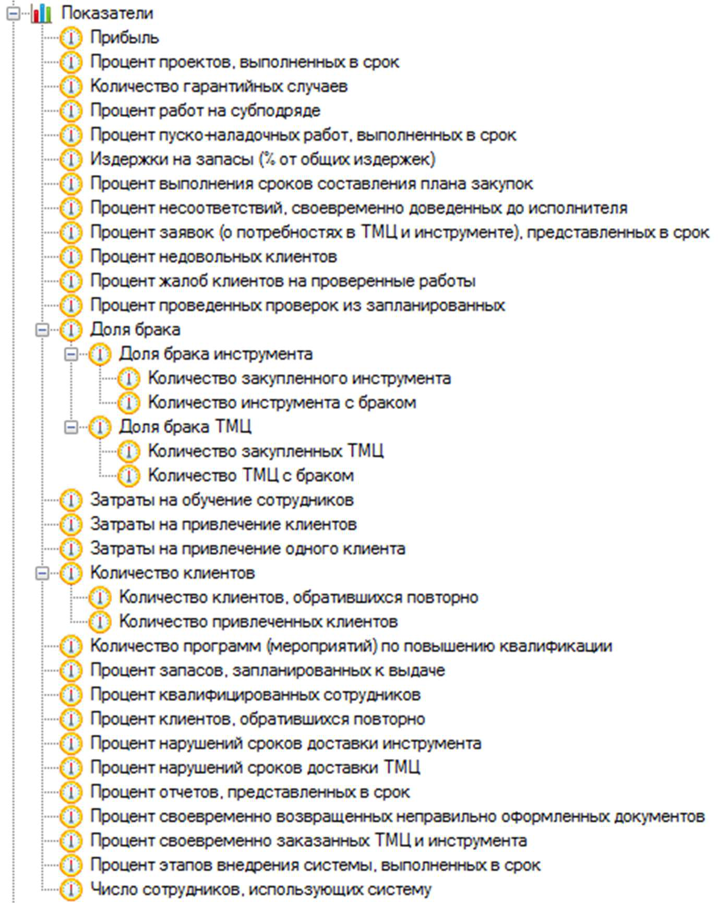

## Страница 16

16 
Моделирование бизнес-процессов. Лабораторная работа №2 
 
Рисунок 2.10 – Справочник «Проекты» 
 
2.6.2 Определение стратегических целей 
Создать цель и редактировать ее свойства можно в справочнике "Цели" 
(Навигатор → вкладка Управление → Цели и показатели → Цели).  
После выбора перспектив необходимо определить стратегические цели 
ССП. Ввести цели можно с помощью иерархического справочника «Цели» 
(Навигатор → вкладка Управление → Цели и показатели → Цели).  
Окно свойств цели (рисунокError! Reference source not found. 2.11) от-
крывается двойным щелчком на элементе в Навигаторе или кнопкой  на панели 
инструментов Навигатора. 
 
 
Рисунок 2.11 – Окно свойств Цели (вкладка Основные)

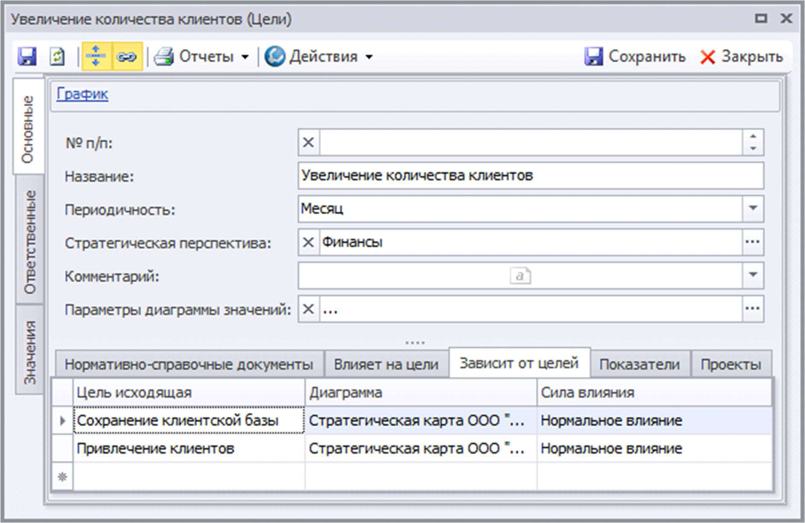

## Страница 17

17 
Моделирование бизнес-процессов. Лабораторная работа №2 
Каждая цель имеет ряд параметров, которые задаются в Окне свойств цели 
(рисунокError! Reference source not found. 2.11). В этом окне параметры пред-
ставлены на следующих вкладках:  
 вкладка Основные – вкладка содержит основные параметры цели; 
 вкладка Ответственные – на этой вкладке указаны ответственные за до-
стижение цели и за контроль ее достижения; 
 вкладка Значения – после указания показателей, измеряющих достиже-
ние данной цели, и заполнения их значений, на этой вкладке отображаются авто-
матически рассчитываемые значения оценок достижения цели за рабочий пе-
риод. 
Описание назначения параметров вкладки Основные (рисунок 2.11) приве-
дено в таблице 2.1. На вкладке Показатели (рисунок 2.11) пользователь имеет 
возможность указать те показатели, которые отражают степень достижения цели. 
Сила влияния указывает на степень корреляции между фактом достижения пока-
зателем планового значения с оценкой достижения цели. Сила влияния участвует 
в расчете оценки достижения цели. 
 
Таблица 2.1 – Параметры цели на вкладке «Основные» 
Параметр 
Назначение 
№ п/п
Номер для управления порядком целей
Название
Наименование цели
Периодичность
Частота оценки достижения цели
Стратегическая перспектива
Перспектива, к которой относится цель
Комментарий
Произвольный комментарий к свойствам цели
Параметры диаграммы зна-
чений 
Параметры настроек диаграммы значений оценок достижения 
цели, которую можно открыть при помощи гиперссылки Гра-
фик в Окне свойств цели. Если использование настроек, ука-
занных при помощи данных параметров, отключено (снят фла-
жок в параметре «Использовать текущие настройки»), то для 
построения 
диаграммы 
значений 
будут использоваться 
настройки, заданные в Настройках для всех пользователей в 
параметре «Параметры диаграммы значений цели» (Главное 
меню → Главная → Настройки для всех пользователей → 
вкладка ССП).
Нормативно-справочные до-
кументы 
Список бумажных или электронных документов из группы 
справочников "Объекты деятельности" (Навигатор → вкладка 
Объекты деятельности → Документы).
Влияет на цели
Список целей, на достижение которых влияет данная цель
Зависит от целей
Список целей, влияющих на достижение данной цели
Показатели
Список показателей, измеряющих степень достижения цели
Проекты 
Список проектов, выполнение которых направлено на дости-
жение цели

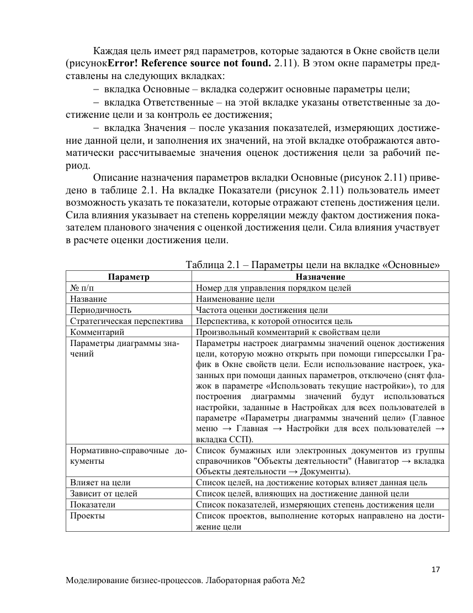

## Страница 18

18 
Моделирование бизнес-процессов. Лабораторная работа №2 
В Окне свойств цели на вкладке Ответственные представлены параметры, 
в которых указываются должностные и/или физические лица, ответственные за 
достижение цели и за контроль ее достижения.  
На рисунке 2.12 представлен внешний вид вкладки Значения. 
 
 
Рисунок 2.12 – Окно свойств Цели (вкладка Значения) 
Таблица 2.2 – Параметры цели на вкладке «Значения» 
Параметр 
Назначение 
Допустимое отклонение 
Максимальное отклонение в меньшую сторону от 100%, не требу-
ющее внимания ответственных лиц. Задается в процентах
Критическое значение 
Значение используется в автоматическом заполнении критиче-
ского значения для оценки достижения цели в создаваемом пери-
оде
Значения оценок 
Список значений оценок достижения целей за рабочий период, 
предназначенный для просмотра и анализа. Доступен ответствен-
ному за достижение и контролирующим лицам
 
2.6.3 Создание стратегической карты 
После внесения цели в справочник ее можно добавлять непосредственно на 
стратегическую карту. Добавить новую стратегическую карту позволяет иерар-
хический справочник «Стратегические карты» раздела «Цели и показатели» 
(Навигатор → вкладка Управление → Цели и показатели → Стратегические 
карты). 
Количество стратегических карт для организации может быть неограни-
ченным. Как минимум, проектирование начинается с главной или общей корпо-
ративной стратегической карты. Окно свойств стратегической карты представ-
лено на рисунке 2.13.

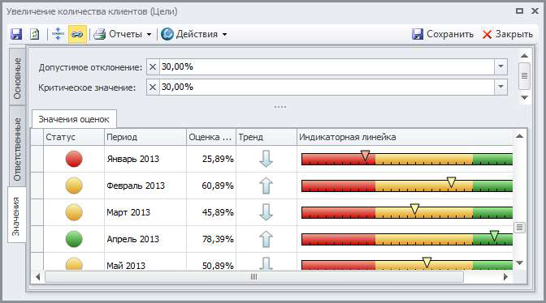

## Страница 19

19 
Моделирование бизнес-процессов. Лабораторная работа №2 
 
Рисунок 2.13 – Окно свойств Стратегической карты 
В Таблица 2.3  2.3 перечислены основные параметры, которые заполняются 
в свойствах стратегической карты. 
 
Таблица 2.3 – Основные параметры стратегической карты 
Параметр 
Описание 
№ п/п 
Номер для управления порядком элементов внутри справочника 
«Стратегические карты»
Название
Наименование стратегической карты
Описание
Подробное уточняющее описание стратегической карты
Комментарий
Произвольный комментарий к свойствам стратегической карты
Нормативно-справоч-
ные документы
Список бумажных или электронных документов. К этим докумен-
там можно приложить файл MS Word, MS Excel, MS Visio и т.д.
Контролирующие 
лица
Лица, имеющие право контролировать достижение целей на стра-
тегической карте. Указывается Должность и/или Физлицо.
 
Открыть диаграмму стратегической карты можно следующим образом: в 
Навигаторе выбрать стратегическую карту и дважды кликнуть по ней левой кноп-
кой мыши. Откроется Окно диаграммы с диаграммой стратегической карты. 
Элементы диаграммы стратегической карты могут быть добавлены на диа-
грамму при помощи кнопок палитры элементов Окна диаграммы. Описание 
назначения кнопок палитры элементов приведено в таблице 2.4. 
 
Таблица 2.4 – Кнопки палитры элементов окна диаграммы стратегической карты 
Кнопка 
Назначение 
Добавление новой стрелки 
 
Добавление сноски. Используется как дополнительный комментарий к элементу 
диаграммы
 
Добавление существующей цели. Откроется окно выбора объекта из справочника 
"Цели"

## Страница 20

20 
Моделирование бизнес-процессов. Лабораторная работа №2 
 
Добавление существующего показателя. Откроется окно выбора объекта из спра-
вочника "Показатели"
 
Перспективы на диаграмме стратегической карты изображаются в виде до-
рожек. Для отображения на диаграмме перспективы перетяните перспективу из 
справочника «Перспективы стратегической карты» (рисунок 2.6) на диаграмму. 
При этом будет создана дорожка.  
В нужную дорожку перетяните цель из справочника «Цели» (рисунок 2.7). 
Для этого можно методом Drag&Drop на «дорожку» поместить нужную цель. 
Или сделать это другим способом: добавить цель на диаграмму стратегической 
карты при помощи кнопки Цели 
, расположенной в палитре элементов Окна 
диаграммы стратегической карты. При нажатии на данную кнопку или при пере-
таскивании данной кнопки на диаграмму откроется Окно выбора цели.  
Элемент диаграммы «Цель» изображаются в виде эллипса. Эллипс должен 
быть расположен точно на одной из дорожек. При этом автоматически заполня-
ется значение параметра «Стратегическая перспектива» в Окне свойств цели. При 
перемещении цели в другую «дорожку» значение параметра «Стратегическая 
перспектива» в Окне свойств цели изменяется автоматически.  
На диаграмме стратегической карты элемент «Цель» можно выделить цве-
том. Например, цели, отвечающие за качество, на диаграмме стратегической 
карты (рисунок 2.14) выделены зеленым цветом.

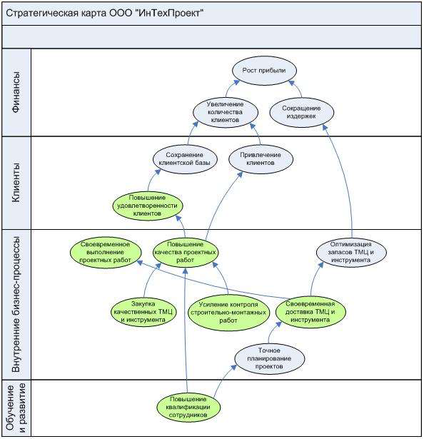

## Страница 21

21 
Моделирование бизнес-процессов. Лабораторная работа №2 
Рисунок 2.14 – Цели, выделенные цветом на диаграмме стратегической карты 
 
2.6.3 Построение причинно-следственных связей 
Цели могут быть связаны с помощью отношений причинно-следственных 
связей. 
Установление связей целей может осуществляться: 
 на диаграмме стратегической карты (рисунок 2.14); 
 в списках «Зависит от целей» и «Влияет на цели» в свойствах цели (рису-
нок 2.11). 
На диаграмме стратегической карты связи целей можно строить в виде 
направленных стрелок от одной цели к другой. Две цели могут влиять друг на 
друга в рамках одной стратегической карты. Такое взаимовлияние изображается 
на карте двумя разными стрелками. 
Степень влияния одной цели на другую задается с помощью поля «Сила 
влияния» и может принимать следующие значения: 
 очень слабое влияние (коэффициент 0,25); 
 слабое влияние (коэффициент 0,5); 
 нормальное влияние (коэффициент 1); 
 сильное влияние (коэффициент 2); 
 очень сильное влияние (коэффициент 4). 
По умолчанию задается «Нормальное влияние». Изменить силу влияния 
можно в свойствах самой связи (стрелки) на стратегической карте или в свой-
ствах цели в списках «Зависит от целей» и «Влияет на цели». В этих же списках 
может осуществляться и само определение причинно-следственных связей. Т.к. 
не все цели ССП могут быть отображены на стратегической карте, для установ-
ления причинно-следственных связей таких целей и используются списки «Зави-
сит от целей» и «Влияет на цели». 
Заполнение списков «Зависит от целей» и «Влияет на цели» может осу-
ществляться путем переноса одной цели в окно свойств другой цели из иерархи-
ческого справочника «Цели» либо выбором из справочника.  
Установление связи между целями на диаграмме стратегической карты 
приводят к изменению списков «Влияет на цели» и «Зависит от целей» в окне 
свойств цели (рисунок 2.11) после сохранения данной диаграммы. 
Список целей, размещенных на стратегической карте, может быть получен 
путем вызова на выполнение отчета «Стратегическая карта». 
 
2.6.4 Определение показателей и целевых значений 
В Business Studio показатели служат как для оценки степени достижения 
цели, так и для оценки результативности процессов одновременно. 
Назначение показателя цели может осуществляться:

## Страница 22

22 
Моделирование бизнес-процессов. Лабораторная работа №2 
 на диаграмме стратегической карты; 
 в списке «Показатели» в свойствах цели; 
 в списке «Цели» в свойствах показателя. 
На диаграмме стратегической карты (рисунок 2.14) назначение показателя 
цели можно строить в виде направленных стрелок от показателя к цели. Степень 
влияния показателя на цель задается с помощью поля «Сила влияния» и может 
принимать те же значения, что и в случае силы влияния цели на цель (рисунок 
2.15). 
 
 
Рисунок 2.15 – Внешний вид диаграммы стратегической карты с показателями 
По умолчанию задается «Нормальное влияние». Сила влияния может быть 
изменена: 
 в свойствах стрелки на стратегической карте; 
 в свойствах цели в списке «Показатели»; 
 в свойствах показателя в списке «Цели». 
Заполнение списка «Показатели» в свойствах цели может также осуществ-
ляться путем переноса показателя из иерархического справочника «Показатели» 
в окно свойств цели либо выбором из справочника. 
Заполнение списка «Цели» в свойствах показателя может также осуществ-
ляться путем переноса цели в окно свойств показателя из иерархического спра-
вочника «Цели» либо выбором из справочника. 
Один и тот же показатель может быть назначен двум (и более) целям, но 
нужно помнить, что плановые и фактические значения будут одинаковы для всех 
целей. Если плановые и фактические значения должны быть разными, несмотря 
на то, что показатель называется одинаково, то необходимо завести два разных 
показателя с названиями, отражающими назначение показателей.

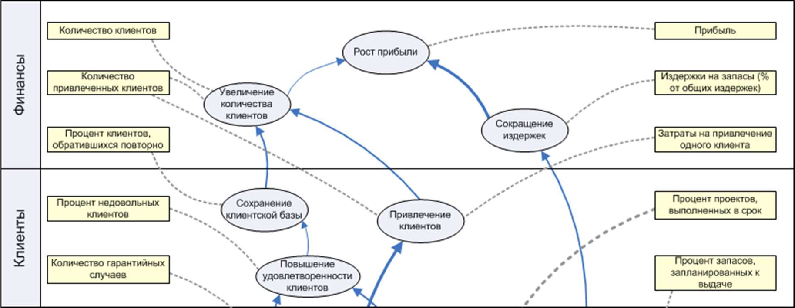

## Страница 23

23 
Моделирование бизнес-процессов. Лабораторная работа №2 
Контрольные вопросы 
1. Что такое «сбалансированная система показателей»? Приведите пример, 
когда и для чего она может использоваться. 
2. Чем отличается ССП от финансовых (бухгалтерских) показателей функ-
ционирования предприятия? 
3. Какие должны быть рассмотрены перспективы, если стратегия развития 
компании формулируется на основе ССП? 
4. В чем суть сбалансированной системы показателей? 
5. Какое основное назначение ССП? Как ССП связана с системой управле-
ния организацией? 
6. Как ССП связана со стратегией компании? Какие преимущества для ор-
ганизации дает разработка стратегии? 
7. Каким образом менеджмент может осуществлять контроль реализации 
стратегии? 
8. В чем преимущество использования в организации ССП для исполните-
лей на всех уровнях? 
9. Какая существует связь между ССП и системой менеджмента качества? 
10. Как ССП влияет на мотивацию персонала и понимание конкретных це-
лей для каждого сотрудника? 
11. С какими сложностями сталкивается организация при применении 
ССП? 
12. Почему трудно оценить сам процесс внедрения ССП, в какой момент 
появляются сложности во внедрении? 
13. Как быстро можно оценить результат от внедрения ССП? 
14. Почему невозможно разработать ССП без участия топ-менеджмента? 
15. С какими трудностями сталкивается менеджмент при оценки ключевых 
показателей? Какие из них проще оценить – финансовые или нефинан-
совые? Почему? 
16. Перечислите 4 этапа разработки и внедрения ССП? 
17. Какие действия необходимо выполнить на этапе подготовки к разра-
ботке ССП? 
18. Что необходимо учитывать при определении подразделений, для кото-
рых будет разрабатываться ССП? 
19. Что необходимо учитывать при выборе перспектив при формировании 
и реализации стратегии? Приведите примеры. 
20. Перечислите исходные предпосылки, необходимые для разработки 
ССП. 
21. Перечислите основные шаги разработки ССП? 
22. Что является ядром ССП – цели или показатели? Какую связь необхо-
димо сохранять между стратегическими целями и показателями и по-
чему?

## Страница 24

24 
Моделирование бизнес-процессов. Лабораторная работа №2 
23. Для чего выполняется каскадирование ССП?  
24. Что такое «вертикальная интеграция целей»? 
25. Как индивидуальный план работы отдельно взятого сотрудника соотно-
сится с ССП? 
26. Для чего необходимо интегрировать ССП в систему управления органи-
зацией? 
27. Какая связь между внедрением ССП и автоматизацией? 
28. Какие критерии необходимо учитывать при выборе стратегических це-
лей?  
29. Для чего между стратегическими целями необходимо устанавливать 
причинно-следственные связи? Что произойдет, если между стратегиче-
скими целями не будут определены причинно-следственных связи? 
30. Для чего необходимо определять показатели и их целевые значения при 
разработке ССП? 
31. Что необходимо учитывать при выборе показателей и определении их 
целевых значений? 
32. Для чего нужны менеджменту показатели и их целевые значения? 
33. Какая существует связь между показателями и бизнес-процессами? 
34. Что такое «стратегические мероприятия» и для чего они используются? 
Как определяется необходимость выполнения определенного стратеги-
ческого мероприятия? 
35. Что должно делать руководство организации для улучшения ССП?  
36. По каким критериям руководители должны оценивать стратегические 
цели и показатели? Как часто такую оценку необходимо проводить? 
37. Для чего проводится оценка показателей? Какие выводы можно сделать 
на основе оценки показателей? 
38. Должны ли мероприятия тоже подвергаться анализу? Если да, то что 
необходимо оценивать для мероприятий? 
39. Что является результатом этапа разработки ССП? 
40. Назначение показателей цели. 
41. В каком пункте меню можно изменить силу влияния. Какая сила влия-
ния задается по умолчанию. 
42. Особенности назначения «показателя» для двух и более целей и какие 
это влечет за собой последствия. 
43. Значения поля «Сила влияния». 
44. Как осуществляется установка связей для целей. 
45. Заполнения списков «Зависит от целей» и «Влияет на цели». 
46. Основные параметры стратегической карты. 
47. С чего надо начинать проектирование системы целей и показателей.

## Страница 25

25 
Моделирование бизнес-процессов. Лабораторная работа №2 
Индивидуальное задание 
1. Создать цели и показатели, указанные на рисунке. Навигатор –> вкладка 
Управление –> Цели и показатели. 
 
 
2. Создать стратегическую карту, представленную на рисунке 
 
 
3. Построить Сбалансированную систему показателей по своей фирме.

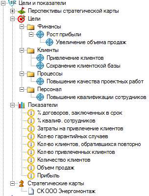
