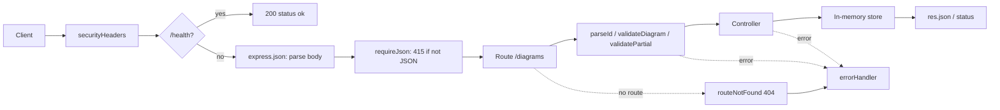

# Lab 1. REST API on Express: study notes for the defence

Branch `lab21`, folder `part-2/lab-01-node-server`. Russian version: `10-LR1-NODE-SERVER.md`. How to run is in `00-RUN-GUIDE.md`; this file covers what you must understand, explain and be able to extend in front of the teacher.

## 1 What the lab does in one minute

The server keeps diagrams (title, notation, source code, priority, owner) in an in-memory array and serves them over HTTP as JSON. Six routes:

| Method | Path | What it does | Success | Errors |
| --- | --- | --- | --- | --- |
| GET | `/diagrams` | list (`limit`, `offset`, `sort`, `order`) | 200, array, `X-Total-Count` | 400 |
| GET | `/diagrams/:id` | one record | 200 | 400, 404 |
| POST | `/diagrams` | create | 201, `Location` | 400, 415 |
| PUT | `/diagrams/:id` | replace entirely | 200 | 400, 404, 415 |
| PATCH | `/diagrams/:id` | change the sent fields | 200 | 400, 404, 415 |
| DELETE | `/diagrams/:id` | delete | 204 no body | 400, 404 |

Also: `GET /health` (liveness check); any other method on these paths gets 405 with an `Allow` header; `OPTIONS` answers 204.

## 2 Project layout

```
server.js                      entry: reads .env, listens on the port
src/app.js                     builds the application (createApp)
src/routes/diagrams.routes.js  which path and method goes to which handler
src/controllers/...            what to do with a request and what to answer
src/models/diagram.model.js    array store, constants
src/middleware/validate.js     id and body validation
src/middleware/list-query.js   limit, offset, sort, order validation
src/middleware/http.js         security headers, 415, 405
src/middleware/error-handler.js  one error format
src/errors.js                  HttpError class
limits.json                    length limits in one place
```

Layer idea: routes only connect a path to a function, the controller does not know where the data lives (it receives `store`), the store knows nothing about HTTP. That is why lab 2 replaced the array with a database without touching the routes, and why `createApp(store)` takes the store as a parameter: tests pass a fresh one.

## 3 Path of one request



The order of `app.use` matters: security headers go first so they reach error responses too; `express.json` goes before the routes, otherwise `req.body` is empty; the error handler goes last because Express calls a four-parameter function only when an error happened earlier in the chain.

## 4 File walk-through

### `server.js`
`process.loadEnvFile()` reads `.env` if present (inside `try`, the file is optional). The port comes from `PORT`, default 3000. `createApp().listen(...)` starts the server.

### `src/app.js`
`app.disable('x-powered-by')` removes the header that gives away Express. `express.json({ limit })` parses JSON and rejects a body above the `limits.json` cap (413). `app.use('/diagrams', ...)` mounts the router; inside it, paths are written without the prefix.

### `src/routes/diagrams.routes.js`
`router.route('/:id')` gathers all methods of one path. A chain such as `.get(parseId, controller.get)` reads left to right: id check first, then the controller. The final `.all(allowMethods([...]))` fires only for methods that had no handler above, so it answers 405 and `OPTIONS`.

### `src/middleware/validate.js`
- `parseId` checks the string with `^[1-9]\d*$` rather than plain `Number(...)`, because `Number('0x1')`, `Number('1e0')` and `Number(' 1')` also give numbers. `Number.isSafeInteger` rejects huge values.
- `text(name, singleLine)` returns a check function. A whitespace-only string (including zero-width characters) counts as empty; length is measured after `trim()`, so what is checked is exactly what is stored. Single-line fields reject control characters.
- `validateDiagram` serves POST and PUT: full body, optional `priority` gets a default, unknown fields are dropped (only fields from `checks` reach `req.diagramFields`).
- `validatePartial` serves PATCH: checks only the sent fields with the same checks; no known field gives 400.
- Errors are collected into a `details` list per field, so the client sees all problems at once.

### `src/models/diagram.model.js`
`createDiagramStore` keeps `diagrams` and the `nextId` counter in a closure: the array is not reachable from outside. `stamp()` returns a `createdAt` strictly later than the previous one, even for two creations in the same millisecond. `replace` keeps the old `createdAt` (PUT replaces fields, not history); `update` does `{ ...old, ...sent }`.

### `src/controllers/diagrams.controller.js`
`list` sorts a copy (`[...store.findAll()]`, so the store is not mutated), compares numbers as numbers and text with `localeCompare`, and breaks ties by `id` so pages never overlap. The total size goes into `X-Total-Count`; the body stays an array, as clients of earlier labs expect. `create` answers 201 with `Location`. `remove` answers 204 with no body.

### `src/middleware/error-handler.js`
Every error becomes `{ "error": "..." }` with the right status. For 5xx the client gets the generic `Internal server error`; details stay in the server console, so the cause never leaks. Malformed JSON (`entity.parse.failed`) gives 400, not 500.

## 5 Likely defence questions

Numbering in the assignment: 9–11 (for variant 26 these are n−1, n, n+1 with n=10). Full answers are in the report, section 3.7; this is the short cheat sheet.

- **PUT vs PATCH.** PUT replaces the resource entirely and is idempotent; PATCH changes only the sent fields and need not be idempotent (for example "increase by 1"). Both are implemented.
- **Why nodemon.** Restarts the server on file save; a development dependency, production uses `npm start`.
- **CORS.** The `Access-Control-Allow-Origin` header, a preflight `OPTIONS` for PUT and JSON; in Express the `cors` package before the routes. Here the client is on the same origin, so CORS is off.
- **Why 201, 204, 404, 400, 415, 405.** 201 created, 204 success with no body, 404 no such record, 400 invalid data, 415 body is not JSON, 405 method not supported on the path.
- **Why the id from the path is checked as a string.** See `parseId` above.
- **What happens if a handler throws.** In Express 5 exceptions and rejected promises from handlers reach `errorHandler` on their own; no `try/catch` is needed.
- **Even variant and the database.** The lab text says the data lives in an array; other materials say a database for even variants. This is an open question for the teacher; the way is ready: `createApp(store)` already accepts any store with the same methods.

## 6 Write it live: rehearsal

1. **New field `tags` (array of strings).** Add a check to `checks` in `validate.js` (array, at most N items, each a non-empty string), a default in `validateDiagram`, the limit in `limits.json`. The store needs no change: it stores what it is given.
2. **Filter `?notation=UML`.** Read `query.notation` in `list-query.js`, check it against `NOTATIONS` (else 400), filter in the controller before sorting and count `X-Total-Count` after the filter.
3. **Endpoint `GET /diagrams/count`.** Declare it before `/:id`, otherwise the word `count` lands in `:id` and returns 400.
4. **Field `updatedAt`.** Call `stamp()` in `replace` and `update`.
5. **"Why does it not work":** check the `app.use` order first, then `Content-Type`, then the server console.

## 7 What to check by hand before the defence

```bash
npm install
npm test
npm start
```

Requests from `requests.http` or `postman_collection.json`: list, one record, 404 on `/diagrams/999`, 400 on `/diagrams/abc`, POST with an empty title, PUT, PATCH, DELETE and a repeated DELETE. Postman screenshots for the report are taken on your machine.
