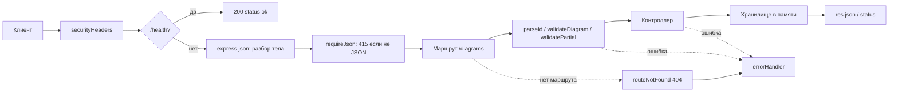

# ЛР1. REST API на Express: разбор для защиты

Ветка `lab21`, папка `part-2/lab-01-node-server`. Английская версия: `10-LR1-NODE-SERVER.en.md`. Запуск описан в `00-RUN-GUIDE.md`, здесь только то, что нужно понимать и уметь объяснить и дописать при преподавателе.

## 1 Что делает работа за одну минуту

Сервер хранит диаграммы (название, нотация, исходный код, приоритет, владелец) в массиве в памяти и отдаёт их по HTTP в формате JSON. Шесть маршрутов:

| Метод | Адрес | Что делает | Успех | Ошибки |
| --- | --- | --- | --- | --- |
| GET | `/diagrams` | список (с `limit`, `offset`, `sort`, `order`) | 200, массив, `X-Total-Count` | 400 |
| GET | `/diagrams/:id` | одна запись | 200 | 400, 404 |
| POST | `/diagrams` | создать | 201, `Location` | 400, 415 |
| PUT | `/diagrams/:id` | заменить целиком | 200 | 400, 404, 415 |
| PATCH | `/diagrams/:id` | изменить присланные поля | 200 | 400, 404, 415 |
| DELETE | `/diagrams/:id` | удалить | 204 без тела | 400, 404 |

Кроме них: `GET /health` (проверка, что сервер жив), любой другой метод на этих адресах даёт 405 с заголовком `Allow`, а `OPTIONS` отвечает 204.

## 2 Как устроен проект

```
server.js                      запуск: читает .env, слушает порт
src/app.js                     собирает приложение (createApp)
src/routes/diagrams.routes.js  какой адрес и метод какому обработчику
src/controllers/...            что делать с запросом и что ответить
src/models/diagram.model.js    хранилище в массиве, константы
src/middleware/validate.js     проверка id и тела запроса
src/middleware/list-query.js   проверка limit, offset, sort, order
src/middleware/http.js         заголовки безопасности, 415, 405
src/middleware/error-handler.js  единый формат ошибок
src/errors.js                  класс HttpError
limits.json                    пределы длины в одном месте
```

Идея слоёв: маршрут только связывает адрес с функцией, контроллер не знает, где лежат данные (ему передают `store`), хранилище не знает про HTTP. Поэтому в ЛР2 массив заменили базой, не трогая маршруты. Это же причина, по которой `createApp(store)` принимает хранилище параметром: тесты подставляют свежее.

## 3 Путь одного запроса



Порядок `app.use` важен: заголовки безопасности должны стоять первыми, чтобы попасть и в ответы с ошибкой; `express.json` стоит до маршрутов, иначе `req.body` будет пустым; обработчик ошибок стоит последним, потому что Express вызывает функцию с четырьмя параметрами только когда ошибка уже случилась выше по цепочке.

## 4 Разбор файлов

### `server.js`
`process.loadEnvFile()` читает `.env`, если он есть (в `try`, потому что файл необязателен). Порт берётся из `PORT`, иначе 3000. `createApp().listen(...)` запускает сервер.

### `src/app.js`
`app.disable('x-powered-by')` убирает заголовок, который выдаёт, что это Express. `express.json({ limit })` разбирает JSON и отказывает телу больше предела из `limits.json` (ответ 413). `app.use('/diagrams', ...)` монтирует роутер: внутри роутера адреса пишутся без префикса.

### `src/routes/diagrams.routes.js`
`router.route('/:id')` собирает все методы одного адреса в цепочку. Цепочка `.get(parseId, controller.get)` читается слева направо: сначала проверка id, потом контроллер. Последний `.all(allowMethods([...]))` срабатывает только для методов, которым выше не нашлось обработчика, поэтому именно он отвечает 405 и на `OPTIONS`.

### `src/middleware/validate.js`
- `parseId` проверяет строку регулярным выражением `^[1-9]\d*$`, а не просто `Number(...)`, потому что `Number('0x1')`, `Number('1e0')` и `Number(' 1')` тоже дают число. Дополнительно `Number.isSafeInteger` отсекает огромные значения.
- `text(name, singleLine)` возвращает функцию-проверку. Пробельная строка (включая невидимые символы нулевой ширины) считается пустой; длина меряется после `trim()`, то есть проверяется ровно то, что сохранится. Однострочные поля не могут содержать управляющие символы.
- `validateDiagram` служит и для POST, и для PUT: полное тело, необязательный `priority` получает значение по умолчанию, лишние поля отбрасываются (в `req.diagramFields` попадают только поля из `checks`).
- `validatePartial` для PATCH: проверяет только присланные поля теми же проверками, пустой набор известных полей даёт 400.
- Ошибки собираются списком `details` по полям, а не по одной, чтобы клиент увидел все проблемы сразу.

### `src/models/diagram.model.js`
`createDiagramStore` держит `diagrams` и счётчик `nextId` в замыкании: снаружи массив недоступен, только методы. `stamp()` выдаёт `createdAt` строго позже предыдущего, даже при двух созданиях в одну миллисекунду. `replace` сохраняет прежний `createdAt` (PUT заменяет поля, но не историю), `update` делает `{ ...старый, ...присланные }`.

### `src/controllers/diagrams.controller.js`
`list` сортирует копию массива (`[...store.findAll()]`, чтобы не менять хранилище), числа сравнивает как числа, текст через `localeCompare`, равные значения упорядочивает по `id`, поэтому страницы не пересекаются. Полный размер выборки идёт в заголовке `X-Total-Count`, а тело остаётся массивом, как ждут клиенты прежних работ. `create` отвечает 201 и заголовком `Location`. `remove` отвечает 204 без тела.

### `src/middleware/error-handler.js`
Все ошибки превращаются в `{ "error": "..." }` с нужным статусом. Для 5xx клиенту отдаётся общий текст `Internal server error`, а подробности остаются в консоли сервера: причина сбоя не должна утекать наружу. Некорректный JSON (`entity.parse.failed`) даёт 400, а не 500.

## 5 Вопросы, которые вероятны на защите

Нумерация в условии: 9–11 (для варианта 26 это n−1, n, n+1 при n=10). Развёрнутые ответы лежат в отчёте, раздел 3.7; здесь короткая шпаргалка.

- **PUT и PATCH.** PUT заменяет ресурс целиком и идемпотентен; PATCH меняет только присланные поля и идемпотентным быть не обязан (например, «увеличить на 1»). В работе есть оба.
- **Зачем nodemon.** Перезапускает сервер при сохранении файла; это зависимость разработки, в рабочем запуске `npm start`.
- **CORS.** Заголовок `Access-Control-Allow-Origin`, предварительный запрос `OPTIONS` для PUT и JSON; в Express подключается пакетом `cors` до маршрутов. В работе клиент на том же адресе, поэтому CORS не включён.
- **Почему 201, 204, 404, 400, 415, 405.** 201 создано, 204 успешно без тела, 404 такой записи нет, 400 данные неверны, 415 тело не JSON, 405 метод не поддержан адресом.
- **Почему `id` из адреса проверяется строкой.** См. `parseId` выше.
- **Что будет, если выбросить ошибку в обработчике.** В Express 5 исключения и отклонённые промисы из обработчиков попадают в `errorHandler` сами, `try/catch` не нужен.
- **Чётный вариант и БД.** По условию ЛР1 данные в массиве; для чётного варианта в других материалах названа БД. Это открытый вопрос к преподавателю, подготовлен путь: `createApp(store)` уже принимает любое хранилище с теми же методами.

## 6 Допиши при мне: тренировка

1. **Новое поле `tags` (массив строк).** Добавить проверку в `checks` в `validate.js` (массив, не длиннее N элементов, каждый элемент непустая строка), значение по умолчанию в `validateDiagram`, предел в `limits.json`. Хранилище править не нужно: оно хранит что дали.
2. **Фильтр `?notation=UML`.** В `list-query.js` прочитать `query.notation`, проверить по `NOTATIONS` (иначе 400), в контроллере отфильтровать до сортировки и считать `X-Total-Count` после фильтра.
3. **Эндпоинт `GET /diagrams/count`.** Объявить до `/:id`, иначе слово `count` попадёт в `:id` и вернётся 400.
4. **Поле «время изменения» `updatedAt`.** В `replace` и `update` ставить `stamp()`.
5. **Ответ на «почему не работает»:** сначала смотреть порядок `app.use`, затем `Content-Type`, затем консоль сервера.

## 7 Что проверить руками перед защитой

```bash
npm install
npm test
npm start
```

Запросы из `requests.http` или `postman_collection.json`: список, одна запись, 404 на `/diagrams/999`, 400 на `/diagrams/abc`, POST с пустым названием, PUT, PATCH, DELETE и повторный DELETE. Скриншоты Postman для отчёта снимаются на вашей машине.
