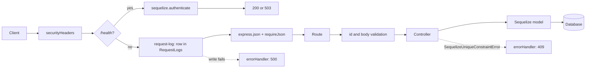

# Lab 2. Express and Sequelize (ORM, migrations): study notes for the defence

Branch `lab12`, folder `part-2/lab-02-sequelize`. Russian version: `11-LR2-SEQUELIZE.md`. How to run is in `00-RUN-GUIDE.md`. This is lab 1 with the array replaced by a database through the Sequelize ORM. Only what you must understand and be able to extend in front of the teacher is here.

## 1 What the lab does in one minute

The REST API of the `diagrams` resource from lab 1, but the records live in a database table. By default this is a SQLite file (`dev.sqlite`); with `DATABASE_URL` it is PostgreSQL. Tables are created by migrations, never by `sequelize.sync()`. New compared with lab 1:
- the `projects` resource and a one-to-many link (a project has many diagrams, a diagram belongs to one project);
- the numeric field `revision` from 0 to a limit;
- a log of every request in the `RequestLogs` table (requirement of even variant 26);
- a 409 answer on a uniqueness violation (project name).

| Method | Path | What it does |
| --- | --- | --- |
| GET, POST | `/diagrams` | list (`limit`, `offset`, `sort`, `order`) and create |
| GET, PUT, PATCH, DELETE | `/diagrams/:id` | as in lab 1 |
| GET, POST | `/projects` | list and create a project (409 on a repeated name) |
| GET, DELETE | `/projects/:id` | one record; deleting keeps the diagrams and clears their `projectId` |
| GET | `/projects/:id/diagrams` | diagrams of one project |
| GET | `/health` | server and database check (503 if the database is unreachable) |

## 2 Project layout

```
server.js                      checks the database connection, then listens
config/config.js               which database: SQLite by default, PostgreSQL by DATABASE_URL
migrations/                    schema history: tables, fields, link, log
seeders/                       starting data
src/models/index.js            connection, models and associations (hasMany, belongsTo)
src/models/diagram.js          Diagram model and its validators
src/models/project.js          Project model
src/models/request-log.js      RequestLog model
src/controllers/               database calls through the models
src/middleware/                body validation, log, errors (as in lab 1 plus log and 409)
limits.json                    limits shared by validation and migrations
```

## 3 Path of one request



The log sits after `/health` so Docker probes do not fill the table, and before body parsing so even bad requests are recorded. If the log write fails, the client gets 500: the variant forbids swallowing that failure.

## 4 Main parts explained

### Configuration and connection
`config/config.js` picks the database from the environment: no `DATABASE_URL` means a local SQLite file, with it PostgreSQL. In production SSL with certificate checks is required; checks cannot be turned off, `DATABASE_SSL_CA` is used instead. `server.js` calls `authenticate()` first and only then listens; without a database the process exits with code 1 and a clear message.

### Models and associations (`src/models`)
`sequelize.define('Diagram', {...})` describes fields, types and validators (`validate`). Model validation is the second line after `validate.js`: even if the model is used outside the API, the constraints still hold. The link:

```js
Project.hasMany(Diagram, { foreignKey: 'projectId', as: 'diagrams', onDelete: 'SET NULL' });
Diagram.belongsTo(Project, { foreignKey: 'projectId', as: 'project' });
```

`hasMany` goes on the parent (the "one" side), `belongsTo` on the child (the "many" side); the foreign key `projectId` lives in the child table. `SET NULL` means that deleting a project keeps its diagrams and clears the key.

### Migrations
A migration has `up` (apply) and `down` (revert). The schema changes only through them, so the history can be replayed on another machine: `npm run db:migrate`, revert the last one with `npm run db:migrate:undo`, rebuild everything with data via `npm run db:reset`. A migration is a snapshot: limits are copied into it rather than imported, so an old migration does not change with the code.

Techniques used in the lab migrations:
- numeric `revision`: `addColumn` plus a `CHECK` from 0 to the limit, so the database is protected even from writes that bypass the API;
- unique project name: `unique: true` on the column;
- non-blank name: `CHECK length(trim(name)) > 0`;
- `removeColumn` in SQLite rebuilds the table and loses the `CHECK`s, so `down` uses `ALTER TABLE ... DROP COLUMN` for SQLite.

### Controllers
Express 5 passes a rejected promise to the error handler itself, so no `try/catch` is needed. `findAndCountAll({ order, limit, offset })` returns the page and the total: the total goes into `X-Total-Count`. Ordering by `[sort, order]` and then `id` makes the order stable. Before saving a diagram, `ensureProject` checks that the project exists and answers a clear 400 instead of a foreign-key error.

### Errors
`errorHandler` turns `SequelizeUniqueConstraintError` into 409 with a field list, `entity.parse.failed` into 400, and any unexpected error into 500 with a generic text (details only in the console). Identifiers are checked with a regular expression and the `MAX_ID` cap (2147483647): a larger number would break the INTEGER column in PostgreSQL with a 500.

## 5 Likely defence questions

For variant 26 these are questions 5–7 of 10 (n−1, n, n+1 with n=6). Full answers are in the report, section 3.11.

- **How to implement one-to-many (5).** `hasMany` on the parent, `belongsTo` on the child, the foreign key in the child table; in the lab `Project` and `Diagram`.
- **How to paginate in Sequelize (6).** `findAndCountAll({ limit, offset, order })`; a stable order is required, otherwise pages overlap.
- **How to handle a uniqueness error (7).** `UNIQUE` in the migration, catch `SequelizeUniqueConstraintError`, answer 409.
- **Why migrations rather than `sync()`.** `sync` keeps no history and cannot safely alter an existing table; migrations are reproducible and reversible.
- **What is CHECK and why, if the code validates.** The last line of defence: data stays correct even if someone writes to the database around the API.
- **How to trigger a 500 with a real failure.** Start the server, in a second window run `npx sequelize-cli db:migrate:undo:all`: the tables vanish, the first request cannot write the log and gets 500. Restore with `npm run db:migrate`, `npm run db:seed`. With PostgreSQL, stop the database.
- **SQLite or PostgreSQL.** An open question for the teacher; SQLite by default, PostgreSQL through `DATABASE_URL` (not yet tried on a real PostgreSQL).

## 6 Write it live: rehearsal

1. **New numeric field `stockQuantity >= 0`.**
   `npx sequelize-cli migration:generate --name add-stock-quantity`; in `up` an `addColumn` and an `addConstraint` of type `check` (`>= 0`); in `down` the reverse (`DROP COLUMN` for SQLite). Then the field in `src/models/diagram.js` (`DataTypes.INTEGER`, `validate: { min: 0, max }`), the limit in `limits.json`, the check in `checks` in `validate.js` (whole number, `>= 0`, `<=` the limit; strings, fractions and `1e999` refused). Apply with `npm run db:migrate`, inspect the table, revert with `npm run db:migrate:undo`.
2. **Filter `?notation=UML`.** Check the value against the list, add `where: { notation }` to `findAndCountAll`; `X-Total-Count` is counted after the filter automatically.
3. **Search `?q=`.** `where: { title: { [Op.like]: `%${q}%` } }` with `%` and `_` escaped; `Op.iLike` on PostgreSQL.
4. **Optional field `description`.** A migration with `allowNull: true`, the field in the model, a length check, optional in `checks`.

## 7 What to check by hand before the defence

```bash
npm install
npm run db:migrate
npm run db:seed
npm test
npm start
```

Requests from `requests.http` or `postman_collection.json`: a list and the page `?limit=2&offset=2`, POST a project, repeat the same name (409), a diagram with a missing `projectId` (400), `GET /projects/1/diagrams`, PATCH, DELETE a project and check that the diagrams stayed. Postman and database-structure screenshots (pgAdmin or DBeaver) for the report are taken on your machine.
