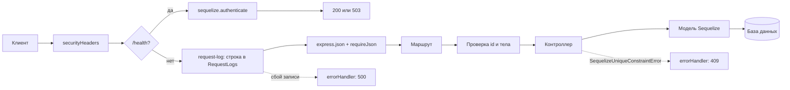

# ЛР2. Express и Sequelize (ORM, миграции): разбор для защиты

Ветка `lab12`, папка `part-2/lab-02-sequelize`. Английская версия: `11-LR2-SEQUELIZE.en.md`. Запуск описан в `00-RUN-GUIDE.md`. Это та же ЛР1, у которой массив заменён базой данных через ORM Sequelize. Здесь только то, что нужно понимать и уметь дописать при преподавателе.

## 1 Что делает работа за одну минуту

REST API ресурса `diagrams` из ЛР1, но записи лежат в таблице базы данных. По умолчанию это файл SQLite (`dev.sqlite`), с переменной `DATABASE_URL` это PostgreSQL. Таблицы создают миграции, а не `sequelize.sync()`. Кроме `diagrams` появились:
- ресурс `projects` и связь один-ко-многим (у проекта много диаграмм, у диаграммы один проект);
- числовое поле `revision` от 0 до предела;
- журнал каждого запроса в таблицу `RequestLogs` (требование чётного варианта 26);
- ответ 409 при нарушении уникальности (имя проекта).

| Метод | Адрес | Что делает |
| --- | --- | --- |
| GET, POST | `/diagrams` | список (`limit`, `offset`, `sort`, `order`) и создание |
| GET, PUT, PATCH, DELETE | `/diagrams/:id` | как в ЛР1 |
| GET, POST | `/projects` | список и создание проекта (409 при повторе имени) |
| GET, DELETE | `/projects/:id` | запись; удаление оставляет диаграммы, обнуляя им `projectId` |
| GET | `/projects/:id/diagrams` | диаграммы одного проекта |
| GET | `/health` | проверка сервера и базы (503, если база недоступна) |

## 2 Как устроен проект

```
server.js                      проверяет подключение к базе, потом слушает порт
config/config.js               какая база: SQLite по умолчанию, PostgreSQL по DATABASE_URL
migrations/                    история схемы: создание таблиц, поля, связи, журнал
seeders/                       стартовые данные
src/models/index.js            подключение, модели и связи (hasMany, belongsTo)
src/models/diagram.js          модель Diagram и её проверки
src/models/project.js          модель Project
src/models/request-log.js      модель RequestLog
src/controllers/               запросы к базе через модели
src/middleware/                проверка тела, журнал, ошибки (как в ЛР1 плюс журнал и 409)
limits.json                    пределы, общие для проверки и миграций
```

## 3 Путь одного запроса



Журнал стоит после `/health`, чтобы проверки Docker не засоряли таблицу, и до разбора тела, чтобы записывались даже плохие запросы. Если запись в журнал не удалась, клиент получает 500: молча проглотить сбой нельзя по условию варианта.

## 4 Разбор главного

### Конфигурация и подключение
`config/config.js` выбирает базу из окружения: без `DATABASE_URL` это локальный файл SQLite, с ним PostgreSQL. В боевом режиме требуется SSL с проверкой сертификата; отключить проверку нельзя, вместо этого указывают `DATABASE_SSL_CA`. `server.js` сначала вызывает `authenticate()` и только потом начинает слушать порт; без базы процесс завершается с кодом 1 и понятным сообщением.

### Модели и связи (`src/models`)
`sequelize.define('Diagram', {...})` описывает поля, их типы и проверки (`validate`). Проверка в модели второй рубеж после `validate.js`: даже если вызвать модель не через API, ограничения сработают. Связь:

```js
Project.hasMany(Diagram, { foreignKey: 'projectId', as: 'diagrams', onDelete: 'SET NULL' });
Diagram.belongsTo(Project, { foreignKey: 'projectId', as: 'project' });
```

`hasMany` стоит у родителя (одна сторона), `belongsTo` у ребёнка (много сторон), внешний ключ `projectId` лежит в таблице ребёнка. `SET NULL` значит: при удалении проекта диаграммы остаются, ключ обнуляется.

### Миграции
Миграция состоит из `up` (применить) и `down` (откатить). Схему меняют только ими, поэтому историю можно повторить на чужой машине: `npm run db:migrate`, откатить последнюю `npm run db:migrate:undo`, пересоздать всё с данными `npm run db:reset`. Миграция фиксирует снимок: пределы в ней скопированы, а не импортированы, чтобы старая миграция не менялась вместе с кодом.

Приёмы из миграций работы:
- числовое поле `revision`: `addColumn` и `CHECK` от 0 до предела, то есть база защищена даже от записи в обход API;
- уникальность имени проекта: `unique: true` на столбце;
- не пустое имя: `CHECK length(trim(name)) > 0`;
- откат `removeColumn` в SQLite пересобирает таблицу и теряет `CHECK`, поэтому в `down` для SQLite используется `ALTER TABLE ... DROP COLUMN`.

### Контроллеры
Express 5 сам передаёт отклонённый промис в обработчик ошибок, поэтому `try/catch` не нужен. `findAndCountAll({ order, limit, offset })` возвращает страницу и общий размер: размер идёт в заголовок `X-Total-Count`. Сортировка по двум столбцам `[sort, order]` и затем `id` делает порядок стабильным. Перед сохранением диаграммы `ensureProject` проверяет, что проект существует, и отвечает понятным 400, а не ошибкой внешнего ключа.

### Ошибки
`errorHandler` переводит `SequelizeUniqueConstraintError` в 409 со списком полей, `entity.parse.failed` в 400, всё прочее непредвиденное в 500 с общим текстом (подробности только в консоли). Идентификаторы проверяются регулярным выражением и пределом `MAX_ID` (2147483647): число побольше сломало бы столбец INTEGER в PostgreSQL ответом 500.

## 5 Вопросы, которые вероятны на защите

Для варианта 26 это вопросы 5–7 из 10 (n−1, n, n+1 при n=6). Развёрнутые ответы в отчёте, раздел 3.11.

- **Как реализовать связь один-ко-многим (5).** `hasMany` у родителя, `belongsTo` у ребёнка, внешний ключ в таблице ребёнка; в работе `Project` и `Diagram`.
- **Как сделать пагинацию в Sequelize (6).** `findAndCountAll({ limit, offset, order })`, стабильный порядок обязателен, иначе страницы пересекутся.
- **Как обработать ошибку уникальности (7).** `UNIQUE` в миграции, поймать `SequelizeUniqueConstraintError`, ответить 409.
- **Зачем миграции, а не `sync()`.** `sync` не хранит историю и не умеет безопасно изменять существующую таблицу; миграции воспроизводимы и обратимы.
- **Что такое CHECK и зачем он, если есть проверка в коде.** Последний рубеж: данные корректны, даже если кто-то пишет в базу мимо API.
- **Как вызвать ответ 500 настоящим сбоем.** Запустить сервер, во втором окне `npx sequelize-cli db:migrate:undo:all`: таблицы исчезают, первый запрос не может записать журнал и получает 500. Вернуть: `npm run db:migrate`, `npm run db:seed`. В PostgreSQL достаточно остановить базу.
- **SQLite или PostgreSQL.** Открытый вопрос к преподавателю; по умолчанию SQLite, PostgreSQL через `DATABASE_URL` (на настоящем PostgreSQL ещё не проверялось).

## 6 Допиши при мне: тренировка

1. **Новое числовое поле `stockQuantity >= 0`.**
   `npx sequelize-cli migration:generate --name add-stock-quantity`, в `up` `addColumn` и `addConstraint` типа `check` (`>= 0`), в `down` обратное (для SQLite `DROP COLUMN`). Затем поле в `src/models/diagram.js` (`DataTypes.INTEGER`, `validate: { min: 0, max }`), предел в `limits.json`, проверка в `checks` в `validate.js` (целое, `>= 0`, `<=` предела; строка, дробь и `1e999` отказ). Применить `npm run db:migrate`, проверить таблицу, откатить `npm run db:migrate:undo`.
2. **Фильтр `?notation=UML`.** Проверить значение по списку, добавить `where: { notation }` в `findAndCountAll`, `X-Total-Count` посчитается после фильтра автоматически.
3. **Поиск `?q=`.** `where: { title: { [Op.like]: `%${q}%` } }` с экранированием `%` и `_`; в PostgreSQL `Op.iLike`.
4. **Поле `description` (необязательное).** Миграция с `allowNull: true`, поле в модели, проверка длины, необязательность в `checks`.

## 7 Что проверить руками перед защитой

```bash
npm install
npm run db:migrate
npm run db:seed
npm test
npm start
```

Запросы из `requests.http` или `postman_collection.json`: список и страница `?limit=2&offset=2`, POST проекта, повтор того же имени (409), диаграмма с несуществующим `projectId` (400), `GET /projects/1/diagrams`, PATCH, DELETE проекта и проверка, что диаграммы остались. Скриншоты Postman и структуры БД (pgAdmin или DBeaver) для отчёта снимаются на вашей машине.
