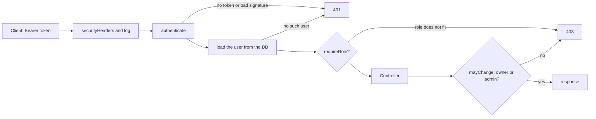

# Lab 3. Authentication and authorization (bcrypt, JWT, roles): study notes for the defence

Branch `23`, folder `part-2/lab-03-auth`. Russian version: `12-LR3-AUTH.md`. How to run is in `00-RUN-GUIDE.md`. This is lab 2 (Express and Sequelize) with users, token login, roles and brute-force protection added. Only what you must understand and be able to extend in front of the teacher is here.

## 1 What the lab does in one minute

A user registers (`POST /auth/register`), logs in (`POST /auth/login`) and receives a JWT. With that token in the header `Authorization: Bearer <token>` they work with diagrams. The password is stored only as a bcrypt hash. A diagram can be changed or deleted by its owner or by an admin.

| Method | Path | Access | What it does |
| --- | --- | --- | --- |
| POST | `/auth/register` | everyone | create a user (201, 409 on a repeated email) |
| POST | `/auth/login` | everyone | issue a token (401 on error, 429 when locked) |
| GET | `/profile` | token | own data |
| GET | `/users` | admin | list users |
| PATCH | `/users/:id/role` | admin | change a role |
| DELETE | `/users/:id` | admin | delete a user |
| GET, POST | `/diagrams` | token | list and create (owner is taken from the token) |
| GET, PUT, PATCH, DELETE | `/diagrams/:id` | token; change and delete by owner or admin | as in lab 2 |
| GET | `/health` | everyone | server and database check |

Codes: 401 missing or bad token, 403 valid token but not enough rights, 409 email taken, 429 too many attempts.

## 2 Project layout

```
src/app.js                     builds the app, wires the limiters
src/settings.js                checks the token secret and lifetime at startup
src/models/user.js             user: email, password hash, role; toPublic hides the hash
src/middleware/auth.js         authenticate (token check) and requireRole
src/middleware/validate-auth.js  email and password validation
src/middleware/rate-limit.js   request limiter and login lock
src/controllers/auth.controller.js  registration and login
src/controllers/users.controller.js profile, list, role, delete
src/controllers/diagrams.controller.js diagrams with an owner and mayChange
limits.json                    limits (email, password length, body size)
```

## 3 Path of a protected request



The role is read from the database on every request, not from the token. So a deleted user or a lowered role loses access at once, not when the token expires.

## 4 Main parts explained

### Registration and login (`auth.controller.js`)
- The password is hashed with `bcrypt.hash(password, rounds)`. The hash contains the salt and the cost, so equal passwords give different hashes and lookup tables of ready hashes are useless.
- On a taken email `User.create` throws `SequelizeUniqueConstraintError`, and the controller turns it into 409. The email is lowercased and trimmed, so one address is one account.
- On login, for an unknown email `bcrypt.compare` still runs against a prepared hash (`dummyHash`). Otherwise the response time would reveal whether the account exists. The message is always the same: "Invalid email or password".
- The token is signed with `jwt.sign(..., { algorithm: 'HS256', expiresIn, issuer, subject })`. The default lifetime is an hour, and the settings do not allow more than a day.

### Token check (`auth.js`)
`jwt.verify` is called with an explicit algorithm list `['HS256']` and an issuer, so a token with `alg: none` cannot be slipped in. An expired token gives "Token expired", any other defect "Invalid token". After verification the user is loaded from the database and `req.user` gets id, email and the role from the database.

### Roles and owner
`requireRole('admin')` guards the `/users` routes. For diagrams `mayChange(user, diagram)` lets the owner and an admin edit. That is a write-permission check (authorization), as opposed to the token check (authentication).

### Brute-force protection (`rate-limit.js`)
Three layers:
1. A per-address rate limiter: at most 20 login attempts per 15 minutes and 10 registrations per hour.
2. A lock on the pair "address and email": after 5 failures login is locked for 15 minutes even with the right password; the answer is 429 with a wait time. The key includes the address, so a stranger cannot lock the real owner's account.
3. Password limits: at least 8 characters and at most 72 bytes (bcrypt ignores the rest).

The state lives in process memory, so with several server instances the counters are not shared (noted in `AUDIT.md`). The counter tables are size-capped so an attacker cannot grow the memory.

### Secret and settings (`settings.js`)
The server will not start with a weak secret: at least 32 characters, not a repeated pattern. The secret lives in `.env` and never in the repository.

## 5 Likely defence questions

For variant 26 these are questions 9–11 of 16 (n−1, n, n+1 with n=10). Full answers are in the report, section 3.10.

- **How to limit a user's concurrent sessions (9).** JWT is stateless, the server remembers no sessions; you need a sessions table (session id in the token, checked on every request, older ones removed at login) or a token-version counter on the user record.
- **How to defend against brute force (10).** The layers above: limiter, lock on address and email, slow bcrypt, one error message.
- **What if the JWT secret is compromised (11).** Whoever knows the key can sign any token, including an admin's. Rotate the secret (all tokens become invalid), notify users, and from now on keep the key outside the repository and the lifetime short.
- **Why bcrypt rather than a plain hash.** Slow and salted, with a tunable cost.
- **401 or 403.** 401 "I do not know who you are", 403 "I know, but not allowed".
- **Where to keep the token on the client.** Discussed in lab 5: localStorage is convenient but readable by page scripts (XSS risk); an `HttpOnly` cookie hides it from scripts but needs CSRF protection.
- **Why the role comes from the database, not the token.** So a role change or deletion takes effect at once.

## 6 Write it live: rehearsal

1. **Role `moderator`.** Add the value to `ROLES` in `models/user.js`; it then passes `validateRole`. In the routes let `requireRole` accept several roles (pass an array and use `includes`).
2. **Password change `PATCH /profile/password`.** Require the old password, check with `bcrypt.compare`, apply the same rules to the new one, save the new hash.
3. **Log out everywhere.** A `tokenVersion` field on the user; the version goes into the token at login, `authenticate` compares them; logout increments the version.
4. **Lock parameters in a file.** Already done: the number of failures, the lock time and the request limits live in `limits.json` and are read into `DEFAULTS` in `app.js`; the `createApp` settings override them.
5. **Show a 403.** A regular user's token on `GET /users` and on someone else's diagram.

## 7 What to check by hand before the defence

```bash
npm install
npm run db:migrate
npm run db:seed
npm test
npm start
```

Requests in order: register, repeat the same email (409), log in, a request without a token (401), a request with a junk token (401), `GET /profile`, create a diagram, edit someone else's diagram (403), `GET /users` as a regular user (403) and as an admin, five wrong passwords in a row and then the right one (429). The seeds create an admin from `ADMIN_EMAIL` and `ADMIN_PASSWORD` and regular demo users with a shared password from `DEMO_USER_PASSWORD`; the values come from your `.env` (a template is in `.env.example`) and must not go into chat or commits. Postman screenshots are taken on your machine.
