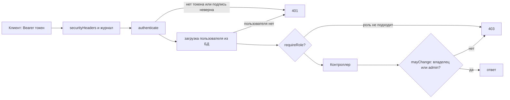

# ЛР3. Аутентификация и авторизация (bcrypt, JWT, роли): разбор для защиты

Ветка `23`, папка `part-2/lab-03-auth`. Английская версия: `12-LR3-AUTH.en.md`. Запуск описан в `00-RUN-GUIDE.md`. Это ЛР2 (Express и Sequelize), к которой добавлены пользователи, вход по токену, роли и защита от подбора пароля. Здесь только то, что нужно понимать и уметь дописать при преподавателе.

## 1 Что делает работа за одну минуту

Пользователь регистрируется (`POST /auth/register`), входит (`POST /auth/login`) и получает токен JWT. С этим токеном в заголовке `Authorization: Bearer <токен>` он работает с диаграммами. Пароль хранится только в виде хеша bcrypt. Изменять и удалять диаграмму может её владелец или администратор.

| Метод | Адрес | Доступ | Что делает |
| --- | --- | --- | --- |
| POST | `/auth/register` | все | создать пользователя (201, 409 при повторе email) |
| POST | `/auth/login` | все | выдать токен (401 при ошибке, 429 при блокировке) |
| GET | `/profile` | токен | свои данные |
| GET | `/users` | admin | список пользователей |
| PATCH | `/users/:id/role` | admin | сменить роль |
| DELETE | `/users/:id` | admin | удалить пользователя |
| GET, POST | `/diagrams` | токен | список и создание (владелец ставится из токена) |
| GET, PUT, PATCH, DELETE | `/diagrams/:id` | токен; изменение и удаление владелец или admin | как в ЛР2 |
| GET | `/health` | все | проверка сервера и базы |

Коды: 401 нет или плохой токен, 403 токен верный, но прав не хватает, 409 email занят, 429 слишком много попыток.

## 2 Как устроен проект

```
src/app.js                     собирает приложение, подключает ограничители
src/settings.js                проверка секрета и срока жизни токена при запуске
src/models/user.js             пользователь: email, хеш пароля, роль; toPublic скрывает хеш
src/middleware/auth.js         authenticate (проверка токена) и requireRole
src/middleware/validate-auth.js  проверка email и пароля
src/middleware/rate-limit.js   ограничитель запросов и блокировка входа
src/controllers/auth.controller.js  регистрация и вход
src/controllers/users.controller.js профиль, список, роль, удаление
src/controllers/diagrams.controller.js диаграммы с владельцем и mayChange
limits.json                    пределы (email, длина пароля, размер тела)
```

## 3 Путь защищённого запроса



Роль берётся из базы при каждом запросе, а не из токена. Поэтому удалённый пользователь или понижённая роль теряют доступ сразу, а не когда истечёт токен.

## 4 Разбор главного

### Регистрация и вход (`auth.controller.js`)
- Пароль хешируется `bcrypt.hash(password, rounds)`. Хеш содержит соль и стоимость, поэтому одинаковые пароли дают разные хеши, а подбор по таблицам готовых хешей не работает.
- `User.create` при занятом email бросает `SequelizeUniqueConstraintError`, контроллер превращает её в 409. Email приводится к нижнему регистру и обрезается, поэтому один адрес это один аккаунт.
- При входе для неизвестного email всё равно считается `bcrypt.compare` с заготовленным хешем (`dummyHash`). Иначе по времени ответа можно узнать, есть ли такой аккаунт. Сообщение одно и то же: «Invalid email or password».
- Токен подписывается `jwt.sign(..., { algorithm: 'HS256', expiresIn, issuer, subject })`. Срок жизни по умолчанию час, больше суток настройки не позволяют.

### Проверка токена (`auth.js`)
`jwt.verify` вызывается с явным списком алгоритмов `['HS256']` и издателем: так нельзя подсунуть токен с `alg: none`. Истёкший токен даёт «Token expired», любой другой дефект «Invalid token». После проверки пользователь загружается из базы и в `req.user` попадают id, email и роль из базы.

### Роли и владелец
`requireRole('admin')` стоит на маршрутах `/users`. Для диаграмм `mayChange(user, diagram)` разрешает правку владельцу и админу. Это проверка прав на запись (авторизация), в отличие от проверки токена (аутентификация).

### Защита от подбора пароля (`rate-limit.js`)
Три слоя:
1. Ограничитель частоты по адресу: не более 20 попыток входа за 15 минут и 10 регистраций за час.
2. Блокировка по паре «адрес и email»: после 5 неудач вход заблокирован на 15 минут даже с верным паролем; ответ 429 с временем ожидания. Ключ включает адрес, поэтому посторонний не может заблокировать аккаунт владельца.
3. Пределы пароля: от 8 символов и не более 72 байт (bcrypt игнорирует остальное).

Состояние хранится в памяти процесса, при нескольких экземплярах серверов счётчики не общие (так записано в `AUDIT.md`). Таблицы счётчиков ограничены по размеру, чтобы злоумышленник не вырастил память.

### Секрет и настройки (`settings.js`)
Сервер не стартует со слабым секретом: не короче 32 символов, не повторяющийся узор. Секрет живёт в `.env` и в репозиторий не попадает.

## 5 Вопросы, которые вероятны на защите

Для варианта 26 это вопросы 9–11 из 16 (n−1, n, n+1 при n=10). Развёрнутые ответы в отчёте, раздел 3.10.

- **Как ограничить число одновременных сессий пользователя (9).** JWT без состояния, сервер сессий не помнит; нужна таблица сессий (id сессии в токене, проверка при каждом запросе, удаление старых при входе) или счётчик версии токена в записи пользователя.
- **Как защититься от brute force (10).** Слои выше: ограничитель, блокировка пары адрес и email, медленный bcrypt, единое сообщение об ошибке.
- **Что если секрет JWT скомпрометирован (11).** Тот, кто знает ключ, подпишет любой токен, в том числе администратора. Нужно сменить секрет (все токены станут недействительными), оповестить пользователей, а впредь хранить ключ вне репозитория и делать срок жизни коротким.
- **Чем bcrypt лучше обычного хеша.** Медленный и с солью, стоимость настраивается.
- **401 или 403.** 401 «не знаю, кто ты», 403 «знаю, но нельзя».
- **Где хранить токен на клиенте.** Обсуждается в ЛР5: localStorage удобен, но доступен скрипту страницы (риск XSS), cookie с `HttpOnly` защищает от чтения скриптом, но требует защиты от CSRF.
- **Зачем роль берётся из базы, а не из токена.** Чтобы смена роли и удаление действовали сразу.

## 6 Допиши при мне: тренировка

1. **Роль `moderator`.** Добавить значение в `ROLES` в `models/user.js`, новая роль проходит проверку `validateRole`; в маршрутах разрешить `requireRole` нескольким ролям (передать массив и использовать `includes`).
2. **Смена пароля `PATCH /profile/password`.** Требовать старый пароль, проверять `bcrypt.compare`, применять те же правила к новому, сохранять новый хеш.
3. **Выход со всех устройств.** Поле `tokenVersion` в пользователе, версия кладётся в токен при входе, `authenticate` сравнивает версии; выход увеличивает версию.
4. **Ограничить срок блокировки по настройке.** Уже сделано: число неудач, срок блокировки и пределы запросов лежат в `limits.json` и читаются в `DEFAULTS` в `app.js`; настройки `createApp` их переопределяют.
5. **Показать 403.** Токен обычного пользователя на `GET /users` и на чужую диаграмму.

## 7 Что проверить руками перед защитой

```bash
npm install
npm run db:migrate
npm run db:seed
npm test
npm start
```

Запросы по порядку: регистрация, повтор того же email (409), вход, запрос без токена (401), запрос с мусорным токеном (401), `GET /profile`, создание диаграммы, правка чужой диаграммы (403), `GET /users` обычным пользователем (403) и администратором, пять неверных паролей подряд и затем верный (429). Сиды создают администратора из `ADMIN_EMAIL` и `ADMIN_PASSWORD` и обычных демо-пользователей с общим паролем из `DEMO_USER_PASSWORD`; значения задаёт ваш `.env` (образец в `.env.example`), в чат и коммиты их не переносить. Скриншоты Postman снимаются на вашей машине.
