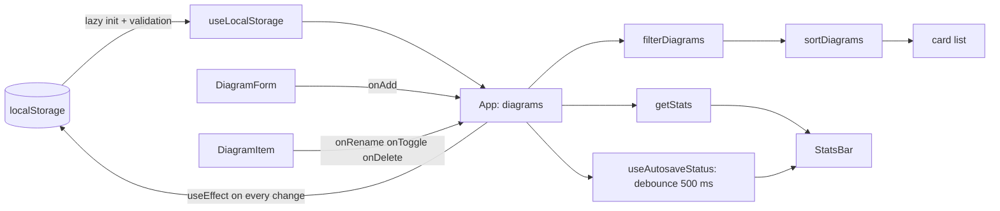

# Lab 4. State in React: useState, useEffect, localStorage. Study notes for the defence

Branch `24`, folder `part-2/lab-04-react-state`. Russian version: `13-LR4-REACT-STATE.md`. How to run is in `00-RUN-GUIDE.md`. This is a client-side React and Vite app with no server: the diagram list lives in the browser. Only what you must understand and be able to extend in front of the teacher is here.

## 1 What the lab does in one minute

A "My diagrams" page: an add form (title and notation), a list of cards, search by title, a status filter (all, published, drafts), sorting by date or title, a statistics bar and an autosave indicator. A card can be renamed, published (draft/published toggle) and deleted. Data is saved to `localStorage` and survives a page reload.

## 2 Project layout

```
src/main.jsx                      entry point, ErrorBoundary around the app
src/App.jsx                       main component: state and actions
src/components/DiagramForm.jsx    add form
src/components/DiagramItem.jsx    card: rename, publish, delete
src/components/DiagramFilters.jsx search, status, sorting
src/components/StatsBar.jsx       totals and autosave status
src/hooks/useLocalStorage.js      state bound to localStorage
src/hooks/useAutosaveStatus.js    "saving" / "saved" with a 500 ms delay
src/utils/validation.js           title check, list cap, check of foreign data
src/utils/diagrams.js             filter, sort, stats, unique creation time
src/limits.json                   limits: title length, record count
src/shell/                        header, footer, theme (the project's shared shell)
```

Principle: `App` owns the state; child components receive data and functions through props and keep only temporary things themselves (field text, edit mode). Pure filter and sort functions live in `utils` and are easy to test.

## 3 How data flows



## 4 Main parts explained

### State and actions (`App.jsx`)
- `useState` holds the query, the status and the sort. The diagram list is held by `useLocalStorage`.
- Actions use the functional form `setDiagrams((prev) => ...)`. It reads the latest value, so two quick clicks in a row do not lose changes. `setDiagrams([...diagrams, x])` would use the value from the moment of the render.
- State is never mutated: `map` and `filter` return new arrays and a changed record becomes a new object `{ ...d, title }`. React compares references and would not react to a mutation.
- `visible` is computed during rendering from `diagrams`, `query`, `status` and `sortBy`: derived data is not put into state, otherwise it would have to be synchronized.
- The `document.title` effect depends only on `diagrams.length`.

### The `useLocalStorage` hook
- The initial value is read once by the lazy initializer `useState(() => readStorage(...))`: the function runs only on the first render, not on each one.
- Reading is guarded: `try/catch` for broken JSON and a `validate` function that rejects data of the wrong shape. Then the initial value is used.
- Writing is a `useEffect` with dependencies `[key, value]`: it runs on every value change. A write error (disk full, storage blocked) is swallowed and the app keeps working in memory.

### Validation of foreign data (`validation.js`)
`localStorage` may hold anything: a manual edit, an old format, another script. So `isDiagramList` checks the whole array: size at most `maxCount`; every record has a valid `id`, a title, a notation from the list, a boolean `published`, parsable dates; and all `id` values are unique. If the whole list does not fit, `repairDiagramList` keeps the good records, drops damaged and repeated ones and cuts the list to the cap; if no record is usable, the initial data is used.

### Title validation
`validateTitle` treats whitespace-only input as empty, measures the length after `trim()` and takes the limits from `limits.json`. The form is submitted through `onSubmit`, so Enter works without a separate handler, and `noValidate` turns off the browser's built-in hints in favour of our own messages with `role="alert"`.

### Autosave (`useAutosaveStatus`)
A timer-based debounce: on each change it sets "saving" and starts a `setTimeout` of 500 ms; the cleanup function returned from the effect (`return () => clearTimeout(timer)`) cancels the previous timer if the value changes sooner. "Saved" appears once the data has been quiet for 500 ms.

### Unique creation time
`uniqueCreatedAt` ensures two records never share a second: if a record is created in the same second as the latest one, a second is added. `newId` uses `crypto.randomUUID`, and if it is missing (plain http outside localhost) it falls back to another generator.

### Accessibility
Field labels are tied through `useId`, card buttons have an `aria-label` with the diagram title, the publish toggle has `aria-pressed`, errors are shown with `role="alert"`, and there is a "skip to main content" link.

## 5 Likely defence questions

The assignment has 16 questions; for variant 26 these are 9–11 (n−1, n, n+1 with n=10). Full answers are in the report, section "Answers to the control questions".

- **How to save an object or array to `localStorage` (9).** `JSON.stringify` on write and `JSON.parse` on read: the storage accepts only strings.
- **What if you read state right after `setState` (10).** The same call still sees the old value: the update is scheduled and applied on the next render. An update that depends on the previous value needs the functional form.
- **How to imitate loading from a server (11).** Start a `setTimeout` in `useEffect` that puts the data into state after a second, show a loading indicator meanwhile; do not forget the cleanup function.
- **Why a dependency array.** The effect runs after rendering only if one of the dependencies changed; an empty array means "once after mounting".
- **Why lazy initialization.** So the expensive storage read does not run on every render.
- **Why hooks cannot be called conditionally.** React matches hooks by call order.
- **How the debounce works.** A timer in an effect plus cleanup.
- **How to optimize a big list.** Virtualization, memoization (`useMemo`, `React.memo`); here the list is capped at 200 records.

## 6 Write it live: rehearsal

1. **"Clear all" button.** A function `clearAll = () => setDiagrams([])` in `App` and a button near the statistics; the write of `[]` to `localStorage` happens by itself through the effect.
2. **"Description" field.** State in `DiagramForm`, a length check next to `validateTitle`, the field in the record in `addDiagram`, a type check in `isDiagram` (old records without the field must still pass), display in the card.
3. **Notation filter.** Add `notation` to `App` state, a `<select>` in `DiagramFilters`, a condition in `filterDiagrams`.
4. **Found counter.** Show `visible.length` of `total` in `StatsBar`.
5. **Persist the theme or a filter.** Use `useLocalStorage` once more with another key.
6. **"Why an infinite loop":** look at the dependency array and at an object or function recreated on every render.

## 7 What to check by hand before the defence

```bash
npm install
npm test
npm run dev
```

In the browser: add a diagram and reload (data is still there), rename (Enter saves, Esc cancels), whitespace instead of a title (error), a very long title (error), search and filters, the theme toggle. Corrupt the data in the browser console: `localStorage.setItem('dslkit.diagrams', '{broken')` and reload: the app must go back to the initial list instead of crashing. The screenshots for the report are already in the `figures` folder.
