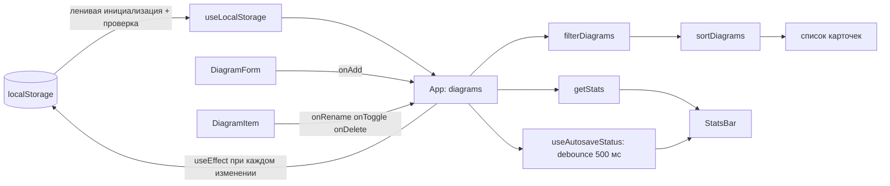

# ЛР4. Состояние в React: useState, useEffect, localStorage. Разбор для защиты

Ветка `24`, папка `part-2/lab-04-react-state`. Английская версия: `13-LR4-REACT-STATE.en.md`. Запуск описан в `00-RUN-GUIDE.md`. Это клиентское приложение на React и Vite без сервера: список диаграмм хранится в браузере. Здесь только то, что нужно понимать и уметь дописать при преподавателе.

## 1 Что делает работа за одну минуту

Страница «Мои диаграммы»: форма добавления (название и нотация), список карточек, поиск по названию, фильтр «все, опубликованные, черновики», сортировка по дате или названию, строка статистики и индикатор автосохранения. Карточку можно переименовать, опубликовать (переключатель черновик/опубликована) и удалить. Данные сохраняются в `localStorage` и переживают перезагрузку страницы.

## 2 Как устроен проект

```
src/main.jsx                      точка входа, ErrorBoundary вокруг приложения
src/App.jsx                       главный компонент: состояние и действия
src/components/DiagramForm.jsx    форма добавления
src/components/DiagramItem.jsx    карточка: правка названия, публикация, удаление
src/components/DiagramFilters.jsx поиск, статус, сортировка
src/components/StatsBar.jsx       итоги и статус автосохранения
src/hooks/useLocalStorage.js      состояние, связанное с localStorage
src/hooks/useAutosaveStatus.js    «сохраняется» / «сохранено» с задержкой 500 мс
src/utils/validation.js           проверка названия, предел списка, проверка чужих данных
src/utils/diagrams.js             фильтр, сортировка, статистика, уникальное время создания
src/limits.json                   пределы: длина названия, число записей
src/shell/                        шапка, подвал, тема (общая оболочка проекта)
```

Принцип: `App` владеет состоянием, дочерние компоненты получают данные и функции через props и сами ничего не хранят, кроме временного (текст в поле, режим правки). Чистые функции фильтра и сортировки вынесены в `utils`, их легко тестировать.

## 3 Как данные идут по приложению



## 4 Разбор главного

### Состояние и действия (`App.jsx`)
- `useState` держит запрос, статус и сортировку. Список диаграмм держит `useLocalStorage`.
- Действия написаны в функциональной форме `setDiagrams((prev) => ...)`. Она читает самое свежее значение, поэтому два быстрых клика подряд не теряют изменения. Запись `setDiagrams([...diagrams, x])` использовала бы значение с момента отрисовки.
- Состояние не мутируют: `map` и `filter` возвращают новые массивы, а у изменённой записи создаётся новый объект `{ ...d, title }`. React сравнивает ссылки, на мутацию он бы не отреагировал.
- `visible` вычисляется прямо при отрисовке из `diagrams`, `query`, `status` и `sortBy`: производные данные в состояние не кладут, иначе их пришлось бы синхронизировать.
- Эффект `document.title` зависит только от `diagrams.length`.

### Хук `useLocalStorage`
- Начальное значение читается один раз ленивым инициализатором `useState(() => readStorage(...))`: функция вызывается только при первом рендере, а не при каждом.
- Чтение защищено: `try/catch` на случай сломанного JSON и функция `validate`, которая отбрасывает данные неверной формы. Тогда берётся начальное значение.
- Запись в `useEffect` с зависимостями `[key, value]`: при каждом изменении значения. Ошибка записи (диск полон, хранилище заблокировано) гасится, приложение продолжает работать в памяти.

### Проверка чужих данных (`validation.js`)
`localStorage` может содержать что угодно: правка вручную, старый формат, другой скрипт. Поэтому `isDiagramList` проверяет массив целиком: размер не больше `maxCount`, у каждой записи допустимый `id`, название, нотация из списка, `published` логического типа, даты разбираются, и все `id` уникальны. Одна испорченная запись сейчас сбрасывает весь список к начальным данным (решение владельца: оставить как есть).

### Проверка названия
`validateTitle` считает пробельное значение пустым, меряет длину после `trim()`, пределы берёт из `limits.json`. Форма отправляется через `onSubmit`, поэтому Enter работает без отдельного обработчика, а `noValidate` отключает встроенные подсказки браузера в пользу своих сообщений с `role="alert"`.

### Автосохранение (`useAutosaveStatus`)
Debounce на таймере: при каждом изменении ставится «сохраняется» и запускается `setTimeout` на 500 мс; функция очистки из эффекта (`return () => clearTimeout(timer)`) сбрасывает прежний таймер, если значение изменилось раньше. Статус «сохранено» появляется, когда данные 500 мс не менялись.

### Уникальное время создания
`uniqueCreatedAt` гарантирует, что у двух записей не совпадут секунды: если запись создана в ту же секунду, что и последняя, ей добавляется секунда. `newId` использует `crypto.randomUUID`, а если его нет (обычный http не на localhost), берёт запасной вариант.

### Доступность
Подписи полей связаны через `useId`, у кнопок карточек `aria-label` с названием диаграммы, переключатель публикации имеет `aria-pressed`, ошибки выводятся с `role="alert"`, есть ссылка «Перейти к основному содержимому».

## 5 Вопросы, которые вероятны на защите

В условии 16 вопросов; для варианта 26 это 9–11 (n−1, n, n+1 при n=10). Развёрнутые ответы в отчёте, раздел «Ответы на контрольные вопросы».

- **Как сохранить объект или массив в `localStorage` (9).** `JSON.stringify` при записи и `JSON.parse` при чтении: хранилище принимает только строки.
- **Что будет, если читать состояние сразу после `setState` (10).** В том же вызове останется старое значение: обновление планируется и применяется при следующей отрисовке. Для зависящего от прежнего значения обновления нужна функциональная форма.
- **Как имитировать загрузку с сервера (11).** В `useEffect` запустить `setTimeout`, который через секунду кладёт данные в состояние, пока показывать индикатор загрузки; не забыть функцию очистки.
- **Зачем массив зависимостей.** Эффект запускается после отрисовки, только если изменилась одна из зависимостей; пустой массив означает «один раз после монтирования».
- **Зачем ленивая инициализация.** Чтобы дорогое чтение хранилища не выполнялось на каждом рендере.
- **Почему нельзя вызывать хуки в условиях.** React сопоставляет хуки по порядку вызова.
- **Как реализован debounce.** Таймер в эффекте плюс очистка.
- **Как оптимизировать большой список.** Виртуализация, мемоизация (`useMemo`, `React.memo`); здесь список ограничен 200 записями.

## 6 Допиши при мне: тренировка

1. **Кнопка «Очистить всё».** В `App` функция `clearAll = () => setDiagrams([])` и кнопка рядом со статистикой; запись `[]` в `localStorage` произойдёт сама через эффект.
2. **Поле «Описание».** Состояние в `DiagramForm`, проверка длины рядом с `validateTitle`, поле в записи в `addDiagram`, проверка типа в `isDiagram` (старые записи без поля должны проходить), вывод в карточке.
3. **Фильтр по нотации.** Добавить `notation` в состояние `App`, `<select>` в `DiagramFilters`, условие в `filterDiagrams`.
4. **Счётчик найденных.** В `StatsBar` показать `visible.length` из `total`.
5. **Сохранение темы или фильтра.** Использовать `useLocalStorage` ещё раз с другим ключом.
6. **«Почему бесконечный цикл»:** смотреть массив зависимостей и объект или функцию, создаваемые заново на каждом рендере.

## 7 Что проверить руками перед защитой

```bash
npm install
npm test
npm run dev
```

В браузере: добавить диаграмму и обновить страницу (данные на месте), переименовать (Enter сохраняет, Esc отменяет), пробелы вместо названия (ошибка), очень длинное название (ошибка), поиск и фильтры, переключатель темы. Испортить данные в консоли браузера: `localStorage.setItem('dslkit.diagrams', '{broken')` и обновить страницу: приложение должно вернуться к начальному списку, а не упасть. Скриншоты для отчёта уже есть в папке `figures`.
