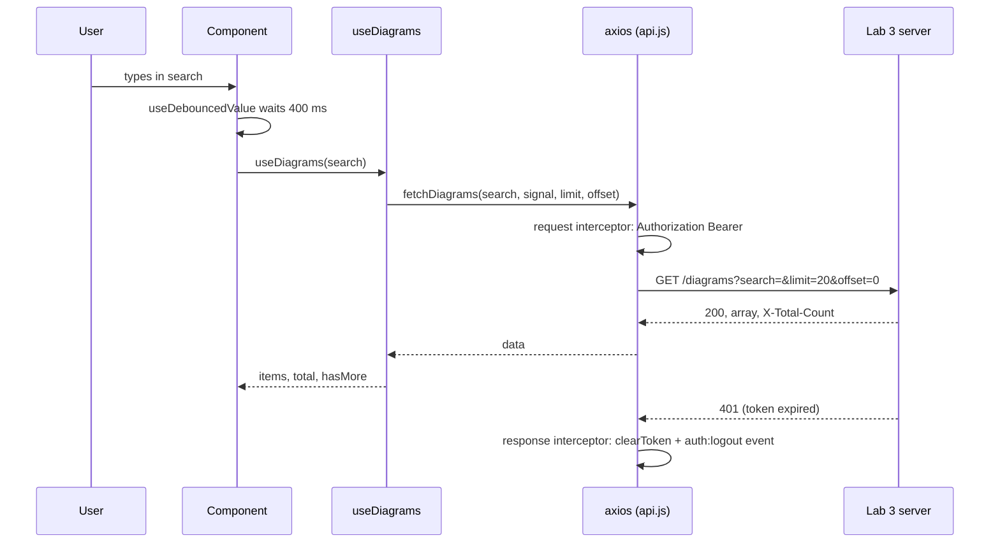

# Lab 5. React and a server: axios, JWT, optimistic updates. Study notes for the defence

Branch `25`, folder `part-2/lab-05-react-api` (the server is `part-2/lab-03-auth` from the same branch). Russian version: `14-LR5-REACT-API.md`. How to run is in `00-RUN-GUIDE.md`. This is a React and Vite client that works with the real API of lab 3 instead of `localStorage` (lab 4). Only what you must understand and be able to extend in front of the teacher is here.

## 1 What the lab does in one minute

The user registers or logs in, the token is saved, and then the app shows their diagrams from the server: a paged list ("Load more"), server-side search by title with a delay, add, edit and delete. Changes appear at once (optimistically) and are rolled back if the server refuses. Network and server failures are explained in plain text.

## 2 Project layout

```
src/main.jsx                      entry point
src/App.jsx                       login or list; search, notices, "Load more"
src/api.js                        axios: base URL, token, interceptors, request functions
src/hooks/useDiagrams.js          server state of the list: pages, add, update, remove
src/hooks/useDebouncedValue.js    value delay for the search
src/components/AuthForm.jsx       login and registration
src/components/DiagramForm.jsx    add form (the code field is multi-line)
src/components/DiagramItem.jsx    card: edit, delete, "Saving…" label
src/utils/validation.js           field checks before sending
src/limits.json                   limits, page size, search delay
```

Principle: all requests live in `api.js`, all list-state logic in one hook `useDiagrams`, and components only display the result. So the screen does not change when the storage changes, the hook interface (`items`, `add`, `update`, `remove`) resembles lab 4.

## 3 Path of a request and response



## 4 Main parts explained

### API service (`api.js`)
- `axios.create({ baseURL, timeout })`: a shared address from `VITE_API_URL` and an 8-second timeout so a request does not hang forever.
- The request interceptor adds `Authorization: Bearer <token>` to every request, so components know nothing about the token.
- The response interceptor: if the server answers 401 while a token exists, the token is removed and an `auth:logout` event is dispatched; the app shows the login form. An expired token never leaves the user in front of a broken list.
- The token is kept in `localStorage` so it survives a reload; every storage access is wrapped in `try/catch` because the browser may block it. This is a trade-off: the token is readable by page scripts (XSS risk), so React renders server error text as plain text, not as markup.
- `errorMessage(error)`: if there is a response, it takes the server's text and fields; with no response: "Server did not answer in time" (`ECONNABORTED`) or "Server unavailable".

### Loading the list (`usePagedList`)
- `useEffect` depends on `search` and an attempt counter. When the search text changes and on unmount, `AbortController` cancels the previous request, so the answer to an old search never reaches the new list (a request race).
- The response is checked: if it is not an array (HTML from a proxy, an empty body), an error is shown and the list does not break.
- `X-Total-Count` is read from the header: it tells whether a next page exists. A value that cannot be read means "unknown", and the "Load more" button is not shown.
- "Load more" (`loadMore`) appends the next page with `offset = fetched`; a second click while loading is ignored, and records already shown are not duplicated.

### Optimistic updates (`useDiagrams`)
The common technique: change the screen first, ask the server, and roll back on refusal.
- `add`: the record appears at once with a temporary id `temp-N` and a `pending` flag; on success the real record from the server replaces it, on error it is removed and the user sees a message.
- `remove`: the record disappears at once; on refusal it returns to its old place, unless the answer is 404 (already deleted, nothing to restore).
- `update`: sends `PUT` with all fields (PUT replaces the whole record); on refusal the previous value is restored.
- The `busy` set prevents a second delete or edit of the same record until the first one ends; a record with a temporary id cannot be edited until it is created.
- "Saving on the server…" is the sum of records in flight and records with `pending`.

### Search debounce
`useDebouncedValue(search.trim(), 400)` returns the value only after a pause in typing, so a request is not sent per letter. The principle is the same as the autosave in lab 4: a timer and cleanup.

### CORS
The lab 3 server allows exactly one client address (`CORS_ORIGIN`, default `http://localhost:5178`), a wildcard is forbidden, and the answer to the `OPTIONS` preflight needs no token.

## 5 Likely defence questions

The assignment has 16 questions; for variant 26 these are 9–11 (n−1, n, n+1 with n=10). Full answers are in the report, section "Answers to the control questions".

- **How to add the Authorization header in axios (9).** A request interceptor `api.interceptors.request.use` that reads the token and sets `Bearer <token>`.
- **What is debounce (10).** Delaying a call until events pause: for search the request goes out after a pause, not per letter.
- **How to cancel a request on unmount (11).** An `AbortController` in `useEffect`, pass `signal` to the request and call `abort()` in the effect's cleanup.
- **fetch vs axios.** axios parses JSON itself, throws on 4xx and 5xx, has interceptors and a timeout; `fetch` rejects only on a network failure.
- **What is an optimistic update.** The UI changes before the server answers and rolls back on error.
- **How to show an error on a 500.** Catch the rejection, show a clear text and a "Retry" button.
- **How to retry a failed request.** The "Retry" button changes the attempt counter in the effect's dependencies; the list read is repeated up to three times with a growing pause on a network failure or a 5xx answer (`withRetry` in `api.js`), while writes and deletes are never repeated.
- **Where to keep the token.** `localStorage` (convenient, readable by scripts) or an `HttpOnly` cookie (unreadable by scripts, but needs CSRF protection).

## 6 Write it live: rehearsal

1. **Automatic retry for GET.** Already done: `withRetry` in `api.js` repeats `fetchDiagrams`; be able to explain why 4xx, a cancel and writes are not repeated.
2. **Edit the notation in edit mode.** Already done: a "New notation" `<select>` in `DiagramItem`, the notation goes into `changes`.
3. **Sorting.** `sort` and `order` parameters in `fetchDiagrams` (the server supports them), a `<select>` next to the search; changing a parameter resets the page the same way as the search does.
4. **Simulated server delay.** In the request interceptor `await new Promise((r) => setTimeout(r, Number(import.meta.env.VITE_API_DELAY) || 0))` to check the indicators.
5. **A "Sign out" button.** `clearToken()` plus the `auth:logout` event the app already listens to.

## 7 What to check by hand before the defence

Two terminals (server and client):

```bash
cd ../lab-03-auth
npm install
npm run db:migrate
npm run dev
```

```bash
npm install
npm run dev
```

In the browser at `http://localhost:5178`: register and log in, the list from the server, "Load more", search (DevTools Network shows a single request after the pause), add with the server stopped (rollback and a message), edit and delete, token expiry (remove the token in Application or wait). Client tests: `npm test`. Checking against a real server is left to you.
