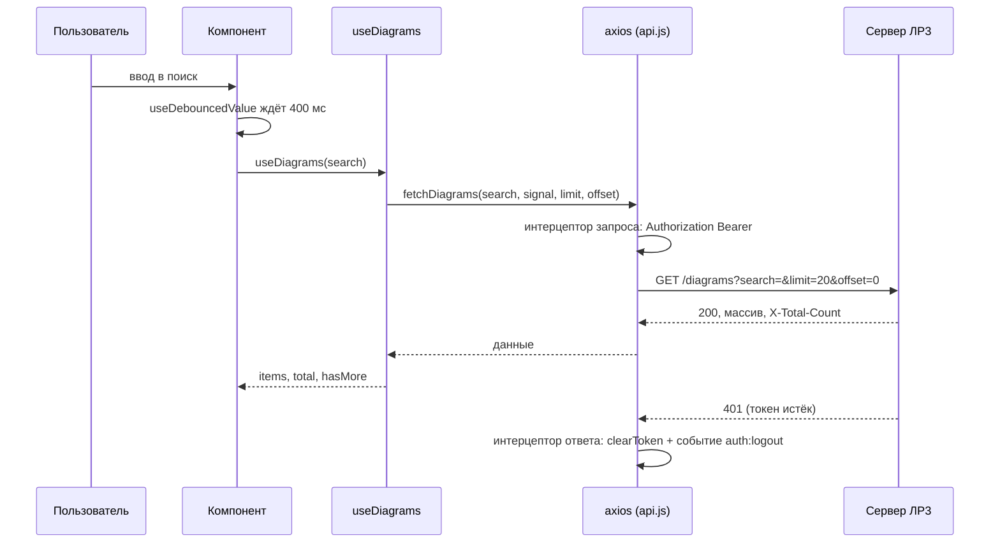

# ЛР5. React и сервер: axios, JWT, оптимистичные обновления. Разбор для защиты

Ветка `25`, папка `part-2/lab-05-react-api` (сервером служит `part-2/lab-03-auth` из той же ветки). Английская версия: `14-LR5-REACT-API.en.md`. Запуск описан в `00-RUN-GUIDE.md`. Это клиент на React и Vite, который вместо `localStorage` (ЛР4) работает с настоящим API ЛР3. Здесь только то, что нужно понимать и уметь дописать при преподавателе.

## 1 Что делает работа за одну минуту

Пользователь регистрируется или входит, токен сохраняется, а дальше приложение показывает его диаграммы с сервера: список постранично («Загрузить ещё»), поиск по названию на сервере с задержкой, добавление, правка и удаление. Изменения показываются сразу (оптимистично) и откатываются, если сервер отказал. Сбои сети и сервера объясняются понятным текстом.

## 2 Как устроен проект

```
src/main.jsx                      точка входа
src/App.jsx                       вход или список; поиск, уведомления, «Загрузить ещё»
src/api.js                        axios: адрес, токен, перехватчики, функции запросов
src/hooks/useDiagrams.js          серверное состояние списка: страницы, add, update, remove
src/hooks/useDebouncedValue.js    задержка значения для поиска
src/components/AuthForm.jsx       вход и регистрация
src/components/DiagramForm.jsx    форма добавления (поле кода многострочное)
src/components/DiagramItem.jsx    карточка: правка, удаление, метка «Сохраняется…»
src/utils/validation.js           проверка полей до отправки
src/limits.json                   пределы, размер страницы, задержка поиска
```

Принцип: все запросы живут в `api.js`, вся логика состояния списка в одном хуке `useDiagrams`, а компоненты только показывают результат. Чтобы экран не менялся от смены способа хранения, интерфейс хука (`items`, `add`, `update`, `remove`) похож на ЛР4.

## 3 Путь запроса и ответа



## 4 Разбор главного

### Сервис API (`api.js`)
- `axios.create({ baseURL, timeout })`: общий адрес из `VITE_API_URL` и таймаут 8 секунд, чтобы запрос не висел вечно.
- Интерцептор запроса добавляет `Authorization: Bearer <токен>` к каждому запросу, поэтому компоненты о токене не знают.
- Интерцептор ответа: если сервер ответил 401 при наличии токена, токен удаляется и посылается событие `auth:logout`; приложение показывает форму входа. Так истёкший токен не оставляет пользователя перед сломанным списком.
- Токен хранится в `localStorage`, чтобы пережить перезагрузку; все обращения к хранилищу обёрнуты в `try/catch`, потому что браузер может его блокировать. Это компромисс: токен доступен скриптам страницы (риск XSS), поэтому текст ошибок сервера React выводит как простой текст, а не как разметку.
- `errorMessage(error)`: если ответ есть, берёт текст и поля ошибки сервера; нет ответа: «Сервер не ответил вовремя» (`ECONNABORTED`) или «Сервер недоступен».

### Загрузка списка (`usePagedList`)
- `useEffect` зависит от `search` и счётчика попыток. При смене поискового текста и при размонтировании `AbortController` отменяет прежний запрос, поэтому ответ на старый поиск не попадёт в новый список (гонка запросов).
- Ответ проверяется: если это не массив (HTML от прокси, пустое тело), показывается ошибка, а список не ломается.
- `X-Total-Count` читается из заголовка: по нему известно, есть ли следующая страница. Не получилось прочитать значит «неизвестно», и кнопка «Загрузить ещё» не показывается.
- «Загрузить ещё» (`loadMore`) дописывает следующую страницу со смещением `offset = fetched`; повторный клик во время загрузки игнорируется, уже показанные записи не дублируются.

### Оптимистичные обновления (`useDiagrams`)
Общий приём: сначала изменить экран, потом спросить сервер, при отказе вернуть как было.
- `add`: запись сразу появляется с временным id `temp-N` и меткой `pending`; на успех её заменяет настоящая запись с сервера, на ошибку удаляется, а пользователь видит сообщение.
- `remove`: запись исчезает сразу; при отказе возвращается на прежнее место, если не пришёл 404 (запись уже удалена, возвращать нечего).
- `update`: отправляет `PUT` со всеми полями (PUT заменяет запись целиком); при отказе восстанавливается прежнее значение.
- Множество `busy` не даёт запустить второе удаление или правку той же записи, пока не закончилось первое; запись с временным id нельзя править, пока она не создана.
- «Сохранение на сервере…» это сумма записей в работе и записей с `pending`.

### Debounce поиска
`useDebouncedValue(search.trim(), 400)` отдаёт значение только после паузы в вводе, поэтому запрос уходит не на каждую букву. Принцип тот же, что в автосохранении ЛР4: таймер и очистка.

### CORS
Сервер ЛР3 разрешает единственный адрес клиента (`CORS_ORIGIN`, по умолчанию `http://localhost:5178`), звёздочка запрещена, ответ на предварительный запрос `OPTIONS` не требует токена.

## 5 Вопросы, которые вероятны на защите

В условии 16 вопросов; для варианта 26 это 9–11 (n−1, n, n+1 при n=10). Развёрнутые ответы в отчёте, раздел «Ответы на контрольные вопросы».

- **Как добавить заголовок Authorization в axios (9).** Перехватчик запроса `api.interceptors.request.use`, который читает токен и ставит `Bearer <токен>`.
- **Что такое debounce (10).** Задержка вызова до паузы в событиях: для поиска запрос уходит после паузы, а не на каждую букву.
- **Как отменить запрос при размонтировании (11).** `AbortController` в `useEffect`, `signal` передаётся в запрос, а `abort()` вызывается в функции очистки эффекта.
- **fetch и axios.** axios сам разбирает JSON, бросает ошибку на коды 4xx и 5xx, умеет перехватчики и таймаут; у `fetch` отказ промиса только на сетевом сбое.
- **Что такое оптимистичное обновление.** Интерфейс меняется до ответа сервера и откатывается при ошибке.
- **Как показать ошибку при коде 500.** Поймать отказ промиса, показать понятный текст и кнопку «Повторить».
- **Как повторить запрос при неудаче.** Кнопка «Повторить» меняет счётчик попыток в зависимостях эффекта; чтение списка повторяется до трёх раз с нарастающей паузой при сетевом сбое или ответе 5xx (`withRetry` в `api.js`), а запись и удаление не повторяются никогда.
- **Где хранить токен.** `localStorage` (удобно, доступен скриптам) или `HttpOnly` cookie (недоступна скриптам, но нужна защита от CSRF).

## 6 Допиши при мне: тренировка

1. **Автоповтор GET.** Уже сделан: `withRetry` в `api.js` повторяет `fetchDiagrams`; уметь объяснить, почему 4xx, отмену и запись не повторяют.
2. **Правка нотации в режиме редактирования.** Уже сделана: `<select>` «Новая нотация» в `DiagramItem`, нотация попадает в `changes`.
3. **Сортировка.** Параметры `sort` и `order` в `fetchDiagrams` (сервер их поддерживает), `<select>` рядом с поиском, смена параметра сбрасывает страницу так же, как поиск.
4. **Имитация задержки сервера.** В интерцепторе запроса `await new Promise((r) => setTimeout(r, Number(import.meta.env.VITE_API_DELAY) || 0))` для проверки индикаторов.
5. **Кнопка «Выйти».** `clearToken()` плюс событие `auth:logout`, которое уже слушает приложение.

## 7 Что проверить руками перед защитой

Два терминала (сервер и клиент):

```bash
cd ../lab-03-auth
npm install
npm run db:migrate
npm run dev
```

```bash
npm install
npm run dev
```

В браузере по адресу `http://localhost:5178`: регистрация и вход, список с сервера, «Загрузить ещё», поиск (в DevTools на вкладке Network видно один запрос после паузы), добавление с остановленным сервером (откат и сообщение), правка и удаление, истечение токена (удалите токен в Application или подождите). Тесты клиента: `npm test`. Проверка с реальным сервером остаётся за вами.
