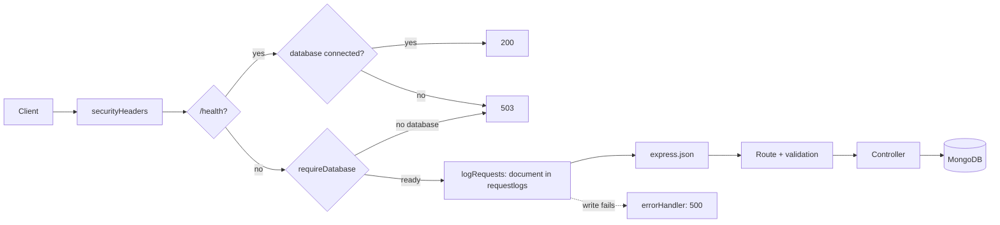

# Lab 6. MongoDB and Mongoose: study notes for the defence

Branch `26`, folder `part-2/lab-06-mongodb`. Russian version: `15-LR6-MONGODB.md`. How to run is in `00-RUN-GUIDE.md`. This is the lab 2 server with Sequelize and SQL replaced by Mongoose and MongoDB: the same `/diagrams` routes, but a diagram is one document, and its tags and comments live inside it. Only what you must understand and be able to extend in front of the teacher is here.

## 1 What the lab does in one minute

A REST API of diagrams on top of MongoDB (local or Atlas). New compared with lab 2:
- nested data: a `tags` array and a `comments` array inside the diagram document;
- filters `?owner=`, `?tag=`, `?commentAuthor=` (search by a nested field), `?q=` (text index over title and code);
- sorting `?sort=title` or `?sort=-priority`, paging with `limit` and `skip`, a record counter;
- aggregation `GET /diagrams/stats` (grouping by notation);
- a log of every request in the `requestlogs` collection (requirement of even variant 26);
- protection from injecting Mongo operators (`$ne`, `$gt`) through `sanitizeFilter`.

| Method | Path | What it does |
| --- | --- | --- |
| GET | `/diagrams` | list with filters, sorting, `limit`, `skip`; `X-Total-Count` |
| GET | `/diagrams/count` | `{ "count": N }` for the same filters |
| GET | `/diagrams/stats` | aggregation by notation |
| POST | `/diagrams` | create (201) |
| GET, PUT, PATCH, DELETE | `/diagrams/:id` | a record; the id is an ObjectId |
| POST | `/diagrams/:id/comments` | add a comment to the array |
| PUT, DELETE | `/diagrams/:id/comments/:commentId` | change or delete a comment |
| GET | `/health` | 200, or 503 if the database is unreachable |

## 2 Project layout

```
server.js                      starts the server, the MongoDB connection is retried every 5 s
src/db.js                      mongoose.connect(MONGODB_URI)
src/app.js                     handler order: headers, /health, 503, log, JSON, routes
src/models/diagram.js          Diagram schema and the nested comment schema, indexes
src/models/request-log.js      request log schema
src/controllers/diagrams.controller.js  collection queries
src/routes/diagrams.routes.js  routes and 405
src/middleware/validate.js     id, body and list-parameter validation
src/middleware/security.js     headers, 503 without a database, log writing
src/middleware/error-handler.js  one error format
```

## 3 Path of a request



The server starts even with MongoDB switched off: requests then get an immediate 503 with a clear text while the connection is retried in the background. Without that, a request would wait for the driver timeout. `/health` sits before the database check so that it can answer 503 itself while the database is down.

## 4 Main parts explained

### Document model (`models/diagram.js`)
- A comment is an **embedded document** (`commentSchema`): there is no separate collection and no join, everything is read with one query. Pros: fast reads and atomic writes of a document. Cons: the document grows, so the number of comments is capped (100), and a MongoDB document may not exceed 16 MB.
- `priority` is an integer from 0 to 2 (`min`, `max` and a custom `Number.isInteger` validator), unlike the string in lab 2.
- `timestamps: true` keeps `createdAt` and `updatedAt` by itself.
- `toJSON`: the output has `id` instead of `_id` and no service field `__v`.
- The `strict: true` schema drops unknown fields.

### Indexes
- `index: true` on `owner` and `tags`: fast lookup by them.
- `diagramSchema.index({ 'comments.author': 1 })`: an index on a nested array field (multikey), used by `?commentAuthor=`.
- `diagramSchema.index({ title: 'text', sourceCode: 'text' })`: a text index, used by `?q=` through `$text`.

### Queries (`diagrams.controller.js`)
- `listFilter` builds the condition: `{ owner }`, `{ tags: tag }` (for an array it means "the array contains the value"), `{ 'comments.author': ... }` (a dotted path for the nested field).
- The list runs `countDocuments(filter)` for the `X-Total-Count` header and then `find(filter).sort(...).skip(...).limit(...)`; `_id` is the second sort key so the order is stable.
- `stats` is an **aggregation pipeline**: `$group` by notation (a count, the `$avg` of the priority, the sum of comment array sizes), `$project` to rename, `$sort`.
- `findByIdAndUpdate(..., { new: true, runValidators: true })`: return the already updated document and run the schema validators (which do not run on updates by default).
- PATCH uses the `$set` operator with the sent fields; comments are untouched.
- `addComment`: the `$push` operator appends to the array atomically. The array length check is part of the filter (`comments.99` must not exist), because update validators do not check the length on `$push`.

### Operator injection protection
`mongoose.set('sanitizeFilter', true)` strips operators such as `{ "$ne": null }` that arrive as values. The server's own operators (`$text`, `$exists`) are marked explicitly with `mongoose.trusted(...)`. List parameters are checked by `validateListQuery`: numbers as short digit strings, the sort field from a whitelist; identifiers are checked as ObjectId (24 hexadecimal characters). Keys such as `__proto__` are dropped.

### Errors and an unreachable database
`503` when MongoDB is off, `500` without the cause text when the log write fails, `400` on validation errors (Mongoose error text is never sent to the client), `404`, `405`, `413` for a body that is too large.

## 5 Likely defence questions

The assignment has 16 questions; for variant 26 these are 9–11 (n−1, n, n+1 with n=10). Full answers are in the report, section "Answers to the control questions".

- **How to create an index in Mongoose (9).** `index: true` on a field or `schema.index({ field: 1 })`; a text index is `schema.index({ title: 'text' })`. An index speeds up reads but slows writes and takes memory.
- **What is populate (10).** A method that replaces an `ObjectId` reference in a document with the document itself from another collection (like a join). Not needed here because comments are embedded.
- **How to search when an array contains a value (11).** A condition on the array field with the value: `{ tags: 'shop' }` finds documents whose array contains it; for nested objects `{ 'comments.author': 'boris' }`.
- **How MongoDB differs from relational databases.** Documents instead of rows, a flexible schema (in Mongoose the application sets it), no joins or transactional links by default.
- **What is an ObjectId.** A 12-byte identifier: creation time, a random part and a counter.
- **What is an aggregation pipeline.** A chain of stages (`$match`, `$group`, `$project`, `$sort`) where the output of one stage is the input of the next.
- **Pros and cons of embedded documents.** Fast reads in one query versus document growth and duplication; hence the caps on array sizes.
- **Why 503, not a 500 page, with the database stopped.** This is an API without HTML: 503 is a 5xx with a clear "database unavailable" text and the connection is retried; a real 500 comes from a failed log write.

## 6 Write it live: rehearsal

1. **New field `status` (draft, published).** A field in the schema with `enum`, a default, a check in `validate.js`, constants in `diagram.constants.js`, a `?status=` filter in `listFilter`.
2. **A priority range search.** `?minPriority=1`: check the number, add `priority: { $gte: n }` (mark the server operator with `mongoose.trusted`, since `sanitizeFilter` is on).
3. **Statistics by owner.** Copy `stats` and replace `'$notation'` with `'$owner'`.
4. **Removing a tag.** The `$pull: { tags: 'shop' }` operator in `findByIdAndUpdate`.
5. **Updating a comment by position.** Already done in `updateComment`: the condition `{ 'comments._id': id }` and the positional operator `{ $set: { 'comments.$.text': text } }`; be able to explain that `$` means "the matched array element".
6. **Index and explain.** Show `Diagram.find({ owner: 'anna' }).explain()` and confirm that the index is used.

## 7 What to check by hand before the defence

A running MongoDB is needed: local or an Atlas cluster (the connection string goes into `.env` as `MONGODB_URI` and must not go into chat or commits).

```bash
npm install
npm test
npm start
```

The tests start a temporary in-memory MongoDB and do not touch a working database. Requests: create a diagram with tags, add a comment, `GET /diagrams?tag=shop`, `?commentAuthor=boris`, `?q=order`, `?sort=-priority`, `/diagrams/stats`; stop MongoDB and repeat a request (503). Atlas and Postman screenshots for the report are taken on your machine; the lab has not been tried on a real Atlas.
