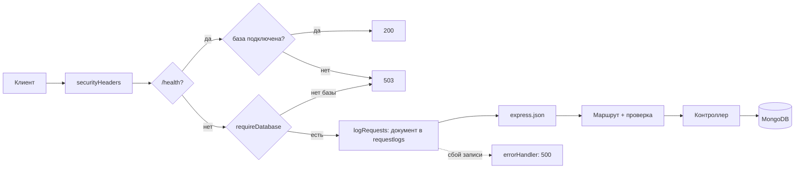

# ЛР6. MongoDB и Mongoose: разбор для защиты

Ветка `26`, папка `part-2/lab-06-mongodb`. Английская версия: `15-LR6-MONGODB.en.md`. Запуск описан в `00-RUN-GUIDE.md`. Это сервер ЛР2, у которого Sequelize и SQL заменены на Mongoose и MongoDB: те же маршруты `/diagrams`, но диаграмма хранится одним документом, а теги и комментарии лежат внутри него. Здесь только то, что нужно понимать и уметь дописать при преподавателе.

## 1 Что делает работа за одну минуту

REST API диаграмм поверх MongoDB (локально или Atlas). Новое по сравнению с ЛР2:
- вложенные данные: массив `tags` и массив комментариев `comments` внутри документа диаграммы;
- фильтры `?owner=`, `?tag=`, `?commentAuthor=` (поиск по вложенному полю), `?q=` (текстовый индекс по названию и коду);
- сортировка `?sort=title` или `?sort=-priority`, постраничный вывод `limit` и `skip`, счётчик записей;
- агрегация `GET /diagrams/stats` (группировка по нотации);
- журнал каждого запроса в коллекцию `requestlogs` (требование чётного варианта 26);
- защита от внедрения операторов Mongo (`$ne`, `$gt`) через `sanitizeFilter`.

| Метод | Адрес | Что делает |
| --- | --- | --- |
| GET | `/diagrams` | список с фильтрами, сортировкой, `limit`, `skip`; `X-Total-Count` |
| GET | `/diagrams/count` | `{ "count": N }` для тех же фильтров |
| GET | `/diagrams/stats` | агрегация по нотациям |
| POST | `/diagrams` | создать (201) |
| GET, PUT, PATCH, DELETE | `/diagrams/:id` | запись; id это ObjectId |
| POST | `/diagrams/:id/comments` | добавить комментарий в массив |
| PUT, DELETE | `/diagrams/:id/comments/:commentId` | изменить или удалить комментарий |
| GET | `/health` | 200 или 503, если база недоступна |

## 2 Как устроен проект

```
server.js                      запускает сервер, подключение к MongoDB повторяется каждые 5 с
src/db.js                      mongoose.connect(MONGODB_URI)
src/app.js                     порядок обработчиков: заголовки, /health, 503, журнал, JSON, маршруты
src/models/diagram.js          схема Diagram и вложенная схема комментария, индексы
src/models/request-log.js      схема журнала запросов
src/controllers/diagrams.controller.js  запросы к коллекции
src/routes/diagrams.routes.js  маршруты и 405
src/middleware/validate.js     проверка id, тела и параметров списка
src/middleware/security.js     заголовки, 503 без базы, запись журнала
src/middleware/error-handler.js  единый формат ошибок
```

## 3 Путь запроса



Сервер стартует и при выключенной MongoDB: запросы тогда сразу получают 503 с понятным текстом, а подключение повторяется в фоне. Без этого запрос ждал бы таймаут драйвера. `/health` стоит до проверки базы, чтобы сам отвечать 503, пока база недоступна.

## 4 Разбор главного

### Документная модель (`models/diagram.js`)
- Комментарий это **вложенный документ** (`commentSchema`): отдельной коллекции и соединения (join) нет, всё читается одним запросом. Плюс: быстрое чтение и атомарность записи документа. Минус: документ растёт, поэтому число комментариев ограничено (100), а общий размер документа в MongoDB не более 16 МБ.
- Поле `priority` это целое от 0 до 2 (`min`, `max` и свой валидатор `Number.isInteger`), в отличие от строки в ЛР2.
- `timestamps: true` сам ведёт `createdAt` и `updatedAt`.
- `toJSON`: наружу отдаётся `id` вместо `_id`, без служебного `__v`.
- Схема `strict: true` отбрасывает неизвестные поля.

### Индексы
- `index: true` у `owner` и `tags`: быстрый поиск по ним.
- `diagramSchema.index({ 'comments.author': 1 })`: индекс по вложенному полю массива (multikey), его использует `?commentAuthor=`.
- `diagramSchema.index({ title: 'text', sourceCode: 'text' })`: текстовый индекс, его использует `?q=` через `$text`.

### Запросы (`diagrams.controller.js`)
- `listFilter` собирает условие: `{ owner }`, `{ tags: tag }` (для массива означает «массив содержит значение»), `{ 'comments.author': ... }` (путь с точкой для вложенного поля).
- Список считает `countDocuments(filter)` для заголовка `X-Total-Count` и затем `find(filter).sort(...).skip(...).limit(...)`; вторым ключом сортировки стоит `_id`, чтобы порядок был стабильным.
- `stats` это **aggregation pipeline**: `$group` по нотации (счётчик, среднее `$avg` приоритета, сумма размеров массивов комментариев), `$project` для переименования, `$sort`.
- `findByIdAndUpdate(..., { new: true, runValidators: true })`: вернуть уже обновлённый документ и выполнить проверки схемы (по умолчанию при обновлении они не запускаются).
- PATCH использует оператор `$set` с присланными полями, комментарии не затрагиваются.
- `addComment`: оператор `$push` добавляет элемент в массив атомарно. Проверка длины массива вынесена в условие поиска (`comments.99` не существует), потому что валидаторы обновления не проверяют длину при `$push`.

### Защита от внедрения операторов
`mongoose.set('sanitizeFilter', true)` вырезает операторы вида `{ "$ne": null }`, пришедшие как значения. Серверные операторы (`$text`, `$exists`) явно помечаются `mongoose.trusted(...)`. Параметры списка проверяет `validateListQuery`: числа короткими строками цифр, поле сортировки по белому списку; идентификаторы проверяются как ObjectId (24 шестнадцатеричных символа). Ключи вроде `__proto__` отбрасываются.

### Ошибки и недоступная база
`503` при выключенной MongoDB, `500` без текста причины при сбое записи журнала, `400` на ошибки проверки (текст ошибок Mongoose клиенту не отдаётся), `404`, `405`, `413` на слишком большое тело.

## 5 Вопросы, которые вероятны на защите

В условии 16 вопросов; для варианта 26 это 9–11 (n−1, n, n+1 при n=10). Развёрнутые ответы в отчёте, раздел «Ответы на контрольные вопросы».

- **Как создать индекс в Mongoose (9).** `index: true` у поля или `schema.index({ поле: 1 })`; текстовый индекс `schema.index({ title: 'text' })`. Индекс ускоряет чтение, но замедляет запись и занимает память.
- **Что такое populate (10).** Метод, который заменяет ссылку `ObjectId` в документе самим документом из другой коллекции (аналог соединения). В работе не нужен, потому что комментарии вложены.
- **Как искать, когда массив содержит значение (11).** Условие на поле-массив со значением: `{ tags: 'shop' }` находит документы, где массив содержит это значение; для вложенных объектов `{ 'comments.author': 'boris' }`.
- **Чем MongoDB отличается от реляционных СУБД.** Документы вместо строк, схема гибкая (в Mongoose задаётся приложением), нет соединений и транзакционных связей по умолчанию.
- **Что такое ObjectId.** 12-байтовый идентификатор: время создания, случайная часть и счётчик.
- **Что такое aggregation pipeline.** Цепочка стадий (`$match`, `$group`, `$project`, `$sort`), где выход одной стадии это вход следующей.
- **Преимущества и недостатки вложенных документов.** Быстрое чтение одним запросом против роста документа и дублирования; поэтому ограничения на размер массивов.
- **Почему 503, а не страница 500 при остановленной базе.** Это API без HTML: 503 это 5xx с понятным текстом «база недоступна», подключение повторяется; настоящий 500 даёт сбой записи журнала.

## 6 Допиши при мне: тренировка

1. **Новое поле `status` (draft, published).** Поле в схеме с `enum`, значение по умолчанию, проверка в `validate.js`, константы в `diagram.constants.js`, фильтр `?status=` в `listFilter`.
2. **Эндпоинт поиска по диапазону приоритета.** `?minPriority=1`: проверить число, добавить `priority: { $gte: n }` (серверный оператор пометить `mongoose.trusted`, потому что включён `sanitizeFilter`).
3. **Статистика по владельцам.** Скопировать `stats`, заменить `'$notation'` на `'$owner'`.
4. **Удаление тега.** Оператор `$pull: { tags: 'shop' }` в `findByIdAndUpdate`.
5. **Обновление комментария по позиции.** Уже сделано в `updateComment`: условие `{ 'comments._id': id }` и позиционный оператор `{ $set: { 'comments.$.text': text } }`; уметь объяснить, что `$` означает «найденный элемент массива».
6. **Индекс и explain.** Показать `Diagram.find({ owner: 'anna' }).explain()` и убедиться, что используется индекс.

## 7 Что проверить руками перед защитой

Нужна работающая MongoDB: локально или кластер Atlas (строка подключения в `.env` как `MONGODB_URI`, в чат и коммиты не переносить).

```bash
npm install
npm test
npm start
```

Тесты поднимают временную MongoDB в памяти и рабочую базу не трогают. Запросы: создать диаграмму с тегами, добавить комментарий, `GET /diagrams?tag=shop`, `?commentAuthor=boris`, `?q=order`, `?sort=-priority`, `/diagrams/stats`; остановить MongoDB и повторить запрос (503). Скриншоты Atlas и Postman для отчёта снимаются на вашей машине; на настоящем Atlas работа не проверялась.
