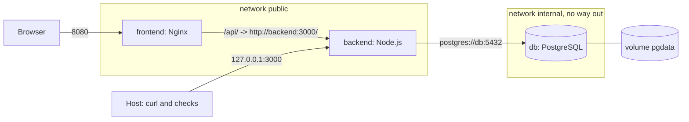

# Lab 8. Docker and Docker Compose: study notes for the defence

Branch `28`, folder `part-2/lab-08-docker`. Russian version: `17-LR8-DOCKER.md`. How to run is in `00-RUN-GUIDE.md`. This lab has no new application code: it packs the ready client (lab 5) and server (lab 3) together with PostgreSQL into three containers started with one command. Only what you must understand and be able to extend in front of the teacher is here.

## 1 What the lab does in one minute

The command `docker compose up --build` builds two images and starts three services:

| Service | Image | Role | Host port |
| --- | --- | --- | --- |
| `frontend` | own: unprivileged Nginx and the built React app | serves pages, proxies `/api/` to the server | 8080 |
| `backend` | own: Node.js 22 Alpine, the lab 3 server | REST API with token login | 127.0.0.1:3000 (this computer only) |
| `db` | `postgres:16-alpine` | the database, data in the `pgdata` volume | not published |

The browser opens `http://localhost:8080`. API requests go to the same address under `/api/` and Nginx forwards them to the server. So CORS is not needed and the server address is not baked into the client build.

## 2 Project layout

```
docker-compose.yml             description of three services, networks and a volume
.env.example                   settings template (the real .env never enters the repository)
backend/Dockerfile             two-stage server build
backend/Dockerfile.dockerignore  what stays out of the server image
frontend/Dockerfile            two-stage client build and Nginx
frontend/nginx.conf            /api/ proxy, security headers, rate limit
docker.test.mjs                file checks without Docker (npm test)
```

The server build context is the folder `../lab-03-auth` and the client's is `../lab-05-react-api`; in branch 28 the lab 5 client was copied in whole from branch 25, and lab 3 sits next to it.

## 3 How the containers connect



Start order: `db` (readiness checked by `pg_isready`) → `backend` (waits for `service_healthy`, then migrations and start) → `frontend` (waits for a healthy `backend`). Containers find each other by service name inside the Compose network: `db` in the connection string and `backend` in Nginx.

## 4 Main parts explained

### Server Dockerfile
- Two-stage build: the first stage runs `npm ci --omit=dev` to install runtime dependencies only, and the second image receives `node_modules` through `COPY --from=deps`. The final image has no npm cache, tests or reports (`Dockerfile.dockerignore` filters them).
- `package.json` and `package-lock.json` are copied separately before the rest of the code: the dependency layer is cached and not rebuilt when the code changes.
- The Alpine base image is small; `USER node` runs the server without root rights.
- `HEALTHCHECK` calls `/health` (answers 200 only while the database is alive).
- `CMD` runs the migrations, then the admin seed (skipped without `ADMIN_EMAIL`) and, through `exec`, the server itself: `exec` makes Node the main process of the container, so it receives the stop signal.

### Client Dockerfile
- The `builder` stage builds the Vite static files with `VITE_API_URL=/api`. Only Nginx and the `dist` folder reach the final image; Node.js and the sources stay in the builder.
- `nginx-unprivileged` runs as non-root and listens on port 8080.

### Nginx (`nginx.conf`)
- `location /api/` with `proxy_pass http://backend:3000/`: the trailing `/` strips the `/api` prefix, so `/api/health` becomes `/health`.
- `limit_req` allows 10 requests per second per address (a burst of 20) and `client_max_body_size 100k` caps the body.
- Security headers and a strict CSP; `server_tokens off` hides the Nginx version.
- `try_files $uri /index.html`: a single-page app, unknown paths return the main page.
- Hashed `assets/` files are cached for a year.

### Compose (`docker-compose.yml`)
- `${POSTGRES_PASSWORD:?...}` and `${JWT_SECRET:?...}` stop the start with a clear message if the value is missing from `.env`. There are no ready-made passwords in the repository.
- `depends_on` with `condition: service_healthy` waits not for the container to start but for it to be ready.
- The `internal` network is marked `internal: true`: it has no way out, and the database is reachable only from the server. The database port is not published.
- The `pgdata` volume keeps data when the container is recreated. `docker compose down` keeps it, `down -v` removes it.
- Server hardening: `read_only: true` (read-only root file system), `tmpfs: [/tmp]`, `cap_drop: [ALL]` and `no-new-privileges`.
- `TRUST_PROXY: '1'` tells the server that exactly one proxy (Nginx) stands in front, so the rate limiter sees the real client address, not Nginx's.
- `REGISTRY` lets you substitute a mirror (for example `mirror.gcr.io/`) if Docker Hub is unreachable.

## 5 Likely defence questions

The assignment has 16 questions; for variant 26 these are 9–11 (n−1, n, n+1 with n=10). Full answers are in the report, section "Answers to the control questions".

- **How to make the database start before the server (9).** `depends_on` with `condition: service_healthy` and a `healthcheck` on the database (`pg_isready`). Plain `depends_on` waits only for the container to start, not for the database to be ready.
- **How to run a command inside a running container (10).** `docker exec -it <container> sh`; in Compose `docker compose exec backend sh`; for example `docker compose exec db psql -U dslkit`.
- **How to publish a host port to a container (11).** The `ports` key as `"host:container"`, for example `'8080:8080'`; with a `127.0.0.1:` prefix the port is reachable from this computer only.
- **Image vs container.** An image is an immutable template, a container is its running instance with its own writable layer.
- **What `COPY --from=builder` does.** Takes files from an earlier build stage, so only the result reaches the final image.
- **How to shrink an image.** Alpine, multi-stage build, `--omit=dev`, `.dockerignore`, cleaning the cache in the same `RUN` layer.
- **CMD vs ENTRYPOINT.** `CMD` is the default command and can be replaced by `docker run` arguments; `ENTRYPOINT` is a fixed entry point, and `CMD` then supplies its arguments.
- **What happens without a database volume.** The data lives in the container layer and is lost when the container is removed.
- **How to scale a service.** `docker compose up --scale backend=3`; remove the fixed host port and put a balancer (Nginx) in front of the copies. In this lab scaling is not supported: there is one host port, and the rate-limiter counters live in the memory of one instance (stated in the README).
- **Logs.** `docker compose logs -f backend`.
- **An alternative registry.** `docker tag` to a name like `ghcr.io/user/name:tag`, `docker login` and `docker push`.

## 6 Write it live: rehearsal

1. **Add Redis or pgAdmin.** A new service in `docker-compose.yml` (image, port, network, variables from `.env`); publish the pgAdmin port on `127.0.0.1` only.
2. **Change the ports.** The assignment names ports 80 and 5000: `FRONTEND_PORT=80` and `BACKEND_PORT=5000` in `.env` and recreate the stack are enough. The defaults are 8080 and 3000 because port 80 is often taken.
3. **A healthcheck for Nginx.** Already present through `wget`; be able to explain `interval`, `timeout`, `retries`, `start-period`.
4. **Limit memory.** Already done: `mem_limit`, `pids_limit` and log rotation on every service; be able to change the number and explain what happens on excess (the process is killed for lack of memory and `restart` brings it up again).
5. **Restart.** Show `restart: unless-stopped` and stop a container with `docker kill`.
6. **Recreate from scratch.** `docker compose down -v` and `docker compose up --build`: the migrations and the seed create the tables again.

## 7 What to check by hand before the defence

Docker Desktop and a `.env` file next to `docker-compose.yml` are needed (create it from `.env.example`: `POSTGRES_PASSWORD` letters and digits only, `JWT_SECRET` at least 32 random characters; the values must not go into chat or commits).

```bash
docker compose up --build
docker ps
docker compose logs -f backend
docker compose down
```

Open `http://localhost:8080`, register, create a diagram, check `http://localhost:8080/api/health`. Stop everything with `down` and start again: the data is still there (the volume). Then `docker compose down -v`: the data is gone. This from-scratch build and publishing an image to Docker Hub have not been checked yet; that step is yours. The static file checks run without Docker with `npm test`.
