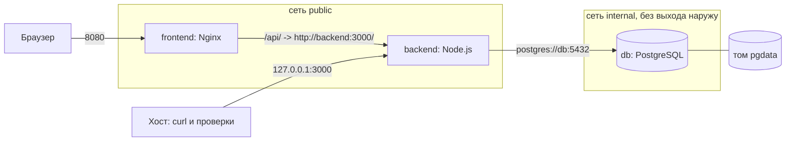

# ЛР8. Docker и Docker Compose: разбор для защиты

Ветка `28`, папка `part-2/lab-08-docker`. Английская версия: `17-LR8-DOCKER.en.md`. Запуск описан в `00-RUN-GUIDE.md`. В этой работе нет нового кода приложения: она упаковывает уже готовые клиент (ЛР5) и сервер (ЛР3) вместе с PostgreSQL в три контейнера, которые поднимаются одной командой. Здесь только то, что нужно понимать и уметь дописать при преподавателе.

## 1 Что делает работа за одну минуту

Команда `docker compose up --build` собирает два образа и запускает три сервиса:

| Сервис | Образ | Роль | Порт на хосте |
| --- | --- | --- | --- |
| `frontend` | собственный: Nginx без прав root и собранный React | отдаёт страницы, проксирует `/api/` на сервер | 8080 |
| `backend` | собственный: Node.js 22 Alpine, сервер ЛР3 | REST API с входом по токену | 127.0.0.1:3000 (только с этого компьютера) |
| `db` | `postgres:16-alpine` | база данных, данные в томе `pgdata` | не опубликован |

Браузер открывает `http://localhost:8080`. Запросы к API идут на тот же адрес, по пути `/api/`, и Nginx пересылает их серверу. Поэтому CORS не нужен и адрес сервера не вшит в сборку клиента.

## 2 Как устроен проект

```
docker-compose.yml             описание трёх сервисов, сетей и тома
.env.example                   образец настроек (сам .env в репозиторий не попадает)
backend/Dockerfile             двухэтапная сборка сервера
backend/Dockerfile.dockerignore  что не попадает в образ сервера
frontend/Dockerfile            двухэтапная сборка клиента и Nginx
frontend/nginx.conf            прокси /api/, заголовки безопасности, ограничение частоты
docker.test.mjs                проверки файлов без Docker (npm test)
```

Контекст сборки сервера это папка `../lab-03-auth`, клиента `../lab-05-react-api`; в ветку 28 клиент ЛР5 перенесён целиком из ветки 25, а ЛР3 лежит рядом.

## 3 Как связаны контейнеры



Порядок запуска: `db` (проверка готовности `pg_isready`) → `backend` (ждёт `service_healthy`, затем миграции и запуск) → `frontend` (ждёт здоровый `backend`). Контейнеры находят друг друга по имени сервиса в сети Compose: адрес `db` в строке подключения и `backend` в Nginx.

## 4 Разбор главного

### Dockerfile сервера
- Двухэтапная сборка: на первом этапе `npm ci --omit=dev` ставит только рабочие зависимости, на втором образ получает `node_modules` через `COPY --from=deps`. Итоговый образ без кэша npm, тестов и отчётов (их отсекает `Dockerfile.dockerignore`).
- Копирование `package.json` и `package-lock.json` отдельно до остального кода: слой с зависимостями кэшируется и не пересобирается при правке кода.
- Базовый образ Alpine маленький; `USER node` запускает сервер без прав root.
- `HEALTHCHECK` обращается к `/health` (ответ 200 только при живой базе).
- `CMD` запускает миграции, затем сид администратора (он пропускается без `ADMIN_EMAIL`) и через `exec` сам сервер: `exec` делает Node главным процессом контейнера, поэтому он получает сигнал остановки.

### Dockerfile клиента
- Этап `builder` собирает статические файлы Vite с `VITE_API_URL=/api`. В итоговый образ попадают только Nginx и папка `dist`; Node.js и исходники остаются в builder.
- `nginx-unprivileged` работает не от root и слушает порт 8080.

### Nginx (`nginx.conf`)
- `location /api/` с `proxy_pass http://backend:3000/`: завершающий `/` отрезает префикс `/api`, поэтому `/api/health` превращается в `/health`.
- `limit_req` ограничивает 10 запросов в секунду с адреса (всплеск до 20), `client_max_body_size 100k`.
- Заголовки безопасности и строгая политика CSP; `server_tokens off` скрывает версию Nginx.
- `try_files $uri /index.html`: одностраничное приложение, неизвестные адреса отдают главную страницу.
- Файлы `assets/` с хешем в имени кэшируются на год.

### Compose (`docker-compose.yml`)
- `${POSTGRES_PASSWORD:?...}` и `${JWT_SECRET:?...}` останавливают запуск с понятным сообщением, если значение не задано в `.env`. Готовых паролей в репозитории нет.
- `depends_on` с `condition: service_healthy` ждёт не просто запуск контейнера, а его готовность.
- Сеть `internal` помечена `internal: true`: из неё нет выхода наружу, база доступна только серверу. Порт базы не публикуется.
- Том `pgdata` хранит данные при пересоздании контейнера. Команда `docker compose down` его сохраняет, `down -v` удаляет.
- Усиление сервера: `read_only: true` (корневая файловая система только для чтения), `tmpfs: [/tmp]`, `cap_drop: [ALL]` и `no-new-privileges`.
- `TRUST_PROXY: '1'` говорит серверу, что перед ним ровно один прокси (Nginx), поэтому ограничитель видит настоящий адрес клиента, а не адрес Nginx.
- `REGISTRY` позволяет подставить зеркало (например, `mirror.gcr.io/`), если Docker Hub недоступен.

## 5 Вопросы, которые вероятны на защите

В условии 16 вопросов; для варианта 26 это 9–11 (n−1, n, n+1 при n=10). Развёрнутые ответы в отчёте, раздел «Ответы на контрольные вопросы».

- **Как задать зависимость запуска, чтобы база стартовала раньше сервера (9).** `depends_on` с `condition: service_healthy` и `healthcheck` у базы (`pg_isready`). Простой `depends_on` ждёт только запуска контейнера, но не готовности базы.
- **Как выполнить команду внутри запущенного контейнера (10).** `docker exec -it <контейнер> sh`, в Compose `docker compose exec backend sh`; например, `docker compose exec db psql -U dslkit`.
- **Как пробросить порт с хоста в контейнер (11).** Ключ `ports` в виде `"хост:контейнер"`, например `'8080:8080'`; с `127.0.0.1:` порт доступен только с этого компьютера.
- **Образ и контейнер.** Образ это неизменяемый шаблон, контейнер это его запущенный экземпляр со своим слоем для записи.
- **Что делает `COPY --from=builder`.** Берёт файлы из прошлого этапа сборки, так в итоговый образ попадает только результат.
- **Как уменьшить образ.** Alpine, многоэтапная сборка, `--omit=dev`, `.dockerignore`, очистка кэша в том же слое `RUN`.
- **CMD и ENTRYPOINT.** `CMD` команда по умолчанию, её можно заменить аргументами `docker run`; `ENTRYPOINT` неизменяемая точка входа, `CMD` тогда даёт ей аргументы.
- **Что будет без тома у базы.** Данные хранятся в слое контейнера и теряются при его удалении.
- **Как масштабировать сервис.** `docker compose up --scale backend=3`; нужно убрать фиксированный порт на хосте и поставить балансировщик (Nginx) перед копиями. В работе масштабирование не поддержано: порт хоста один, а счётчики ограничителя запросов лежат в памяти экземпляра (так записано в README).
- **Логи.** `docker compose logs -f backend`.
- **Альтернативный реестр.** `docker tag` на имя вида `ghcr.io/пользователь/имя:тег`, `docker login` и `docker push`.

## 6 Допиши при мне: тренировка

1. **Добавить Redis или pgAdmin.** Новый сервис в `docker-compose.yml` (образ, порт, сеть, переменные из `.env`); для pgAdmin порт публиковать только на `127.0.0.1`.
2. **Поменять порты.** Условие называет порты 80 и 5000: достаточно `FRONTEND_PORT=80` и `BACKEND_PORT=5000` в `.env` и пересоздать стек. По умолчанию стоят 8080 и 3000, потому что порт 80 часто занят.
3. **Healthcheck у Nginx.** Уже есть через `wget`; уметь объяснить параметры `interval`, `timeout`, `retries`, `start-period`.
4. **Ограничить память.** Уже сделано: `mem_limit`, `pids_limit` и ротация журналов у каждого сервиса; уметь изменить число и объяснить, что будет при превышении (процесс завершается по нехватке памяти, `restart` поднимает его снова).
5. **Перезапуск.** Показать `restart: unless-stopped` и остановить контейнер командой `docker kill`.
6. **Пересоздать с нуля.** `docker compose down -v` и `docker compose up --build`: миграции и сид заново создают таблицы.

## 7 Что проверить руками перед защитой

Нужны Docker Desktop и файл `.env` рядом с `docker-compose.yml` (создайте его из `.env.example`: `POSTGRES_PASSWORD` только из букв и цифр, `JWT_SECRET` не короче 32 случайных символов; значения в чат и коммиты не переносить).

```bash
docker compose up --build
docker ps
docker compose logs -f backend
docker compose down
```

Откройте `http://localhost:8080`, зарегистрируйтесь, создайте диаграмму, проверьте `http://localhost:8080/api/health`. Остановите всё командой `down`, поднимите снова: данные на месте (том). Затем `docker compose down -v`: данных нет. Эта сборка с нуля и публикация образа на Docker Hub пока не проверялись; это ваш шаг. Статические проверки файлов запускаются без Docker командой `npm test`.
