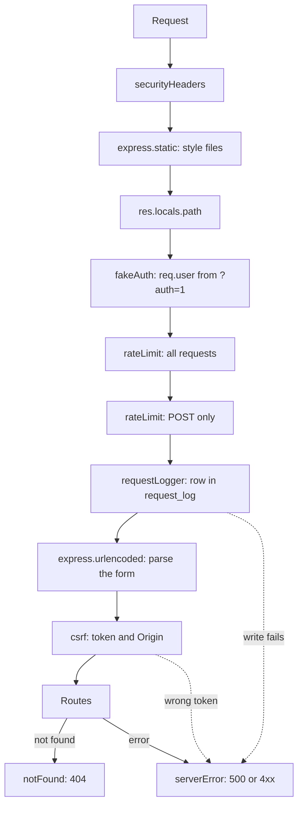

# Practical 1. Middleware and EJS templates: study notes for the defence

Branch `pz21`, folder `part-2/pz-01-middleware-ejs`. Russian version: `18-PZ1-MIDDLEWARE-EJS.md`. How to run is in `00-RUN-GUIDE.md`. This is an Express application that draws pages with EJS templates (the server builds the HTML, not React). Only what you must understand and be able to extend in front of the teacher is here.

## 1 What the work does in one minute

A catalogue of diagrams as plain HTML pages: a list, a record page, an add and edit form, delete, and a request log. The diagram data lives in an in-memory array (the practical requires that), while every request is logged to a SQLite table (requirement of even variant 26). Sign-in is imitated by the `?auth=1` parameter: a teaching stub, not real authorization.

| Method | Path | Access | What it does |
| --- | --- | --- | --- |
| GET | `/` | everyone | list |
| GET | `/item/:id` | everyone | record page (404 if missing) |
| GET, POST | `/add` | "signed in" | form and create |
| GET, POST | `/item/:id/edit` | "signed in" | form and save the edit |
| POST | `/item/:id/delete` | "signed in" | delete |
| GET | `/login` | everyone | "sign in" page |
| GET | `/log` | "signed in" | latest log rows |

A guest who opens a protected path is redirected to `/login`. Any failure ends on a styled 404 or 500 page, never bare text.

## 2 Project layout

```
src/server.js                  entry, port from PORT (default 3000)
src/app.js                     createApp: middleware order and all routes
src/middleware/security.js     headers, CSRF, rate limiter, text cleaning for the log
src/middleware/requestLogger.js  writes the request to a table before the route runs
src/middleware/fakeAuth.js     simulated sign-in: ?auth=1
src/middleware/errorHandlers.js  404 and 500 pages
src/data/diagrams.js           diagram array and form validation
src/data/requestLog.js         request_log table in SQLite
src/limits.js, limits.json     limits in one place
views/                         EJS templates: index, item, add (also edit), log, login, 404, 500
public/                        styles
```

## 3 Handler order



The order is the main idea of the work (question 27): headers first so every answer has them; static files before the rest because a stylesheet must not go through checks, be logged and spend the rate limit; limiters before the log so a flood is cut before it reaches the database; the form parser before CSRF because the token is in the form body; error handlers last, since Express calls a four-parameter function only after an error happened earlier in the chain.

## 4 Main parts explained

### Simulated sign-in (`fakeAuth.js`)
The `?auth=1` parameter makes `req.user = { name: 'Owner' }`, otherwise the user is a guest. `res.locals.authQuery` is appended to links so the sign-in flag is not lost between pages. `requireAuth` guards one route: a guest is redirected to `/login`. This is a teaching model, not protection; lab 3 has a real login. In the log the `auth` value is replaced with `***` (`hideAuth`) so a reader of the log cannot reuse the flag.

### Request log in a table (`requestLogger.js`, `requestLog.js`)
- The row is written **before** the route runs. If the write fails (an unreachable database file), the error goes to the error handler and the user sees a styled 500 page with an explanation. This reproduces "a real failure", not a button.
- Status and duration are added to the same row on the response `finish` event; if that also fails, the server does not crash but writes a console message.
- `node:sqlite` opens the database lazily on first use: an unreachable database breaks the request (a 500 page), not the server start.
- The request address is user-controlled, so `safeLogText` escapes line breaks and control characters and cuts the length: otherwise an extra log line could be forged (log injection).

### Protection (`security.js`)
- **Headers.** A strict CSP without inline scripts or styles, no framing, `nosniff`, `Permissions-Policy`. All set by hand without a package. `Referrer-Policy: same-origin`, not `no-referrer`, otherwise browsers send `Origin: null` and the site's own forms would be rejected.
- **CSRF (question 25).** Double-submit token: the server puts a random token into a cookie with `HttpOnly` and `SameSite=Strict` and into the hidden `_csrf` field of every form. A state-changing request (POST, PUT, PATCH, DELETE) must send both values and they must match (compared in constant time with `timingSafeEqual`). A foreign site can neither read the cookie nor guess the token. `Origin` is also checked when present.
- **Rate limiter.** A fixed window per address: 300 requests per minute overall and 20 writing (POST) requests per minute; when exceeded, a 429 page with `Retry-After`.

### Form validation (`diagrams.js`)
`validateDiagram` checks all fields on the server with the same limits as the form's `maxlength`, from `limits.json`: title up to 80 characters, description 500, code 5000, revision a whole number from 0 to 100000, notation from the list. Whitespace-only values count as empty. On an error the form is shown again with the entered values and messages at the fields, status 400. The form body is capped (`20kb`, at most 20 parameters), and repeated keys (arrays) do not crash the server: only plain strings count.

### EJS templates
`<%= x %>` prints a value with HTML escaping (protection from code injection), `<%- x %>` prints raw, so it is used only for the template's own markup (for example the `aria-invalid` attributes) and never for user text. `<%- include('partials/header') %>` brings in the shared header. The `formatTime` function in `app.locals` is available to all templates: this is the answer to question 26 (a helper for date formatting).

### Error pages
`notFound` serves a styled 404. `serverError` picks the code (400, 403, 413, 429 or 500), shows a clear `publicMessage`, and writes details only to the console. If even the 500 page fails to render, the `fallbackPage` takes over: the user never sees bare text.

## 5 Likely defence questions

The assignment has 30 questions; for variant 26 these are 25–27 (n−1, n, n+1 with n=26). Full answers are in the report, section 4.

- **How to implement CSRF protection with middleware in Express (25).** A token in a cookie and in a hidden form field, compared on every changing request, an `Origin` check, `SameSite=Strict`; see above.
- **How to use a helper function in EJS (26).** Put a function into `app.locals` (for all templates) or `res.locals` (for one request) and call it in the template: `<%= formatTime(item.createdAt) %>`.
- **Why static middleware is mounted before the routes (27).** A request for a stylesheet or logo must be answered at once, without checks, log writing and spending the rate limit; mounted after the routes, it would reach the 404 handler.
- **What middleware is.** A function `(req, res, next)`; it calls `next()` to pass on or ends the response; the mounting order sets the execution order.
- **How the error handler works.** Four parameters `(err, req, res, next)`, mounted last; in Express 5 exceptions and rejected promises from handlers reach it by themselves.
- **`<%= %>` vs `<%- %>`.** The first escapes, the second inserts as is.
- **Why the log is written before the route.** So a write failure shows as a 500, and so even rejected requests are recorded.
- **Why "Delete" is a form, not a link.** A link is a GET request (which a foreign image can trigger), whereas deletion must be a POST with a CSRF token.

## 6 Write it live: rehearsal

1. **A new "response time" middleware.** In `app.js` before the routes: `res.on('finish', ...)` prints the duration to the console; or an `X-Response-Time` header set before sending.
2. **One more page `/about`.** A route `app.get('/about', ...)`, a template `views/about.ejs` that includes the header.
3. **A new form field.** The field in `add.ejs`, reading in `readForm`, a check and a limit in `validateDiagram` and `limits.json`, display in `item.ejs`.
4. **Search `?q=` on the main page.** Filter by `title` in the `/` route (lowercase, a whitespace-only query is ignored), a search field in `index.ejs`.
5. **A "Clear log" button.** A POST route with `requireAuth` and CSRF, a `clear` method in `requestLog.js`.
6. **Show the 500 page with a real failure.** Start the server with a database file that cannot be created (the method is in the README, section "Как вызвать страницу 500") and open any page.

## 7 What to check by hand before the defence

```bash
npm install
npm test
npm start
```

Open `http://localhost:3000`: the list, a record, `/add` (a guest is redirected to `/login`), then `/add?auth=1`: an empty title, a too long title, revision `-1` and `1.5` (errors at the fields and status 400), edit and delete, `/log?auth=1`. Check the 404 (`/nothing`) and the 500 page by the README method. In DevTools, the Network tab shows the `Content-Security-Policy` header and the `dslkit_csrf` cookie. The page screenshots for the report are already in the `figures` folder.
