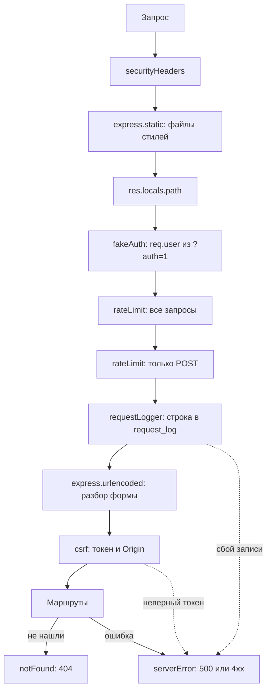

# ПЗ1. Middleware и шаблоны EJS: разбор для защиты

Ветка `pz21`, папка `part-2/pz-01-middleware-ejs`. Английская версия: `18-PZ1-MIDDLEWARE-EJS.en.md`. Запуск описан в `00-RUN-GUIDE.md`. Это серверное приложение на Express, которое рисует страницы шаблонами EJS (HTML собирает сервер, а не React). Здесь только то, что нужно понимать и уметь дописать при преподавателе.

## 1 Что делает работа за одну минуту

Каталог диаграмм в виде обычных HTML-страниц: список, страница записи, форма добавления и правки, удаление, журнал запросов. Данные диаграмм лежат в массиве в памяти (так требует практическое занятие), а журнал каждого запроса пишется в таблицу SQLite (требование чётного варианта 26). Вход имитируется параметром `?auth=1`: это учебная заглушка, а не настоящая авторизация.

| Метод | Адрес | Доступ | Что делает |
| --- | --- | --- | --- |
| GET | `/` | все | список |
| GET | `/item/:id` | все | страница записи (404, если нет) |
| GET, POST | `/add` | «вошедший» | форма и создание |
| GET, POST | `/item/:id/edit` | «вошедший» | форма и сохранение правки |
| POST | `/item/:id/delete` | «вошедший» | удаление |
| GET | `/login` | все | страница «войти» |
| GET | `/log` | «вошедший» | последние записи журнала |

Гость, открывший защищённый адрес, перенаправляется на `/login`. Любой сбой завершается оформленной страницей 404 или 500, а не голым текстом.

## 2 Как устроен проект

```
src/server.js                  запуск, порт из PORT (по умолчанию 3000)
src/app.js                     createApp: порядок middleware и все маршруты
src/middleware/security.js     заголовки, CSRF, ограничитель частоты, очистка текста для журнала
src/middleware/requestLogger.js  запись запроса в таблицу до выполнения маршрута
src/middleware/fakeAuth.js     имитация входа: ?auth=1
src/middleware/errorHandlers.js  страницы 404 и 500
src/data/diagrams.js           массив диаграмм и проверка формы
src/data/requestLog.js         таблица request_log в SQLite
src/limits.js, limits.json     пределы в одном месте
views/                         шаблоны EJS: index, item, add (и для правки), log, login, 404, 500
public/                        стили
```

## 3 Порядок обработчиков



Порядок это главная мысль работы (вопрос 27): заголовки первыми, чтобы они были у любого ответа; статика до остального, потому что файл стилей не должен проходить проверки, писаться в журнал и расходовать лимит; ограничители раньше журнала, чтобы флуд отсекался до обращения к базе; разбор формы до CSRF, потому что токен лежит в теле формы; обработчики ошибок самые последние, ведь Express вызывает функцию из четырёх параметров только когда ошибка уже случилась выше.

## 4 Разбор главного

### Имитация входа (`fakeAuth.js`)
Параметр `?auth=1` делает `req.user = { name: 'Owner' }`, иначе гость. `res.locals.authQuery` добавляется к ссылкам, чтобы признак входа не терялся при переходах. `requireAuth` защищает конкретный маршрут: гостя перенаправляет на `/login`. Это не защита, а учебная модель; в ЛР3 вход настоящий. В журнале значение `auth` заменяется на `***` (`hideAuth`), чтобы читатель журнала не мог воспользоваться признаком.

### Журнал запросов в таблицу (`requestLogger.js`, `requestLog.js`)
- Строка записывается **до** выполнения маршрута. Если запись не удалась (недоступный файл базы), ошибка уходит в обработчик ошибок, и пользователь видит оформленную страницу 500 с пояснением. Так воспроизводится «настоящий сбой», а не кнопка.
- Статус и длительность дописываются в ту же строку по событию `finish` ответа; если и это не удалось, сервер не падает, а пишет сообщение в консоль.
- `node:sqlite` открывает базу лениво при первом использовании: недоступная база ломает запрос (страница 500), а не запуск сервера.
- Адрес запроса пользователь контролирует, поэтому `safeLogText` экранирует переводы строк и управляющие символы и обрезает длину: иначе можно подделать лишнюю строку журнала (log injection).

### Защита (`security.js`)
- **Заголовки.** Строгая CSP без встроенных скриптов и стилей, запрет показа во фрейме, `nosniff`, `Permissions-Policy`. Всё выставлено вручную без пакета. `Referrer-Policy: same-origin`, а не `no-referrer`, иначе браузеры шлют `Origin: null` и собственные формы сайта отклонялись бы.
- **CSRF (вопрос 25).** Двойная отправка токена: сервер кладёт случайный токен в cookie с `HttpOnly` и `SameSite=Strict` и в скрытое поле `_csrf` каждой формы. Запрос, меняющий данные (POST, PUT, PATCH, DELETE), должен прислать оба значения, и они обязаны совпасть (сравнение за постоянное время `timingSafeEqual`). Чужой сайт не может ни прочитать cookie, ни угадать токен. Дополнительно сверяется `Origin`, если он есть.
- **Ограничитель частоты.** Окно фиксированной длины на адрес: 300 запросов в минуту на всё и 20 записывающих (POST) в минуту; при превышении страница 429 с `Retry-After`.

### Проверка формы (`diagrams.js`)
`validateDiagram` проверяет все поля на сервере теми же пределами, что стоят в `maxlength` формы, из `limits.json`: название до 80 знаков, описание до 500, код до 5000, номер правки целое от 0 до 100000, нотация из списка. Пробельные значения считаются пустыми. При ошибке форма показывается снова с введёнными значениями и сообщениями у полей, ответ 400. Тело формы ограничено (`20kb`, не более 20 параметров), повторяющиеся ключи (массивы) не роняют сервер: учитываются только обычные строки.

### Шаблоны EJS
`<%= x %>` выводит значение с экранированием HTML (защита от внедрения кода), `<%- x %>` без экранирования, поэтому им выводят только собственную разметку шаблона (например, атрибуты `aria-invalid`), но никогда пользовательский текст. `<%- include('partials/header') %>` подключает общую шапку. Функция `formatTime` в `app.locals` доступна всем шаблонам: это ответ на вопрос 26 (helper для форматирования даты).

### Страницы ошибок
`notFound` отдаёт оформленную 404. `serverError` определяет код (400, 403, 413, 429 или 500), показывает понятный текст `publicMessage`, а подробности пишет только в консоль. Если не рисуется даже страница 500, срабатывает запасная страница `fallbackPage`: голого текста пользователь не увидит.

## 5 Вопросы, которые вероятны на защите

В условии 30 вопросов; для варианта 26 это 25–27 (n−1, n, n+1 при n=26). Развёрнутые ответы в отчёте, раздел 4.

- **Как реализовать защиту от CSRF с помощью middleware (25).** Токен в cookie и в скрытом поле формы, сверка на каждом изменяющем запросе, проверка `Origin`, `SameSite=Strict`; см. выше.
- **Как использовать в EJS функцию-помощник (26).** Положить функцию в `app.locals` (для всех шаблонов) или `res.locals` (для одного запроса) и вызвать в шаблоне: `<%= formatTime(item.createdAt) %>`.
- **Почему middleware для статики подключается раньше маршрутов (27).** Запрос файла стилей или логотипа должен получить ответ сразу, без проверок, записи в журнал и расхода лимита запросов; если поставить после маршрутов, он дошёл бы до обработчика 404.
- **Что такое middleware.** Функция `(req, res, next)`; вызывает `next()` для передачи дальше или завершает ответ; порядок подключения задаёт порядок выполнения.
- **Как работает обработчик ошибок.** Четыре параметра `(err, req, res, next)`, подключается последним; в Express 5 исключения и отклонённые промисы из обработчиков попадают в него сами.
- **Чем `<%= %>` отличается от `<%- %>`.** Первое экранирует, второе вставляет как есть.
- **Почему журнал пишется до маршрута.** Чтобы сбой записи был виден как 500, и чтобы записывались даже отклонённые запросы.
- **Почему форма «Удалить» это форма, а не ссылка.** Ссылка выполняется GET-запросом (его можно спровоцировать чужой картинкой), а удаление должно идти POST с токеном CSRF.

## 6 Допиши при мне: тренировка

1. **Новый middleware «время ответа».** В `app.js` до маршрутов: `res.on('finish', ...)` пишет в консоль длительность; или заголовок `X-Response-Time`, выставленный до отправки.
2. **Ещё одна страница `/about`.** Маршрут `app.get('/about', ...)`, шаблон `views/about.ejs` с `include` шапки.
3. **Новое поле формы.** Поле в `add.ejs`, чтение в `readForm`, проверка и предел в `validateDiagram` и `limits.json`, вывод в `item.ejs`.
4. **Поиск `?q=` на главной.** Фильтр по `title` в маршруте `/` (приведение к нижнему регистру, пробельный запрос игнорируется), поле поиска в `index.ejs`.
5. **Кнопка «Очистить журнал».** POST-маршрут с `requireAuth` и CSRF, метод `clear` в `requestLog.js`.
6. **Показать страницу 500 настоящим сбоем.** Запустить сервер с файлом базы, который нельзя создать (способ описан в README, раздел «Как вызвать страницу 500»), и открыть любую страницу.

## 7 Что проверить руками перед защитой

```bash
npm install
npm test
npm start
```

Откройте `http://localhost:3000`: список, запись, `/add` (гостя перенаправляет на `/login`), затем `/add?auth=1`: пустое название, слишком длинное название, номер правки `-1` и `1.5` (ошибки у полей и ответ 400), правка и удаление, `/log?auth=1`. Проверьте 404 (`/nothing`) и страницу 500 способом из README. В DevTools на вкладке Network виден заголовок `Content-Security-Policy` и cookie `dslkit_csrf`. Скриншоты страниц для отчёта уже в папке `figures`.
