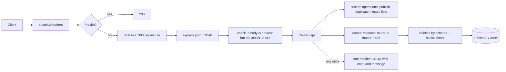

# Practical 2. Designing a REST API: study notes for the defence

Branch `pz22`, folder `part-2/pz-02-rest-api`. Russian version: `19-PZ2-REST-API.md`. How to run is in `00-RUN-GUIDE.md`. This is a teaching REST API on Express without a database: three linked resources, one format for responses and errors, filters, search, sorting and paging. The full description of every path is in the work's own `API.md`. Only what you must understand and be able to extend in front of the teacher is here.

## 1 What the work does in one minute

Three resources with one-to-many links: a user (`users`) owns projects (`projects`), and a project contains diagrams (`diagrams`). Every resource has the same six routes, so they are created by one function. The data lives in in-memory arrays (the practical requires that); the seed is 2 users, 2 projects and a few diagrams. All paths start with `/api`.

| Method | Path | What it does |
| --- | --- | --- |
| GET, POST | `/api/{users,projects,diagrams}` | list with filters, and create |
| GET, PUT, PATCH, DELETE | `/api/{...}/:id` | one record, replace, partial change, delete |
| GET | `/api/users/:id/projects` | projects of a user (cross-resource link) |
| GET | `/api/projects/:id/diagrams` | diagrams of a project |
| POST | `/api/diagrams/:id/publish` | set the status to `published` |
| POST | `/api/diagrams/:id/duplicate` | copy a diagram (201) |
| GET | `/health` | server check |

A list accepts `?page=`, `?limit=` (1–100), `?sort=-title`, `?q=text` and a filter on any schema field (`?status=draft`). The list answer is `{ data: [...], meta: { page, limit, total } }`. Errors always have one shape: `{ error: { code, message, details? } }`.

## 2 Project layout

```
src/server.js          entry
src/app.js             resource schemas, links, custom operations, error handler
src/resource.js        createResourceRouter: six standard routes, listItems, parseId, 405
src/validation.js      body validation by schema (validate, applyDefaults, trimStrings)
src/store.js           in-memory collections and seed data
src/errors.js          ApiError and the single error body format
src/security.js        headers, rate limiter, text cleaning for the log
API.md                 documentation of paths, parameters and errors
postman_collection.json, requests.http  ready requests
```

## 3 Path of a request



Custom routes (`/users/:id/projects`, `/projects/:id/diagrams`, `publish`, `duplicate`) are mounted **before** the standard router; otherwise the word after `/:id/` would match nothing or the path would be parsed as a record.

## 4 Main parts explained

### The schema as the single source of rules (`app.js`, `validation.js`)
Each resource is described by an object: field type, required, maximum, allowed values, pattern, default. One `validate` function checks any body against such a schema and returns a list of `{ field, message }`; the same schema serves as the filter and the whitelist of sortable fields. Consequences:
- an unknown field in the body is an error, not a silent skip;
- strings are trimmed before checking, and a whitespace-only value of a required field counts as empty;
- length is counted in Unicode characters (an emoji is one character), and the NUL character is forbidden;
- integers are checked for type and range (identifiers 1–2147483647).

### The generic router (`resource.js`)
`createResourceRouter({ label, collection, schema, hooks })` builds GET list, GET record, POST, PUT, PATCH, DELETE and the 405 handlers. Differences between resources are moved into **hooks**: `check` verifies references and uniqueness (does `ownerId` exist, is the email taken), and `beforeRemove` forbids deletion while dependent records exist (a user with projects or a project with diagrams gives 409). PUT vs PATCH: PUT needs all required fields and replaces the record, keeping `id` and `createdAt`; PATCH checks only the sent fields and refuses an empty body.

### Identifiers and list parameters
`parseId` accepts only a string of digits without a leading zero, up to 15 characters: `0x1`, `1e0`, `-1` and huge numbers give 400 `invalid_id`. `page` and `limit` are parsed the same way and capped (`limit` at most 100). The sort field is checked against the schema, so a field name never enters the comparison unchecked.

### Cross-resource links (question 25)
A link is a reference by id (`projects.ownerId`, `diagrams.projectId`) plus two techniques in the API: **nested paths** (`/users/:id/projects`, `/projects/:id/diagrams`) to read the subordinate records, and **reference checks on write** (a missing `ownerId` gives 400 `validation_failed`, not a dangling reference). Deleting a parent that has children is refused with 409; the alternatives are cascade delete and clearing the reference.

### Errors (`errors.js`, the handler in `app.js`)
`ApiError` carries a status, a code and a message; one four-parameter handler turns everything into JSON of one shape. The cases are:
- 400 `validation_failed` (with `details` per field), `invalid_id`, `invalid_query`, `invalid_json`;
- 404 `not_found`;
- 405 `method_not_allowed` with an `Allow` header (OPTIONS answers 204);
- 409 `conflict`;
- 413 a body over 100 KB;
- 415 a body is present but is not JSON;
- 429 too many requests (with `Retry-After`);
- 500 `internal_error` without details (they go to the console only).
Client errors raised by Express (for example a broken percent escape in the path) keep their own 4xx and are not turned into 500.

### Protection
Headers for a JSON API (a forbidding CSP, `nosniff`, `no-store`), a rate limiter per address (300 per minute, and `/health` is exempt so monitoring does not use up the limit), a body size cap, text cleaning for the log. There is no login in this work by the assignment.

## 5 Likely defence questions

The assignment has 30 questions; for variant 26 these are 25–27 (n−1, n, n+1 with n=26). Full answers are in the report, section "Answers to the control questions".

- **What are cross-resource links and how to implement them in a REST API (25).** A link by id plus nested paths like `/users/:id/projects` and an existence check of the parent on write; show it with a user's projects.
- **Which codes are used for redirects (26).** 301 and 308 permanent, 302, 303 and 307 temporary; a JSON API rarely needs redirects (a moved resource, 201 with a `Location` header instead of a redirect), and clients usually do not need them.
- **How to document the possible error codes (27).** A table of codes per path with an example error body, or OpenAPI `responses`; in the work this is the `Errors` section of `API.md` and the single body format.
- **PUT vs PATCH.** PUT replaces the record entirely and is idempotent, PATCH changes the sent fields.
- **Why 201 and `Location`.** A resource was created: the client learns the new record's address.
- **Why 204 without a body on DELETE.** There is nothing left to show.
- **400, 404 or 422 for bad data.** Here 400 `validation_failed` with a field list; 422 is acceptable as "the syntax is right, the meaning is not".
- **How to organize versioning.** A `/api/v1` prefix, a header or a parameter.
- **Why sorting and filters use a whitelist of fields.** So a client cannot reach service fields or break the comparison.

## 6 Write it live: rehearsal

1. **A new `priority` field in a diagram.** One line in the `diagrams` schema (`{ type: 'string', enum: [...], default: 'normal' }`): validation, the `?priority=` filter and sorting start working by themselves.
2. **A new `tags` resource.** A schema, a collection in `store.js`, `createResourceRouter` and `api.use('/tags', ...)` in `app.js`.
3. **A nested path `/projects/:id/owner`.** A custom route before the router: find the project, return the user `users.find(project.ownerId)`.
4. **A counter `GET /api/diagrams/count`.** Declare it before `/:id`, otherwise `count` is taken as an identifier and returns 400.
5. **Soft delete.** A `deletedAt` field, `DELETE` sets the date, the list hides such records.
6. **Show a 405.** `PUT /api/diagrams` and the answer with an `Allow` header.

## 7 What to check by hand before the defence

```bash
npm install
npm test
npm start
```

Requests in Postman (the `postman_collection.json` collection) or from `requests.http`: a list with `?limit=2&sort=-title`, `GET /api/users/1/projects`, a POST with an empty body (400 and a field list), an unknown field (400), a repeated email (409), deleting a user who owns projects (409), `PATCH` with `{}` (400), `POST /api/diagrams/1/duplicate`, `GET /api/diagrams/abc` (400), a request with `Content-Type: text/plain` (415). Screenshots of at least five Postman operations for the report are taken on your machine. User emails are hidden in the general list (visible only in the user card, and a list cannot be filtered or searched by them).
