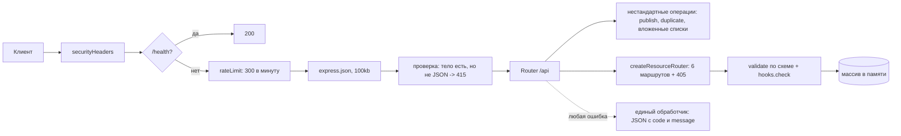

# ПЗ2. Проектирование REST API: разбор для защиты

Ветка `pz22`, папка `part-2/pz-02-rest-api`. Английская версия: `19-PZ2-REST-API.en.md`. Запуск описан в `00-RUN-GUIDE.md`. Это учебный REST API на Express без базы данных: три связанных ресурса, единый формат ответов и ошибок, фильтры, поиск, сортировка и постраничный вывод. Подробное описание всех адресов лежит в `API.md` самой работы. Здесь только то, что нужно понимать и уметь дописать при преподавателе.

## 1 Что делает работа за одну минуту

Три ресурса с связями «один ко многим»: пользователь (`users`) владеет проектами (`projects`), проект содержит диаграммы (`diagrams`). Для каждого ресурса одинаковые шесть маршрутов, поэтому они создаются одной функцией. Данные лежат в массивах в памяти (так требует практическое занятие), сид-данные: 2 пользователя, 2 проекта и несколько диаграмм. Все адреса начинаются с `/api`.

| Метод | Адрес | Что делает |
| --- | --- | --- |
| GET, POST | `/api/{users,projects,diagrams}` | список с фильтрами и создание |
| GET, PUT, PATCH, DELETE | `/api/{...}/:id` | одна запись, замена, частичное изменение, удаление |
| GET | `/api/users/:id/projects` | проекты пользователя (межресурсная связь) |
| GET | `/api/projects/:id/diagrams` | диаграммы проекта |
| POST | `/api/diagrams/:id/publish` | сменить статус на `published` |
| POST | `/api/diagrams/:id/duplicate` | копия диаграммы (201) |
| GET | `/health` | проверка сервера |

Список принимает `?page=`, `?limit=` (1–100), `?sort=-title`, `?q=текст` и фильтр по любому полю схемы (`?status=draft`). Ответ списка: `{ data: [...], meta: { page, limit, total } }`. Ошибки везде одной формы: `{ error: { code, message, details? } }`.

## 2 Как устроен проект

```
src/server.js          запуск
src/app.js             схемы ресурсов, связи, нестандартные операции, обработчик ошибок
src/resource.js        createResourceRouter: шесть стандартных маршрутов, listItems, parseId, 405
src/validation.js      проверка тела по схеме (validate, applyDefaults, trimStrings)
src/store.js           коллекции в памяти и сид-данные
src/errors.js          ApiError и единый формат тела ошибки
src/security.js        заголовки, ограничитель частоты, очистка текста для журнала
API.md                 документация адресов, параметров и ошибок
postman_collection.json, requests.http  готовые запросы
```

## 3 Путь запроса



Нестандартные маршруты (`/users/:id/projects`, `/projects/:id/diagrams`, `publish`, `duplicate`) подключаются **раньше** стандартного роутера, иначе слово после `/:id/` не совпало бы ни с чем или адрес был бы разобран как запись.

## 4 Разбор главного

### Схема как единственный источник правил (`app.js`, `validation.js`)
Каждый ресурс описан объектом: тип поля, обязательность, максимум, список допустимых значений, шаблон, значение по умолчанию. Одна функция `validate` проверяет любое тело по такой схеме и возвращает список `{ field, message }`; та же схема служит фильтром и белым списком полей для сортировки. Следствия:
- неизвестное поле в теле это ошибка, а не молчаливый пропуск;
- строки обрезаются по краям до проверки, пробельное значение обязательного поля считается пустым;
- длина считается по символам Unicode (эмодзи это один символ), символ NUL запрещён;
- целые числа проверяются на тип и диапазон (идентификаторы 1–2147483647).

### Универсальный роутер (`resource.js`)
`createResourceRouter({ label, collection, schema, hooks })` строит GET список, GET запись, POST, PUT, PATCH, DELETE и обработчики 405. Различия между ресурсами вынесены в **хуки**: `check` проверяет ссылки и уникальность (существует ли `ownerId`, не занят ли email), `beforeRemove` запрещает удаление, пока есть зависимые записи (пользователь с проектами, проект с диаграммами дают 409). Разница PUT и PATCH: PUT требует все обязательные поля и заменяет запись, сохраняя `id` и `createdAt`; PATCH проверяет только присланные поля и не принимает пустое тело.

### Идентификаторы и параметры списка
`parseId` принимает только строку из цифр без ведущего нуля длиной до 15 знаков: `0x1`, `1e0`, `-1` и огромные числа дают 400 `invalid_id`. `page` и `limit` разбираются так же и ограничены (`limit` не больше 100). Поле сортировки проверяется по схеме, поэтому имя поля не попадает в сравнение без проверки.

### Межресурсные связи (вопрос 25)
Связь это ссылка по идентификатору (`projects.ownerId`, `diagrams.projectId`) плюс два приёма в API: **вложенные адреса** (`/users/:id/projects`, `/projects/:id/diagrams`) для чтения подчинённых записей и **проверка ссылки при записи** (несуществующий `ownerId` даёт 400 `validation_failed`, а не повисшую ссылку). Удаление родителя при наличии детей отвергается 409; альтернативы это каскадное удаление и обнуление ссылки.

### Ошибки (`errors.js`, обработчик в `app.js`)
`ApiError` несёт статус, код и сообщение; один обработчик с четырьмя параметрами превращает всё в JSON одного вида. Различаются:
- 400 `validation_failed` (с `details` по полям), `invalid_id`, `invalid_query`, `invalid_json`;
- 404 `not_found`;
- 405 `method_not_allowed` с заголовком `Allow` (OPTIONS отвечает 204);
- 409 `conflict`;
- 413 тело больше 100 КБ;
- 415 тело есть, но это не JSON;
- 429 слишком много запросов (с `Retry-After`);
- 500 `internal_error` без подробностей (они только в консоли).
Ошибки клиента, пришедшие от Express (например, битая процентная последовательность в адресе), сохраняют свой 4xx и не превращаются в 500.

### Защита
Заголовки для JSON-API (запрещающая CSP, `nosniff`, `no-store`), ограничитель частоты на адрес (300 в минуту, `/health` ему не подчиняется, чтобы мониторинг не расходовал лимит), ограничение размера тела, очистка текста для журнала. Вход в этой работе по условию отсутствует.

## 5 Вопросы, которые вероятны на защите

В условии 30 вопросов; для варианта 26 это 25–27 (n−1, n, n+1 при n=26). Развёрнутые ответы в отчёте, раздел «Ответы на контрольные вопросы».

- **Что такое межресурсные связи и как их реализовать в REST API (25).** Связь по идентификатору плюс вложенные адреса `/users/:id/projects` и проверка существования родителя при записи; показать на проектах пользователя.
- **Какие коды используются для редиректов (26).** 301 и 308 постоянные, 302, 303 и 307 временные; для JSON-API редиректы нужны редко (смена адреса ресурса, 201 с заголовком `Location` вместо редиректа), клиентам они обычно не нужны.
- **Как в документации указать возможные коды ошибок (27).** Для каждого адреса таблица кодов с примером тела ошибки или описание в OpenAPI (`responses`); в работе это раздел `Errors` в `API.md` и единый формат тела.
- **PUT и PATCH.** PUT заменяет запись целиком и идемпотентен, PATCH меняет присланные поля.
- **Почему 201 и `Location`.** Создание ресурса: клиент узнаёт адрес новой записи.
- **Почему 204 без тела на DELETE.** Удалять уже нечего показывать.
- **404, 400 или 422 на неверные данные.** Здесь 400 `validation_failed` со списком полей; 422 допустим как «синтаксис верный, смысл нет».
- **Как организовать версионирование.** Префикс `/api/v1`, заголовок или параметр.
- **Почему сортировка и фильтры по белому списку полей.** Чтобы клиент не мог обратиться к служебным полям и не ломал сравнение.

## 6 Допиши при мне: тренировка

1. **Новое поле `priority` в диаграмме.** Одна строка в схеме `diagrams` (`{ type: 'string', enum: [...], default: 'normal' }`): проверка, фильтр `?priority=` и сортировка заработают сами.
2. **Новый ресурс `tags`.** Схема, коллекция в `store.js`, `createResourceRouter` и `api.use('/tags', ...)` в `app.js`.
3. **Вложенный адрес `/projects/:id/owner`.** Нестандартный маршрут до роутера: найти проект, вернуть пользователя `users.find(project.ownerId)`.
4. **Счётчик `GET /api/diagrams/count`.** Объявить до `/:id`, иначе `count` будет принят за идентификатор и вернёт 400.
5. **Мягкое удаление.** Поле `deletedAt`, `DELETE` ставит дату, список скрывает такие записи.
6. **Показать 405.** `PUT /api/diagrams` и ответ с заголовком `Allow`.

## 7 Что проверить руками перед защитой

```bash
npm install
npm test
npm start
```

Запросы в Postman (коллекция `postman_collection.json`) или из `requests.http`: список с `?limit=2&sort=-title`, `GET /api/users/1/projects`, POST с пустым телом (400 и список полей), неизвестное поле (400), повтор email (409), удаление пользователя с проектами (409), `PATCH` с `{}` (400), `POST /api/diagrams/1/duplicate`, `GET /api/diagrams/abc` (400), запрос с `Content-Type: text/plain` (415). Скриншоты не менее пяти операций Postman для отчёта снимаются на вашей машине. Открытый вопрос: email пользователей виден в общем списке (скрывать ли его, решение за вами).
