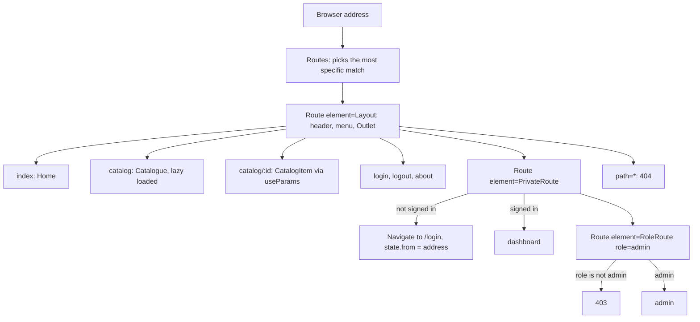

# Practical 3. Routing in React (React Router): study notes for the defence

Branch `pz23`, folder `part-2/pz-03-routing`. Russian version: `20-PZ3-ROUTING.md`. How to run is in `00-RUN-GUIDE.md`. This is a client-side React and Vite app with several "pages" and no page reloads: a menu, dynamic paths, protected pages, roles and error pages. There is no server; sign-in is imitated. Only what you must understand and be able to extend in front of the teacher is here.

## 1 What the work does in one minute

A site of pages: home, a catalogue of diagram templates with search and sorting, a template page by number, "About", login, a personal dashboard and an admin section. The dashboard is open only to a "signed-in" user (sign-in is imitated, no password is asked), the admin section only to the admin role (the name `admin` gives that role). An unknown path shows a 404 page, a forbidden section a 403 page.

| Path | Page | Access |
| --- | --- | --- |
| `/` | home | everyone |
| `/catalog` | catalogue; the filter is in the address `?q=...&sort=...` | everyone |
| `/catalog/:id` | a template by number (a not-found page if missing) | everyone |
| `/about` | about | everyone |
| `/login`, `/logout` | sign in and out | everyone |
| `/dashboard` | personal dashboard | signed in |
| `/admin` | administrator | admin role (else 403) |
| `*` | page not found | everyone |

An important caveat: the sign-in and role checks in the browser only hide pages in the interface and **do not protect data**. A real check is possible only on a server (as in lab 3).

## 2 Project layout

```
src/main.jsx                   BrowserRouter, AuthProvider, ErrorBoundary
src/App.jsx                    the route table (Routes and Route)
src/auth.jsx                   AuthProvider: sign-in state, role, safe return address
src/components/Layout.jsx      common frame: header, NavLink menu, Outlet in Suspense, footer
src/components/PrivateRoute.jsx  lets signed-in users in, sends others to /login
src/components/RoleRoute.jsx   lets the needed role in, else the 403 page
src/components/Breadcrumbs.jsx breadcrumbs from the address
src/pages/                     pages: pages.jsx (small ones), Catalog, Dashboard, Admin
src/data/templates.js          template data
src/usePageTitle.js            the tab title for every page
src/limits.json                limits (name, search)
```

## 3 How an address is matched



Wrapper routes (`Layout`, `PrivateRoute`, `RoleRoute`) have no path of their own: they have an `element` with an `<Outlet />`, and the matched child route is rendered in its place. This way a common frame and a common check are written once for a group of pages.

## 4 Main parts explained

### The route table (`App.jsx`)
- `<Route index>` is the parent's home page; `path="catalog/:id"` is a dynamic segment, its value is read with the `useParams()` hook.
- `path="*"` catches everything unmatched (the 404 page). The router picks the most specific match, not the first in order, so `*` can be written anywhere.
- `Catalog`, `Dashboard` and `Admin` are imported with `lazy(() => import(...))`: their code downloads on the first visit, and the `Suspense` in `Layout` shows a spinner while it loads (question 21).
- In `main.jsx` the `BrowserRouter` sits outside `App`: tests replace it with `MemoryRouter`, so `App` itself does not depend on a particular router.

### The menu (`Layout.jsx`)
`NavLink` differs from `Link` in that it knows whether the link is active: it adds an `active` class and `aria-current="page"`. The home link has `end`, otherwise "Home" would be active on every page (the address `/` begins every address). A double click on "Sign in" and "Sign out" is swallowed so the second click does not land on the new link.

### Protected route and return (`PrivateRoute.jsx`, `Login`)
`PrivateRoute` checks `isAuth`. It sends a guest through `<Navigate to="/login" replace state={{ from }} />`. `replace` replaces the history entry, so the "Back" button does not return to the closed page and does not create a loop. The `state` holds the whole requested address (path, query and hash), and it is **not visible in the address bar**. After sign-in, `Login` reads `location.state.from` and calls `navigate(target, { replace: true })`.

The return address is checked by `safeReturnPath`: it must start with a single `/`; `//host`, `https://host`, `/\` and the login page itself are rejected and replaced by the dashboard. Otherwise a planted address could take the user to a foreign site (an open redirect).

### Roles (`RoleRoute.jsx`)
`RoleRoute` compares `auth.role` with the required role and renders either `<Outlet />` or the 403 page. It sits inside `PrivateRoute`, so a guest first goes to sign-in, not to a 403. The role in the work is a convention: `roleFor(name)` gives `admin` for the name `admin` in any letter case and `user` to everyone else.

### Sign-in state (`auth.jsx`)
The session lives in `useState` and in `localStorage`; the value is wrapped in `useMemo`, and `login` and `logout` in `useCallback`, so the context does not change needlessly. A stored flag is accepted only together with a valid name: a hand-written `true` opens nothing. The `storage` event synchronizes sign-out between tabs. It is the same provider-context technique as in practical 4.

### The catalogue filter in the address (`Catalog.jsx`)
`useSearchParams()` returns the query parameters and a function to change them, like `useState`. The filter and sorting live in the address (`/catalog?q=BPMN&sort=title`), so the result can be shared as a link and survives a reload. A value from the address is cut to the limit, a whitespace-only query and an unknown sort are ignored; `{ replace: true }` does not clutter the history on every keystroke.

### Breadcrumbs (`Breadcrumbs.jsx`)
`buildCrumbs` splits `pathname` by `/` and builds the chain "Home / Catalogue / Template name". For an unknown segment (the 404 page, a missing number) no chain is built at all, so a wrong path is never shown.

### Error pages
The 404 page sits on `path="*"`; `RoleRoute` renders the 403; the `ErrorBoundary` in `main.jsx` catches rendering failures. `usePageTitle` sets the tab title of every page.

## 5 Likely defence questions

The assignment has 30 questions; for variant 26 these are 25–27 (n−1, n, n+1 with n=26). Full answers are in the report, section "Answers to the control questions".

- **`BrowserRouter` vs `HashRouter` (25).** The first uses ordinary addresses through the History API (`/catalog`) and needs the server to return `index.html` for any path; the second keeps the path after `#` (`/#/catalog`), the server sees only `/` and needs no setup (fits static hosting without redirect rules).
- **How to make a modal window with its own route (26).** A nested route rendered over the list through an `<Outlet />`; closing calls `navigate(-1)` or navigates to the parent; the window's address can also be opened directly.
- **How to test routing (27).** Wrap the component in a `MemoryRouter` with `initialEntries={['/catalog/2']}` and check the text; in the work this is how route protection, roles and the catalogue filter are tested.
- **What `Outlet` is.** A place in a parent route where the chosen child route is rendered.
- **`Link` vs `NavLink`.** `NavLink` knows whether the address is active and can highlight it.
- **How to protect a route.** A wrapper component that does `<Navigate replace>` when there is no sign-in.
- **How to pass `state` without showing it in the address.** `navigate(path, { state })` or `<Navigate state>`, read with `useLocation().state`.
- **How to host the app not at the server root (20).** Pass `basename` to the router; not used in the work (`basename` is not set).
- **How to warn about unsaved data on leaving (29).** `useBlocker` works only in a data router (`createBrowserRouter`); the work uses `BrowserRouter`, so this is not implemented.
- **Version.** The assignment names React Router v6, the work has v7 (`react-router-dom` 7.x) with the same API for these tasks; the owner decided to keep v7.

## 6 Write it live: rehearsal

1. **A new page `/contacts`.** A page component, a line `<Route path="contacts" element={<Contacts />} />` inside `Layout`, an entry in the `NAV` array, a label in the breadcrumb `LABELS`.
2. **A new protected route `/settings`.** A line inside `<Route element={<PrivateRoute />}>`.
3. **Role `editor`.** Extend `roleFor` (for example the name `editor`) and add `<Route element={<RoleRoute role="editor" />}>`; be able to explain how to allow several roles (pass an array and use `includes`).
4. **A `?page=` parameter for the catalogue.** Read through `useSearchParams`, check the number, slice the array.
5. **A "Back" button.** `const navigate = useNavigate(); navigate(-1)`.
6. **Redirect an old address.** `<Route path="old" element={<Navigate to="/catalog" replace />} />`.
7. **`HashRouter`.** Replace `BrowserRouter` in `main.jsx` and show the address with `#`.

## 7 What to check by hand before the defence

```bash
npm install
npm test
npm run dev
```

In the browser: the menu highlights the current page; `/catalog?q=bpmn` filters at once; `/catalog/999` shows "not found"; `/dashboard` without sign-in leads to `/login` and returns to the dashboard after sign-in (also try an address like `/catalog/1` sending you to sign-in first); signing in under an ordinary name and then `/admin` gives 403, under the name `admin` it opens; `/nothing` shows 404; the "Back" button after sign-in does not return to the sign-in form. The screenshots of all pages and the menu for the report are in the `figures` folder; show the mobile menu at the defence too.
