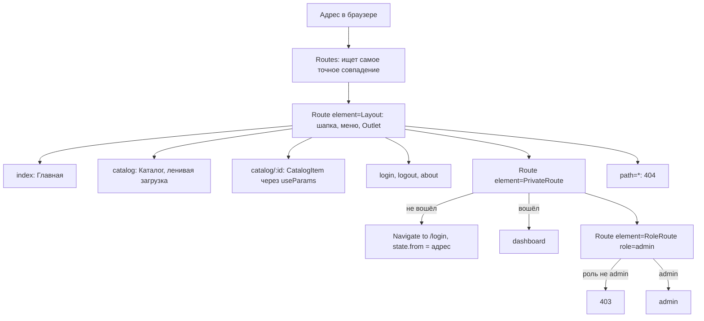

# ПЗ3. Маршрутизация в React (React Router): разбор для защиты

Ветка `pz23`, папка `part-2/pz-03-routing`. Английская версия: `20-PZ3-ROUTING.en.md`. Запуск описан в `00-RUN-GUIDE.md`. Это клиентское приложение на React и Vite с несколькими «страницами» без перезагрузки: меню, динамические адреса, защищённые страницы, роли и страницы ошибок. Сервера нет, вход имитируется. Здесь только то, что нужно понимать и уметь дописать при преподавателе.

## 1 Что делает работа за одну минуту

Сайт из страниц: главная, каталог шаблонов диаграмм с поиском и сортировкой, страница шаблона по номеру, «О проекте», вход, личный кабинет и раздел администратора. Кабинет доступен только «вошедшему» (вход имитируется, пароль не спрашивается), раздел администратора только роли admin (имя `admin` даёт эту роль). Неизвестный адрес показывает страницу 404, запрещённый раздел страницу 403.

| Адрес | Страница | Доступ |
| --- | --- | --- |
| `/` | главная | все |
| `/catalog` | каталог; фильтр в адресе `?q=...&sort=...` | все |
| `/catalog/:id` | шаблон по номеру (404-страница, если нет) | все |
| `/about` | о проекте | все |
| `/login`, `/logout` | вход и выход | все |
| `/dashboard` | личный кабинет | вошедший |
| `/admin` | администратор | роль admin (иначе 403) |
| `*` | страница не найдена | все |

Важная оговорка: проверка входа и роли в браузере только прячет страницы в интерфейсе и **не защищает данные**. Настоящая проверка возможна лишь на сервере (как в ЛР3).

## 2 Как устроен проект

```
src/main.jsx                   BrowserRouter, AuthProvider, ErrorBoundary
src/App.jsx                    таблица маршрутов (Routes и Route)
src/auth.jsx                   AuthProvider: состояние входа, роль, безопасный адрес возврата
src/components/Layout.jsx      общий каркас: шапка, меню NavLink, Outlet в Suspense, подвал
src/components/PrivateRoute.jsx  пускает вошедших, остальных ведёт на /login
src/components/RoleRoute.jsx   пускает нужную роль, иначе страница 403
src/components/Breadcrumbs.jsx хлебные крошки по адресу
src/pages/                     страницы: pages.jsx (малые), Catalog, Dashboard, Admin
src/data/templates.js          данные шаблонов
src/usePageTitle.js            заголовок вкладки для каждой страницы
src/limits.json                пределы (имя, поиск)
```

## 3 Как сопоставляется адрес



Маршруты-обёртки (`Layout`, `PrivateRoute`, `RoleRoute`) не имеют своего пути: у них есть `element`, в котором стоит `<Outlet />`, а вложенный маршрут подставляется на его место. Так один раз описывается общий каркас и общая проверка для группы страниц.

## 4 Разбор главного

### Таблица маршрутов (`App.jsx`)
- `<Route index>` главная страница родителя; `path="catalog/:id"` динамический сегмент, значение читается хуком `useParams()`.
- `path="*"` ловит всё несовпавшее (страница 404). Router выбирает самое точное совпадение, а не первое по порядку, поэтому `*` можно писать где угодно.
- Страницы `Catalog`, `Dashboard`, `Admin` подключены через `lazy(() => import(...))`: их код скачивается при первом посещении, а `Suspense` в `Layout` показывает индикатор, пока он загружается (вопрос 21).
- В `main.jsx` роутер `BrowserRouter` стоит снаружи `App`: в тестах его заменяют на `MemoryRouter`, поэтому сам `App` от конкретного роутера не зависит.

### Меню (`Layout.jsx`)
`NavLink` отличается от `Link` тем, что знает, активна ли ссылка: он добавляет класс `active` и атрибут `aria-current="page"`. Для главной страницы указано `end`, иначе «Главная» была бы активна на любой странице (адрес `/` является началом любого). Двойной щелчок по «Войти» и «Выйти» гасится, чтобы второй щелчок не попал уже в новую ссылку.

### Защищённый маршрут и возврат (`PrivateRoute.jsx`, `Login`)
`PrivateRoute` проверяет `isAuth`. Гостя он отправляет через `<Navigate to="/login" replace state={{ from }} />`. `replace` заменяет запись в истории, поэтому кнопка «Назад» не возвращает на закрытую страницу и не создаёт петлю. В `state` попадает исходный адрес целиком (путь, запрос и якорь), и он **не виден в адресной строке**. После входа `Login` читает `location.state.from` и вызывает `navigate(target, { replace: true })`.

Адрес возврата проверяет `safeReturnPath`: он обязан начинаться с одного `/`; значения `//host`, `https://host`, `/\` и сама страница входа отвергаются и заменяются кабинетом. Иначе подставленный адрес позволил бы увести пользователя на чужой сайт (открытое перенаправление).

### Роли (`RoleRoute.jsx`)
`RoleRoute` сравнивает `auth.role` с требуемой ролью и либо рисует `<Outlet />`, либо страницу 403. Он стоит внутри `PrivateRoute`, поэтому гость сначала попадает на вход, а не на 403. Роль в работе условная: `roleFor(name)` даёт `admin` для имени `admin` в любом регистре, остальным `user`.

### Состояние входа (`auth.jsx`)
Сессия лежит в `useState` и в `localStorage`; значение оборачивается в `useMemo`, а `login` и `logout` в `useCallback`, чтобы контекст не менялся без надобности. Сохранённый флаг принимается только вместе с допустимым именем: вручную записанное `true` ничего не откроет. Событие `storage` синхронизирует выход между вкладками. Это тот же приём «контекст провайдера», что в ПЗ4.

### Фильтр каталога в адресе (`Catalog.jsx`)
`useSearchParams()` возвращает параметры запроса и функцию их изменения, как `useState`. Фильтр и сортировка живут в адресе (`/catalog?q=BPMN&sort=title`), поэтому результат можно переслать ссылкой и он переживает перезагрузку. Значение из адреса обрезается до предела, пробельный запрос и неизвестная сортировка игнорируются; `{ replace: true }` не засоряет историю при каждом нажатии клавиши.

### Хлебные крошки (`Breadcrumbs.jsx`)
`buildCrumbs` режет `pathname` по `/` и строит цепочку «Главная / Каталог / Название шаблона». Для неизвестного сегмента (страница 404, несуществующий номер) цепочка не строится вовсе, чтобы не показать неверный путь.

### Страницы ошибок
Страница 404 стоит на `path="*"`; 403 рисует `RoleRoute`; `ErrorBoundary` в `main.jsx` ловит сбои отрисовки. Заголовок вкладки у каждой страницы задаёт `usePageTitle`.

## 5 Вопросы, которые вероятны на защите

В условии 30 вопросов; для варианта 26 это 25–27 (n−1, n, n+1 при n=26). Развёрнутые ответы в отчёте, раздел «Ответы на контрольные вопросы».

- **Чем `BrowserRouter` отличается от `HashRouter` (25).** Первый использует обычные адреса через History API (`/catalog`) и требует, чтобы сервер на любой путь отдавал `index.html`; второй хранит путь после `#` (`/#/catalog`), сервер видит только `/` и настраивать его не нужно (подходит для статического хостинга без правил перенаправления).
- **Как сделать модальное окно с отдельным маршрутом (26).** Вложенный маршрут, который рисуется поверх списка через `<Outlet />`, закрытие кнопкой вызывает `navigate(-1)` или переход на родителя; адрес окна можно открыть и по прямой ссылке.
- **Как протестировать маршрутизацию (27).** Обернуть компонент в `MemoryRouter` с `initialEntries={['/catalog/2']}` и проверить текст; в работе так проверены защита маршрутов, роли и фильтр каталога.
- **Что такое `Outlet`.** Место в родительском маршруте, куда подставляется выбранный вложенный маршрут.
- **`Link` и `NavLink`.** `NavLink` знает, активен ли адрес, и умеет подсвечивать.
- **Как защитить маршрут.** Компонент-обёртка, который при отсутствии входа делает `<Navigate replace>`.
- **Как передать `state` без показа в адресе.** `navigate(path, { state })` или `<Navigate state>`, чтение через `useLocation().state`.
- **Как разместить приложение не в корне сервера (20).** Передать `basename` в роутер; в работе не используется (`basename` не задан).
- **Как предупредить о несохранённых данных при уходе (29).** `useBlocker` работает только в маршрутизаторе с данными (`createBrowserRouter`); в работе стоит `BrowserRouter`, поэтому это не реализовано.
- **Версия.** В условии указан React Router v6, в работе стоит v7 (`react-router-dom` 7.x) с тем же API для этих задач; владелица решила оставить v7.

## 6 Допиши при мне: тренировка

1. **Новая страница `/contacts`.** Компонент страницы, строка `<Route path="contacts" element={<Contacts />} />` внутри `Layout`, пункт в массиве `NAV`, подпись в `LABELS` крошек.
2. **Новый защищённый маршрут `/settings`.** Строка внутри `<Route element={<PrivateRoute />}>`.
3. **Роль `editor`.** Расширить `roleFor` (например, имя `editor`) и добавить `<Route element={<RoleRoute role="editor" />}>`; уметь объяснить, как разрешить несколько ролей (передать массив и использовать `includes`).
4. **Параметр `?page=` каталога.** Прочитать через `useSearchParams`, проверить число, срез массива.
5. **Кнопка «Назад».** `const navigate = useNavigate(); navigate(-1)`.
6. **Редирект старого адреса.** `<Route path="old" element={<Navigate to="/catalog" replace />} />`.
7. **`HashRouter`.** Заменить `BrowserRouter` в `main.jsx` и показать адрес с `#`.

## 7 Что проверить руками перед защитой

```bash
npm install
npm test
npm run dev
```

В браузере: меню подсвечивает текущую страницу; `/catalog?q=bpmn` фильтрует сразу; `/catalog/999` показывает «не найдено»; `/dashboard` без входа ведёт на `/login`, а после входа возвращает в кабинет (проверьте и с адресом вида `/catalog/1`, ведущим сначала на вход); вход под обычным именем и затем `/admin` даёт 403, под именем `admin` открывается; `/nothing` показывает 404; кнопка «Назад» после входа не возвращает на форму входа. Скриншоты всех страниц и меню для отчёта в папке `figures`; при защите покажите и мобильное меню.
