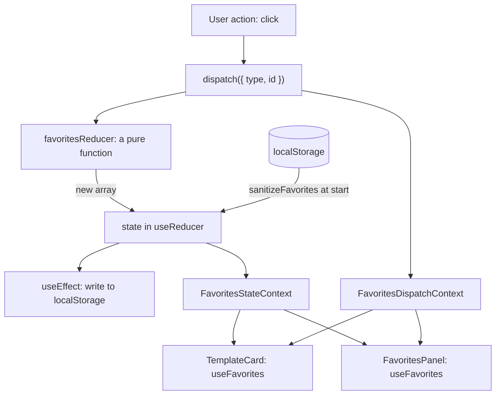

# Practical 4. Context API and useReducer: study notes for the defence

Branch `pz24`, folder `part-2/pz-04-context-reducer`. Russian version: `21-PZ4-CONTEXT-REDUCER.md`. How to run is in `00-RUN-GUIDE.md`. This is a client-side React and Vite app with no server: shared data (theme, language, favorites) lives in contexts, and the favorites are managed by a reducer. Only what you must understand and be able to extend in front of the teacher is here.

## 1 What the work does in one minute

A "Diagram templates" page: a list of templates with an "Add to favorites" button, a favorites panel with a quantity per template (plus, minus, direct input, "Clear"), a theme and language switch (Russian and English), and a two-column "Prop drilling" block: the problem on the left (a user name passes through three components that do not need it), the context solution on the right. The theme, the language and the favorites are saved in `localStorage`.

## 2 Project layout

```
src/main.jsx, src/App.jsx          assembly of providers and the page
src/context/FavoritesContext.jsx   favorites reducer and two contexts (data and dispatch)
src/context/ThemeContext.jsx       theme: a saved choice or the system one
src/context/LanguageContext.jsx    ru/en dictionary and the translation function t
src/components/Templates.jsx       template list and the favorites panel
src/components/PropDrilling.jsx    the problem and the solution side by side
src/components/Settings.jsx        the language switch
src/data/templates.js              template data
src/limits.json                    the quantity limit (99)
src/shell/                         header, footer, error boundary (the project's shared shell)
```

## 3 How data flows



## 4 Main parts explained

### The reducer (`favoritesReducer`)
A pure function `(state, action) → new state`: no side effects and no change to the previous value, every answer is a new array. The state is an array of `{ id, qty }`.

| Action | What it does |
| --- | --- |
| `ADD` | adds a template with quantity 1 (a repeat and an unknown `id` are ignored) |
| `REMOVE` | removes the entry |
| `TOGGLE` | adds or removes (the star button) |
| `INCREMENT`, `DECREMENT` | change the quantity by 1 |
| `SET_QTY` | sets the quantity by direct input |
| `CLEAR` | empties the favorites |

The quantity always goes through `clampQty`: a whole number from 1 to 99, a fraction is cut off, and junk is replaced by the nearest valid value. So neither `-5`, nor `1e999`, nor `abc` breaks the list. An unknown action and an unknown `id` return the state unchanged, and a broken state (`null`) is replaced by an empty array. This is easy to test: call the function directly.

### Two contexts: data and `dispatch` (`FavoritesContext.jsx`)
`useReducer` returns `[favorites, dispatch]`. The data changes often, `dispatch` never changes. If both are put into one context, every data change also re-renders components that need only `dispatch`. So there are two contexts: `FavoritesStateContext` (data) and `FavoritesDispatchContext` (the function). The hooks `useFavorites()` and `useFavoritesDispatch()` each read their own; a component that only sends actions subscribes to the second and is not re-rendered when the data changes (questions 5, 16, 27, 29). Outside `FavoritesProvider` the hooks throw an error naming the provider rather than silently returning `undefined`.

### Initial state and saving
`useReducer(favoritesReducer, undefined, loadFavorites)`: the third argument is a lazy-initialization function (question 20) called once on the first render. `loadFavorites` reads `localStorage` and passes the data through `sanitizeFavorites`: only known `id` values stay, each once, with a valid quantity; the first version's format (a plain list of ids) is accepted as quantity 1. A `useEffect` writes to `localStorage` on every change; a write error is swallowed and the app works in memory.

### Theme and language
`ThemeContext` holds `theme`, `setTheme` and `toggleTheme`; the value is wrapped in `useMemo` so consumers do not re-render without cause (question 21). The default theme is the system one (`prefers-color-scheme`), a saved choice wins, foreign values in storage are ignored; the `data-theme` attribute on the root element switches the colour variables of the whole page. `LanguageContext` holds the `ru` and `en` dictionary and a function `t(key)`; a language code is taken from storage only if it is in the known list.

### Prop drilling: the problem and the solution (`PropDrilling.jsx`)
The problem: the user name is needed only by `UserAvatar`, but it passes through `Header`, `Navigation` and `UserMenu` as `props` at every level. The solution: the same tree, but the name lives in `UserContext` and `UserAvatar` reads it with the `useUser()` hook; the middle components get no props. An empty name does not break the page (a `?` is shown).

### Accessibility
The "Add to favorites" button has `aria-pressed` and a label with the template name; there is a "skip to main content" link; interface labels come from the dictionary, not hard-coded.

## 5 Likely defence questions

The assignment has 30 questions; for variant 26 these are 25–27 (n−1, n, n+1 with n=26). Full answers are in the report, section "Answers to the control questions".

- **Can `useReducer` be used without Context (25).** Yes. For the local state of one component (a form, a counter) Context is not needed: `const [state, dispatch] = useReducer(reducer, initial)`. Context is added when `state` or `dispatch` is needed by distant descendants without passing props.
- **How Context plus `useReducer` differs from Redux (26).** For small and medium apps they give the same idea (one state, actions, a pure reducer) without an external library. Redux adds a debugger with action history, middleware (thunk), subscription to a part of the state through selectors and a single global store; a context re-renders all its consumers on any value change, so it is split into several.
- **How to get only `dispatch` (27).** Put `dispatch` into a separate context (like `FavoritesDispatchContext`) and read it with `useFavoritesDispatch()`: it never changes, so the component is not re-rendered when the data changes.
- **What is prop drilling (1).** Passing data through a chain of components that do not need it; solved with context, composition or a store.
- **Why `useReducer` rather than `useState` (3, 11).** The transition logic is collected in one pure function that is easy to test and reuse; useful when the state is complex or the next value depends on the action.
- **How to avoid mutation (15).** Return new arrays and objects (`map`, `filter`, `{ ...item }`), do not change the old ones.
- **What is an action creator (22).** A function that returns an action object: `const toggle = (id) => ({ type: 'TOGGLE', id })`; in the work actions are written as objects by hand.
- **How to implement undo (24).** Keep a history `{ past, present, future }` in the reducer state; not implemented.
- **How to test a reducer (30).** Call the function directly: `favoritesReducer([], { type: 'ADD', id: 1 })` and compare the result; in the work this covers the quantity edge values too.
- **What is a thunk (28).** A function instead of an action object that does async work and then calls `dispatch`; for a pure reducer, async work is moved outside.

## 6 Write it live: rehearsal

1. **A new action `RESET_QTY`.** A new `case` in `favoritesReducer`: set all quantities to 1 with `state.map((item) => ({ ...item, qty: 1 }))`; a button calls `dispatch({ type: 'RESET_QTY' })`.
2. **A total of quantities.** Show `favorites.reduce((sum, item) => sum + item.qty, 0)` in the panel; it is computed while rendering and not put into state.
3. **Action creators.** An `actions.js` file with `toggle`, `setQty`, `clear`, and replace the objects in components.
4. **A third language.** A `de` block in the dictionary and the code in `LANGUAGES`, a button in `Settings`.
5. **A user context.** Create `UserContext` with a provider in `App` and remove `props` in one more place.
6. **A reducer test.** Three checks: a repeated `ADD` does not duplicate, `SET_QTY` with `1e999` gives 99, an unknown action returns the same state.
7. **Show the extra re-renders.** A temporary `console.log` in a component that takes only `dispatch`: when adding to favorites it stays silent.

## 7 What to check by hand before the defence

```bash
npm install
npm test
npm run dev
```

In the browser: add a template to favorites, change the quantity with plus, minus and input (`0`, `-5` and `abc` give a valid value), reload (the favorites are still there), press "Clear"; switch the theme and the language and reload (the choice is kept); compare the two columns of the "Prop drilling" block. Corrupt the data in the console: `localStorage.setItem('dslkit.favorites', '[{"id":999,"qty":-1},null]')`, reload: the app starts with empty favorites and does not crash. The screenshots for the report are in the `figures` folder.
