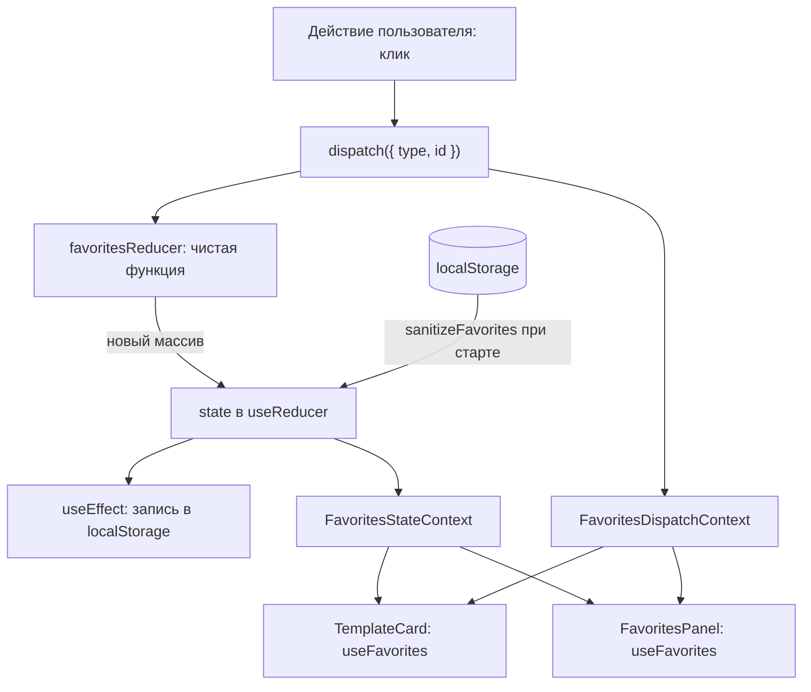

# ПЗ4. Context API и useReducer: разбор для защиты

Ветка `pz24`, папка `part-2/pz-04-context-reducer`. Английская версия: `21-PZ4-CONTEXT-REDUCER.en.md`. Запуск описан в `00-RUN-GUIDE.md`. Это клиентское приложение на React и Vite без сервера: общие данные (тема, язык, избранное) лежат в контекстах, а избранное управляется редьюсером. Здесь только то, что нужно понимать и уметь дописать при преподавателе.

## 1 Что делает работа за одну минуту

Страница «Шаблоны диаграмм»: список шаблонов с кнопкой «В избранное», панель избранного с количеством каждого шаблона (плюс, минус, прямой ввод, «Очистить»), переключатель темы и языка (русский и английский) и блок «Prop drilling» из двух столбцов: слева проблема (имя пользователя проходит через три компонента, которым оно не нужно), справа решение через контекст. Тема, язык и избранное сохраняются в `localStorage`.

## 2 Как устроен проект

```
src/main.jsx, src/App.jsx          сборка провайдеров и страницы
src/context/FavoritesContext.jsx   редьюсер избранного и два контекста (данные и dispatch)
src/context/ThemeContext.jsx       тема: сохранённый выбор или системная
src/context/LanguageContext.jsx    словарь ru/en и функция перевода t
src/components/Templates.jsx       список шаблонов и панель избранного
src/components/PropDrilling.jsx    проблема и решение рядом
src/components/Settings.jsx        переключатель языка
src/data/templates.js              данные шаблонов
src/limits.json                    предел количества (99)
src/shell/                         шапка, подвал, граница ошибок (общая оболочка проекта)
```

## 3 Как данные идут по приложению



## 4 Разбор главного

### Редьюсер (`favoritesReducer`)
Чистая функция `(состояние, действие) → новое состояние`: без побочных эффектов и без изменения прежнего значения, каждый ответ это новый массив. Состояние это массив `{ id, qty }`.

| Действие | Что делает |
| --- | --- |
| `ADD` | добавляет шаблон с количеством 1 (повтор и неизвестный `id` игнорируются) |
| `REMOVE` | убирает запись |
| `TOGGLE` | добавляет или убирает (кнопка-звёздочка) |
| `INCREMENT`, `DECREMENT` | меняют количество на 1 |
| `SET_QTY` | задаёт количество прямым вводом |
| `CLEAR` | очищает избранное |

Количество всегда проходит через `clampQty`: целое число от 1 до 99, дробь отбрасывается, мусор заменяется ближайшим допустимым значением. Поэтому ни ввод `-5`, ни `1e999`, ни `abc` не ломают список. Неизвестное действие и неизвестный `id` возвращают состояние без изменений, а сломанное состояние (`null`) заменяется пустым массивом. Это удобно тестировать: достаточно вызвать функцию напрямую.

### Два контекста: данные и `dispatch` (`FavoritesContext.jsx`)
`useReducer` возвращает `[favorites, dispatch]`. Данные меняются часто, а `dispatch` не меняется никогда. Если положить оба в один контекст, то каждая смена данных перерисует и тех, кому нужен только `dispatch`. Поэтому контексты два: `FavoritesStateContext` (данные) и `FavoritesDispatchContext` (функция). Хуки `useFavorites()` и `useFavoritesDispatch()` читают каждый свой; компонент, который только отправляет действия, подписан на второй и не перерисовывается при смене данных (вопросы 5, 16, 27, 29). Вне `FavoritesProvider` хуки бросают ошибку с названием провайдера, а не молча возвращают `undefined`.

### Начальное состояние и сохранение
`useReducer(favoritesReducer, undefined, loadFavorites)`: третий аргумент это функция ленивой инициализации (вопрос 20), она вызывается один раз при первом рендере. `loadFavorites` читает `localStorage` и пропускает данные через `sanitizeFavorites`: остаются только известные `id`, каждый один раз, с допустимым количеством; формат первой версии (просто список идентификаторов) принимается как количество 1. Запись в `localStorage` делает `useEffect` при каждом изменении; ошибка записи гасится, и приложение работает в памяти.

### Тема и язык
`ThemeContext` хранит `theme`, `setTheme` и `toggleTheme`; значение обёрнуто в `useMemo`, чтобы потребители не перерисовывались без причины (вопрос 21). Тема по умолчанию системная (`prefers-color-scheme`), сохранённый выбор побеждает, посторонние значения в хранилище игнорируются; атрибут `data-theme` на корневом элементе переключает цветовые переменные всей страницы. `LanguageContext` содержит словарь `ru` и `en` и функцию `t(ключ)`; допустимый код языка берётся из хранилища только из известного списка.

### Prop drilling: проблема и решение (`PropDrilling.jsx`)
Проблема: имя пользователя нужно только компоненту `UserAvatar`, но передаётся через `Header`, `Navigation` и `UserMenu` как `props` на каждом уровне. Решение: то же дерево, но имя лежит в `UserContext`, а `UserAvatar` читает его хуком `useUser()`; промежуточные компоненты props не получают. Пустое имя не ломает страницу (показывается `?`).

### Доступность
Кнопка «В избранное» имеет `aria-pressed` и подпись с названием шаблона; есть ссылка «Перейти к основному содержимому»; подписи интерфейса берутся из словаря, а не зашиты.

## 5 Вопросы, которые вероятны на защите

В условии 30 вопросов; для варианта 26 это 25–27 (n−1, n, n+1 при n=26). Развёрнутые ответы в отчёте, раздел «Ответы на контрольные вопросы».

- **Можно ли использовать `useReducer` без Context (25).** Да. Для локального состояния одного компонента (форма, счётчик) Context не нужен: `const [state, dispatch] = useReducer(reducer, initial)`. Context добавляют, когда `state` или `dispatch` нужны далёким потомкам без передачи через props.
- **Чем Context плюс `useReducer` отличается от Redux (26).** Для малых и средних приложений они дают ту же идею (одно состояние, действия, чистый редьюсер) без внешней библиотеки. Redux добавляет отладчик с историей действий, промежуточные обработчики (middleware, thunk), подписку на часть состояния через селекторы и единое глобальное хранилище; контекст перерисовывает всех потребителей при любой смене значения, поэтому его делят на несколько.
- **Как получить только `dispatch` (27).** Вынести `dispatch` в отдельный контекст (как `FavoritesDispatchContext`) и читать его хуком `useFavoritesDispatch()`: он не меняется, значит компонент не перерисовывается при смене данных.
- **Что такое prop drilling (1).** Передача данных через цепочку компонентов, которым они не нужны; решается контекстом, композицией или хранилищем.
- **Зачем `useReducer` вместо `useState` (3, 11).** Логика переходов собрана в одной чистой функции, её легко тестировать и повторно использовать; полезно, когда состояние сложное или следующее значение зависит от действия.
- **Как избежать мутации (15).** Возвращать новые массивы и объекты (`map`, `filter`, `{ ...item }`), не менять прежние.
- **Что такое action creator (22).** Функция, возвращающая объект действия: `const toggle = (id) => ({ type: 'TOGGLE', id })`; в работе действия записываются объектами вручную.
- **Как реализовать отмену действия (24).** Хранить историю `{ past, present, future }` в состоянии редьюсера; не реализовано.
- **Как протестировать редьюсер (30).** Вызвать функцию напрямую: `favoritesReducer([], { type: 'ADD', id: 1 })` и сравнить результат; в работе так проверены в том числе граничные значения количества.
- **Что такое thunk (28).** Функция вместо объекта действия, которая выполняет асинхронную работу и затем вызывает `dispatch`; для чистого редьюсера асинхронность выносят наружу.

## 6 Допиши при мне: тренировка

1. **Новое действие `RESET_QTY`.** Новый `case` в `favoritesReducer`: все количества в 1 через `state.map((item) => ({ ...item, qty: 1 }))`; кнопка вызывает `dispatch({ type: 'RESET_QTY' })`.
2. **Общая сумма количеств.** Вывести в панели `favorites.reduce((sum, item) => sum + item.qty, 0)`; вычисляется при отрисовке, в состояние не кладётся.
3. **Action creators.** Файл `actions.js` с функциями `toggle`, `setQty`, `clear`, замена объектов в компонентах.
4. **Третий язык.** Блок `de` в словаре и код в `LANGUAGES`, кнопка в `Settings`.
5. **Контекст пользователя.** Создать `UserContext` с провайдером в `App` и убрать `props` ещё в одном месте.
6. **Тест редьюсера.** Три проверки: `ADD` повторно не дублирует, `SET_QTY` с `1e999` даёт 99, неизвестное действие возвращает то же состояние.
7. **Показать лишние перерисовки.** Временный `console.log` в компоненте, который берёт только `dispatch`: при добавлении в избранное он молчит.

## 7 Что проверить руками перед защитой

```bash
npm install
npm test
npm run dev
```

В браузере: добавьте шаблон в избранное, измените количество плюсом, минусом и вводом (`0`, `-5` и `abc` дают допустимое значение), обновите страницу (избранное на месте), нажмите «Очистить»; переключите тему и язык и обновите страницу (выбор сохранён); сравните два столбца блока «Prop drilling». Испортите данные в консоли: `localStorage.setItem('dslkit.favorites', '[{"id":999,"qty":-1},null]')`, обновите страницу: приложение стартует с пустым избранным и не падает. Скриншоты для отчёта в папке `figures`.
