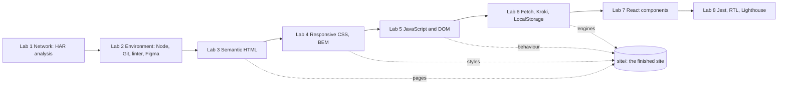

# ITiVP, Part 1: detailed study guide for the defence

Russian version: `30-PART1-ITIVP-OVERVIEW.md`. Branch `work/part1-finish`. Project theme DSLKit (SaaS: a "diagrams as code" editor), variant 26 (even). Part 1 is eight labs that build one site step by step, from network analysis to tests and Lighthouse. For Part 2 see `31-PART2-ITIVP-OVERVIEW.en.md`.

## 1 How Part 1 becomes one product

The result lives in `site/`: a Russian and an English home page, four application screens (welcome, dashboard, editor, settings), error pages, 27 diagram notations, four rendering engines, light and dark themes. Each lab has a folder `labs/0N-...` with its own README, tests and reports in two languages (`report.md`, `report.en.md`, built from the `report.tpl.md` templates by `npm run labN:report`).

## 2 Status and walk-through per lab

| Lab | Topic | What is handed in | Status |
| --- | --- | --- | --- |
| 1 | Network analysis of draw.io: HAR, DevTools | report, HAR analysis script, figures | accepted |
| 2 | Working environment | environment check, ESLint/Prettier, Figma links | accepted |
| 3 | Semantic markup and Schema.org | pages, W3C Nu check, microdata | done |
| 4 | Responsive CSS: Flexbox, Grid, mobile-first, BEM | styles, a no-JS burger, a three-width check | done |
| 5 | Events, DOM, LocalStorage, ES6 modules | accordion, burger, notation filter, form | done |
| 6 | Fetch, async/await, Kroki API, cache | engines, cache, history, offline | done |
| 7 | React components | `react-app/` with at least 5 components | done |
| 8 | Front-end tests | Jest, RTL, coverage, Lighthouse before and after | done |

Overall: 525 automated tests, 100% code coverage of lines, branches and functions (the threshold is enforced by `npm test`), 53 negative scenarios (bad input, network failures, damaged storage), a security audit with no findings.

### Lab 1. Network and developer tools
- **What to understand:** HTTP request and response, status codes, headers (`Cache-Control`, `Content-Type`), caching, compression, HTTP/2, WebSocket in draw.io, the DNS, TCP, TLS chain. HAR is a JSON log of the browser's network requests.
- **What was done:** `analyze-har.js` counts requests, size, the heaviest resources and timing; figures are generated by a script, the report is built from a template.
- **Likely questions:** how browser cache differs from `ETag`; why `Content-Encoding: gzip`; what a "waterfall" on the Network tab is; how HTTP/2 differs from HTTP/1.1.

### Lab 2. Environment
- **What to understand:** Node and npm versions, `package.json` and `package-lock.json`, scripts, Git branches, linter and formatter, environment variables, DevTools.
- **What was done:** `npm run check:env` checks versions and tools; Figma asset export; one report build; one branch per work.
- **Questions:** why a lock file; `dependencies` vs `devDependencies`; how to revert a commit; what ESLint does versus Prettier.

### Lab 3. Semantic HTML
- **What to understand:** `header`, `nav`, `main`, `section`, `article`, `aside`, `footer`, the `h1`–`h6` hierarchy, `alt` on images, `lang`, `meta viewport`, `canonical`, `hreflang`, Schema.org microdata (`SoftwareApplication`, `FAQPage`), accessibility (`aria-*`, a skip link).
- **What was done:** Russian and English home pages, 15 pages with no errors in the W3C Nu Validator, a link check (300 links, none broken), error pages 400, 403, 404, 405, 500.
- **Questions:** `section` vs `article`; why one `h1`; what Schema.org gives; how to check accessibility.

### Lab 4. Responsive CSS
- **What to understand:** mobile-first and `min-width` media queries, Flexbox and Grid (when to use which), CSS variables (`--token`), BEM (block, element, modifier), `rem` instead of `px`, a burger on `:checked` without JavaScript, contrast and `prefers-color-scheme`.
- **What was done:** tokens in `site/css/variables.css` (font and spacing scales on the golden ratio), a test that every HTML class has a CSS rule, a three-width check.
- **Questions:** Flexbox vs Grid; what mobile-first is; why BEM; how the burger works without JS.

### Lab 5. JavaScript and DOM
- **What to understand:** event delegation, `addEventListener`, `preventDefault`, `localStorage` (strings only, `JSON.stringify`), form validation, ES6 modules (`import`/`export`), safe text output (`textContent`, not `innerHTML`).
- **What was done:** FAQ accordion, burger, notation filter, waitlist form, an editor with code checking, a problems panel, settings.
- **Questions:** what bubbling and delegation are; `localStorage` vs cookies; how to defend from XSS.

### Lab 6. Async and API
- **What to understand:** `fetch`, `async/await`, `AbortController` (cancelling), response codes and error handling, timeouts, a cache with a lifetime, offline mode, `Promise.all`.
- **What was done:** the Kroki service draws Graphviz, Mermaid and PlantUML from text; an own engine draws SVG right in the browser with no network; SVG cache and history; stripping scripts from foreign SVG (`sanitizeSvg`); the diagram field blurs while drawing; on an error the old drawing is hidden (decided on 22 October).
- **Questions:** why cancel a request; what happens offline; how to defend from malicious SVG; `async/await` vs a `then` chain.

### Lab 7. React components
- **What to understand:** a component is a function, `props` pass data down, a list needs `key`, conditional output, placeholder events; there is no state in this lab (`useState`, `useEffect` are not covered yet).
- **What was done:** a Vite app in `react-app/` with basic and domain components and mock data.
- **Questions:** why `key`; `props` vs state; what JSX is.

### Lab 8. Testing
- **What to understand:** unit and component tests, Jest and React Testing Library (queries by role and text, not by class), coverage, Lighthouse (performance, accessibility, best practices, SEO), function mocks.
- **What was done:** `react-app` tests with coverage, Lighthouse before and after fixes, reports in two languages.
- **Questions:** unit vs integration test; what 100% coverage means and why it does not guarantee no bugs; how to improve a Lighthouse score.

## 3 The editor: the main product of Part 1

- **Notations (27):** UML (class, sequence, state and more), BPMN, ER, DFD, IDEF0, Petri nets, graphs, timing and others; a description is written as DSL text, parsed in `site/js/notations/`.
- **Engines (4):** Graphviz, Mermaid, PlantUML through Kroki, and an own engine in the browser. The choice is only in the settings, the engine name is in the editor's status line.
- **Flow:** text → parse → engine input → Kroki request or local drawing → SVG cleaning → display → cache and history.
- **Theme:** colours of foreign SVG and of the own engine follow the light and dark theme.
- **States:** loading (the field is blurred, clicks off), error (a clear text, the old drawing hidden), offline (a saved copy if there is one).
- **Mockups:** 27 notations × 4 engines × RU/EN, with and without a hint (432 frames in `docs/design-contest/mockups/`), contact sheets in `docs/design-contest/sheets/`.

## 4 Quality and security

- Tests: `npm test` from the root runs all Part 1 tests with a 100% coverage threshold.
- Security: a strict CSP, output through `textContent`, SVG cleaning, no secrets in the repository, input checks with bounds (huge values, whitespace, control characters).
- Clean code and architecture: functions are split into small ones, limits live in one place, dependencies point inward (a notation parser knows nothing about the DOM). The second refactoring round (`App.jsx` of lab 5, the notation render functions) is still ahead.

## 5 What is left for the owner

- Checks in Firefox and Edge and screenshots (`docs/notes/12-owner-screenshots.md`).
- Google Rich Results Test (needs the site published; the owner passes the captcha).
- Signing in to Figma to upload the mockups.
- Merging the branch into `main` and pushing.

## 6 Questions most often asked about Part 1

1. How does your site work from typed text to the picture? (the flow in section 3)
2. What happens without the internet? (the own engine and the cache)
3. How do you defend from malicious SVG and XSS?
4. Why 100% coverage and how do you check it?
5. How does mobile-first differ from desktop-first?
6. Why semantic tags and Schema.org?
7. What did Lighthouse show and what did you improve?
