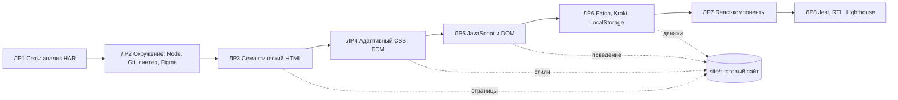

# ИТиВП, Часть 1: подробный разбор для защиты

Английская версия: `30-PART1-ITIVP-OVERVIEW.en.md`. Ветка `work/part1-finish`. Тема проекта DSLKit (SaaS: редактор диаграмм «как код»), вариант 26 (чётный). Часть 1 состоит из восьми лабораторных, которые строят один сайт шаг за шагом: от анализа сети до тестов и Lighthouse. Для Части 2 см. `31-PART2-ITIVP-OVERVIEW.md`.

## 1 Как Часть 1 складывается в один продукт

Результат лежит в папке `site/`: главная страница на русском и английском, четыре экрана приложения (приветствие, панель, редактор, настройки), страницы ошибок, 27 нотаций диаграмм, четыре движка отрисовки, светлая и тёмная темы. Каждая лабораторная имеет папку `labs/0N-...` со своим README, тестами и отчётами на двух языках (`report.md`, `report.en.md`, собираются из шаблонов `report.tpl.md` командой `npm run labN:report`).

## 2 Статус и разбор по лабораторным

| Работа | Тема | Что сдаётся | Статус |
| --- | --- | --- | --- |
| ЛР1 | Сетевой анализ draw.io: HAR, DevTools | отчёт, скрипт разбора HAR, рисунки | принята |
| ЛР2 | Рабочее окружение | проверка окружения, ESLint/Prettier, ссылки на Figma | принята |
| ЛР3 | Семантическая разметка и Schema.org | страницы, проверка в W3C Nu, микроразметка | сделана |
| ЛР4 | Адаптивный CSS: Flexbox, Grid, mobile-first, БЭМ | стили, бургер без JavaScript, проверка на трёх ширинах | сделана |
| ЛР5 | События, DOM, LocalStorage, ES6-модули | аккордеон, бургер, фильтр нотаций, форма | сделана |
| ЛР6 | Fetch, async/await, API Kroki, кэш | движки, кэш, история, офлайн | сделана |
| ЛР7 | React-компоненты | `react-app/` с ≥5 компонентами | сделана |
| ЛР8 | Тесты фронтенда | Jest, RTL, покрытие, Lighthouse до и после | сделана |

Общее: 525 автотестов, покрытие кода 100% по строкам, ветвям и функциям (порог проверяется командой `npm test`), 53 негативных сценария (неверный ввод, сбои сети, повреждённое хранилище), аудит безопасности без замечаний.

### ЛР1. Сеть и инструменты разработчика
- **Что нужно понимать:** запрос и ответ HTTP, статус-коды, заголовки (`Cache-Control`, `Content-Type`), кэш, сжатие, HTTP/2, WebSocket в редакторе draw.io, цепочка DNS, TCP, TLS. HAR это журнал сетевых запросов браузера в JSON.
- **Что сделано:** скрипт `analyze-har.js` считает число запросов, объём, самые тяжёлые ресурсы, время; рисунки генерируются скриптом, отчёт собирается из шаблона.
- **Вероятные вопросы:** чем отличается кэш браузера от `ETag`; зачем `Content-Encoding: gzip`; что такое «водопад» на вкладке Network; чем HTTP/2 отличается от HTTP/1.1.

### ЛР2. Окружение
- **Что нужно понимать:** версии Node и npm, `package.json` и `package-lock.json`, скрипты, Git-ветки, линтер и форматтер, переменные окружения, DevTools.
- **Что сделано:** `npm run check:env` проверяет версии и инструменты; экспорт ресурсов Figma; единая сборка отчётов; ветки по одной на работу.
- **Вопросы:** зачем lock-файл; чем `dependencies` отличаются от `devDependencies`; как откатить коммит; что делает ESLint, а что Prettier.

### ЛР3. Семантический HTML
- **Что нужно понимать:** `header`, `nav`, `main`, `section`, `article`, `aside`, `footer`, иерархия заголовков `h1`–`h6`, `alt` у изображений, `lang`, `meta viewport`, `canonical`, `hreflang`, микроразметка Schema.org (`SoftwareApplication`, `FAQPage`), доступность (`aria-*`, ссылка «перейти к содержимому»).
- **Что сделано:** русская и английская главные, 15 страниц без ошибок в W3C Nu Validator, проверка ссылок (300 ссылок, битых нет), страницы ошибок 400, 403, 404, 405, 500.
- **Вопросы:** чем `section` отличается от `article`; зачем один `h1`; что даёт Schema.org; как проверить доступность.

### ЛР4. Адаптивный CSS
- **Что нужно понимать:** mobile-first и `min-width` в медиазапросах, Flexbox и Grid (когда что), CSS-переменные (`--token`), БЭМ (блок, элемент, модификатор), `rem` вместо `px`, бургер-меню на `:checked` без JavaScript, контрастность и `prefers-color-scheme`.
- **Что сделано:** токены в `site/css/variables.css` (шкала шрифтов и отступов на золотом сечении), тест «каждый класс из HTML имеет правило в CSS», проверка трёх ширин.
- **Вопросы:** чем Flexbox отличается от Grid; что такое mobile-first; зачем БЭМ; как работает бургер без JS.

### ЛР5. JavaScript и DOM
- **Что нужно понимать:** делегирование событий, `addEventListener`, `preventDefault`, `localStorage` (только строки, `JSON.stringify`), проверка формы, ES6-модули (`import`/`export`), безопасный вывод текста (`textContent`, не `innerHTML`).
- **Что сделано:** аккордеон FAQ, бургер, фильтр нотаций, форма очереди ожидания, редактор с проверкой кода, панель задач, настройки.
- **Вопросы:** что такое всплытие и делегирование; чем `localStorage` отличается от cookie; как защититься от XSS.

### ЛР6. Асинхронность и API
- **Что нужно понимать:** `fetch`, `async/await`, `AbortController` (отмена), коды ответа и обработка ошибок, таймауты, кэш с временем жизни, офлайн-режим, `Promise.all`.
- **Что сделано:** сервис Kroki рисует Graphviz, Mermaid и PlantUML по тексту; собственный движок рисует SVG прямо в браузере без сети; кэш SVG и история; очистка чужого SVG от скриптов (`sanitizeSvg`); поле диаграммы размывается, пока идёт отрисовка; при ошибке старая картинка скрывается (решено 22 октября).
- **Вопросы:** зачем отменять запрос; что произойдёт при офлайне; как защититься от вредного SVG; чем `async/await` отличается от цепочки `then`.

### ЛР7. React-компоненты
- **Что нужно понимать:** компонент это функция, `props` передают данные вниз, список с `key`, условный вывод, события-заглушки; в этой работе нет состояния (`useState`, `useEffect` ещё не изучены).
- **Что сделано:** приложение на Vite в `react-app/` с базовыми и предметными компонентами и мок-данными.
- **Вопросы:** зачем `key`; чем `props` отличаются от состояния; что такое JSX.

### ЛР8. Тестирование
- **Что нужно понимать:** юнит- и компонентные тесты, Jest и React Testing Library (запросы по роли и тексту, а не по классам), покрытие, Lighthouse (производительность, доступность, лучшие практики, SEO), мок функций.
- **Что сделано:** тесты `react-app` с покрытием, Lighthouse до и после правок, отчёты на двух языках.
- **Вопросы:** чем юнит-тест отличается от интеграционного; что значит покрытие 100% и почему оно не гарантирует отсутствия ошибок; как улучшить показатель Lighthouse.

## 3 Редактор: главный продукт Части 1

- **Нотации (27):** UML (классы, последовательности, состояния и др.), BPMN, ER, DFD, IDEF0, сети Петри, графы, тайминги и другие; описание пишется текстом на DSL, разбор в `site/js/notations/`.
- **Движки (4):** Graphviz, Mermaid, PlantUML через Kroki и собственный движок в браузере. Выбор только в настройках, имя движка в строке состояния редактора.
- **Поток:** текст → разбор → описание для движка → запрос к Kroki или локальный рисунок → очистка SVG → показ → кэш и история.
- **Тема:** цвета чужого SVG и собственного движка подчиняются светлой и тёмной теме.
- **Состояния:** загрузка (поле размыто, клики отключены), ошибка (понятный текст, старая картинка скрыта), офлайн (сохранённая копия, если есть).
- **Макеты:** 27 нотаций × 4 движка × RU/EN, с подсказкой и без (432 кадра в `docs/design-contest/mockups/`), контактные листы в `docs/design-contest/sheets/`.

## 4 Качество и безопасность

- Тесты: `npm test` из корня запускает все тесты Части 1 с порогом покрытия 100%.
- Безопасность: строгая CSP, вывод через `textContent`, очистка SVG, отсутствие секретов в репозитории, проверка ввода с границами (огромные значения, пробелы, управляющие символы).
- Чистый код и архитектура: функции разбиты на небольшие, пределы лежат в одном месте, зависимости направлены внутрь (разбор нотации не знает про DOM). Второй круг рефакторинга (`App.jsx` ЛР5, функции отрисовки нотаций) ещё впереди.

## 5 Что остаётся владельцу

- Проверка в Firefox и Edge и снимки (`docs/handover/12-owner-screenshots.md`).
- Rich Results Test Google (нужна публикация сайта, капчу ассистент не проходит).
- Вход в Figma для загрузки макетов.
- Слить ветку в `main` и запушить.

## 6 Вопросы, которые чаще всего задают по Части 1

1. Как работает ваш сайт от ввода текста до картинки? (поток из раздела 3)
2. Что будет без интернета? (собственный движок и кэш)
3. Как вы защищаетесь от вредного SVG и XSS?
4. Почему покрытие 100% и чем вы это проверяете?
5. Чем mobile-first отличается от desktop-first?
6. Зачем нужны семантические теги и Schema.org?
7. Что показал Lighthouse и что вы улучшили?
