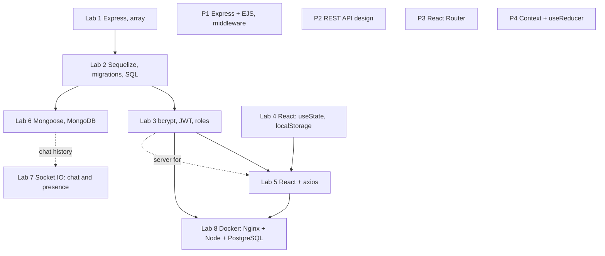

# ITiVP, Part 2: detailed study guide for the defence

Russian version: `31-PART2-ITIVP-OVERVIEW.md`. Part 2 is server and client development: eight labs (1–8), four practicals (P1–P4) and a course project. The theme is the same, DSLKit, variant 26 (even). Detailed guides to every work are the files `10`–`21` in this folder. For Part 1 see `30-PART1-ITIVP-OVERVIEW.en.md`.

## 1 Map: how the works connect

Principle: each work takes the previous one and adds exactly one new idea. Lab 1→2: the array is replaced by a database; 2→3: users and a token are added; 3+4→5: the client talks to the server; 2→6: SQL is replaced by documents; 3+5→8: everything is packed into containers. P1–P4 are separate small apps, one topic each.

## 2 Table of works

| Work | Branch | Folder (`part-2/`) | Main idea | Data | Tests |
| --- | --- | --- | --- | --- | --- |
| 67 || Lab 1 | lab21 | lab-01-node-server | REST API on Express, layers | in-memory array | 64 |
| 101 || Lab 2 | lab12 | lab-02-sequelize | ORM, migrations, 1:N link, 409 | SQLite or PostgreSQL | 98 |
| 125 || Lab 3 | 23 | lab-03-auth | bcrypt, JWT, roles, brute-force defence | SQLite or PostgreSQL | 121 |
| 87 || Lab 4 | 24 | lab-04-react-state | useState, useEffect, localStorage | localStorage | 84 |
| 100 || Lab 5 | 25 | lab-05-react-api | axios, token, optimistic updates | the lab 3 server | 92 |
| Lab 6 | 26 | lab-06-mongodb | documents, indexes, aggregation | MongoDB | 136 |
| Lab 7 | 27 | lab-07-websocket | Socket.IO, rooms, presence | memory or MongoDB | 90 |
| 10 || Lab 8 | 28 | lab-08-docker | Dockerfile, Compose, Nginx, healthcheck | PostgreSQL in a container | 9 |
| 101 || P1 | pz21 | pz-01-middleware-ejs | middleware, EJS, CSRF | array + log table | 99 |
| 68 || P2 | pz22 | pz-02-rest-api | REST design, three linked resources | arrays | 67 |
| P3 | pz23 | pz-03-routing | React Router, protected routes | localStorage (sign-in) | 86 |
| P4 | pz24 | pz-04-context-reducer | Context, useReducer | localStorage | 59 |
| Course project | course-project | separate | not checked | | |

(Test counts come from the latest `npm test` runs; the counts for labs 6, 1, 4 and P1, P2 include the report tests.)

## 3 What all the works share

- **One structure.** Layers: routes, controllers, model or store, middleware, one error handler. In React: components receive data through props, one owner holds the state, hooks are separate.
- **One error format.** `{ "error": ... }` with code 400, 401, 403, 404, 405, 409, 413, 415, 429, 500 or 503. For 5xx the client gets a generic text, details only go to the console.
- **Limits in one file.** `limits.json` in every work: lengths, body sizes, counts. No magic numbers in code.
- **Input checked at the edges.** Whitespace, `{}`, `1.5`, `-1`, huge numbers, control characters, repeated keys, operator injection (`$ne` in MongoDB). Each work has `NEGATIVE-TESTS.md` and a set of negative tests.
- **Security.** Headers (CSP, `nosniff`, `no-store`), secrets only in `.env`, passwords only as hashes, rate limiters, CSRF protection (P1), an `Origin` check (lab 7), no secrets in the repository; summary in `docs/study/02-SECURITY-AUDIT.md`.
- **Even variant 26.** The request log is written to a database table or collection (labs 2, 3, 6, P1). In lab 1 and P2 the array stays by the assignment.
- **Reports and READMEs in two languages.** `report.md` and `report.en.md` are built from templates by `node tools/build.js part-2/<folder>`; app code is inserted automatically, so after a code change the report must be rebuilt (otherwise the report test fails).

## 4 Summary of data storage options

| Option | Works | Pros | Cons |
| --- | --- | --- | --- |
| In-memory array | Lab 1, P1, P2 | simple, fast | data vanishes on restart |
| SQL + ORM (Sequelize) | Labs 2, 3, 8 | links, constraints, migrations | rigid schema |
| Documents (Mongoose) | Lab 6, lab 7 history | flexible, nested data | no joins, the document grows |
| `localStorage` | Lab 4, P3, P4, lab 5 token | no server needed | readable by page scripts, about 5 MB |
| Log table | Labs 2, 3, 6, P1 | requirement of the even variant | a write per request |

## 5 Cross-cutting topics that get asked

1. **Authentication and authorization** (lab 3): bcrypt, JWT, roles, 401 vs 403, login lock.
2. **Migrations vs `sync()`** (lab 2).
3. **Links and constraints** (labs 2, 6, P2): 1:N, uniqueness and 409, cascades.
4. **State in React** (labs 4, 5, P3, P4): local, server, global (Context + reducer).
5. **Optimistic updates and request cancelling** (lab 5).
6. **Real time** (lab 7): rooms, acknowledgements, scaling.
7. **Containers** (lab 8): image vs container, volumes, networks, healthcheck.
8. **Middleware and handler order** (P1, all server works).
9. **REST design** (P2): resources, methods, codes, versioning.
10. **Testing**: unit, integration, negative scenarios, coverage.

## 6 Teacher extras (forecast) and their state

The list is from the consilium of 17 October (`docs/handover/10-consilium-2026-10-17.md`). For the works you marked, everything important is already done or added: answers to questions n−1, n, n+1 in the reports, `createdAt` in lab 1, PATCH, a numeric field `>= 0`, the 1:N link and 409 in lab 2, a way to trigger a 500, "Edit" and "Delete" buttons in P1, `GET /api/users/:id/projects` in P2, filter, `lazy`, breadcrumbs and an admin role in P3, quantity in the reducer and context in P4, "Load more" in lab 5, `PATCH`, sorting and a counter in lab 6, history in MongoDB and a token in lab 7.

## 7 What is left for the owner

- Screenshots of Postman, the database structure, DevTools.
- Atlas (lab 6) and PostgreSQL (labs 2, 3).
- Docker: `docker compose up --build` from scratch and Docker Hub (lab 8).
- Questions for the teacher: the even variant and the database in lab 1, React Router v6 or v7, the 500 page in client-only works, SQLite or PostgreSQL.
- Merge the branches and push.

## 8 Questions most often asked about Part 2

1. How does a request travel from the client to the database and back in your work? (the request-path diagram in every guide)
2. Why is a password stored as a hash and how does the token work?
3. What happens if the database is unavailable? (503 or 500, `/health`)
4. How do you defend from large and strange data?
5. How does PUT differ from PATCH?
6. Why migrations, and what is wrong with `sync()`?
7. How to scale the app over several servers?
8. Show the work from scratch in Docker.
