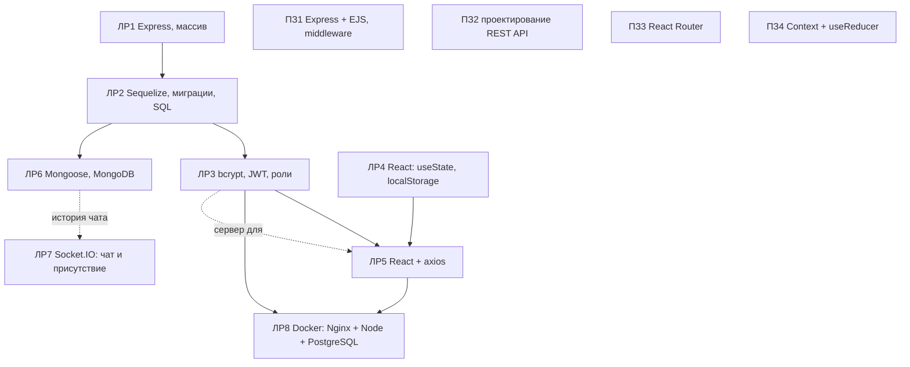

# ИТиВП, Часть 2: подробный разбор для защиты

Английская версия: `31-PART2-ITIVP-OVERVIEW.en.md`. Часть 2 это серверная и клиентская разработка: восемь лабораторных (ЛР1–ЛР8), четыре практических занятия (ПЗ1–ПЗ4) и курсовой проект. Тема та же, DSLKit, вариант 26 (чётный). Подробные разборы каждой работы: файлы `10`–`21` в этой папке. Часть 1 см. `30-PART1-ITIVP-OVERVIEW.md`.

## 1 Карта: как работы связаны

Принцип: каждая работа берёт предыдущую и добавляет ровно одну новую идею. ЛР1→ЛР2: массив заменён базой; ЛР2→ЛР3: добавлены пользователи и токен; ЛР3+ЛР4→ЛР5: клиент ходит на сервер; ЛР2→ЛР6: SQL заменён документами; ЛР3+ЛР5→ЛР8: всё упаковано в контейнеры. ПЗ1–ПЗ4 это отдельные небольшие приложения на одну тему каждое.

## 2 Таблица работ

| Работа | Ветка | Папка (`part-2/`) | Главная идея | Данные | Тесты |
| --- | --- | --- | --- | --- | --- |
| ЛР1 | lab21 | lab-01-node-server | REST API на Express, слои | массив в памяти | 67 |
| 101 || ЛР2 | lab12 | lab-02-sequelize | ORM, миграции, связь 1:N, 409 | SQLite или PostgreSQL | 98 |
| 125 || ЛР3 | 23 | lab-03-auth | bcrypt, JWT, роли, защита от подбора | SQLite или PostgreSQL | 121 |
| 87 || ЛР4 | 24 | lab-04-react-state | useState, useEffect, localStorage | localStorage | 84 |
| 100 || ЛР5 | 25 | lab-05-react-api | axios, токен, оптимистичные обновления | сервер ЛР3 | 92 |
| ЛР6 | 26 | lab-06-mongodb | документы, индексы, агрегации | MongoDB | 136 |
| ЛР7 | 27 | lab-07-websocket | Socket.IO, комнаты, присутствие | память или MongoDB | 90 |
| 10 || ЛР8 | 28 | lab-08-docker | Dockerfile, Compose, Nginx, healthcheck | PostgreSQL в контейнере | 9 |
| 101 || ПЗ1 | pz21 | pz-01-middleware-ejs | middleware, EJS, CSRF | массив + таблица журнала | 99 |
| 68 || ПЗ2 | pz22 | pz-02-rest-api | проектирование REST, три связанных ресурса | массивы | 67 |
| ПЗ3 | pz23 | pz-03-routing | React Router, защищённые маршруты | localStorage (вход) | 86 |
| ПЗ4 | pz24 | pz-04-context-reducer | Context, useReducer | localStorage | 59 |
| Курсовой | course-project | отдельно | не проверялся | | |

(Число тестов взято из последних прогонов `npm test`; в числах ЛР6, ЛР1, ЛР4, ПЗ1, ПЗ2 учтены тесты отчётов.)

## 3 Что общего у всех работ

- **Единая структура.** Слои: маршруты, контроллеры, модель или хранилище, промежуточные обработчики, единый обработчик ошибок. В React: компоненты получают данные через props, состояние держит один владелец, хуки вынесены отдельно.
- **Единый формат ошибок.** `{ "error": ... }` с кодом 400, 401, 403, 404, 405, 409, 413, 415, 429, 500 или 503. Для 5xx клиенту отдаётся общий текст, подробности только в консоль.
- **Пределы в одном файле.** `limits.json` у каждой работы: длины, размеры тела, числа. Никаких «магических чисел» в коде.
- **Проверка ввода на границах.** Пробелы, `{}`, `1.5`, `-1`, огромные числа, управляющие символы, повторяющиеся ключи, внедрение операторов (`$ne` в MongoDB). У каждой работы есть `NEGATIVE-TESTS.md` и набор негативных тестов.
- **Безопасность.** Заголовки (CSP, `nosniff`, `no-store`), секреты только в `.env`, пароли только хешем, ограничители частоты, защита от CSRF (ПЗ1), проверка `Origin` (ЛР7), отсутствие секретов в репозитории; сводка в `docs/study/02-SECURITY-AUDIT.md`.
- **Чётный вариант 26.** Журнал запросов пишется в таблицу или коллекцию базы данных (ЛР2, ЛР3, ЛР6, ПЗ1). В ЛР1 и ПЗ2 по условию остаётся массив.
- **Отчёты и README на двух языках.** `report.md` и `report.en.md` собираются из шаблонов командой `node tools/build.js part-2/<папка>`; код в приложениях вставляется автоматически, поэтому после правки кода отчёт нужно пересобрать (иначе тест отчёта падает).

## 4 Сводка по способам хранения данных

| Способ | Работы | Плюсы | Минусы |
| --- | --- | --- | --- |
| Массив в памяти | ЛР1, ПЗ1, ПЗ2 | просто, быстро | данные пропадают при перезапуске |
| SQL + ORM (Sequelize) | ЛР2, ЛР3, ЛР8 | связи, ограничения, миграции | схема жёсткая |
| Документы (Mongoose) | ЛР6, история ЛР7 | гибкость, вложенные данные | нет соединений, документ растёт |
| `localStorage` | ЛР4, ПЗ3, ПЗ4, токен ЛР5 | не нужен сервер | доступно скриптам страницы, до ~5 МБ |
| Таблица журнала | ЛР2, ЛР3, ЛР6, ПЗ1 | требование чётного варианта | запись на каждый запрос |

## 5 Сквозные темы, по которым спрашивают

1. **Аутентификация и авторизация** (ЛР3): bcrypt, JWT, роли, 401 и 403, блокировка входа.
2. **Миграции против `sync()`** (ЛР2).
3. **Связи и ограничения** (ЛР2, ЛР6, ПЗ2): 1:N, уникальность и 409, каскады.
4. **Состояние в React** (ЛР4, ЛР5, ПЗ3, ПЗ4): локальное, серверное, глобальное (Context + reducer).
5. **Оптимистичные обновления и отмена запросов** (ЛР5).
6. **Реальное время** (ЛР7): комнаты, подтверждения, масштабирование.
7. **Контейнеры** (ЛР8): образ и контейнер, тома, сети, healthcheck.
8. **Middleware и порядок обработчиков** (ПЗ1, все серверные работы).
9. **Проектирование REST** (ПЗ2): ресурсы, методы, коды, версионирование.
10. **Тестирование**: юнит, интеграция, негативные сценарии, покрытие.

## 6 Допы преподавателя (прогноз) и состояние

Список из консилиума 17 октября (`docs/handover/10-consilium-2026-10-17.md`). Для работ, которые вы отметили, всё важное уже сделано или добавлено: ответы на вопросы n−1, n, n+1 в отчётах, `createdAt` в ЛР1, PATCH, числовое поле `>= 0`, связь 1:N и 409 в ЛР2, способ вызвать 500, кнопки «Изменить» и «Удалить» в ПЗ1, `GET /api/users/:id/projects` в ПЗ2, фильтр, `lazy`, крошки и роль admin в ПЗ3, количество в редьюсере и контекст в ПЗ4, «Загрузить ещё» в ЛР5, `PATCH`, сортировка и счётчик в ЛР6, история в MongoDB и токен в ЛР7.

## 7 Что остаётся владельцу

- Скриншоты Postman, структуры БД, DevTools.
- Atlas (ЛР6) и PostgreSQL (ЛР2, ЛР3).
- Docker: `docker compose up --build` с нуля и Docker Hub (ЛР8).
- Вопросы преподавателю: чётный вариант и БД в ЛР1, React Router v6 или v7, страница 500 в клиентских работах, SQLite или PostgreSQL.
- Слить ветки и запушить.

## 8 Вопросы, которые чаще всего задают по Части 2

1. Как устроен запрос от клиента до базы и обратно в вашей работе? (схема пути запроса в каждом разборе)
2. Почему пароль хранится хешем и как работает токен?
3. Что произойдёт, если база недоступна? (503 или 500, `/health`)
4. Как вы защищаетесь от больших и странных данных?
5. Чем PUT отличается от PATCH?
6. Зачем миграции и чем плохо `sync()`?
7. Как масштабировать приложение на несколько серверов?
8. Покажите работу с нуля в Docker.
