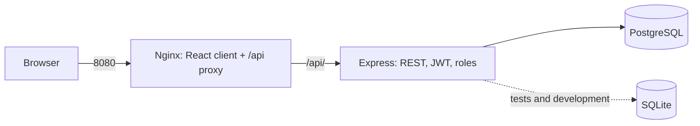

# DSLKit course project: study guide for the defence

Russian version: `32-COURSE-PROJECT.md`. The explanatory note lives in the branch `course-project`, folder `course-project/` (`note.md` in Russian, `note.en.md` in English, Mermaid diagrams in `diagrams/`, screenshots in `screenshots/`). The structure follows the assignment file "Structure of the explanatory note". The main part is 20–30 pages, with 15–20 sources.

## 1 What the project is in one minute

The web application "DSLKit": storing and editing diagrams from their text description, with password login and roles. It is an integrated stack from the Part 2 labs: the server from lab 3 (Express, Sequelize, bcrypt, JWT), the client from lab 5 (React, axios), and the packaging from lab 8 (Docker Compose, Nginx, PostgreSQL). MongoDB (lab 6) and WebSocket (lab 7) are not part of the main stack and are named as prospects.

Three functional modules, as the assignment requires: authentication (registration and login), diagrams (CRUD, search, pages) and administration (user list, role change, user deletion).

## 2 How the note is built

| Section | What is inside | Where to check |
| --- | --- | --- |
| Introduction | relevance, goal, five tasks, object and subject, significance | `note.md`, "Введение" |
| Chapter 1 | requirements FR1–FR12 and NFR1–NFR9, use case diagram, C4 scheme, REST API table, ER diagram | `diagrams/*.mmd` |
| Chapter 2 | stack and its justification, server (structure, models, API, JWT, errors), client (routes, state, axios, responsiveness), Docker, deployment, tests | code in appendices A–C |
| Chapter 3 | user guide, 18 test cases | table 7 |
| Conclusion, sources | results, 20 sources | list at the end |
| Appendices A–G | code, Docker, test data, diagrams, service recommendations, screenshots | |

## 3 What to understand and be able to explain

- **Architecture.** The client does not know the server address: requests go to `/api` and Nginx forwards them to the server (no CORS and no baked-in address). The server is split into routes, controllers, models and middleware. The database is reachable only from the server.
- **Data.** Three entities: user (`Users`), diagram (`Diagrams`, owner `ownerId`) and request log (`RequestLogs`, a requirement of the even variant). One-to-many link, foreign key `RESTRICT`: a user with diagrams cannot be deleted, the answer is 409. The assignment recommends 4–6 entities; a variant with a fourth entity is described in `er-planned.mmd` and is not implemented. Worth discussing with the teacher in advance.
- **Security.** Passwords only as a bcrypt hash, an HS256 token with a lifetime, the role read from the database on every request, a login lock after five failures, rate limiters, input limits in `limits.json`, security headers built by hand without `helmet` (a deliberate choice, explained in 2.2.5), a 500 answer without the cause text.
- **Client.** List state in a hook, optimistic updates with rollback, cancelling outdated requests, debounced search, "Load more", automatic retry of the list read.
- **Deployment.** `docker compose up --build` starts three services, the database is waited for by `pg_isready`, data is in the `pgdata` volume, secrets only in `.env`.
- **Tests.** 135 server tests on a temporary SQLite database with real migrations, 100 client tests, static Docker checks.

## 4 Likely defence questions

1. Why PostgreSQL and not MongoDB? (links, constraints, transactions, migrations)
2. Why JWT and not sessions? How to revoke a token? (not until it expires, so the lifetime is short and the role comes from the database)
3. How are passwords and login protected? (bcrypt, lock, limiters, one error message)
4. What happens if the database is down? (`/health` answers 503, requests get 500 without details)
5. How does the client talk to the server, and where is CORS? (the Nginx proxy, CORS is not needed; in development one origin is allowed)
6. How to scale? (login counters are in memory, a shared cache is needed; several server copies behind a balancer)
7. How to start from scratch? (`git clone`, `.env`, `docker compose up --build`)
8. How did you test? (unit, integration on a temporary database, negative scenarios, manual test cases)
9. Which requirements are not implemented? (an admin screen in the client, cloud deployment, the fourth entity)

## 5 Write it live

1. **A new role or permission.** A value in `ROLES`, a `requireRole` check, a test for 403.
2. **A new diagram field** (for example `status`): a migration, the model, a check, a field in the client form, a test.
3. **A statistics endpoint** `GET /diagrams/stats`: grouping by notation with `Diagram.findAll` and `group`.
4. **An admin screen** in the client: a page with the `GET /users` list and the role change `PATCH /users/:id/role` (P3 has a ready route protection by role).

## 6 What is left for the owner

- Title page, assignment, contents: prepare in Word by the enterprise standard.
- Agree the topic "DSLKit, a diagram editor as code" with the teacher (it is not in the list of 150 topics).
- Cloud deployment and the application address (Render and Netlify or similar), if required.
- Screenshots of the current client and a run of `docker compose up --build`, the "Actual result" column of the test cases table.
- Access dates for the sources.
