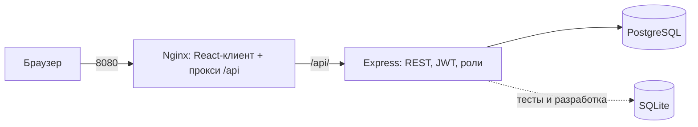

# Курсовой проект DSLKit: разбор для защиты

Английская версия: `32-COURSE-PROJECT.en.md`. Пояснительная записка лежит в ветке `course-project`, папка `course-project/` (`note.md` на русском, `note.en.md` на английском, диаграммы Mermaid в `diagrams/`, снимки в `screenshots/`). Структура записки задана файлом условия «Структура пояснительной записки к курсовой работе». Объём основной части 20–30 страниц, источников 15–20.

## 1 Что это за проект в одну минуту

Веб-приложение «DSLKit»: хранение и редактирование диаграмм по их текстовому описанию с входом по паролю и ролями. Это интегрированный стек из лабораторных Части 2: сервер из ЛР3 (Express, Sequelize, bcrypt, JWT), клиент из ЛР5 (React, axios), упаковка из ЛР8 (Docker Compose, Nginx, PostgreSQL). MongoDB (ЛР6) и WebSocket (ЛР7) в основной стек не входят и названы перспективами.

Три функциональных модуля, как требует условие: аутентификация (регистрация и вход), диаграммы (CRUD, поиск, страницы) и администрирование (список пользователей, смена роли, удаление).

## 2 Как устроена записка

| Раздел | Что внутри | Где проверить |
| --- | --- | --- |
| Введение | актуальность, цель, пять задач, объект и предмет, значимость | `note.md`, «Введение» |
| Глава 1 | требования FR1–FR12 и NFR1–NFR9, диаграмма вариантов использования, схема C4, таблица REST API, ER-диаграмма | `diagrams/*.mmd` |
| Глава 2 | стек и обоснование, сервер (структура, модели, API, JWT, ошибки), клиент (маршруты, состояние, axios, адаптивность), Docker, деплой, тесты | коды в приложениях А–В |
| Глава 3 | руководство пользователя, 18 контрольных примеров | таблица 7 |
| Заключение, источники | выводы, 20 источников | список в конце |
| Приложения А–Ж | код, Docker, исходные данные, диаграммы, рекомендации по сервисам, снимки | |

## 3 Что нужно понимать и уметь объяснить

- **Архитектура.** Клиент не знает адрес сервера: запросы идут на `/api`, Nginx пересылает их серверу (нет CORS и вшитого адреса). Сервер разделён на маршруты, контроллеры, модели и промежуточные обработчики. База доступна только серверу.
- **Данные.** Три сущности: пользователь (`Users`), диаграмма (`Diagrams`, владелец `ownerId`) и журнал запросов (`RequestLogs`, требование чётного варианта). Связь один-ко-многим, внешний ключ `RESTRICT`: пользователя с диаграммами удалить нельзя, ответ 409. Условие рекомендует 4–6 сущностей, вариант с четвёртой сущностью описан в `er-planned.mmd` и не реализован. Это стоит обсудить с преподавателем заранее.
- **Безопасность.** Пароль только хешем bcrypt, токен HS256 со сроком, роль берётся из базы при каждом запросе, блокировка входа после пяти неудач, ограничители частоты, пределы ввода в `limits.json`, заголовки безопасности собраны вручную без `helmet` (осознанный выбор, объясняется в 2.2.5), ответ 500 без текста причины.
- **Клиент.** Состояние списка в хуке, оптимистичные обновления с откатом, отмена устаревших запросов, поиск с задержкой, «Загрузить ещё», автоповтор чтения списка.
- **Развёртывание.** `docker compose up --build` поднимает три сервиса, база ждёт готовности по `pg_isready`, данные в томе `pgdata`, секреты только в `.env`.
- **Тесты.** 135 тестов сервера на временной базе SQLite с настоящими миграциями, 100 тестов клиента, статические проверки Docker.

## 4 Вопросы, которые вероятны на защите

1. Почему выбран PostgreSQL, а не MongoDB? (связи, ограничения, транзакции, миграции)
2. Почему JWT, а не сессии? Как отозвать токен? (нельзя до срока, поэтому срок короткий, роль из базы)
3. Как защищены пароли и вход? (bcrypt, блокировка, ограничители, единое сообщение об ошибке)
4. Что будет, если база недоступна? (`/health` отвечает 503, запросы получают 500 без деталей)
5. Как клиент общается с сервером и где CORS? (прокси Nginx, CORS не нужен; в разработке разрешён один адрес)
6. Как масштабировать? (счётчики входа в памяти, нужен общий кэш; несколько копий сервера за балансировщиком)
7. Как запустить с нуля? (`git clone`, `.env`, `docker compose up --build`)
8. Как вы тестировали? (юнит, интеграционные на временной базе, негативные сценарии, ручные контрольные примеры)
9. Какие требования не реализованы? (экран администратора в клиенте, облачный деплой, четвёртая сущность)

## 5 Допиши при мне

1. **Новая роль или право.** Значение в `ROLES`, проверка `requireRole`, тест на 403.
2. **Новое поле диаграммы** (например, `status`): миграция, модель, проверка, поле в форме клиента, тест.
3. **Эндпоинт статистики** `GET /diagrams/stats`: группировка по нотации через `Diagram.findAll` с `group`.
4. **Экран администратора** в клиенте: страница со списком `GET /users` и сменой роли `PATCH /users/:id/role` (в ПЗ3 есть готовая защита маршрута по роли).

## 6 Что осталось сделать владельцу

- Титульный лист, задание, содержание: оформить в Word по Стандарту предприятия.
- Согласовать тему «DSLKit, редактор диаграмм как кода» с преподавателем (её нет в списке 150 тем).
- Облачный деплой и адрес приложения (Render и Netlify или аналог), если требуется.
- Снимки экранов актуального клиента и запуск `docker compose up --build`, колонка «Фактический результат» в таблице контрольных примеров.
- Даты доступа к источникам.
