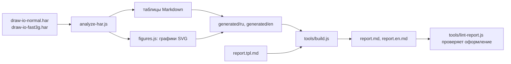
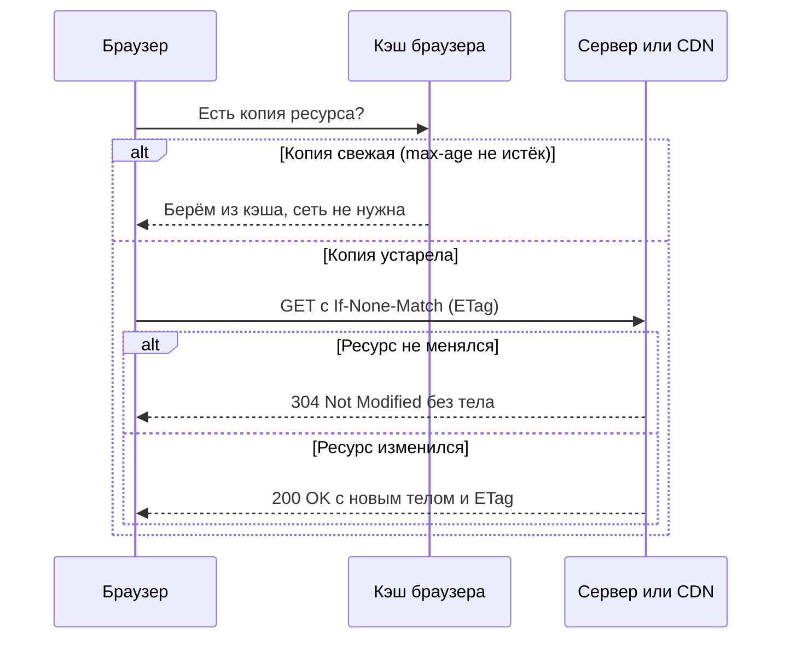

# ЛР1. Анализ сетевых протоколов и инструменты разработчика

Тема: сетевой трафик редактора диаграмм draw.io (`app.diagrams.net`), близкого к DSLKit. Отчёты: [`report.md`](report.md) на русском, [`report.en.md`](report.en.md) на английском.

## 1. Как запускать

```bash
npm install
npm test
npm run lab1:generate
npm run lab1:report
```

- `npm test` запускает все тесты репозитория, порог покрытия 100 процентов.
- `npm run lab1:generate` разбирает файлы `data/*.har` и пишет таблицы и графики в `generated/ru` и `generated/en`.
- `npm run lab1:report` дополнительно собирает `report.md` и `report.en.md` из шаблонов `report.tpl.md` и `report.en.tpl.md`.
- Разбор своего журнала: `node labs/01-network/cli.js мой-обычный.har мой-3g.har ru папка-вывода`.

## 2. Архитектура лабы

```text
labs/01-network/
├── data/                 журналы HAR и скриншот страницы
├── generated/            таблицы и графики, которые строит программа
├── analyze-har.js        разбор HAR: сводка, заголовки, кэш, cookie, безопасность, Timing
├── figures.js            столбчатые диаграммы SVG
├── i18n.js               тексты и пояснения заголовков на русском и английском
├── cli.js                запуск: HAR на входе, таблицы и графики на выходе
├── analyze-har.test.js   тесты
├── report.tpl.md         шаблон отчёта на русском
├── report.en.tpl.md      шаблон отчёта на английском
└── report.md, report.en.md   готовые отчёты
```



Общие инструменты лежат в `tools/`: `lint-report.js` проверяет отчёт по требованиям преподавателя, `build-report.js` подставляет таблицы и листинги в шаблон.

## 3. Условие и задание

Цель: освоить вкладку Network инструментов разработчика и разобрать сетевой обмен реального сайта по теме будущего курсового проекта.

1. Записать загрузку страницы, найти основной документ, статус 200 или 304, число запросов и объём.
2. Разобрать не менее трёх разных запросов (документ, CSS или JS, XHR или изображение): не менее 5 заголовков запроса и 5 заголовков ответа с объяснением.
3. Найти заголовки кэширования (`Cache-Control`, `ETag`, `Last-Modified`), cookie и заголовки безопасности (CSP, HSTS, X-Frame-Options, X-Content-Type-Options).
4. Изучить вкладку Timing и расшифровать фазы запроса.
5. Сравнить загрузку при обычной сети и при Fast 3G или Slow 3G.
6. Отфильтровать запросы по типам, сохранить журнал в формате HAR.
7. Оформить отчёт.

## 4. Технические термины

| Термин        | Что это                                                                        |
| ------------- | ------------------------------------------------------------------------------ |
| HTTP, HTTPS   | Протокол обмена между браузером и сервером; HTTPS добавляет шифрование TLS     |
| HAR           | Файл JSON с записью всех запросов и ответов страницы                           |
| Заголовок     | Пара «имя: значение» в запросе или ответе, управляет поведением обмена         |
| Код состояния | Число в ответе: 200 успех, 304 не изменено, 404 не найдено, 500 ошибка сервера |
| TTFB          | Время до первого байта ответа: работа сервера и задержка сети                  |
| DNS           | Служба, которая превращает имя сайта в IP-адрес                                |
| CDN           | Сеть серверов, отдающих копии ресурсов с ближайшей точки                       |
| Кэш           | Сохранённая копия ресурса, которую браузер использует повторно                 |
| ETag          | Идентификатор версии ресурса для условных запросов                             |
| Cookie        | Небольшие данные, которые сервер просит браузер сохранить и вернуть            |
| CSP           | Политика, которая перечисляет разрешённые источники ресурсов страницы          |
| HSTS          | Требование открывать сайт только по HTTPS                                      |
| Waterfall     | Диаграмма, на которой запросы показаны во времени                              |
| Fast 3G       | Эмуляция медленного мобильного соединения в DevTools                           |

## 5. Теория

Браузер отправляет запрос, сервер возвращает ответ. Для повторных заходов работает кэш: если срок жизни копии не истёк, запрос не нужен, если истёк, браузер проверяет версию условным запросом.



Фазы запроса на вкладке Timing идут по порядку: очередь, DNS Lookup, установка соединения, SSL, отправка запроса, ожидание первого байта (TTFB), загрузка тела.

```mermaid
gantt
  title Фазы запроса документа (мс, обычная сеть)
  dateFormat X
  axisFormat %s
  DNS Lookup        :0, 511
  Initial connection :511, 559
  SSL               :559, 591
  TTFB              :591, 639
  Content Download  :639, 643
```



## 6. Рисунки и диаграммы


## 7. Что нужно сделать вам

1. **Сайт для анализа.** По условию сайт выбирают по генератору вариантов (`E:\ИТиВП\Часть 1\...\27a. Лабораторная работа 1 - Генератор вариантов.html`). Сейчас взят draw.io. Если генератор выдал другую тему, запишите HAR нужного сайта: DevTools, вкладка Network, включите Preserve log, загрузите страницу, правый клик по журналу и Save all as HAR. Положите файл в `data/` и запустите разбор.
2. **Скриншоты DevTools.** Вы решили обойтись без них. Если преподаватель потребует, снимите панель Network с таблицей запросов, вкладку Headers трёх запросов, Timing и результат Fast 3G.
3. **Контрольные вопросы.** По требованию преподавателя отвечают только на вопросы n−1, n, n+1 вашего варианта. Сообщите номер варианта, и лишние ответы будут убраны.
4. **Оформление.** Отчёт в Markdown. Для PDF по СТП соберите документ в Word: `pandoc report.md -f markdown-implicit_figures -o report.docx`, затем примените стили СТП (титульный лист для части 1 не нужен).
5. **Логины.** В этой работе пароли не нужны. Для отправки на GitHub нужен вход в аккаунт в Git Credential Manager (откроется браузер при первом `git push`).

Сиды: журналы `data/draw-io-normal.har` и `data/draw-io-fast3g.har` служат исходными данными для всех таблиц и тестов.
