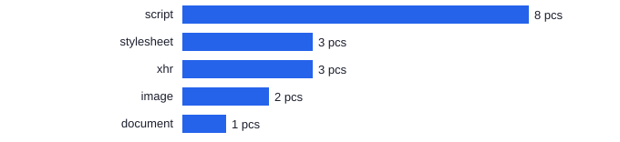
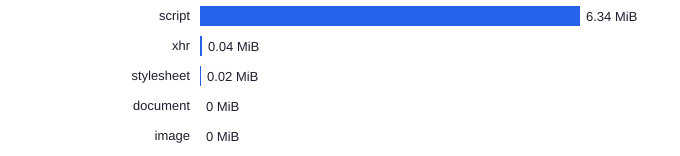
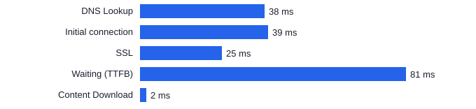
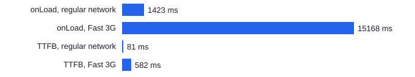

# Laboratory Work 1. Network Protocol Analysis and Developer Tools

## 1 Purpose of the Work

Gain practical skills in analysing web application network traffic: study the structure of HTTP/HTTPS requests and responses, headers, status codes, caching, cookies, security and timing on the example of a site close in topic to the DSLKit course project (a web IDE for diagrams as code).

## 2 Brief Theoretical Background

**Client-server model.** The browser sends an HTTP request and the server returns a response. Each message consists of a start line, headers and an optional body.

**HTTP and HTTPS.** HTTP runs over TCP, HTTP/3 runs over QUIC. HTTPS adds TLS encryption. HTTP/2 and HTTP/3 send several requests over one connection and compress headers.

**Methods.** GET reads a resource, POST creates data or submits a form, PUT replaces a resource, PATCH changes it partially, DELETE removes it.

**Status codes.** Class 1xx means informational, 2xx success (200 OK, 204 No Content), 3xx redirect and cache (301, 302, 304 Not Modified), 4xx client error (404 Not Found), 5xx server error (500 Internal Server Error).

**Headers.** Request headers: `User-Agent`, `Accept`, `Referer`, `Cookie`, `Authorization`. Response headers: `Content-Type`, `Cache-Control`, `Set-Cookie`, `Location`. Security headers: `Content-Security-Policy`, `Strict-Transport-Security`, `X-Frame-Options`, `X-Content-Type-Options`.

**Caching.** `Cache-Control: max-age` sets the lifetime of a copy. The `ETag` and `Last-Modified` headers let a conditional request check freshness and get a 304 response without a body.

**Cookies.** Small pieces of data that the server sets with `Set-Cookie` and the browser returns with `Cookie`: session, preferences, analytics.

**Timing.** Request phases: Queued and Stalled, DNS Lookup, Initial connection, SSL, Request sent, Waiting (TTFB), Content Download.

## 3 Progress of the Work

### 3.1 Site Selection and Justification

The project topic belongs to the SaaS direction, so a service of that type is chosen: https://app.diagrams.net/ (draw.io). It is a cloud web diagram editor with scenarios close to DSLKit: an editor, a canvas, notation templates and export. The network behaviour of such a site is representative for the future project: a heavy client application, shape libraries, API calls and a content delivery network.

### 3.2 Method

The page was loaded in Google Chrome 155 on Windows with an empty cache and without cookies. The log was recorded in the HAR format, as with the Export HAR item on the Network tab. Two runs covered the regular network and Fast 3G emulation (562.5 ms latency, 1.6 Mbit/s download, 750 Kbit/s upload, as in the Chrome DevTools preset). Fast 3G was chosen instead of Slow 3G because the assignment allows both and the load size is 6.40 MiB.

The log files are attached to the work: `labs/01-network/data/draw-io-normal.har` for the regular network and `labs/01-network/data/draw-io-fast3g.har` for Fast 3G. The analysis was made by the program from appendices A, B and C, its tests are described in appendix D. The page after loading is shown in Figure 1.

Figure 1 – The draw.io start page after full loading

### 3.3 Log Analysis Results

The program built the tables below. For three different requests (the main document, a script and a data request) all request and response headers are listed with their purpose, which exceeds the minimum of five headers.

{{include:labs/01-network/generated/en/analysis.md}}

### 3.4 Graphical Presentation of Results

The distribution of requests by resource type is shown in Figure 2: most requests belong to scripts.

Figure 2 – Number of requests by resource type

The distribution of transferred data by type is shown in Figure 3: scripts take 99 percent of the traffic.

Figure 3 – Transferred data volume by resource type in megabytes

The phases of the main document request are shown in Figure 4: the longest phase was DNS Lookup.

Figure 4 – Duration of the main document request phases in milliseconds

The effect of a slow connection is shown in Figure 5: loading under Fast 3G took three times longer and TTFB grew twelve times.

Figure 5 – Load time and TTFB on the regular network and on Fast 3G

### 3.5 Interpretation of Results

**Overview.** The page needed 17 requests with a total size of 6.40 MiB over HTTP/2 and finished loading in 1.4 s (onLoad). Scripts account for 8 requests and 6.34 MiB, the heaviest being `stencils.min.js` (2.78 MiB), `app.min.js` (2.11 MiB) and `extensions.min.js` (1.14 MiB). All requests used the GET method, 16 of them finished with code 200 and one (the `log.diagrams.net` ping) with code 204.

**Caching.** The HTML document is cached for 10 minutes (`max-age=600`) and has no ETag or Last-Modified, so after expiry the browser downloads the whole page again. Static resources such as `stencils.min.js` are cached for 30 days (`max-age=2592000`) and have the weak ETag `W/"SyJN0w"`. The same ETag on different files shows that it is bound to the build version. There is no 304 response in the log because the browser cache was empty.

**Cookies.** Requests carry no `Cookie` header and responses carry no `Set-Cookie`. On the first visit the site sets no cookies and keeps application settings elsewhere.

**Security.** The document has `Content-Security-Policy`, `Strict-Transport-Security: max-age=31536000; includeSubDomains`, `X-Content-Type-Options: nosniff`, `Referrer-Policy: strict-origin` and `Permissions-Policy`. The `X-Frame-Options` header is absent. Protection against embedding in foreign frames can be set with the CSP directive `frame-ancestors`, but it is not visible in the clipped header value.

**Document timing.** The longest phase is TTFB (81 ms), followed by Initial connection 39 ms (it includes SSL 25 ms), DNS Lookup 38 ms and Content Download 2 ms. The server answered quickly and a noticeable part of the time went to name resolution and the secure connection setup.

**Network emulation.** Under Fast 3G the full load time grew from 1423 to 15168 ms (10.7 times) and the document TTFB from 81 to 582 ms (7.2 times) because of the 562.5 ms channel latency. The slowest requests turned out to be `stencils.min.js` (24.4 s), `extensions.min.js` (14.9 s) and `app.min.js` (12.9 s). The data volume did not change, so the slowdown comes from bandwidth and latency rather than server load. DOMContentLoaded grew from 337 to 1508 ms. These are single measurements, so repeated runs are needed for conclusions.

**Filtering by type.** `script` has the most requests (8), followed by `stylesheet` (3), `xhr` (3), `image` (2) and `document` (1). Scripts lead by volume. The log is saved in the HAR format.

## 4 Answers to Control Questions

{{answers}}
1. **Which protocol does the site use?** HTTPS. The address starts with `https://`, the log shows version `HTTP/2.0` and the `Strict-Transport-Security` header pins HTTPS. It can be checked by the URL scheme, the lock icon and the Protocol column on the Network tab.
2. **Which methods occurred?** Only GET (17 of 17): fetching HTML, scripts, styles, images and data. POST, PUT, PATCH and DELETE are not needed for a plain page load, they serve to send and change data, for example when saving a file.
3. **Status codes.** Code 200 OK occurred 16 times, for example for the main document. Code 204 No Content occurred once for the `log.diagrams.net` ping, the response had no body. Code 304 Not Modified appears for a conditional request with `If-None-Match` after the cache expires: the server reports that the copy is fresh. Codes 404 (resource not found) and 500 (internal server error) are absent from the log.
4. **Request headers about the client.** `User-Agent` holds the browser and the operating system, `sec-ch-ua` holds the browser brand and version (`Google Chrome` version 155 in the log, recorded in a regular Chrome with a visible window), `sec-ch-ua-platform` holds the operating system (`"Windows"`).
5. **Response headers controlling caching.** `Cache-Control` (`public, max-age=600` for the document and `public, max-age=2592000` for `stencils.min.js`), `Expires` (the staleness date of the document) and `ETag` (`W/"SyJN0w"` for static files). The `Age` header (340 s for the document) shows the age of the response in the CDN cache.
6. **What are cookies.** Name and value pairs that the server sets with `Set-Cookie` and the browser returns with `Cookie`. They store sessions, preferences and analytics data. On draw.io no cookies passed in either direction on the first visit.
7. **Security headers.** `Content-Security-Policy` limits resource sources and protects against XSS. `Strict-Transport-Security` with `max-age=31536000` enforces HTTPS. `X-Content-Type-Options: nosniff` forbids guessing the content type. The `X-Frame-Options` header is absent, it protects against embedding the page into frames and clickjacking.
8. **The Timing chart.** It shows the request phases from the queue to receiving the body. TTFB (Waiting) is the time from sending the request to the first response byte, that is server work and network latency. Content Download is the transfer time of the body itself. For the document TTFB was 81 ms and the download 2 ms. For the large `stencils.min.js` the download phase is much longer (462 ms) because of its 2.78 MiB size.
9. **Effect of a slow connection.** The document TTFB grew from 81 to 582 ms and the page load time from 1.4 to 15.2 s. Channel latency increases TTFB of every request and low bandwidth increases Content Download of large files: `stencils.min.js` loaded for 24.4 s.
10. **Why a filter is needed.** It keeps only the selected types on the panel (Doc, CSS, JS, XHR, Img, Font), which simplifies finding heavy and redundant resources. The work used the types document (1), stylesheet (3), script (8), xhr (3) and image (2).
11. **What a CDN is and how to detect it.** A content delivery network keeps copies of resources on servers near the user. Signs: `server: cloudflare`, `cf-ray`, `cf-cache-status: HIT` for static files (served from the CDN cache) and `DYNAMIC` for the HTML document, which is not cached at the edge.
12. **How to save the log in the HAR format.** With the Export HAR button on the Network tab. HAR describes requests, responses and timings in JSON. It is needed to reproduce problems, hand them to developers and analyse automatically, as in this work.
13. **What the Referer header carries.** The address of the page that made the request: for subresources it is `https://app.diagrams.net/`, while the document request has no such header because the navigation was started manually. Referer is used for analytics and for protection against CSRF and hotlinking. Privacy is controlled by `Referrer-Policy`, here `strict-origin`.
14. **Why resources come from different domains.** Requests went to three domains: `app.diagrams.net` (14), `apis.google.com` (2, Google API integration) and `log.diagrams.net` (1, statistics collection). Separation gives dedicated servers for different tasks, use of external services, independent scaling and caching.
15. **How to find slow requests.** Sort by the Time column or look at the Waterfall. On the regular network the slowest are `extensions.min.js` (681 ms) and `stencils.min.js` (613 ms), under Fast 3G the slowest is `stencils.min.js` (23.5 s). Optimisation: compression (`br` is already applied), long caching (already 30 days), splitting and lazy loading of shape libraries, `preload` of critical resources, a CDN.
16. **What blocking requests are.** Scripts and styles that the browser loads and processes before continuing rendering: scripts without `async` and `defer`, CSS in `<head>`. They delay the first paint. They can be detected with the Initiator column, the Waterfall and tag attributes in HTML, while a single HAR cannot show whether a script blocks.
{{/answers}}

## Conclusion

The draw.io site uses HTTPS and HTTP/2, serves static resources through the Cloudflare CDN with a 30 day cache, sets no cookies on the first visit and builds its protection on CSP, HSTS and `nosniff`. Most of the page weight, 6.40 MiB, comes from scripts (99 percent), so on a slow connection the load time grows 10.7 times, from 1.4 to 15.2 s. For DSLKit this means that heavy libraries (shapes, a WebAssembly core) must be cached for a long time, loaded lazily and compressed, while the HTML document should stay light.

## Appendix A – Listing of analyze-har.js

{{code:labs/01-network/analyze-har.js}}

## Appendix B – Listing of figures.js

{{code:labs/01-network/figures.js}}

## Appendix C – Listing of cli.js

{{code:labs/01-network/cli.js}}

## Appendix D – Listing of the tests analyze-har.test.js

{{code:labs/01-network/analyze-har.test.js}}
