# Лабораторная работа №1. Анализ сетевых протоколов и инструменты разработчика

## 1 Цель работы

Получить практические навыки анализа сетевого трафика веб-приложения: изучить структуру HTTP/HTTPS-запросов и ответов, заголовки, коды состояния, кэширование, cookie, безопасность и временные характеристики на примере сайта, близкого по теме к курсовому проекту DSLKit (веб-IDE для диаграмм как кода).

## 2 Краткие теоретические сведения

**Клиент-серверная модель.** Браузер отправляет HTTP-запрос, сервер возвращает ответ. Каждое сообщение состоит из стартовой строки, заголовков и необязательного тела.

**HTTP и HTTPS.** HTTP работает поверх TCP, HTTP/3 поверх QUIC. HTTPS добавляет шифрование TLS. Версии HTTP/2 и HTTP/3 передают несколько запросов в одном соединении и сжимают заголовки.

**Методы.** GET читает ресурс, POST создаёт данные или отправляет форму, PUT заменяет ресурс, PATCH изменяет его частично, DELETE удаляет.

**Коды состояния.** Класс 1xx обозначает информационный ответ, 2xx успех (200 OK, 204 No Content), 3xx перенаправление и кэш (301, 302, 304 Not Modified), 4xx ошибку клиента (404 Not Found), 5xx ошибку сервера (500 Internal Server Error).

**Заголовки.** Заголовки запроса: `User-Agent`, `Accept`, `Referer`, `Cookie`, `Authorization`. Заголовки ответа: `Content-Type`, `Cache-Control`, `Set-Cookie`, `Location`. Заголовки безопасности: `Content-Security-Policy`, `Strict-Transport-Security`, `X-Frame-Options`, `X-Content-Type-Options`.

**Кэширование.** Значение `Cache-Control: max-age` задаёт время жизни копии. Заголовки `ETag` и `Last-Modified` позволяют условным запросом проверить актуальность и получить ответ 304 без тела.

**Cookie.** Небольшие данные, которые сервер устанавливает заголовком `Set-Cookie`, а браузер возвращает заголовком `Cookie`: сессия, настройки, аналитика.

**Timing.** Фазы запроса: Queued и Stalled, DNS Lookup, Initial connection, SSL, Request sent, Waiting (TTFB), Content Download.

## 3 Ход работы

### 3.1 Выбор сайта и обоснование

Тема проекта относится к направлению SaaS, поэтому выбран сайт сервиса такого типа: https://app.diagrams.net/ (draw.io). Это облачный веб-редактор диаграмм со сценариями, которые близки к DSLKit: редактор, холст, шаблоны нотаций и экспорт. Сетевое поведение такого сайта показательно для будущего проекта: тяжёлое клиентское приложение, библиотеки шейпов, обращения к API, сеть доставки контента.

### 3.2 Методика

Страница загружена в Google Chrome 155 на Windows с пустым кэшем и без cookie. Журнал записан в формате HAR, как при экспорте через пункт «Export HAR» на вкладке Network. Выполнено два прогона: обычная сеть и эмуляция Fast 3G (задержка 562,5 мс, 1,6 Мбит/с на загрузку, 750 Кбит/с на отдачу, как в пресете Chrome DevTools). Режим Fast 3G выбран вместо Slow 3G, потому что задание допускает оба, а объём загрузки составляет 6,40 МиБ.

Файлы журналов приложены к работе: `labs/01-network/data/draw-io-normal.har` для обычной сети и `labs/01-network/data/draw-io-fast3g.har` для Fast 3G. Разбор выполнен программой из приложений А, Б и В, её проверки описаны в приложении Г. Вид страницы после загрузки показан на рисунке 1.

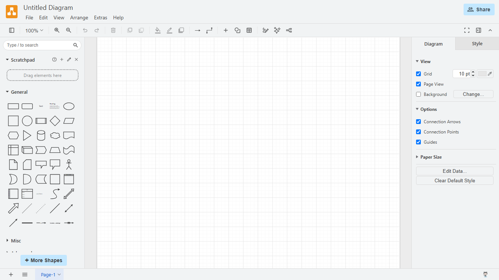

Рисунок 1 – Стартовая страница draw.io после полной загрузки

### 3.3 Результаты анализа журнала

Ниже приведены таблицы, которые построила программа. Для трёх разных запросов (основной документ, скрипт и запрос данных) выведены все заголовки запроса и ответа с назначением, что превышает минимум в пять заголовков.

{{include:labs/01-network/generated/ru/analysis.md}}

### 3.4 Графическое представление результатов

Распределение запросов по типам ресурсов показано на рисунке 2: больше всего запросов относится к скриптам.

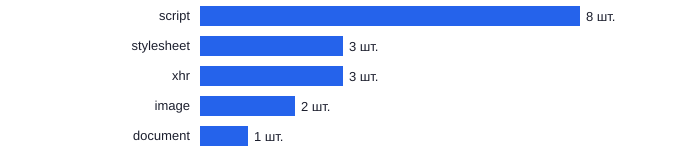

Рисунок 2 – Количество запросов по типам ресурсов

Распределение переданных данных по типам показано на рисунке 3: скрипты занимают 99 процентов трафика.

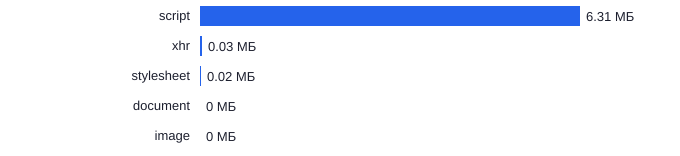

Рисунок 3 – Объём переданных данных по типам ресурсов в мегабайтах

Фазы запроса основного документа показаны на рисунке 4: самой долгой оказалась фаза DNS Lookup.

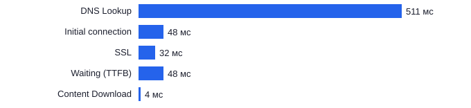

Рисунок 4 – Длительность фаз запроса основного документа в миллисекундах

Влияние медленного соединения показано на рисунке 5: загрузка страницы при Fast 3G заняла втрое больше времени, а TTFB вырос в двенадцать раз.

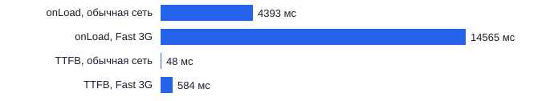

Рисунок 5 – Время загрузки и TTFB при обычной сети и при Fast 3G

### 3.5 Интерпретация результатов

**Общий вид.** Загружено 17 запросов объёмом 6,40 МиБ по протоколу HTTP/2 за 1,4 с (onLoad). Скрипты составляют 8 запросов и 6,34 МиБ, самые тяжёлые из них `stencils.min.js` (2,78 МиБ), `app.min.js` (2,11 МиБ) и `extensions.min.js` (1,14 МиБ). Все запросы выполнены методом GET, 16 из них завершились кодом 200, один (пинг `log.diagrams.net`) кодом 204.

**Кэширование.** HTML-документ кэшируется на 10 минут (`max-age=600`), заголовки ETag и Last-Modified у него отсутствуют, поэтому после истечения срока браузер загрузит страницу целиком. Статические ресурсы, например `stencils.min.js`, кэшируются на 30 дней (`max-age=2592000`) и имеют слабый ETag `W/"SyJN0w"`. Одинаковое значение ETag у разных файлов говорит о привязке к версии сборки. Ответ 304 в журнале отсутствует, потому что кэш браузера был пуст.

**Cookie.** В запросах нет заголовка `Cookie`, в ответах нет `Set-Cookie`. При первом заходе сайт не устанавливает cookie, а настройки приложения хранятся не в них.

**Безопасность.** Для документа заданы `Content-Security-Policy`, `Strict-Transport-Security: max-age=31536000; includeSubDomains`, `X-Content-Type-Options: nosniff`, `Referrer-Policy: strict-origin` и `Permissions-Policy`. Заголовок `X-Frame-Options` отсутствует. Защиту от встраивания в чужие фреймы можно задавать директивой CSP `frame-ancestors`, но в усечённом значении заголовка она не видна.

**Timing документа.** Самая долгая фаза TTFB (81 мс), далее Initial connection 39 мс (в неё входит SSL 25 мс), DNS Lookup 38 мс и Content Download 2 мс. Сервер ответил быстро, заметная часть времени ушла на разрешение имени и установку защищённого соединения.

**Эмуляция сети.** При Fast 3G полное время загрузки выросло с 1423 до 15168 мс (в 10,7 раза), TTFB документа с 81 до 582 мс (в 7,2 раза) из-за задержки канала 562,5 мс. Самыми долгими стали запросы `stencils.min.js` (24,4 с), `extensions.min.js` (14,9 с) и `app.min.js` (12,9 с). Объём данных не изменился, поэтому замедление определяется пропускной способностью и задержкой, а не нагрузкой на сервер. DOMContentLoaded вырос с 337 до 1508 мс. Это единичные замеры, для выводов нужны повторные прогоны.

**Фильтрация по типам.** Больше всего запросов типа `script` (8), затем `stylesheet` (3), `xhr` (3), `image` (2) и `document` (1). По объёму лидируют скрипты. Журнал сохранён в формате HAR.

### 3.6 Работа с панелями DevTools

Страница открыта в Chrome 155, вкладка Network записывала запросы при отключённом кэше. В Chrome 155 прежний профиль Fast 3G называется Slow 4G: задержка 562,5 мс, 1,6 Мбит/с на загрузку и 750 Кбит/с на отдачу. Он использован для второго замера.

Общий вид вкладки Network показан на рисунке 6: список из 68 запросов, шкала времени и итоговая строка с объёмом 6,7 МБ и временем загрузки 1,10 с.

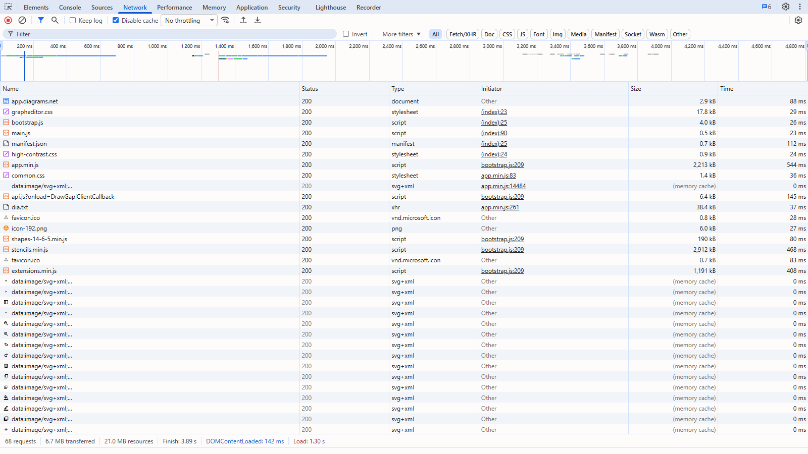

Рисунок 6 – Вкладка Network после загрузки страницы с отключённым кэшем

Фильтрация по типу JS показана на рисунке 7: в списке остались только скрипты.

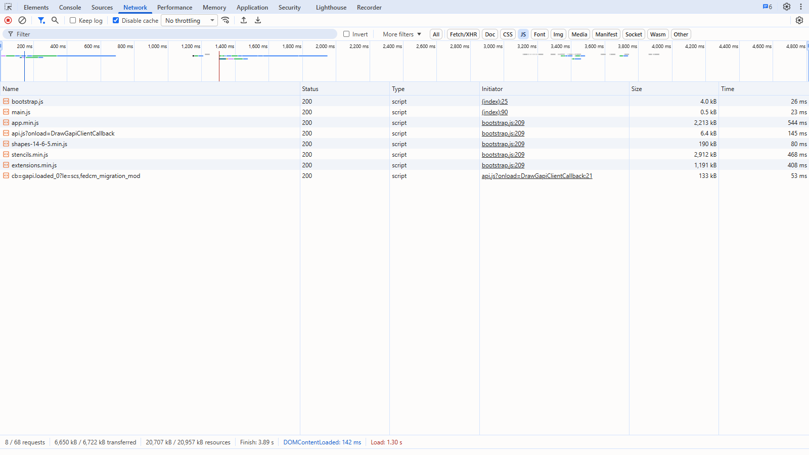

Рисунок 7 – Фильтрация запросов по типу JS

Заголовки основного документа показаны на рисунке 8: общие сведения и заголовки ответа, среди них Cache-Control, Content-Security-Policy, Strict-Transport-Security и X-Content-Type-Options.

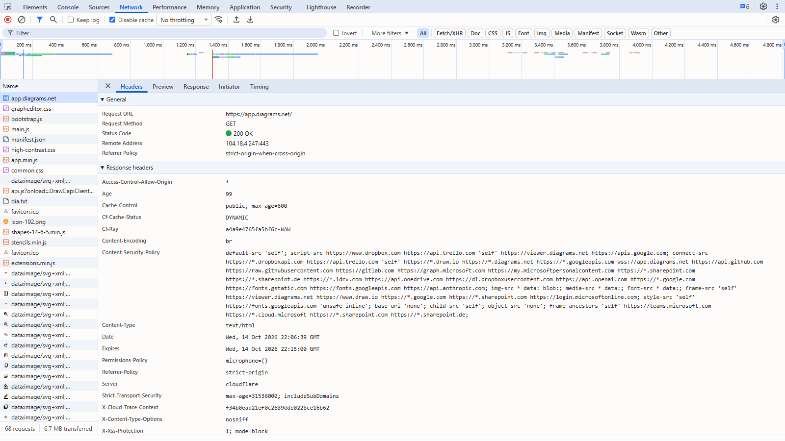

Рисунок 8 – Заголовки запроса к документу: общие сведения и заголовки ответа

Заголовки запроса показаны на рисунке 9: User-Agent, Sec-CH-UA, Sec-CH-UA-Platform и Accept-Language.

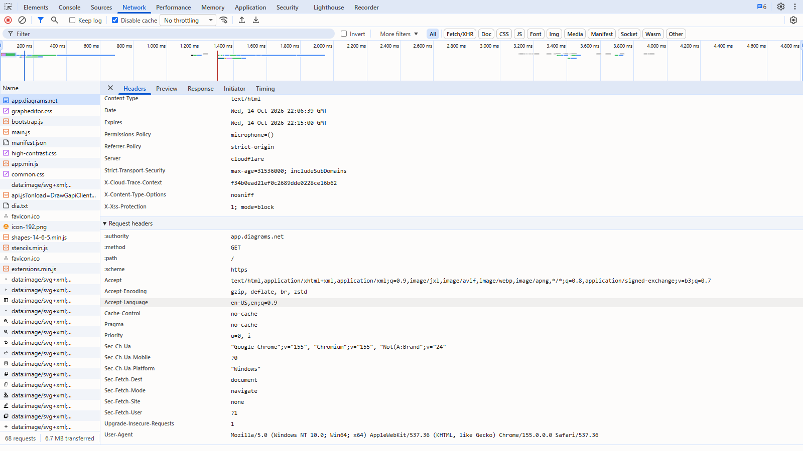

Рисунок 9 – Заголовки запроса к документу

Фазы запроса показаны на рисунке 10 на вкладке Timing.

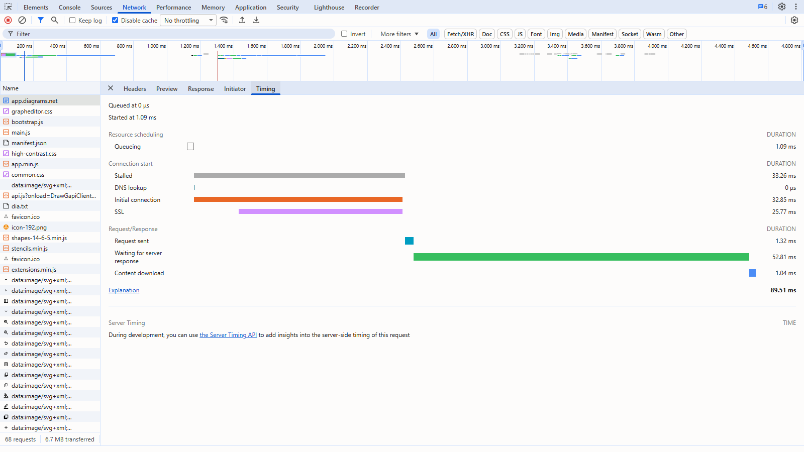

Рисунок 10 – Вкладка Timing отдельного запроса

Состояние защиты показано на рисунке 11: действительный сертификат, протокол TLS 1.3 и безопасная загрузка всех ресурсов.

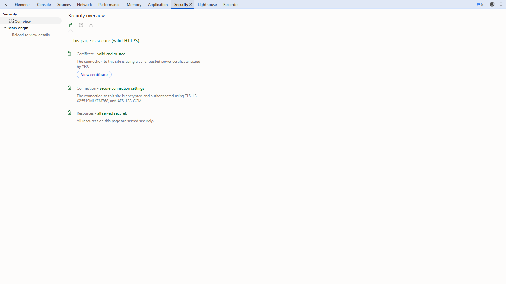

Рисунок 11 – Панель Security

Хранилище cookie показано на рисунке 12: при первом заходе cookie не установлены.

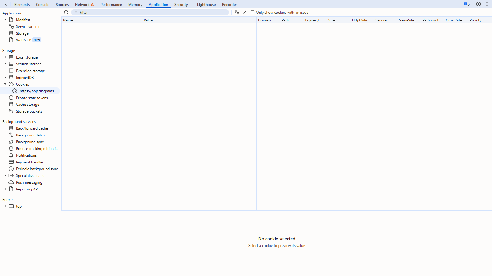

Рисунок 12 – Панель Application, раздел Cookies

Список профилей эмуляции сети показан на рисунке 13.

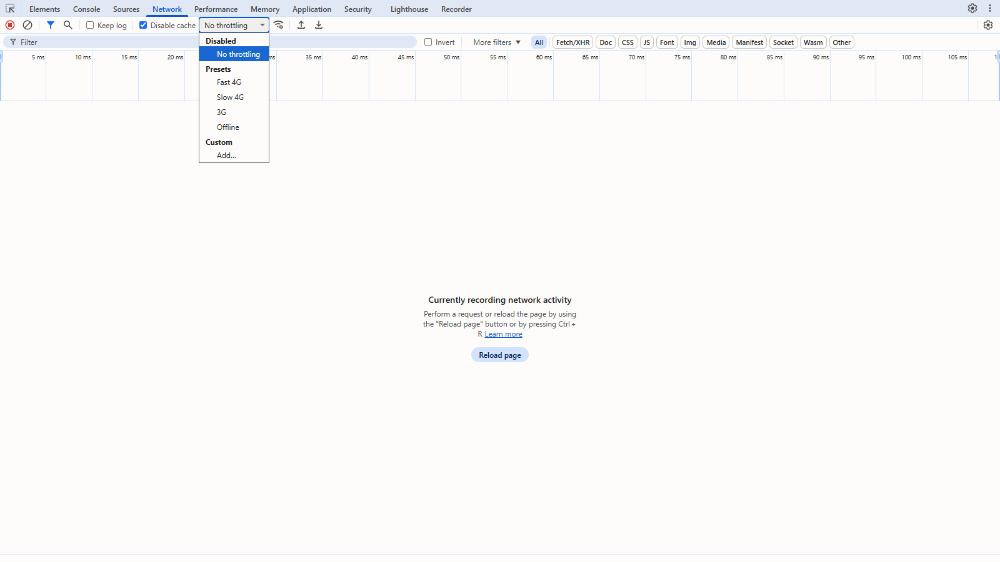

Рисунок 13 – Профили эмуляции сети в DevTools

Загрузка при профиле Slow 4G показана на рисунке 14: полная загрузка заняла 15,16 с, а самым долгим стал запрос stencils.min.js (24,48 с).

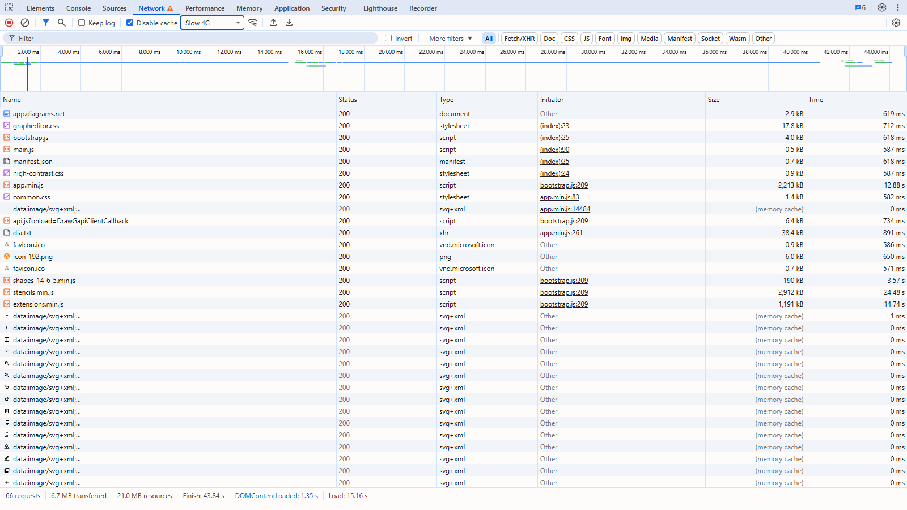

Рисунок 14 – Загрузка страницы при профиле Slow 4G

## 4 Ответы на контрольные вопросы

{{answers}}
1. **Какой протокол использует сайт?** HTTPS. Адрес начинается с `https://`, в журнале указана версия `HTTP/2.0`, заголовок `Strict-Transport-Security` закрепляет HTTPS. Проверить можно по схеме URL, значку замка и колонке Protocol на вкладке Network.
2. **Какие методы встретились?** Только GET (17 из 17): получение HTML, скриптов, стилей, изображений и данных. Методы POST, PUT, PATCH и DELETE при простой загрузке страницы не нужны, они служат для отправки и изменения данных, например при сохранении файла.
3. **Статус-коды.** Код 200 OK встретился 16 раз, например у основного документа. Код 204 No Content встретился один раз у пинга `log.diagrams.net`, ответ пришёл без тела. Код 304 Not Modified возникает при условном запросе с `If-None-Match` после истечения срока кэша: сервер сообщает, что копия актуальна. Коды 404 (ресурс не найден) и 500 (внутренняя ошибка сервера) в журнале отсутствуют.
4. **Заголовки запроса о клиенте.** `User-Agent` содержит браузер и операционную систему, `sec-ch-ua` содержит бренд и версию браузера (в журнале `Google Chrome` версии 155, запись сделана в обычном Chrome с открытым окном), `sec-ch-ua-platform` содержит операционную систему (`"Windows"`).
5. **Заголовки ответа о кэшировании.** `Cache-Control` (`public, max-age=600` у документа и `public, max-age=2592000` у `stencils.min.js`), `Expires` (дата устаревания документа) и `ETag` (`W/"SyJN0w"` у статических файлов). Заголовок `Age` (340 с у документа) показывает возраст ответа в кэше CDN.
6. **Что такое cookie.** Пары «имя=значение», которые сервер устанавливает заголовком `Set-Cookie`, а браузер возвращает заголовком `Cookie`. Они хранят сессии, настройки и данные аналитики. На draw.io при первом заходе cookie не передавались и не устанавливались.
7. **Заголовки безопасности.** `Content-Security-Policy` ограничивает источники ресурсов и защищает от XSS. `Strict-Transport-Security` с `max-age=31536000` принуждает использовать HTTPS. `X-Content-Type-Options: nosniff` запрещает определять тип содержимого по догадке. Заголовок `X-Frame-Options` отсутствует, он защищает от встраивания страницы во фреймы и атаки clickjacking.
8. **Диаграмма Timing.** Показывает фазы запроса от очереди до получения тела. TTFB (Waiting) это время от отправки запроса до первого байта ответа, то есть работа сервера и задержка сети. Content Download это время передачи самого тела. У документа TTFB составил 81 мс, а загрузка 2 мс. У крупного файла `stencils.min.js` фаза загрузки заметно длиннее (462 мс) из-за размера 2,78 МиБ.
9. **Влияние медленного соединения.** TTFB документа вырос с 81 до 582 мс, время загрузки страницы с 1,4 до 15,2 с. Задержка канала увеличивает TTFB каждого запроса, а малая пропускная способность увеличивает Content Download крупных файлов: `stencils.min.js` загружался 24,4 с.
10. **Зачем нужен фильтр.** Он оставляет на панели выбранные типы (Doc, CSS, JS, XHR, Img, Font), что упрощает поиск тяжёлых и лишних ресурсов. В работе использованы типы document (1), stylesheet (3), script (8), xhr (3) и image (2).
11. **Что такое CDN и как его определить.** Сеть доставки контента хранит копии ресурсов на серверах рядом с пользователем. Признаки: `server: cloudflare`, `cf-ray`, `cf-cache-status: HIT` у статических файлов (отдано из кэша CDN) и `DYNAMIC` у HTML-документа, который на краю сети не кэшируется.
12. **Как сохранить журнал в формате HAR.** Кнопкой Export HAR на вкладке Network. HAR описывает запросы, ответы и тайминги в формате JSON. Он нужен для воспроизведения проблем, передачи разработчикам и автоматического анализа, как в этой работе.
13. **Что передаёт заголовок Referer.** Адрес страницы, с которой выполнен запрос: у подресурсов это `https://app.diagrams.net/`, а у запроса самого документа заголовка нет, так как переход начат вручную. Referer применяют для аналитики, защиты от CSRF и от хотлинкинга. Приватность регулирует `Referrer-Policy`, здесь `strict-origin`.
14. **Почему ресурсы приходят с разных доменов.** Запросы шли на три домена: `app.diagrams.net` (14), `apis.google.com` (2, интеграция с Google API) и `log.diagrams.net` (1, сбор статистики). Разделение даёт выделенные серверы под разные задачи, использование внешних сервисов, независимое масштабирование и кэширование.
15. **Как выявить медленные запросы.** Отсортировать по колонке Time или посмотреть Waterfall. В обычной сети самые долгие `extensions.min.js` (681 мс) и `stencils.min.js` (613 мс), при Fast 3G самый долгий `stencils.min.js` (23,5 с). Оптимизация: сжатие (уже применён `br`), долгое кэширование (уже 30 дней), разбиение и ленивая загрузка библиотек шейпов, `preload` критичных ресурсов, CDN.
16. **Что такое блокирующие запросы.** Скрипты и стили, которые браузер загружает и обрабатывает до продолжения отрисовки: скрипты без `async` и `defer`, CSS в `<head>`. Они задерживают первую отрисовку. Обнаружить их можно по колонке Initiator, по Waterfall и по атрибутам тегов в HTML, по одному HAR блокирующий характер скрипта определить нельзя.
{{/answers}}

## Заключение

Сайт draw.io использует HTTPS и HTTP/2, отдаёт статические ресурсы через CDN Cloudflare с кэшем на 30 дней, не устанавливает cookie при первом заходе и строит защиту на CSP, HSTS и `nosniff`. Основной вес страницы, 6,40 МиБ, приходится на скрипты (99 процентов), поэтому на медленном соединении время загрузки возрастает в 10,7 раза, с 1,4 до 15,2 с. Для DSLKit отсюда следует: тяжёлые библиотеки (шейпы, ядро на WebAssembly) нужно кэшировать надолго, загружать лениво и сжимать, а HTML-документ держать лёгким.

## Приложение А – Листинг файла analyze-har.js

{{code:labs/01-network/analyze-har.js}}

## Приложение Б – Листинг файла figures.js

{{code:labs/01-network/figures.js}}

## Приложение В – Листинг файла cli.js

{{code:labs/01-network/cli.js}}

## Приложение Г – Листинг тестов analyze-har.test.js

{{code:labs/01-network/analyze-har.test.js}}
