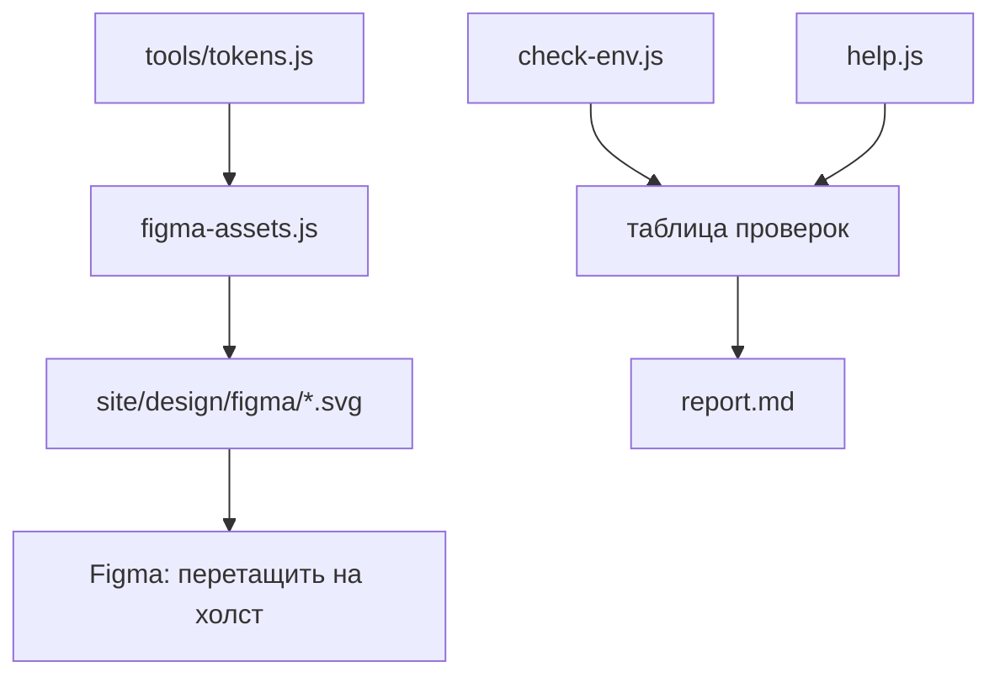
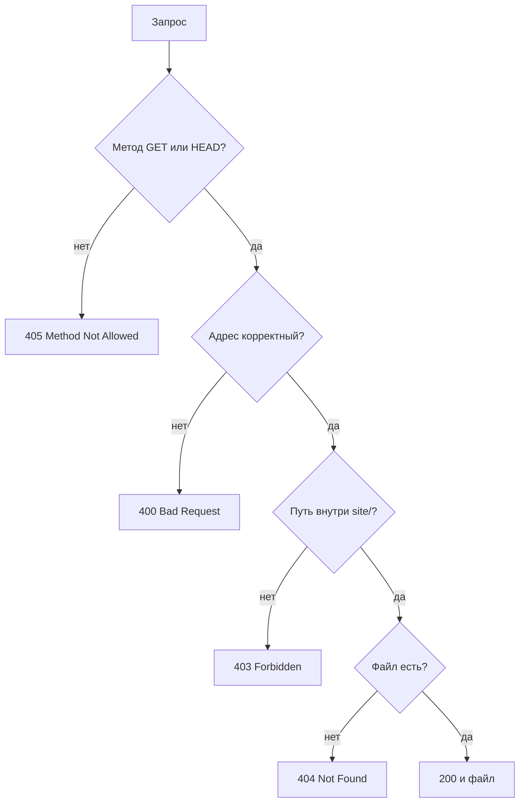
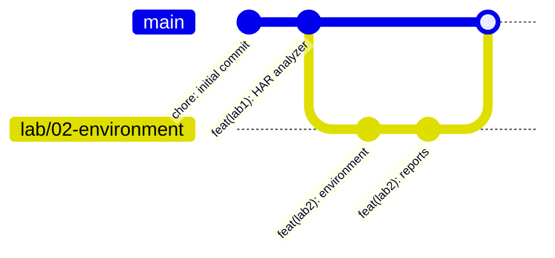

# ЛР2. Настройка рабочего окружения для веб-разработки

Тема: окружение проекта DSLKit. Отчёты: [`report.md`](report.md) на русском, [`report.en.md`](report.en.md) на английском.

## 1. Как запускать

```bash
npm install
npm run check:env
npm run dev
npm test
npm run lab2:report
```

- `npm run check:env` проверяет окружение и для каждой ошибки печатает причину и способ исправления. Версия на английском: `npm run check:env:en`.
- `npm run dev` запускает статический сервер на http://localhost:5173 под nodemon, он перезапускается при изменении файлов в `site/`.
- `npm run design:generate` пересоздаёт SVG-макеты для Figma в `site/design/figma`.
- `npm run format` и `npm run format:check` приводят код к стилю Prettier и проверяют его.
- `npm run lab2:report` собирает отчёты.

## 2. Архитектура лабы

```text
.
├── .editorconfig, .gitattributes, .nvmrc, .prettierrc, .prettierignore
├── .vscode/              настройки редактора и рекомендованные расширения
├── .github/workflows/    проверка на GitHub Actions
├── site/                 сайт: css/, js/, assets/, images/, design/, index.html
├── tools/server.js       статический сервер с обработкой ошибок
├── tools/tokens.js       токены дизайна светлой и тёмной тем
├── tools/contrast.js     расчёт контраста WCAG
└── labs/02-environment/
    ├── check-env.js      проверки окружения
    ├── help.js           пояснения к ошибкам на русском и английском
    ├── check.js          запуск проверок в терминале
    ├── figma-assets.js   генератор SVG для Figma
    └── report*.md        отчёты
```



Статический сервер сопоставляет ситуации и ответы:



## 3. Условие и задание

1. Установить и проверить Node.js LTS, npm, Git, VS Code, создать аккаунт Figma.
2. Освоить интерфейс VS Code, установить расширения: Live Server, Auto Rename Tag, Prettier, GitLens, ES6 String HTML, Figma to Code.
3. Создать папку проекта, структуру `css js assets images design` и базовые файлы `index.html`, `css/style.css`, `js/script.js`.
4. Инициализировать Git, создать `.gitignore`, сделать несколько коммитов, привязать удалённый репозиторий и отправить код.
5. Выполнить `npm init`, установить `lodash` и `nodemon`, настроить `.prettierrc` и форматирование при сохранении.
6. В Figma создать мудборд, палитру, типографику и прототип главной страницы, сохранить ссылку в `design/figma-link.txt`.
7. Оформить `README.md` и ответить на 10 контрольных вопросов.

## 4. Технические термины

| Термин                            | Что это                                                                   |
| --------------------------------- | ------------------------------------------------------------------------- |
| Node.js                           | Среда запуска JavaScript вне браузера                                     |
| npm                               | Менеджер пакетов, ставит зависимости из `package.json`                    |
| `dependencies`, `devDependencies` | Зависимости для работы и только для разработки                            |
| Git, коммит, ветка                | Система версий, снимок изменений, параллельная линия истории              |
| `origin`                          | Имя удалённого репозитория на GitHub                                      |
| `.gitignore`                      | Список файлов, которые Git не отслеживает                                 |
| Prettier                          | Форматировщик, приводит код к единому стилю                               |
| nodemon                           | Утилита, перезапускающая программу при изменении файлов                   |
| Live Server                       | Расширение VS Code, открывающее страницу с автообновлением                |
| Токены дизайна                    | Именованные значения цветов, шрифтов и отступов                           |
| Контраст WCAG                     | Отношение яркостей текста и фона, для обычного текста нужно не меньше 4,5 |
| SVG                               | Векторный формат, который Figma импортирует как редактируемые слои        |

## 5. Теория

Рабочее окружение определяет, насколько быстро разработчик получает проверяемый результат. Git фиксирует историю, npm воспроизводит зависимости, Prettier убирает споры о стиле, Figma согласует вид интерфейса до вёрстки.



Токены дизайна служат единым источником правды: из них строятся SVG-макеты, а в ЛР4 из них же проверяется CSS.

## 6. Рисунки и диаграммы


## 7. Что нужно сделать вам

1. **Figma.** Войдите в аккаунт figma.com (логин и пароль вводите только на сайте Figma). Откройте файл `bsuir-diploma` или создайте файл `DSLKit_Design`. Выделите все SVG из `site/design/figma` в проводнике и перетащите на холст. Скопируйте ссылку (Share, Copy link) и замените содержимое `site/design/figma-link.txt`.
2. **GitHub.** Убедитесь, что вы вошли в GitHub в Git Credential Manager: при первом `git push` откроется окно браузера. Токены хранить в репозитории нельзя.
3. **Git.** Проверьте имя и почту: `git config --global user.name "Ваше имя"` и `git config --global user.email "почта@example.com"`.
4. **README.** В `README.md` замените ссылку на репозиторий, если назовёте его иначе.
5. **VS Code.** Все шесть расширений уже стоят. На другом компьютере откройте проект и согласитесь на установку рекомендованных расширений.
6. **Контрольные вопросы.** Сообщите номер варианта, чтобы оставить ответы n−1, n, n+1.
7. **Сайт.** В `index.html`, `style.css` и `script.js` лежат заготовки. Содержимое заменяют ЛР3 (разметка), ЛР4 (стили) и ЛР5 (скрипты).

Сиды: файлы `site/design/figma/*.svg` строятся из токенов командой `npm run design:generate`.
