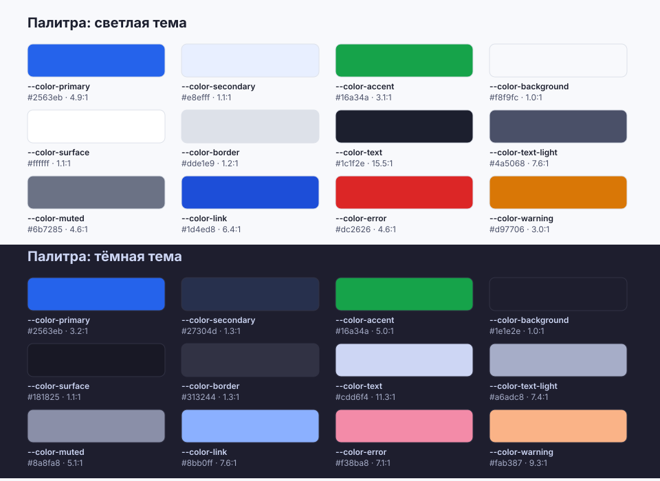
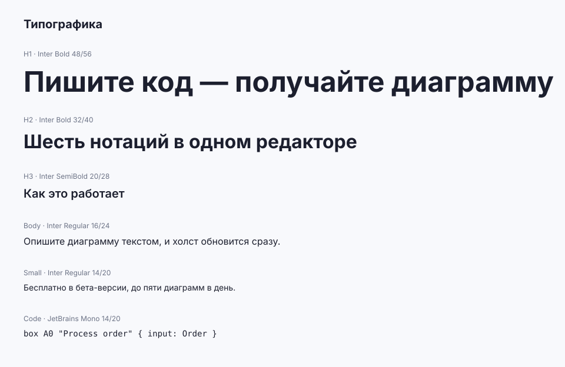
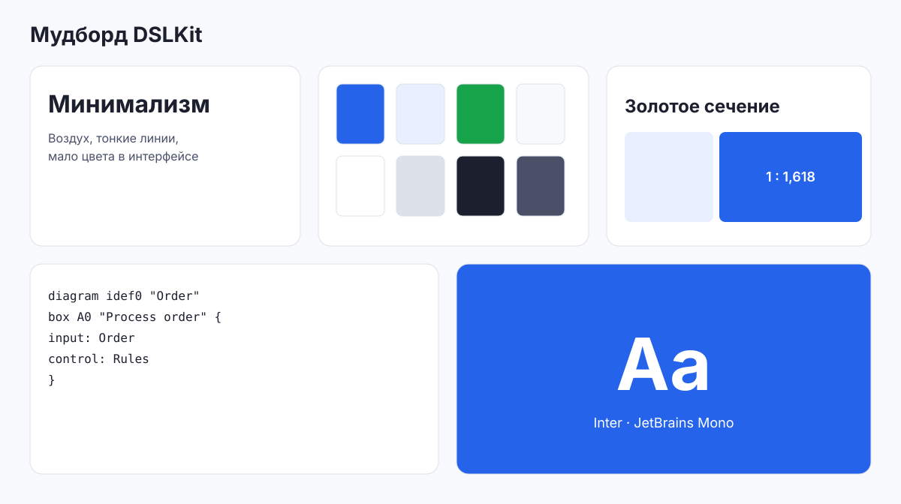
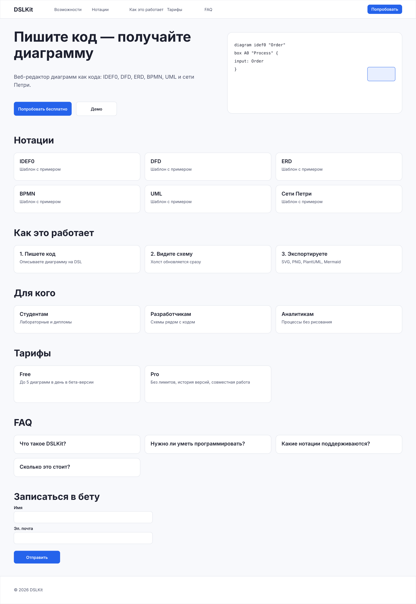
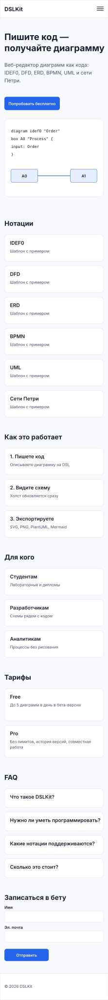
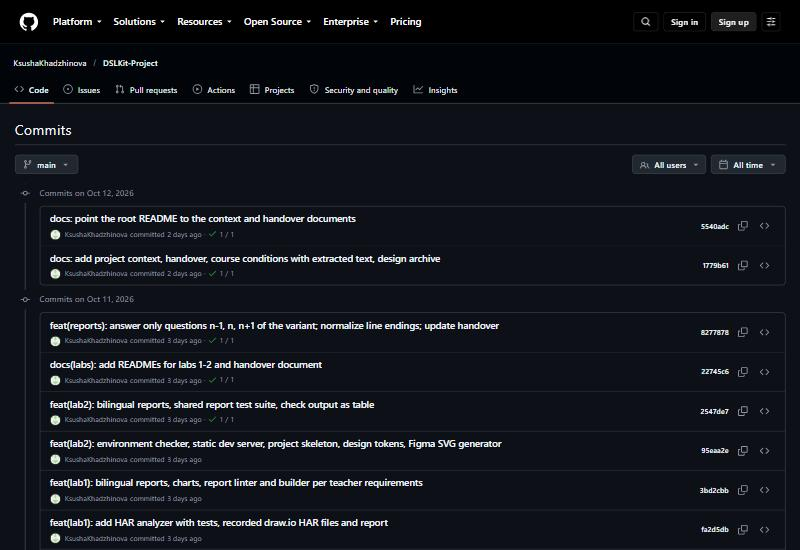

# Лабораторная работа №2. Настройка рабочего окружения для веб-разработки

## 1 Цель работы

Сформировать практические навыки настройки современного рабочего окружения для веб-разработки: освоить систему контроля версий, создать и сконфигурировать проект, изучить возможности интегрированной среды разработки и инструментов проектирования на примере проекта DSLKit, который связан с будущим курсовым проектом.

## 2 Краткие теоретические сведения

**Процесс веб-разработки.** Жизненный цикл включает анализ требований, проектирование, реализацию, тестирование, развёртывание и сопровождение. Рабочее окружение сокращает путь от идеи до проверяемого результата.

**Система контроля версий.** Git хранит историю изменений проекта в виде коммитов, позволяет работать с ветками и синхронизироваться с удалённым репозиторием на GitHub. Основные команды: `git init`, `git add`, `git commit`, `git push`.

**Node.js и npm.** Node.js выполняет JavaScript вне браузера. Менеджер пакетов npm устанавливает зависимости из `package.json`: обычные (`dependencies`) и необходимые только при разработке (`devDependencies`).

**Редактор кода.** Visual Studio Code объединяет редактор, терминал, отладчик и панель Source Control. Расширения добавляют форматирование, живой сервер и работу с Git.

**Figma.** Облачный редактор интерфейсов, в котором создают мудборды, палитры, типографику и прототипы страниц до начала вёрстки.

## 3 Ход работы

### 3.1 Выбор тематики проекта

Тематика проекта: DSLKit, веб-IDE для диаграмм как кода. Название папки проекта и репозитория `DSLKit-Project` легко расширить до курсового проекта: сайт лежит в папке `site`, лабораторные работы в папке `labs`, вспомогательные инструменты в папке `tools`.

### 3.2 Установка и проверка программного обеспечения

Проверку установки выполняет скрипт `npm run check:env` из приложения Б. Он запускает команды `node --version`, `npm --version`, `git --version`, читает настройки Git и проверяет файлы проекта. Результаты приведены в таблице ниже, а для каждой непройденной проверки скрипт выводит причину и способ исправления.

Таблица 1 – Результаты проверки окружения

| Проверка | Статус | Подробности |
|---|---|---|
| Node.js LTS | пройдена | v24.13.1 |
| Менеджер пакетов npm | пройдена | 11.8.0 |
| Git | пройдена | git version 2.55.0.windows.3 |
| Имя в настройках Git | пройдена | KsushaKhadzhinova |
| Почта в настройках Git | пройдена | 73707328+KsushaKhadzhinova@users.noreply.github.com |
| Структура проекта | пройдена | — |
| Файл .gitignore | пройдена | — |
| Настройки Prettier | пройдена | {"semi":true,"singleQuote":true,"printWidth":160} |
| Пакеты lodash и nodemon | пройдена | lodash ^4.18.1, nodemon ^3.1.14 |
| Форматирование при сохранении | пройдена | — |
| Расширения VS Code | пройдена | — |
| Файл README.md | пройдена | — |
| Ссылка на макет Figma | пройдена | — |
| Удалённый репозиторий | пройдена | https://github.com/KsushaKhadzhinova/DSLKit-Project.git |
| История коммитов | пройдена | 83 |

Все проверки пройдены.

### 3.3 Настройка Visual Studio Code

В среде установлены обязательные расширения: Live Server, Auto Rename Tag, Prettier, GitLens, ES6 String HTML и Figma to Code. Рекомендованные расширения перечислены в файле `.vscode/extensions.json`, поэтому редактор предложит их установить при открытии проекта на другом компьютере. Файл `.vscode/settings.json` включает форматирование при сохранении (`editor.formatOnSave`) и назначает Prettier форматировщиком по умолчанию.

### 3.4 Структура проекта и базовые файлы

Создана структура `site/css`, `site/js`, `site/assets`, `site/images`, `site/design`. Базовые файлы: `site/index.html` с разметкой HTML5, `site/css/style.css` с базовыми стилями и `site/js/script.js` с простым скриптом. Пустые папки закреплены файлами `.gitkeep`, так как Git не хранит пустые каталоги.

### 3.5 Работа с системой контроля версий

Репозиторий создан командой `git init` и привязан к GitHub командой `git remote add origin`. Файл `.gitignore` исключает `node_modules/`, `.DS_Store`, `*.log`, `coverage/` и `.env`. Изменения фиксируются отдельными коммитами по этапам: структура проекта, базовые файлы, настройка инструментов. Для каждой лабораторной работы создаётся своя ветка, готовая работа сливается в `main`. Файл `.gitattributes` задаёт одинаковые переводы строк для Windows и Linux.

### 3.6 Интеграция инструментов разработки

Проект инициализирован командой `npm init`. Установлена зависимость `lodash` и инструменты разработки `nodemon`, `prettier`, `jsdom`. Команда `npm run dev` запускает статический сервер из файла `tools/server.js` под наблюдением nodemon: при изменении файлов в папке `site` сервер перезапускается. Сервер обрабатывает ошибки: для адресов вне проекта отвечает кодом 403, для неизвестных файлов 404, для некорректных адресов 400, для неподдерживаемых методов 405, при сбое чтения файла 500. Файл `.prettierrc` содержит настройки `semi: true` и `singleQuote: true`, команда `npm run format` приводит весь код к единому стилю.

### 3.7 Проектирование в Figma

Макеты подготовлены как SVG-файлы в папке `site/design/figma`, их можно перетащить на холст Figma. Генератор `labs/02-environment/figma-assets.js` строит их из одних и тех же токенов дизайна. Цветовая палитра светлой и тёмной тем с коэффициентами контраста показана на рисунке 1.



Рисунок 1 – Цветовая палитра проекта DSLKit для светлой и тёмной тем

Выбранные шрифты и размеры показаны на рисунке 2: Inter для интерфейса и JetBrains Mono для кода.



Рисунок 2 – Типографика проекта: шрифты, размеры и интерлиньяж

Общий визуальный язык проекта показан на рисунке 3: минимализм, воздух, золотое сечение и тонкие линии.



Рисунок 3 – Мудборд проекта DSLKit

Прототип главной страницы для десктопа показан на рисунке 4.



Рисунок 4 – Прототип главной страницы DSLKit для экрана шириной 1440 пикселей

Мобильная версия прототипа показана на рисунке 5: навигация заменена кнопкой меню, карточки расположены в один столбец.



Рисунок 5 – Прототип главной страницы DSLKit для экрана шириной 390 пикселей

Ссылка на файл Figma сохранена в `site/design/figma-link.txt`.

### 3.8 Документирование проекта

Файл `README.md` в корне репозитория содержит описание проекта, перечень технологий, ссылки на репозиторий и макет Figma, команды запуска и структуру папок.

Репозиторий проекта: https://github.com/KsushaKhadzhinova/DSLKit-Project. Файл Figma: https://www.figma.com/design/HYmcqqGdcszOt7dGnKrvZg/bsuir-diploma. История коммитов ветки `main` на GitHub показана на рисунке 6.



Рисунок 6 – История коммитов ветки main в репозитории DSLKit-Project на GitHub

## Заключение

Настроено окружение для веб-разработки: установлены и проверены Node.js, npm, Git и VS Code с расширениями, создана структура проекта DSLKit, подключены Git и GitHub, настроены Prettier, nodemon и статический сервер с обработкой ошибок. Подготовлены макеты Figma: палитра, типографика, мудборд и прототип главной страницы для разных ширин экрана. Правильная настройка окружения позволяет одинаково воспроизводить проект на любом компьютере и служит основой для следующих работ и курсового проекта.

## Приложение А – Листинг файла check-env.js

```js
import { HELP, WORDS } from './help.js';

export const DIRS = ['css', 'js', 'assets', 'images', 'design'];
export const FILES = ['index.html', 'css/style.css', 'js/script.js', 'design/figma-link.txt'];
export const IGNORE = ['node_modules/', '.DS_Store', '*.log'];
export const EXTENSIONS = [
  'ritwickdey.liveserver',
  'formulahendry.auto-rename-tag',
  'esbenp.prettier-vscode',
  'eamodio.gitlens',
  'tobermory.es6-string-html',
  'figma-to-code.figma-to-code-sync',
];
const MIN_NODE = 20;

const attempt = (fn, fallback) => {
  try {
    return fn();
  } catch {
    return fallback;
  }
};

export const checkEnv = ({ run, exists, read }, site = 'site') => {
  const at = (p) => `${site}/${p}`;
  const json = (p) => attempt(() => JSON.parse(read(p)), {});
  const lines = (p) =>
    attempt(
      () =>
        read(p)
          .split(/\r?\n/)
          .map((l) => l.trim()),
      [],
    );
  const out = (cmd, args) => attempt(() => run(cmd, args).trim(), '');
  const result = (id, pass, detail = '') => ({ id, pass: Boolean(pass), detail });
  const node = out('node', ['--version']);
  const missing = [...DIRS, ...FILES].filter((p) => !exists(at(p)));
  const ignored = lines('.gitignore');
  const prettier = json('.prettierrc');
  const pkg = json('package.json');
  const recommended = json('.vscode/extensions.json').recommendations ?? [];
  const readme = attempt(() => read('README.md'), '');
  const commits = Number(out('git', ['rev-list', '--count', 'HEAD']));
  return [
    result('node', Number(/^v(\d+)/.exec(node)?.[1]) >= MIN_NODE, node),
    result('npm', /^\d+\.\d+/.test(out('npm', ['--version'])), out('npm', ['--version'])),
    result('git', /^git version \d/.test(out('git', ['--version'])), out('git', ['--version'])),
    result('gitName', out('git', ['config', 'user.name']), out('git', ['config', 'user.name'])),
    result('gitEmail', out('git', ['config', 'user.email']), out('git', ['config', 'user.email'])),
    result('structure', missing.length === 0, missing.join(', ')),
    result(
      'gitignore',
      IGNORE.every((l) => ignored.includes(l)),
      IGNORE.filter((l) => !ignored.includes(l)).join(', '),
    ),
    result('prettier', prettier.semi === true && prettier.singleQuote === true, JSON.stringify(prettier)),
    result(
      'packages',
      pkg.dependencies?.lodash && pkg.devDependencies?.nodemon,
      `lodash ${pkg.dependencies?.lodash ?? '—'}, nodemon ${pkg.devDependencies?.nodemon ?? '—'}`,
    ),
    result('format', json('.vscode/settings.json')['editor.formatOnSave'] === true),
    result(
      'extensions',
      EXTENSIONS.every((e) => recommended.map((r) => r.toLowerCase()).includes(e)),
      EXTENSIONS.filter((e) => !recommended.map((r) => r.toLowerCase()).includes(e)).join(', '),
    ),
    result('readme', /figma\.com/.test(readme) && /github\.com/.test(readme) && /^## (Технологии|Technologies)/m.test(readme)),
    result('figma', /^https:\/\/www\.figma\.com\/\S+$/.test(attempt(() => read(at('design/figma-link.txt')).trim(), ''))),
    result('remote', /github\.com/.test(out('git', ['remote', 'get-url', 'origin'])), out('git', ['remote', 'get-url', 'origin'])),
    result('commits', commits >= 3, String(commits || 0)),
  ];
};

export const formatResults = (results, lang = 'ru') => {
  const w = WORDS[lang];
  const rows = results.map((r) => `| ${HELP[lang][r.id][0]} | ${r.pass ? w.ok : w.fail} | ${r.detail || '—'} |`);
  const failed = results.filter((r) => !r.pass);
  const table = [`| ${w.check} | ${w.status} | ${w.detail} |`, '|---|---|---|', ...rows].join('\n');
  const help = failed.map((r) => {
    const [title, why, fix] = HELP[lang][r.id];
    return `**${title}.** ${w.why}: ${why} ${w.fix}: ${fix}`;
  });
  return [`${w.table} 1 – ${w.title}`, table, failed.length ? `${w.failed}: ${failed.length}.` : w.done, ...help].join('\n\n');
};
```

## Приложение Б – Листинг файла check.js

```js
import { execSync } from 'node:child_process';
import { existsSync, readFileSync } from 'node:fs';
import { checkEnv, formatResults } from './check-env.js';

const results = checkEnv({
  run: (c, a) => execSync([c, ...a].join(' '), { encoding: 'utf8', stdio: ['ignore', 'pipe', 'ignore'] }),
  exists: existsSync,
  read: (p) => readFileSync(p, 'utf8'),
});
console.log(formatResults(results, process.argv[2]));
process.exitCode = results.filter((r) => !r.pass).length;
```

## Приложение В – Листинг файла server.js

```js
import * as nodeFs from 'node:fs';
import { createServer } from 'node:http';
import { extname, join, resolve, sep } from 'node:path';

const TYPES = {
  '.html': 'text/html; charset=utf-8',
  '.css': 'text/css; charset=utf-8',
  '.js': 'text/javascript; charset=utf-8',
  '.json': 'application/json; charset=utf-8',
  '.svg': 'image/svg+xml',
  '.png': 'image/png',
  '.txt': 'text/plain; charset=utf-8',
  '.xml': 'application/xml; charset=utf-8',
};

export const staticServer = (rootDir, fs = nodeFs) => {
  const root = resolve(rootDir);
  const send = (req, res, status, file, headers = {}) => {
    const page = join(root, 'errors', `${status}.html`);
    const target = file ?? (fs.existsSync(page) ? page : null);
    res.writeHead(status, { 'Content-Type': target ? (TYPES[extname(target)] ?? 'application/octet-stream') : 'text/plain; charset=utf-8', ...headers });
    if (req.method === 'HEAD') return res.end();
    if (!target) return res.end(String(status));
    return fs
      .createReadStream(target)
      .on('error', () => res.end())
      .pipe(res);
  };
  return createServer((req, res) => {
    try {
      if (req.method !== 'GET' && req.method !== 'HEAD') return send(req, res, 405, null, { Allow: 'GET, HEAD' });
      let path;
      try {
        path = decodeURIComponent(new URL(req.url, 'http://localhost').pathname);
      } catch {
        return send(req, res, 400);
      }
      let file = resolve(join(root, path));
      if (file !== root && !file.startsWith(root + sep)) return send(req, res, 403);
      if (fs.existsSync(file) && fs.statSync(file).isDirectory()) file = join(file, 'index.html');
      return fs.existsSync(file) ? send(req, res, 200, file) : send(req, res, 404);
    } catch {
      return send(req, res, 500);
    }
  });
};
```

## Приложение Г – Листинг тестов check-env.test.js

```js
import assert from 'node:assert/strict';
import { test } from 'node:test';
import { DIRS, EXTENSIONS, FILES, checkEnv, formatResults } from './check-env.js';
import { HELP, WORDS } from './help.js';

const GOOD_FILES = {
  ...Object.fromEntries([...DIRS, ...FILES].map((p) => [`site/${p}`, ''])),
  'site/design/figma-link.txt': 'https://www.figma.com/design/abc/DSLKit\n',
  '.gitignore': 'node_modules/\r\n.DS_Store\n*.log\n',
  '.prettierrc': '{"semi":true,"singleQuote":true}',
  'package.json': '{"dependencies":{"lodash":"^4"},"devDependencies":{"nodemon":"^3"}}',
  '.vscode/settings.json': '{"editor.formatOnSave":true}',
  '.vscode/extensions.json': JSON.stringify({ recommendations: EXTENSIONS.map((e) => e.toUpperCase()) }),
  'README.md': '# DSLKit\n\n## Технологии\n\nhttps://github.com/x/y https://www.figma.com/design/abc\n',
};
const GOOD_CMDS = {
  'node --version': 'v24.1.0\n',
  'npm --version': '11.0.0\n',
  'git --version': 'git version 2.50.0\n',
  'git config user.name': 'Ксения\n',
  'git config user.email': 'k@example.com\n',
  'git remote get-url origin': 'https://github.com/x/y.git\n',
  'git rev-list --count HEAD': '5\n',
};

const env = (files = GOOD_FILES, cmds = GOOD_CMDS) => ({
  run: (c, a) => {
    const key = [c, ...a].join(' ');
    if (!(key in cmds)) throw new Error(`missing ${key}`);
    return cmds[key];
  },
  exists: (p) => p in files,
  read: (p) => {
    if (!(p in files)) throw new Error('ENOENT');
    return files[p];
  },
});
const failed = (e) =>
  checkEnv(e)
    .filter((r) => !r.pass)
    .map((r) => r.id);
const without = (obj, key) => Object.fromEntries(Object.entries(obj).filter(([k]) => k !== key));

test('a complete environment passes every check', () => {
  assert.deepEqual(failed(env()), []);
});

test('tool checks fail when commands are missing or old', () => {
  assert.deepEqual(failed(env(GOOD_FILES, {})), ['node', 'npm', 'git', 'gitName', 'gitEmail', 'remote', 'commits']);
  assert.deepEqual(failed(env(GOOD_FILES, { ...GOOD_CMDS, 'node --version': 'v18.0.0' })), ['node']);
  assert.deepEqual(failed(env(GOOD_FILES, { ...GOOD_CMDS, 'git remote get-url origin': 'https://example.com/x.git', 'git rev-list --count HEAD': '2' })), [
    'remote',
    'commits',
  ]);
});

test('file checks fail with details', () => {
  assert.deepEqual(failed(env(without(GOOD_FILES, 'site/js/script.js'))), ['structure']);
  assert.deepEqual(failed(env({ ...GOOD_FILES, '.gitignore': 'node_modules/\n' })), ['gitignore']);
  assert.deepEqual(failed(env({ ...GOOD_FILES, '.prettierrc': '{"semi":false}' })), ['prettier']);
  assert.deepEqual(failed(env({ ...GOOD_FILES, 'package.json': '{}' })), ['packages']);
  assert.deepEqual(failed(env({ ...GOOD_FILES, '.vscode/settings.json': '{}' })), ['format']);
  assert.deepEqual(failed(env({ ...GOOD_FILES, '.vscode/extensions.json': '{"recommendations":[]}' })), ['extensions']);
  assert.deepEqual(failed(env({ ...GOOD_FILES, 'README.md': '# only title' })), ['readme']);
  assert.deepEqual(failed(env({ ...GOOD_FILES, 'site/design/figma-link.txt': 'https://example.com' })), ['figma']);
});

test('unreadable or broken files do not crash the checks', () => {
  const broken = { ...without(GOOD_FILES, 'package.json'), '.prettierrc': '{oops', '.vscode/extensions.json': '{}' };
  assert.deepEqual(failed(env(broken)), ['prettier', 'packages', 'extensions']);
  assert.deepEqual(failed(env({})).length, 8);
});

test('formatResults lists failures with explanations in both languages', () => {
  const bad = checkEnv(env(without(GOOD_FILES, 'README.md')));
  const ru = formatResults(bad);
  assert.match(ru, /\| Файл README\.md \| не пройдена \|/);
  assert.match(ru, /\*\*Файл README\.md\.\*\*/);
  assert.match(ru, /Зачем это нужно: README объясняет/);
  assert.match(ru, /Как исправить: Добавьте описание/);
  const en = formatResults(bad, 'en');
  assert.match(en, /Checks failed: 1\./);
  assert.match(en, /How to fix: Add a project description/);
  assert.match(formatResults(checkEnv(env())), /Все проверки пройдены\./);
});

test('every check has help text in both languages', () => {
  const ids = checkEnv(env()).map((r) => r.id);
  assert.deepEqual(Object.keys(HELP.ru), ids);
  assert.deepEqual(Object.keys(HELP.en), ids);
  assert.deepEqual(Object.keys(WORDS.ru), Object.keys(WORDS.en));
  for (const lang of ['ru', 'en']) for (const id of ids) assert.equal(HELP[lang][id].length, 3);
});

test('cli prints the check table and exposes the number of failures as exit code', async () => {
  const lines = [];
  const log = console.log;
  console.log = (s) => lines.push(s);
  process.argv[2] = 'en';
  try {
    await import('./check.js');
  } finally {
    console.log = log;
  }
  assert.match(lines[0], /Table 1 – Environment check results/);
  assert.equal(process.exitCode, (lines[0].match(/\| failed \|/g) ?? []).length);
  process.exitCode = 0;
});
```
