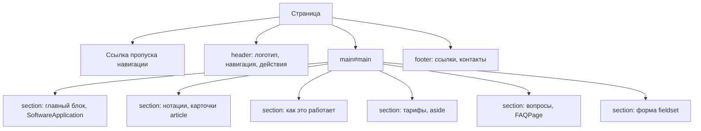

# Лабораторная работа №3. Семантическая HTML-разметка

Проект DSLKit (направление SaaS), ветка `feature/semantic-markup`. Условие: `materials/text/part-1/Модуль 03…/33. Лабораторная работа 3…`. Отчёты: [`report.md`](report.md) на русском, [`report.en.md`](report.en.md) на английском.

## 1 Цель и задание

Создать валидную семантическую разметку главной страницы по макету Figma: не менее восьми различных семантических тегов, правильная иерархия заголовков, `alt` у изображений, ссылка пропуска навигации, классы БЭМ и микроразметка Schema.org, проверка валидаторами.

## 2 Структура

| Путь                                                          | Назначение                                                           |
| ------------------------------------------------------------- | -------------------------------------------------------------------- |
| `site/index.html`, `site/en/index.html`                       | Главная страница на русском и английском                             |
| `site/errors/*.html`                                          | Страницы кодов 400, 403, 404, 405, 500 с русским и английским блоком |
| `site/thanks.html`, `site/privacy.html` и версии в `site/en/` | Подтверждение записи и политика конфиденциальности                   |
| `site/app/*.html`                                             | Экраны приложения (прототип разметки)                                |
| `site/design/`                                                | Токены дизайна и SVG-макеты для Figma                                |
| `site/robots.txt`, `site/sitemap.xml`                         | Служебные файлы поисковых систем                                     |
| `labs/03-semantic-markup/site-checks.js`                      | Функции проверок разметки                                            |
| `labs/03-semantic-markup/*.test.js`                           | Тесты проверок и интеграционный тест по всем страницам               |
| `labs/03-semantic-markup/figures/`                            | Скриншоты валидаторов для отчёта                                     |

## 3 Запуск и проверка

```bash
npm start                 # сайт на http://localhost:5173
npm test                  # все тесты, порог покрытия 100 процентов
npm run lab3:report       # сборка отчётов из шаблонов
npm run format:check
```

Валидаторы: W3C Nu (validator.w3.org/nu) для страниц, validator.schema.org для микроразметки.

## 4 Архитектура разметки



## 5 Доступность и микроразметка

- Один `h1` на странице, уровни заголовков идут без пропусков.
- Все `img` имеют `alt`, декоративные пустой.
- Поля формы связаны с `label`, подсказки с `aria-describedby`.
- Микроразметка: `SoftwareApplication` с `Offer`, `FAQPage` с `Question` и `Answer`.

## 6 Тесты и проверки

- Модульные тесты функций проверок (покрытие 100 процентов) и интеграционные тесты по 15 страницам: язык и заголовок, заголовки, `alt`, ссылка пропуска, идентификаторы и якоря, подписи полей, тексты ссылок, БЭМ, микроразметка, паритет русской и английской версий, `hreflang`, карта сайта, длина `title` и `description`.
- W3C Nu Html Checker: 15 страниц без ошибок и предупреждений. validator.schema.org: 0 ошибок.

## 7 Отчёт, сдача и открытые вопросы

Отчёты собираются из шаблонов командой `npm run lab3:report` и проходят линтер оформления. Ответы ограничены вопросами n−1, n, n+1 варианта 26 (правило нужно подтвердить у преподавателя).

Не выполнено и ждёт решения владельца:

1. Google Rich Results Test (нужен публичный адрес, домен `dslkit.io` не куплен).
2. Сверка с файлом Figma `bsuir-diploma` (нужен доступ).
3. PDF для СЭО и титульный лист по СТП.
4. Подтверждение текстов политики конфиденциальности и слияние в `main` после приёмки.
