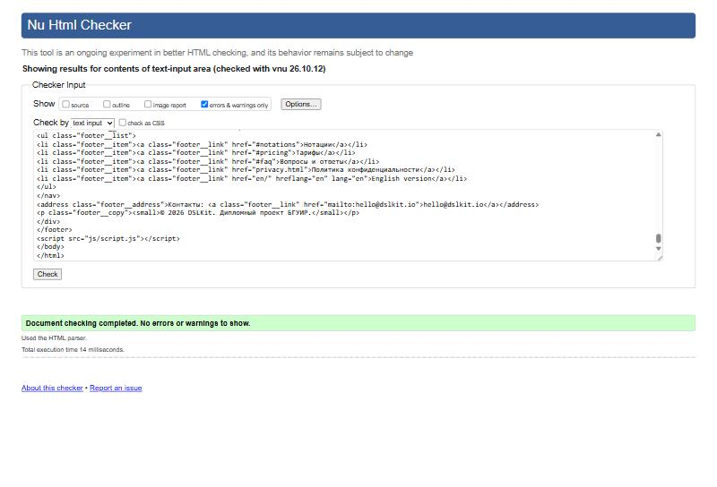
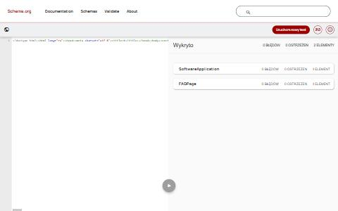

# Лабораторная работа №3. Создание семантической HTML-разметки

## 1 Цель работы

Освоить принципы семантической HTML-разметки, основы веб-доступности и микроразметку Schema.org. Сформировать навыки создания валидной структурированной разметки на примере проекта DSLKit, веб-редактора диаграмм как кода, тематика которого соответствует направлению SaaS и будущему курсовому проекту.

## 2 Краткие теоретические сведения

**Семантическая разметка.** Теги описывают смысл содержимого, а не внешний вид: `header`, `nav`, `main`, `article`, `section`, `aside`, `footer`. Такая структура понятна поисковым системам, программам чтения с экрана и разработчикам, а стили добавляются отдельно.

**Иерархия заголовков.** На странице один заголовок первого уровня, остальные уровни вложены без пропусков. Программы чтения с экрана строят по заголовкам оглавление, а поисковые системы определяют по ним тему разделов.

**Основы доступности.** Каждое изображение получает текстовую альтернативу `alt`, декоративные изображения помечаются пустым значением, ссылки имеют осмысленный текст, поля форм связаны с подписями, а ссылка пропуска навигации (skip-link) позволяет сразу перейти к основному содержимому.

**Микроразметка Schema.org.** Атрибуты `itemscope`, `itemtype` и `itemprop` описывают объект и его свойства словарём Schema.org. Поисковые системы используют эти данные для расширенных результатов выдачи.

**Валидация.** Проверка валидатором W3C показывает нарушения синтаксиса и модели содержимого. Валидная разметка одинаково обрабатывается разными браузерами.

## 3 Ход работы

### 3.1 Выбор и анализ макета

Макет подготовлен в Figma и сохранён в виде SVG-файлов в папке `site/design/figma`. Ссылка на файл хранится в `site/design/figma-link.txt`, цвета и шрифты записаны в `site/design/design-tokens.txt`. Макет соответствует теме SaaS: главная страница сервиса с примером продукта, нотациями, тарифами, вопросами и ответами и формой записи в бету.

Анализ выделил семантические блоки: шапка с логотипом, навигацией и действиями, главный блок с изображением продукта, секции «Нотации», «Как это работает», «Для кого», «Тарифы», «Вопросы и ответы», форма записи и подвал. Изображения экспортированы в папку `site/images`.

### 3.2 Структура документа

Страница `site/index.html` начинается с ссылки пропуска навигации, которая ведёт к элементу `main` с идентификатором `main`. Далее идут `header`, `main` и `footer`. Для языковых версий создана страница `site/en/index.html` с той же структурой, переключатель языка и атрибуты `hreflang`. Для кодов ответа 400, 403, 404, 405 и 500 подготовлены страницы в папке `site/errors`, а для списка ожидания страницы `thanks.html` и `privacy.html`.

### 3.3 Семантические теги

Главная страница использует 15 разных семантических тегов, перечисленных в таблице 1. Условие требовало не менее восьми.

Таблица 1 – Семантические теги главной страницы

| Тег | Назначение | Пример на странице |
|---|---|---|
| `header` | Шапка сайта | Логотип, навигация, действия |
| `nav` | Блок навигации | Основное и нижнее меню |
| `main` | Основное содержимое | Все секции страницы |
| `section` | Тематический раздел с заголовком | «Нотации», «Тарифы» |
| `article` | Самостоятельный блок | Карточка нотации, тариф |
| `aside` | Второстепенная информация | Примечание к тарифам |
| `footer` | Подвал | Ссылки и контакты |
| `figure`, `figcaption` | Иллюстрация с подписью | Изображение редактора |
| `time` | Дата в машиночитаемом виде | Дата обновления тарифов |
| `address` | Контактная информация | Адрес электронной почты |
| `details`, `summary` | Раскрывающийся блок | Вопросы и ответы |
| `fieldset`, `legend` | Группа полей формы | «Контакты», «Ваш проект» |

### 3.4 Иерархия заголовков

Каждая страница содержит один заголовок первого уровня. На главной это «Пишите код — получайте диаграмму», секции получают заголовки второго уровня, карточки и шаги заголовки третьего. Пропусков уровней нет, это проверяет автоматический тест для всех 15 страниц сайта.

### 3.5 Доступность

Все изображения имеют атрибут `alt`: изображение редактора описано полным предложением, декоративные значки нотаций имеют пустое значение. Тексты ссылок осмысленные, например «Записаться в бету: UML». Каждое поле формы связано с подписью через `label` и `for`, группы полей оформлены через `fieldset` и `legend`, подсказки подключены атрибутом `aria-describedby`. Кнопки со значками имеют текстовые названия `aria-label`. Ссылка пропуска навигации есть на каждой странице и ведёт к существующему элементу `main`.

### 3.6 БЭМ

Классы построены по методологии БЭМ: блок `card`, элемент `card__title`, модификатор `button--primary`. Тест проверяет, что все имена классов на всех страницах соответствуют схеме «блок, элемент, модификатор» в нижнем регистре через дефис.

### 3.7 Микроразметка Schema.org

Для проекта выбран тип `SoftwareApplication`, потому что страница описывает программный продукт. В разметке используются свойства из таблицы 2.

Таблица 2 – Микроразметка Schema.org главной страницы

| Тип | Свойства |
|---|---|
| `SoftwareApplication` | `name`, `applicationCategory`, `operatingSystem`, `url`, `description`, `image`, `offers` |
| `Offer` | `price`, `priceCurrency`, `availability`, `url` |
| `FAQPage` | `mainEntity` |
| `Question` | `name`, `acceptedAnswer` |
| `Answer` | `text` |

Отзывы и оценки в разметку не добавлены, так как реальных отзывов пока нет, а выдумывать их недопустимо. Поэтому расширенный результат Google для программных приложений недоступен.

### 3.8 Проверка валидности

Страница проверена валидатором W3C Nu Html Checker. Результат показан на рисунке 1: ошибок и предупреждений нет. Код передан в валидатор без отступов, на содержимое это не влияет.



Рисунок 1 – Результат проверки W3C Nu Html Checker: ошибок и предупреждений нет

Все 15 страниц сайта проверены тем же сервисом с нулевым числом ошибок и предупреждений. Остаются только информационные сообщения о слэше в пустых элементах, на работу страниц они не влияют.

### 3.9 Проверка микроразметки

Для проверки микроразметки использован валидатор Schema.org. Результат показан на рисунке 2: найдены объекты SoftwareApplication и FAQPage без ошибок и предупреждений. Инструмент Google Rich Results Test требует публичный адрес страницы, а домен `dslkit.io` пока не куплен, поэтому проверка в нём не выполнена и остаётся задачей после публикации.



Рисунок 2 – Результат проверки микроразметки: объекты SoftwareApplication и FAQPage без ошибок

### 3.10 Автоматические тесты

Для разметки написаны тесты, проверяющие на всех страницах: наличие языка, заголовка и метатегов, один заголовок первого уровня без пропусков, атрибуты `alt`, ссылку пропуска навигации, уникальность идентификаторов, целостность якорей и ссылок на элементы, подписи полей, осмысленные тексты ссылок, имена классов по БЭМ, обязательные свойства микроразметки, соответствие русской и английской версий, атрибуты `hreflang` и `canonical`, карту сайта и файл `robots.txt`. Покрытие кода проверок равно 100 процентов.

### 3.11 Структура проекта

Файлы проекта находятся в папках `site` (страницы, стили, скрипты, изображения, макеты), `labs` (лабораторные работы) и `tools` (инструменты). Страницы приложения для следующих работ лежат в `site/app`.

### 3.12 Фиксация изменений

Работа выполнена в ветке `feature/semantic-markup`. Коммит: https://github.com/KsushaKhadzhinova/DSLKit-Project/commit/a2b85e0. Сообщение коммита: `feat: add semantic HTML markup with Schema.org for a SaaS diagram editor`.

## 4 Ответы на контрольные вопросы

5. **Ошибки валидации.** Валидатор показал замечание о секции без заголовка на странице настроек, а локальные проверки нашли ссылки на несуществующие идентификаторы. Секция заменена на `div`, ссылки исправлены. Валидная разметка одинаково обрабатывается браузерами и проще поддерживается.
6. **Section и article.** Элемент `section` объединяет тематический раздел и требует заголовка, например «Тарифы». Элемент `article` самостоятелен и может существовать вне страницы, например карточка нотации или тариф.
7. **Figure.** Элемент `figure` связывает иллюстрацию с подписью `figcaption`, и программы чтения с экрана воспринимают их как единое целое. Обычный `div` с изображением такой связи не создаёт.

## Заключение

Создана семантическая разметка главной страницы DSLKit и сопутствующих страниц: русская и английская версии, страницы ошибок, политика и подтверждение записи. Использовано 15 семантических тегов, соблюдены иерархия заголовков и требования доступности, добавлена микроразметка SoftwareApplication, Offer и FAQPage. Валидаторы W3C и Schema.org не нашли ошибок, автоматические тесты проверяют разметку на всех страницах. Проверка в Rich Results Test отложена до публикации сайта.

## Приложение А – Листинг файла index.html

```html
<!doctype html>
<html lang="ru">
  <head>
    <meta charset="utf-8" />
    <meta name="viewport" content="width=device-width, initial-scale=1" />
    <title>DSLKit: диаграммы как код. UML, BPMN, ERD, DFD, IDEF0</title>
    <meta
      name="description"
      content="DSLKit — веб-редактор диаграмм как кода. Опишите схему текстом на DSL и получите UML, BPMN, ERD, DFD, IDEF0 и сети Петри. Запишитесь в закрытую бета-версию."
    />
    <meta name="theme-color" content="#2563eb" />
    <link rel="canonical" href="https://dslkit.io/" />
    <link rel="alternate" hreflang="ru" href="https://dslkit.io/" />
    <link rel="alternate" hreflang="en" href="https://dslkit.io/en/" />
    <link rel="alternate" hreflang="x-default" href="https://dslkit.io/" />
    <link rel="icon" href="images/favicon.svg" type="image/svg+xml" />
    <link rel="stylesheet" href="css/style.css" />
  </head>
  <body class="page">
    <a class="skip-link" href="#main">Перейти к основному содержимому</a>
    <header class="header">
      <div class="header__inner">
        <a class="header__logo" href="./">
          
          <span class="header__logo-text">DSLKit</span>
        </a>
        <input class="burger__input" type="checkbox" id="burger-toggle" />
        <label class="burger__button" for="burger-toggle">
          <span class="burger__label">Меню</span>
          <span class="burger__icon" aria-hidden="true"></span>
        </label>
        <nav class="nav" aria-label="Основная навигация">
          <ul class="nav__list">
            <li class="nav__item"><a class="nav__link" href="#notations">Нотации</a></li>
            <li class="nav__item"><a class="nav__link" href="#how">Как это работает</a></li>
            <li class="nav__item"><a class="nav__link" href="#audience">Для кого</a></li>
            <li class="nav__item"><a class="nav__link" href="#pricing">Тарифы</a></li>
            <li class="nav__item"><a class="nav__link" href="#faq">FAQ</a></li>
          </ul>
        </nav>
        <div class="header__tools">
          <a class="header__lang" href="en/" hreflang="en" lang="en">English</a>
          <input class="theme__input" type="checkbox" id="theme-toggle" />
          <label class="theme__button" for="theme-toggle">Тёмная тема</label>
          <a class="button button--primary header__cta" href="#waitlist">В бету</a>
        </div>
      </div>
    </header>
    <main class="main" id="main">
      <section class="hero" aria-labelledby="hero-title" itemscope itemtype="https://schema.org/SoftwareApplication">
        <meta itemprop="name" content="DSLKit" />
        <meta itemprop="applicationCategory" content="DeveloperApplication" />
        <meta itemprop="operatingSystem" content="Web" />
        <meta itemprop="url" content="https://dslkit.io/" />
        <div class="hero__content">
          <p class="hero__badge">Скоро: закрытая бета</p>
          <h1 class="hero__title" id="hero-title">Пишите код — получайте диаграмму</h1>
          <p class="hero__lead" itemprop="description">
            Веб-редактор диаграмм как кода: опишите схему текстом на DSL, а DSLKit проверит её по правилам нотации и нарисует.
          </p>
          <div class="hero__cta">
            <a class="button button--primary button--hero" href="app/editor.html">Создать диаграмму</a>
            <p class="hero__cta-note">Откроется редактор: слева код, справа диаграмма</p>
          </div>
          <p class="hero__actions">
            <a class="button" href="#waitlist">Записаться в бету</a>
            <a class="button" href="#how">Как это работает</a>
          </p>
          <p class="hero__note" itemprop="offers" itemscope itemtype="https://schema.org/Offer">
            <meta itemprop="price" content="0" />
            <meta itemprop="priceCurrency" content="USD" />
            <link itemprop="availability" href="https://schema.org/PreOrder" />
            <link itemprop="url" href="https://dslkit.io/#waitlist" />
            Бесплатно в бета-версии: до 5 диаграмм в день.
          </p>
          <ul class="hero__facts">
            <li class="hero__fact"><strong class="hero__fact-value">6</strong> <span class="hero__fact-label">нотаций в одном редакторе</span></li>
            <li class="hero__fact"><strong class="hero__fact-value">3</strong> <span class="hero__fact-label">нотации в первой бете</span></li>
            <li class="hero__fact"><strong class="hero__fact-value">5</strong> <span class="hero__fact-label">диаграмм в день бесплатно в бете</span></li>
          </ul>
        </div>
        <figure class="hero__figure">
          
          <figcaption class="hero__caption">Код слева превращается в диаграмму справа</figcaption>
        </figure>
      </section>

      <section class="section" id="notations" aria-labelledby="notations-title">
        <h2 class="section__title" id="notations-title">Нотации</h2>
        <p class="section__lead">Шесть нотаций в одном редакторе. Первыми в бета-версии появятся IDEF0, DFD и ERD.</p>
        <ul class="cards" id="notations-list">
          <li class="cards__item" data-status="planned">
            <article class="card">
              
              <h3 class="card__title">UML</h3>
              <p class="card__meta"><span class="badge badge--planned">в планах</span></p>
              <p class="card__text">Классы, последовательности и другие диаграммы объектной модели.</p>
              <a class="card__link" href="#waitlist">Записаться в бету: UML</a>
            </article>
          </li>
          <li class="cards__item" data-status="planned">
            <article class="card">
              
              <h3 class="card__title">BPMN</h3>
              <p class="card__meta"><span class="badge badge--planned">в планах</span></p>
              <p class="card__text">Бизнес-процессы: события, задачи и шлюзы.</p>
              <a class="card__link" href="#waitlist">Записаться в бету: BPMN</a>
            </article>
          </li>
          <li class="cards__item" data-status="beta">
            <article class="card">
              
              <h3 class="card__title">ERD</h3>
              <p class="card__meta"><span class="badge">в бете</span></p>
              <p class="card__text">Сущности и связи для проектирования баз данных.</p>
              <a class="card__link" href="#waitlist">Записаться в бету: ERD</a>
            </article>
          </li>
          <li class="cards__item" data-status="beta">
            <article class="card">
              
              <h3 class="card__title">DFD</h3>
              <p class="card__meta"><span class="badge">в бете</span></p>
              <p class="card__text">Диаграммы потоков данных: процессы, хранилища и связи между ними.</p>
              <a class="card__link" href="#waitlist">Записаться в бету: DFD</a>
            </article>
          </li>
          <li class="cards__item" data-status="beta">
            <article class="card">
              
              <h3 class="card__title">IDEF0</h3>
              <p class="card__meta"><span class="badge">в бете</span></p>
              <p class="card__text">Функциональное моделирование: блоки, входы, управление, выходы и механизмы.</p>
              <a class="card__link" href="#waitlist">Записаться в бету: IDEF0</a>
            </article>
          </li>
          <li class="cards__item" data-status="planned">
            <article class="card">
              
              <h3 class="card__title">Сети Петри</h3>
              <p class="card__meta"><span class="badge badge--planned">в планах</span></p>
              <p class="card__text">Параллельные процессы: позиции, переходы и фишки.</p>
              <a class="card__link" href="#waitlist">Записаться в бету: сети Петри</a>
            </article>
          </li>
        </ul>
      </section>

      <section class="section" id="how" aria-labelledby="how-title">
        <h2 class="section__title" id="how-title">Как это работает</h2>
        <ol class="steps">
          <li class="steps__item">
            <h3 class="steps__title">Пишете код</h3>
            <p class="steps__text">Описываете диаграмму на DSL, подсказки и шаблоны помогают начать.</p>
          </li>
          <li class="steps__item">
            <h3 class="steps__title">Видите схему</h3>
            <p class="steps__text">Холст обновляется сразу, а ошибки подсвечиваются с пояснением.</p>
          </li>
          <li class="steps__item">
            <h3 class="steps__title">Экспортируете</h3>
            <p class="steps__text">Сохраняете результат в SVG, PNG, PlantUML или Mermaid.</p>
          </li>
        </ol>
      </section>

      <section class="section" id="audience" aria-labelledby="audience-title">
        <h2 class="section__title" id="audience-title">Для кого</h2>
        <ul class="cards">
          <li class="cards__item">
            <article class="card">
              <h3 class="card__title">Студентам</h3>
              <p class="card__text">Лабораторные работы, курсовые и дипломы с диаграммами, которые легко править.</p>
            </article>
          </li>
          <li class="cards__item">
            <article class="card">
              <h3 class="card__title">Разработчикам</h3>
              <p class="card__text">Схемы лежат рядом с кодом и попадают в историю Git.</p>
            </article>
          </li>
          <li class="cards__item">
            <article class="card">
              <h3 class="card__title">Аналитикам</h3>
              <p class="card__text">Процессы и данные описываются текстом без ручного рисования.</p>
            </article>
          </li>
        </ul>
      </section>

      <section class="section" id="pricing" aria-labelledby="pricing-title">
        <h2 class="section__title" id="pricing-title">Тарифы</h2>
        <div class="plans">
          <article class="plan">
            <h3 class="plan__title">Free</h3>
            <ul class="plan__list">
              <li>До 5 диаграмм в день в бета-версии</li>
              <li>Все доступные нотации</li>
              <li>Экспорт в SVG и PNG</li>
            </ul>
          </article>
          <article class="plan">
            <h3 class="plan__title">Pro</h3>
            <ul class="plan__list">
              <li>Без дневного лимита</li>
              <li>История версий</li>
              <li>Совместная работа и API</li>
            </ul>
          </article>
        </div>
        <aside class="note" aria-label="Примечание к тарифам">
          <p class="note__text">Условия тарифов могут измениться после бета-версии. Обновлено <time datetime="2026-10-11">11 октября 2026</time>.</p>
        </aside>
      </section>

      <section class="section" id="faq" aria-labelledby="faq-title" itemscope itemtype="https://schema.org/FAQPage">
        <h2 class="section__title" id="faq-title">Вопросы и ответы</h2>
        <details class="faq__item" itemprop="mainEntity" itemscope itemtype="https://schema.org/Question">
          <summary class="faq__question" itemprop="name">Что такое DSLKit?</summary>
          <div class="faq__answer" itemprop="acceptedAnswer" itemscope itemtype="https://schema.org/Answer">
            <p itemprop="text">
              DSLKit — веб-редактор диаграмм как кода. Вы описываете схему текстом на DSL, а редактор проверяет её по правилам нотации и рисует диаграмму.
            </p>
          </div>
        </details>
        <details class="faq__item" itemprop="mainEntity" itemscope itemtype="https://schema.org/Question">
          <summary class="faq__question" itemprop="name">Нужно ли уметь программировать?</summary>
          <div class="faq__answer" itemprop="acceptedAnswer" itemscope itemtype="https://schema.org/Answer">
            <p itemprop="text">
              Нет. Синтаксис короткий, а шаблоны нотаций и подсказки помогают написать первую диаграмму. Для тех, кто не пишет код, планируется режим
              редактирования кликами.
            </p>
          </div>
        </details>
        <details class="faq__item" itemprop="mainEntity" itemscope itemtype="https://schema.org/Question">
          <summary class="faq__question" itemprop="name">Какие нотации будут поддерживаться?</summary>
          <div class="faq__answer" itemprop="acceptedAnswer" itemscope itemtype="https://schema.org/Answer">
            <p itemprop="text">В планах шесть нотаций: UML, BPMN, ERD, DFD, IDEF0 и сети Петри. Первыми в бета-версии появятся IDEF0, DFD и ERD.</p>
          </div>
        </details>
        <details class="faq__item" itemprop="mainEntity" itemscope itemtype="https://schema.org/Question">
          <summary class="faq__question" itemprop="name">Сколько это стоит?</summary>
          <div class="faq__answer" itemprop="acceptedAnswer" itemscope itemtype="https://schema.org/Answer">
            <p itemprop="text">В бета-версии бесплатно, до пяти диаграмм в день. Платный тариф Pro с расширенными возможностями появится позже.</p>
          </div>
        </details>
      </section>

      <section class="section" id="waitlist" aria-labelledby="waitlist-title">
        <h2 class="section__title" id="waitlist-title">Записаться в бету</h2>
        <p class="section__lead">Оставьте контакты, и мы сообщим, когда откроется доступ. Все поля, кроме комментария, обязательны.</p>
        <form class="form" id="waitlist-form" action="#waitlist" method="get">
          <fieldset class="form__group">
            <legend class="form__legend">Контакты</legend>
            <div class="form__field">
              <label class="form__label" for="name">Имя</label>
              <input
                class="form__input"
                id="name"
                name="name"
                type="text"
                required
                minlength="2"
                maxlength="60"
                pattern="\p{L}[\p{L}' ’\-]{1,59}"
                autocomplete="name"
                aria-describedby="name-hint"
              />
              <p class="form__hint" id="name-hint">От 2 до 60 букв. Допустимы пробел, дефис и апостроф.</p>
              <p class="form__error" role="alert" id="name-error" hidden>
                Имя не принято: поле пустое, короче двух символов или содержит цифры и знаки. Введите от 2 до 60 букв, например «Ксения».
              </p>
            </div>
            <div class="form__field">
              <label class="form__label" for="email">Электронная почта</label>
              <input class="form__input" id="email" name="email" type="email" required maxlength="120" autocomplete="email" aria-describedby="email-hint" />
              <p class="form__hint" id="email-hint">Адрес вида name@example.com. На него придёт приглашение.</p>
              <p class="form__error" role="alert" id="email-error" hidden>
                Адрес не принят: он пустой или не похож на электронную почту. Проверьте, что есть символ «@» и домен после него.
              </p>
            </div>
          </fieldset>
          <fieldset class="form__group">
            <legend class="form__legend">Ваш проект</legend>
            <div class="form__field">
              <label class="form__label" for="notation">Нотация</label>
              <select class="form__input" id="notation" name="notation" required>
                <option value="" selected disabled>Выберите нотацию</option>
                <option value="idef0">IDEF0</option>
                <option value="dfd">DFD</option>
                <option value="erd">ERD</option>
                <option value="bpmn">BPMN</option>
                <option value="uml">UML</option>
                <option value="petri">Сети Петри</option>
              </select>
              <p class="form__error" role="alert" id="notation-error" hidden>Нотация не выбрана. Выберите одну из шести нотаций в списке.</p>
            </div>
            <div class="form__field">
              <label class="form__label" for="team">Размер команды</label>
              <input
                class="form__input"
                id="team"
                name="team"
                type="number"
                required
                min="0"
                max="500"
                step="1"
                inputmode="numeric"
                value="0"
                aria-describedby="team-hint"
              />
              <p class="form__hint" id="team-hint">Целое число от 0 до 500. Укажите 0, если работаете один.</p>
              <p class="form__error" role="alert" id="team-error" hidden>
                Число не принято: допустимы целые значения от 0 до 500, отрицательные числа и дроби запрещены.
              </p>
            </div>
            <div class="form__field">
              <label class="form__label" for="comment">Комментарий (по желанию)</label>
              <textarea class="form__input" id="comment" name="comment" rows="4" maxlength="500" aria-describedby="comment-hint"></textarea>
              <p class="form__hint" id="comment-hint">До 500 символов.</p>
            </div>
          </fieldset>
          <div class="form__field form__field--checkbox">
            <input class="form__checkbox" id="consent" name="consent" type="checkbox" required />
            <label class="form__label" for="consent"
              >Согласен получать письма о запуске беты и с <a class="form__link" href="privacy.html">политикой конфиденциальности</a></label
            >
            <p class="form__error" role="alert" id="consent-error" hidden>
              Без согласия мы не можем отправить приглашение. Поставьте галочку, чтобы продолжить.
            </p>
          </div>
          <button class="button button--primary form__submit" type="submit">Отправить</button>
        </form>
      </section>
    </main>
    <footer class="footer">
      <div class="footer__inner">
        <nav class="footer__nav" aria-label="Нижняя навигация">
          <ul class="footer__list">
            <li class="footer__item"><a class="footer__link" href="#notations">Нотации</a></li>
            <li class="footer__item"><a class="footer__link" href="#pricing">Тарифы</a></li>
            <li class="footer__item"><a class="footer__link" href="#faq">Вопросы и ответы</a></li>
            <li class="footer__item"><a class="footer__link" href="privacy.html">Политика конфиденциальности</a></li>
            <li class="footer__item"><a class="footer__link" href="en/" hreflang="en" lang="en">English version</a></li>
          </ul>
        </nav>
        <address class="footer__address">Контакты: <a class="footer__link" href="mailto:hello@dslkit.io">hello@dslkit.io</a></address>
        <p class="footer__copy"><small>© 2026 DSLKit. Дипломный проект БГУИР.</small></p>
      </div>
    </footer>
    <script type="module" src="js/script.js"></script>
  </body>
</html>
```

## Приложение Б – Листинг файла site-checks.js

```js
import { JSDOM } from 'jsdom';

export const SEMANTIC_TAGS = [
  'header',
  'nav',
  'main',
  'article',
  'section',
  'aside',
  'footer',
  'figure',
  'figcaption',
  'time',
  'address',
  'details',
  'summary',
  'fieldset',
  'legend',
];

export const MICRODATA_REQUIRED = {
  'https://schema.org/SoftwareApplication': ['name', 'applicationCategory', 'operatingSystem'],
  'https://schema.org/Offer': ['price', 'priceCurrency'],
  'https://schema.org/FAQPage': ['mainEntity'],
  'https://schema.org/Question': ['name', 'acceptedAnswer'],
  'https://schema.org/Answer': ['text'],
};

const BEM = /^[a-z][a-z0-9]*(-[a-z0-9]+)*(__[a-z0-9]+(-[a-z0-9]+)*)?(--[a-z0-9]+(-[a-z0-9]+)*)?$/;
const VAGUE_LINK_TEXT = /^(здесь|тут|ссылка|подробнее|here|click here|link|more)$/i;
const FIELD_SELECTOR = 'input:not([type="hidden"]):not([type="submit"]):not([type="button"]):not([type="reset"]):not([type="image"]), select, textarea';
const IDREF_ATTRIBUTES = ['aria-controls', 'aria-labelledby', 'aria-describedby'];

export const parse = (html) => new JSDOM(html).window.document;

const all = (doc, selector) => [...doc.querySelectorAll(selector)];
const text = (element) => element.textContent.replace(/\s+/g, ' ').trim();
const hasId = (doc, id) => doc.getElementById(id) !== null;

export const usedSemanticTags = (doc) => SEMANTIC_TAGS.filter((tag) => doc.querySelector(tag) !== null);

export const documentProblems = (doc) => {
  const problems = [];
  if (!doc.documentElement.getAttribute('lang')) problems.push('html has no lang');
  if (!text(doc.querySelector('title') ?? doc.createElement('title'))) problems.push('title is missing or empty');
  if (!doc.querySelector('meta[charset]')) problems.push('meta charset is missing');
  if (!doc.querySelector('meta[name="viewport"]')) problems.push('meta viewport is missing');
  return problems;
};

export const headingProblems = (doc) => {
  const levels = all(doc, 'h1, h2, h3, h4, h5, h6').map((heading) => Number(heading.tagName[1]));
  const problems = [];
  const h1Count = levels.filter((level) => level === 1).length;
  if (h1Count !== 1) problems.push(`expected exactly one h1, found ${h1Count}`);
  levels.forEach((level, index) => {
    const previous = levels[index - 1] ?? 0;
    if (level > previous + 1) problems.push(`heading level jumps from h${previous} to h${level}`);
  });
  return problems;
};

export const imagesWithoutAlt = (doc) => all(doc, 'img:not([alt])').map((img) => img.getAttribute('src') ?? '(no src)');

export const skipLinkProblems = (doc) => {
  const first = doc.querySelector('body a[href]');
  if (!first?.classList.contains('skip-link')) return ['the first link is not a skip-link'];
  const target = first.getAttribute('href');
  if (target !== '#main') return [`skip-link points to ${target}, expected #main`];
  return doc.querySelector('main#main') ? [] : ['skip-link target main#main does not exist'];
};

export const duplicateIds = (doc) => {
  const seen = new Set();
  const duplicates = new Set();
  all(doc, '[id]').forEach(({ id }) => (seen.has(id) ? duplicates.add(id) : seen.add(id)));
  return [...duplicates];
};

export const missingIdReferences = (doc) => {
  const problems = [];
  all(doc, 'a[href^="#"]').forEach((link) => {
    const id = link.getAttribute('href').slice(1);
    if (id && !hasId(doc, id)) problems.push(`anchor #${id} has no target`);
  });
  all(doc, 'label[for]').forEach((label) => {
    if (!hasId(doc, label.getAttribute('for'))) problems.push(`label for="${label.getAttribute('for')}" has no control`);
  });
  IDREF_ATTRIBUTES.forEach((attribute) => {
    all(doc, `[${attribute}]`).forEach((element) => {
      element
        .getAttribute(attribute)
        .split(/\s+/)
        .forEach((id) => {
          if (!hasId(doc, id)) problems.push(`${attribute} points to missing id ${id}`);
        });
    });
  });
  return problems;
};

export const unlabeledFields = (doc) =>
  all(doc, FIELD_SELECTOR)
    .filter((field) => {
      const labelled = field.id && doc.querySelector(`label[for="${field.id}"]`);
      return !labelled && !field.closest('label') && !field.getAttribute('aria-label') && !field.getAttribute('aria-labelledby');
    })
    .map((field) => field.getAttribute('name') ?? field.tagName.toLowerCase());

export const bemProblems = (doc) => {
  const names = new Set();
  all(doc, '[class]').forEach((element) => element.classList.forEach((name) => names.add(name)));
  return [...names].filter((name) => !BEM.test(name));
};

export const unnamedControls = (doc) =>
  all(doc, 'a[href], button')
    .filter((control) => !text(control) && !control.getAttribute('aria-label') && !control.getAttribute('aria-labelledby'))
    .map((control) => control.outerHTML.slice(0, 60));

export const vagueLinks = (doc) =>
  all(doc, 'a[href]')
    .filter((link) => VAGUE_LINK_TEXT.test(text(link)))
    .map((link) => text(link));

const ownProperties = (scope) => all(scope, '[itemprop]').filter((property) => property.parentElement.closest('[itemscope]') === scope);

export const microdataProblems = (doc, required = MICRODATA_REQUIRED) => {
  const problems = [];
  all(doc, '[itemscope]').forEach((scope) => {
    const type = scope.getAttribute('itemtype');
    if (!type) {
      problems.push('itemscope without itemtype');
      return;
    }
    const present = new Set(ownProperties(scope).map((property) => property.getAttribute('itemprop')));
    (required[type] ?? []).forEach((name) => {
      if (!present.has(name)) problems.push(`${type} lacks property ${name}`);
    });
  });
  return problems;
};

export const alternateProblems = (doc) => {
  const problems = [];
  const canonical = doc.querySelector('link[rel="canonical"]');
  if (!canonical) problems.push('canonical link is missing');
  else if (!canonical.getAttribute('href').startsWith('https://')) problems.push('canonical is not an absolute https URL');
  ['ru', 'en', 'x-default'].forEach((lang) => {
    const alternate = doc.querySelector(`link[rel="alternate"][hreflang="${lang}"]`);
    if (!alternate) problems.push(`hreflang ${lang} is missing`);
    else if (!alternate.getAttribute('href').startsWith('https://')) problems.push(`hreflang ${lang} is not an absolute https URL`);
  });
  return problems;
};

export const structureSignature = (doc) =>
  all(doc, 'body *').map((element) => (element.id ? `${element.tagName.toLowerCase()}#${element.id}` : element.tagName.toLowerCase()));

export const parityProblems = (first, second) => {
  const a = structureSignature(first);
  const b = structureSignature(second);
  if (a.length !== b.length) return [`element count differs: ${a.length} and ${b.length}`];
  const index = a.findIndex((item, position) => item !== b[position]);
  return index === -1 ? [] : [`element ${index} differs: ${a[index]} and ${b[index]}`];
};
```

## Приложение В – Листинг файла site.test.js

```js
import assert from 'node:assert/strict';
import { readFileSync, readdirSync, statSync } from 'node:fs';
import { dirname, join, relative } from 'node:path';
import { test } from 'node:test';
import { fileURLToPath } from 'node:url';
import {
  alternateProblems,
  bemProblems,
  documentProblems,
  duplicateIds,
  headingProblems,
  imagesWithoutAlt,
  microdataProblems,
  missingIdReferences,
  parityProblems,
  parse,
  skipLinkProblems,
  unlabeledFields,
  unnamedControls,
  usedSemanticTags,
  vagueLinks,
} from './site-checks.js';

const SITE = join(dirname(fileURLToPath(import.meta.url)), '..', '..', 'site');
const walk = (dir) => readdirSync(dir).flatMap((name) => (statSync(join(dir, name)).isDirectory() ? walk(join(dir, name)) : [join(dir, name)]));
const files = walk(SITE);
const pages = Object.fromEntries(
  files.filter((file) => file.endsWith('.html')).map((file) => [relative(SITE, file).replaceAll('\\', '/'), parse(readFileSync(file, 'utf8'))]),
);
const names = Object.keys(pages);
const landing = ['index.html', 'en/index.html'];

const eachPage = (title, check, subset = names) =>
  test(title, () => {
    for (const name of subset) assert.deepEqual(check(pages[name]), [], name);
  });

test('the site has the landing pages in both languages, error pages and application screens', () => {
  for (const page of ['index.html', 'en/index.html', 'thanks.html', 'privacy.html', 'errors/404.html', 'app/editor.html'])
    assert.ok(names.includes(page), page);
  assert.equal(names.length, 15);
});

eachPage('every page has lang, title, charset and viewport', documentProblems);
eachPage('every page has one h1 and no skipped heading levels', headingProblems);
eachPage('every image has an alt attribute', imagesWithoutAlt);
eachPage('every page starts with a skip-link to main#main', skipLinkProblems);
eachPage('ids are unique on every page', duplicateIds);
eachPage('anchors, labels and aria references point to existing ids', missingIdReferences);
eachPage('every form field has a label or an aria name', unlabeledFields);
eachPage('every link and button has an accessible name', unnamedControls);
eachPage('link texts are descriptive', vagueLinks);
eachPage('class names follow the BEM naming scheme', bemProblems);
eachPage('microdata has an itemtype and the required properties', microdataProblems);

test('the main pages use at least eight different semantic tags', () => {
  for (const name of landing) assert.ok(usedSemanticTags(pages[name]).length >= 8, name);
});

test('the main pages use the tags the assignment lists', () => {
  for (const name of landing)
    for (const tag of ['header', 'nav', 'main', 'article', 'section', 'aside', 'footer', 'figure', 'figcaption', 'time'])
      assert.ok(usedSemanticTags(pages[name]).includes(tag), `${name}: ${tag}`);
});

test('the landing title and description keep the lengths recommended by the course', () => {
  for (const name of landing) {
    const title = pages[name].querySelector('title').textContent.length;
    const description = pages[name].querySelector('meta[name="description"]').getAttribute('content').length;
    assert.ok(title >= 50 && title <= 60, `${name} title ${title}`);
    assert.ok(description >= 150 && description <= 160, `${name} description ${description}`);
  }
});

test('the landing pages declare canonical and ru, en, x-default alternates', () => {
  for (const name of landing) assert.deepEqual(alternateProblems(pages[name]), [], name);
});

test('the Russian and English versions have the same element structure', () => {
  for (const [ru, en] of [
    ['index.html', 'en/index.html'],
    ['thanks.html', 'en/thanks.html'],
    ['privacy.html', 'en/privacy.html'],
  ])
    assert.deepEqual(parityProblems(pages[ru], pages[en]), [], ru);
});

test('the Russian pages declare lang ru and the English pages declare lang en', () => {
  for (const name of names.filter((page) => page.startsWith('en/'))) assert.equal(pages[name].documentElement.lang, 'en', name);
  for (const name of names.filter((page) => !page.startsWith('en/') && !page.startsWith('errors/'))) assert.equal(pages[name].documentElement.lang, 'ru', name);
});

test('the sitemap lists existing indexable pages and robots.txt points to it', () => {
  const sitemap = readFileSync(join(SITE, 'sitemap.xml'), 'utf8');
  const locations = [...sitemap.matchAll(/<loc>https:\/\/dslkit\.io\/([^<]*)<\/loc>/g)].map((match) => match[1] || 'index.html');
  assert.ok(locations.length >= 4);
  for (const location of locations) assert.ok(names.includes(location.endsWith('/') ? `${location}index.html` : location), location);
  for (const noindex of names.filter((name) => pages[name].querySelector('meta[name="robots"][content="noindex"]')))
    assert.ok(!locations.includes(noindex), noindex);
  assert.match(readFileSync(join(SITE, 'robots.txt'), 'utf8'), /Sitemap: https:\/\/dslkit\.io\/sitemap\.xml/);
});

test('every local href and src resolves to an existing file', () => {
  const missing = [];
  for (const file of files.filter((name) => name.endsWith('.html'))) {
    const html = readFileSync(file, 'utf8');
    for (const [, url] of html.matchAll(/\b(?:href|src)="([^"#]*)(?:#[^"]*)?"/g)) {
      if (!url || /^(https?:|mailto:)/.test(url)) continue;
      const target = url.startsWith('/') ? join(SITE, url) : join(dirname(file), url);
      const resolved = statSync(target, { throwIfNoEntry: false })?.isDirectory() ? join(target, 'index.html') : target;
      if (!statSync(resolved, { throwIfNoEntry: false })) missing.push(`${relative(SITE, file)} -> ${url}`);
    }
  }
  assert.deepEqual(missing, []);
});
```

## Приложение Г – Токены дизайна

```txt
Макет: https://www.figma.com/design/HYmcqqGdcszOt7dGnKrvZg/bsuir-diploma

Шрифты
Интерфейс: Inter, 400 / 500 / 600 / 700
Код: JetBrains Mono, 400
Размеры: H1 48/56, H2 32/40, H3 20/28, основной текст 16/24, малый 14/20

Цвета светлой темы
primary #2563eb
secondary #e8efff
accent #16a34a
background #f8f9fc
surface #ffffff
border #dde1e9
text #1c1f2e
text-light #4a5068
muted #6b7285
link #1d4ed8
error #dc2626
warning #d97706

Цвета тёмной темы
primary #2563eb
secondary #27304d
accent #16a34a
background #1e1e2e
surface #181825
border #313244
text #cdd6f4
text-light #a6adc8
muted #8a8fa8
link #8bb0ff
error #f38ba8
warning #fab387

Сетка и отступы: базовая единица 8 px, отступы 8 / 16 / 24 / 48 px, максимальная ширина контейнера 1200 px
Точки перелома: 576 px, 768 px, 1024 px
```
