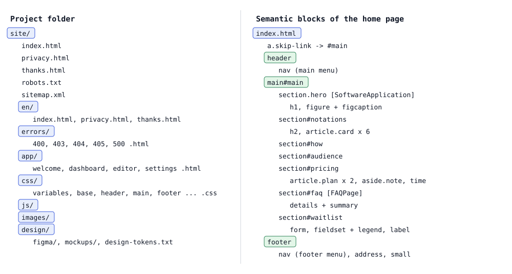

# Лабораторная работа №3. Создание семантической HTML-разметки

## 1 Цель работы

Освоить принципы семантической HTML-разметки, основы веб-доступности и микроразметку Schema.org. Сформировать навыки создания валидной структурированной разметки на примере проекта DSLKit, веб-редактора диаграмм как кода, тематика которого соответствует направлению SaaS и будущему курсовому проекту.

## 2 Краткие теоретические сведения

**Семантическая разметка.** Теги описывают смысл содержимого, а не внешний вид: `header`, `nav`, `main`, `article`, `section`, `aside`, `footer`. Такая структура понятна поисковым системам, программам чтения с экрана и разработчикам, а стили добавляются отдельно.

**Иерархия заголовков.** На странице один заголовок первого уровня, остальные уровни вложены без пропусков. Программы чтения с экрана строят по заголовкам оглавление, а поисковые системы определяют по ним тему разделов.

**Основы доступности.** Каждое изображение получает текстовую альтернативу `alt`, декоративные изображения помечаются пустым значением, ссылки имеют осмысленный текст, поля форм связаны с подписями, а ссылка пропуска навигации (skip-link) позволяет сразу перейти к основному содержимому.

**Микроразметка Schema.org.** Атрибуты `itemscope`, `itemtype` и `itemprop` описывают объект и его свойства словарём Schema.org. Поисковые системы используют эти данные для расширенных результатов выдачи.

**Валидация.** Проверка валидатором W3C показывает нарушения синтаксиса и модели содержимого. Валидная разметка одинаково обрабатывается разными браузерами.

## 3 Ход работы

### 3.1 Выбор и анализ макета

Макет подготовлен в Figma и сохранён в виде SVG-файлов в папке `site/design/figma`. Ссылка на файл хранится в `site/design/figma-link.txt`, цвета и шрифты записаны в `site/design/design-tokens.txt`. Макет соответствует теме SaaS: главная страница сервиса с примером продукта, нотациями, тарифами, вопросами и ответами и формой записи в бету.

Анализ выделил семантические блоки: шапка с логотипом, навигацией и действиями, главный блок с изображением продукта, секции «Нотации», «Как это работает», «Для кого», «Тарифы», «Вопросы и ответы», форма записи и подвал. Изображения экспортированы в папку `site/images`.

### 3.2 Структура документа

Страница `site/index.html` начинается с ссылки пропуска навигации, которая ведёт к элементу `main` с идентификатором `main`. Далее идут `header`, `main` и `footer`. Для языковых версий создана страница `site/en/index.html` с той же структурой, переключатель языка и атрибуты `hreflang`. Для кодов ответа 400, 403, 404, 405 и 500 подготовлены страницы в папке `site/errors`, а для списка ожидания страницы `thanks.html` и `privacy.html`.

### 3.3 Семантические теги

Главная страница использует 15 разных семантических тегов, перечисленных в таблице 1. Условие требовало не менее восьми.

Таблица 1 – Семантические теги главной страницы

| Тег | Назначение | Пример на странице |
|---|---|---|
| `header` | Шапка сайта | Логотип, навигация, действия |
| `nav` | Блок навигации | Основное и нижнее меню |
| `main` | Основное содержимое | Все секции страницы |
| `section` | Тематический раздел с заголовком | «Нотации», «Тарифы» |
| `article` | Самостоятельный блок | Карточка нотации, тариф |
| `aside` | Второстепенная информация | Примечание к тарифам |
| `footer` | Подвал | Ссылки и контакты |
| `figure`, `figcaption` | Иллюстрация с подписью | Изображение редактора |
| `time` | Дата в машиночитаемом виде | Дата обновления тарифов |
| `address` | Контактная информация | Адрес электронной почты |
| `details`, `summary` | Раскрывающийся блок | Вопросы и ответы |
| `fieldset`, `legend` | Группа полей формы | «Контакты», «Ваш проект» |

### 3.4 Иерархия заголовков

Каждая страница содержит один заголовок первого уровня. На главной это «Пишите код — получайте диаграмму», секции получают заголовки второго уровня, карточки и шаги заголовки третьего. Пропусков уровней нет, это проверяет автоматический тест для всех 16 страниц сайта.

### 3.5 Доступность

Все изображения имеют атрибут `alt`: изображение редактора описано полным предложением, декоративные значки нотаций имеют пустое значение. Тексты ссылок осмысленные, например «Записаться в бету: UML». Каждое поле формы связано с подписью через `label` и `for`, группы полей оформлены через `fieldset` и `legend`, подсказки подключены атрибутом `aria-describedby`. Кнопки со значками имеют текстовые названия `aria-label`. Ссылка пропуска навигации есть на каждой странице и ведёт к существующему элементу `main`.

### 3.6 БЭМ

Классы построены по методологии БЭМ: блок `card`, элемент `card__title`, модификатор `button--primary`. Тест проверяет, что все имена классов на всех страницах соответствуют схеме «блок, элемент, модификатор» в нижнем регистре через дефис.

### 3.7 Микроразметка Schema.org

Для проекта выбран тип `SoftwareApplication`, потому что страница описывает программный продукт. В разметке используются свойства из таблицы 2.

Таблица 2 – Микроразметка Schema.org главной страницы

| Тип | Свойства |
|---|---|
| `SoftwareApplication` | `name`, `applicationCategory`, `operatingSystem`, `url`, `description`, `image`, `offers` |
| `Offer` | `price`, `priceCurrency`, `availability`, `url` |
| `FAQPage` | `mainEntity` |
| `Question` | `name`, `acceptedAnswer` |
| `Answer` | `text` |

Отзывы и оценки в разметку не добавлены, так как реальных отзывов пока нет, а выдумывать их недопустимо. Поэтому расширенный результат Google для программных приложений недоступен.

### 3.8 Проверка валидности

Страница проверена валидатором W3C Nu Html Checker (версия vnu 26.10.12, указана на снимке) в режиме «Check by text input»: исходный код вставлен в поле ввода, потому что сайт не опубликован и проверка по адресу невозможна. Показаны только ошибки и предупреждения. Дата проверки на снимке не отображается, файл снимка добавлен в репозиторий 14 октября 2026 года. Результат показан на рисунке 1: ошибок и предупреждений нет. Код передан в валидатор без отступов, на содержимое это не влияет.

Рисунок 1 – Результат проверки W3C Nu Html Checker: ошибок и предупреждений нет

Все 15 страниц сайта проверены тем же сервисом и тем же способом, вставкой кода, с нулевым числом ошибок и предупреждений. Остаются только информационные сообщения о слэше в пустых элементах, на работу страниц они не влияют.

### 3.9 Проверка микроразметки

Для проверки микроразметки использован валидатор Schema.org (validator.schema.org), код страницы вставлен в поле ввода. Результат показан на рисунке 2: обнаружены 2 элемента, SoftwareApplication и FAQPage, ошибок 0 и предупреждений 0. Интерфейс на снимке польский, дата проверки на нём не отображается, файл снимка добавлен в репозиторий 14 октября 2026 года.

Рисунок 2 – Результат проверки микроразметки: объекты SoftwareApplication и FAQPage без ошибок

Google Rich Results Test не запускался: сайт не опубликован, домен `dslkit.io` пока не куплен. Проверка в этом инструменте остаётся задачей после публикации, результатов по нему в отчёте нет.

### 3.10 Автоматические тесты

Для разметки написаны тесты, проверяющие на всех страницах: наличие языка, заголовка и метатегов, один заголовок первого уровня без пропусков, атрибуты `alt`, ссылку пропуска навигации, уникальность идентификаторов, целостность якорей и ссылок на элементы, подписи полей, осмысленные тексты ссылок, имена классов по БЭМ, обязательные свойства микроразметки, соответствие русской и английской версий, атрибуты `hreflang` и `canonical`, карту сайта и файл `robots.txt`. Покрытие кода проверок равно 100 процентов.

### 3.11 Структура проекта

Файлы проекта находятся в папках `site` (страницы, стили, скрипты, изображения, макеты), `labs` (лабораторные работы) и `tools` (инструменты). Страницы приложения для следующих работ лежат в `site/app`. Структура папки `site` и семантические блоки главной страницы показаны на рисунке 3, он построен по фактическим файлам и разметке `site/index.html`.

Рисунок 3 – Структура папки site и семантические блоки страницы index.html

### 3.12 Фиксация изменений

Работа выполнена в ветке `feature/semantic-markup`. Коммит: https://github.com/KsushaKhadzhinova/DSLKit-Project/commit/a2b85e0. Сообщение коммита: `feat: add semantic HTML markup with Schema.org for a SaaS diagram editor`.

## Заключение

Создана семантическая разметка главной страницы DSLKit и сопутствующих страниц: русская и английская версии, страницы ошибок, политика и подтверждение записи. Использовано 15 семантических тегов, соблюдены иерархия заголовков и требования доступности, добавлена микроразметка SoftwareApplication, Offer и FAQPage. Валидаторы W3C и Schema.org не нашли ошибок, автоматические тесты проверяют разметку на всех страницах. Google Rich Results Test не запускался, так как сайт не опубликован и домен не куплен.

## Приложение А – Листинг файла index.html

{{code:site/index.html}}

## Приложение Б – Листинг файла site-checks.js

{{code:labs/03-semantic-markup/site-checks.js}}

## Приложение В – Листинг файла site.test.js

{{code:labs/03-semantic-markup/site.test.js}}

## Приложение Г – Токены дизайна

{{code:site/design/design-tokens.txt}}
