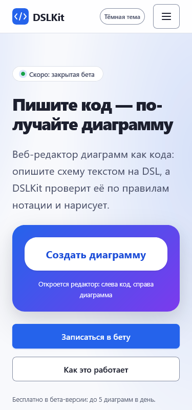
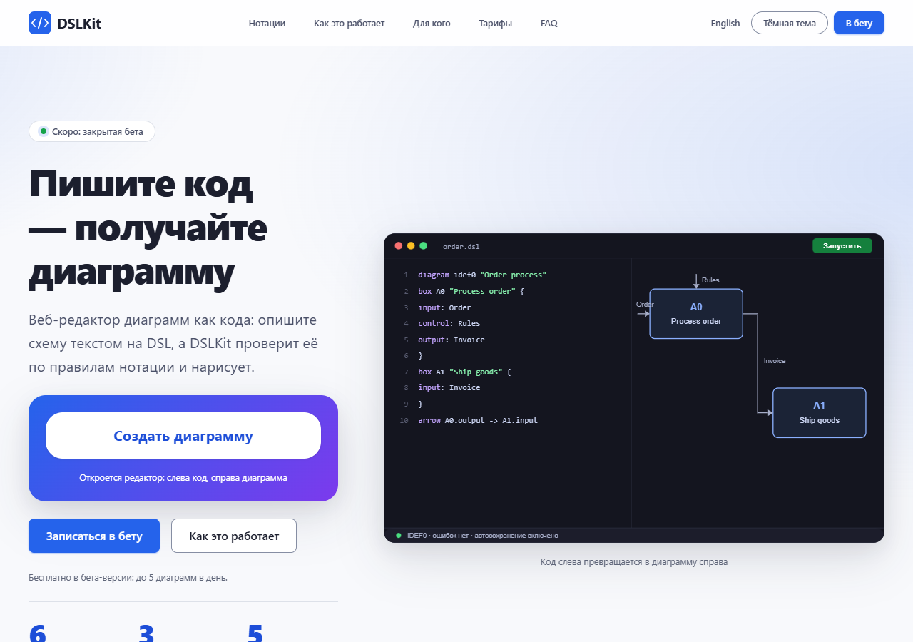

# Laboratory Work No. 4. Building a Responsive Layout with CSS

## 1 Purpose of the Work

To master modern CSS techniques for responsive layouts: Flexbox, CSS Grid, media queries, CSS variables and the BEM methodology. The skills are practised on the DSLKit project, a web editor for diagrams as code that belongs to the SaaS direction and matches the future course project.

## 2 Brief Theoretical Background

**Responsive layout.** A page adapts to the screen width without separate versions for each device. Fluid grids, relative units and media queries form the basis.

**Mobile first.** Base styles describe a phone, and extra rules for wider screens are added in `min-width` queries. The approach is easier to maintain because the mobile version is never overridden by desktop rules.

**Flexbox and CSS Grid.** Flexbox aligns items in one direction: headers, footers and rows of buttons. Grid describes a two-dimensional layout: columns of cards, a layout with a sidebar and the page structure.

**Media queries.** `@media` rules switch styles on when a condition holds: window width, pointer type or the preference for reduced motion.

**BEM.** The methodology splits an interface into blocks, elements and modifiers: `card`, `card__title`, `button--primary`. Class names describe the purpose, not the look.

**CSS variables.** Custom properties `--name` keep colours, fonts and spacing in one place, and a theme is switched by replacing values.

## 3 Work Progress

### 3.1 Choosing the Layout and Matching the Topic

The project layouts are prepared in Figma and as SVG files: prototypes of the home page for three widths, a moodboard, a palette and typography are in `site/design/figma`, and the application screens are in `docs/project/figma-svg`. The link to the Figma file is stored in `site/design/figma-link.txt`. The topic belongs to the SaaS direction: a landing page of the service with the Free and Pro plans, a FAQ and a waiting list, and the screens of the application itself.

The layout analysis gave this structure: a header with a logo, navigation and actions, a hero block with a product example, card sections, pricing, a FAQ, a form and a footer. The palette is built on the blue primary colour `#2563eb` with neutral tones and a green accent, and the typography uses Inter and JetBrains Mono. The grid follows the golden ratio: the hero and pricing columns relate as 1 to 1.618, and font sizes grow by the square root of the golden ratio.

### 3.2 Organising the CSS Files

Styles are split by purpose. The main file `style.css` only imports the others in cascade order, as table 1 shows.

Table 1 – Style files of the DSLKit project

| File | Purpose |
|---|---|
| `variables.css` | Colours, fonts, the size scale, spacing, widths and breakpoints |
| `base.css` | Margin reset, `box-sizing`, base font, focus, utility classes |
| `components.css` | Buttons, cards, steps, pricing, FAQ, form |
| `header.css` | Header, logo, navigation, burger menu, theme switch |
| `main.css` | Hero block and page sections |
| `footer.css` | Footer |
| `pages.css` | Error pages and the privacy policy |
| `app.css` | Application shell, dashboard, settings, welcome screen |
| `editor.css` | Editor screen |
| `adaptive.css` | Mobile-first media queries for the public pages |

### 3.3 CSS Variables

The file `variables.css` defines colours of the light and dark themes, font families, the text size scale, spacing, radii, shadows and the container width. The names required by the assignment (`--font-family-main`, `--font-size-base`, `--spacing-small`, `--container-max-width`, `--breakpoint-mobile` and others) are aliases of the project scales. Spacing of 8, 16, 24, 40, 64 and 104 pixels corresponds to Fibonacci numbers multiplied by 8, so the 8 pixel grid agrees with the golden ratio.

The reasons for the main values are given in table 2.

Table 2 – Rationale of the CSS variable values

| Variables | Value | Rationale |
|---|---|---|
| `--phi`, `--phi-root` | 1.618 and 1.272 | The golden ratio and its square root build the type scale: a step of √φ gives small increments for captions and a step of φ gives headings |
| `--font-size-base` | 16 pixels | The browser default: text never drops below 12 pixels and the user's scaling in `rem` is kept |
| `--font-size-h1`, `--font-size-h2` | about 53 and 42 pixels | Steps `--step-5` and `--step-4` of the scale: 16 × φ² × √φ and 16 × φ² |
| `--spacing-small` … `--spacing-xlarge` | 8, 16, 24 and 40 pixels | Fibonacci numbers 1, 2, 3 and 5 multiplied by 8, so spacing stays on the 8 pixel grid. The assignment example uses 48 for the last value, the project uses 40 to keep the Fibonacci series |
| `--space-5`, `--space-6` | 64 and 104 pixels | Fibonacci numbers 8 and 13 for the vertical spacing of sections |
| `--container-max-width` | 1200 pixels | The value from the assignment: a line of text stays within `--measure` (62 characters) and the hero columns get about 458 and 742 pixels |
| `--target-size` | 48 pixels | A tap target above the 24 pixel minimum of WCAG 2.2 (criterion 2.5.8), comfortable for a finger |
| `--header-height` | 64 pixels | Equal to `--space-5`, so the header fits the 8 pixel grid |

The breakpoints are set in pixels in `--breakpoint-small`, `--breakpoint-medium` and `--breakpoint-large` and repeated in the aliases required by the assignment. CSS variables cannot be used inside an `@media` condition, so the numbers 576, 768 and 1024 are written in `adaptive.css` directly, and a test checks them against the list of allowed breakpoints.

### 3.4 Base Styles

The file `base.css` resets margins, sets `box-sizing: border-box`, the font, the text colour and the line height. The line height is 1.618 for body text and 1.15 for headings. Every interactive element has a visible focus ring, the `visually-hidden` class hides text visually only, and the `prefers-reduced-motion` rule turns animation off for users who are bothered by it.

### 3.5 Header and Burger Menu

The header is fixed with `position: sticky`. On screens narrower than 768 pixels the navigation is hidden, and the Menu button opens it without JavaScript: the hidden checkbox `burger__input` is a sibling of the label and the list, so the rule `.burger__input:checked ~ .nav` shows the menu. The checkbox stays reachable by keyboard and the focus is drawn on the label. From 768 pixels the burger disappears and the navigation becomes a horizontal Flexbox menu.

### 3.6 Flexbox and Grid Layouts

Flexbox and Grid solve different problems, so the project uses them together: Flexbox arranges content along one axis, Grid defines a two-dimensional layout.

#### 3.6.1 Flexbox

Flexbox is used where items sit side by side or one under another and align along one axis:

- the logo in the header (`.header__logo`), the navigation row (`.nav__list`) and the row of tools (`.header__tools`);
- rows of buttons in the hero block (`.hero__actions`) and the buttons themselves (`.button`), where the icon and the label are centred;
- the list of footer links (`.footer__list`);
- the title and the meta line of a card (`.card__title`, `.card__meta`) and the accordion question (`.faq__question`).

On a phone the navigation is a column, and from 768 pixels it is a wrapping row (`flex-flow: row wrap`).

#### 3.6.2 CSS Grid

Grid is used for two-dimensional layouts:

- the page frame `.page` is described by the areas `header`, `main` and `footer` with `grid-template-areas`, one column and the rows `auto 1fr auto`. The `1fr` row pushes the footer to the bottom of the window on short pages, as the former Flexbox frame did. The public pages have no sidebar, so the `sidebar` area from the assignment example is not needed, and the application shell with its 224 pixel panel is described separately in `app.css`;
- the hero block `.hero`: one column on a phone and `1fr 1.618fr` from 1024 pixels;
- the card grid `.cards`: one, two and three columns through `repeat(n, minmax(0, 1fr))`, where `minmax(0, 1fr)` stops a long word from stretching a column;
- pricing `.plans` and the hero facts `.hero__facts`;
- the editor screen: the named areas `toolbar`, `activity`, `sidebar`, `main`, `problems` and `status`, with the `sidebar` column added on a wide screen.

After `.page` moved from Flexbox to Grid, comparing the position and size of every element with the previous ones on six pages at the widths 375, 500, 800 and 1440 pixels showed no differences.

### 3.7 Responsiveness

Three states are implemented with the mobile-first approach and listed in table 3.

The breakpoints follow the page content and typical devices, not particular phone models:

- 576 pixels: the border between a narrow and a wide phone, for example after a screen rotation. From here the cards have room for two columns, and the burger caption becomes visible;
- 768 pixels: the width of a tablet in portrait orientation. Five menu items, the language switch and the button fit in one row, so the burger is replaced by a horizontal menu. The assignment names the same border as the limit for the burger;
- 1024 pixels: a tablet in landscape orientation and a laptop. There is room for three columns of cards and for the hero block in the proportion 1 to 1.618.

The mobile-first approach is used: base styles describe a phone and each `min-width` query only adds rules. A phone never receives desktop rules that would have to be cancelled, and the cascade has fewer overrides than with desktop-first `max-width` queries. The breakpoints are in pixels because dependence on the user's font size is not needed here. The assignment text names 992 pixels for the desktop, and the project uses 1024 as in the media query example of the same assignment. Every query is written in `adaptive.css` as one block, and a test forbids repeats.

Table 3 – Breakpoints and page behaviour

| Width | State | Behaviour |
|---|---|---|
| below 576 pixels | Phone (base styles) | One column of cards, burger menu, full-width buttons |
| from 576 pixels | Large phone and tablet | Two columns of cards |
| from 768 pixels | Tablet | Horizontal menu, three facts in a row, form with larger padding |
| from 1024 pixels | Desktop | Three columns of cards, hero and pricing in the golden ratio, theme switch |

The mobile version of the page is shown in figure 1.

Figure 1 – The DSLKit home page on a 375 pixel screen

The tablet version with the horizontal menu is shown in figure 2.

Figure 2 – The DSLKit home page on a 768 pixel screen

The desktop version is shown in figure 3.

Figure 3 – The DSLKit home page on a 1280 pixel screen

### 3.8 Dark Theme

The dark theme switches without JavaScript: the rule `:root:has(.theme__input:checked)` replaces the values of the colour variables. The contrast of every text and background pair is checked by an automated test for both themes and meets level AA of WCAG 2.2.

### 3.9 Cross-Browser Compatibility

Flexbox and Grid are supported by all modern browsers, so no fallbacks are needed for them. Every `color-mix()` declaration is preceded by a fallback value, so a browser without the function uses a plain colour. The `-webkit-` prefix is added for `backdrop-filter`. Autoprefixer is not connected because the project targets current browser versions.

The site was opened in real browsers driven through puppeteer-core. The results are in table 4, and the full protocol is in `docs/metrics/browsers/README.md`.

Table 4 – Browser test results

| Browser | Version | Check | Result |
|---|---|---|---|
| Google Chrome | current | inspection at 375, 768 and 1280 pixels | layout is correct |
| Mozilla Firefox | 157.0.1 | 20 scenarios on the landing, the application and the editor | 20 of 20 |
| Microsoft Edge | 155.0.4283.45 | the same 20 scenarios | 20 of 20 |
| Safari | not tested | no Apple device | left for the acceptance stage |

Each browser checked page loading, the theme switch, the burger menu, forms, no horizontal scrolling at 375 pixels and no console errors. The check found a defect: at 375 pixels the page scrolled sideways, and it was fixed with the rule `overflow-x: clip` for `html` in `base.css`. A snapshot of the landing page in Firefox at 375 pixels is shown in figure 4.

Figure 4 – The DSLKit landing page in Firefox on a 375 pixel screen

A snapshot of the landing page in Edge at 1280 pixels is shown in figure 5.

Figure 5 – The DSLKit landing page in Edge on a 1280 pixel screen

### 3.10 Verification and Testing

Automated checks are collected in the tests of `labs/04-responsive-css`. They confirm that every class used in the HTML has a rule in the styles, that the tokens follow the golden ratio, that spacing is a multiple of 8 pixels and forms a Fibonacci series, that colours pass AA contrast in the light and dark themes, that no colours live outside the variables file, that no font is smaller than 12 pixels, that only `min-width` queries and the breakpoints 576, 768 and 1024 are used, and that no file contains two identical `@media` queries.

Every style file was checked with the W3C CSS validator (profile CSS 3.0 with SVG, warnings on). The results are in table 5, and the full validator responses are saved in `docs/metrics/css-validator`.

Table 5 – W3C CSS validator results

| File | Errors | Warnings |
|---|---|---|
| `variables.css` | 0 | 0 |
| `base.css` | 0 | 29 |
| `components.css` | 0 | 98 |
| `header.css` | 0 | 35 |
| `main.css` | 0 | 34 |
| `footer.css` | 0 | 9 |
| `pages.css` | 0 | 26 |
| `app.css` | 0 | 236 |
| `editor.css` | 0 | 170 |
| `adaptive.css` | 0 | 14 |

Almost all warnings have one cause: the validator cannot evaluate values with `var()` because they depend on the runtime. The rest report vendor prefixes (`-webkit-appearance`, `progress` indicators), the deprecated `clip` property in the `visually-hidden` class, kept as a fallback beside `clip-path`, and the notation `rect(0 0 0 0)` without commas, which browsers understand.

The HTML pages passed the W3C Nu validator. The geometry of all page elements was compared before and after the move to mobile first at the widths 500, 800 and 1440 pixels, and no differences appeared. The same method was applied after the `.page` frame moved to Grid.

### 3.11 Committing the Changes

The work is done in the branch `feature/responsive-layout`. The commit with the implementation: https://github.com/KsushaKhadzhinova/DSLKit-Project/commit/eb70a59. The commit message: `feat: implement responsive layout according to Figma design`.

## Conclusion

The styles of the DSLKit project are split into files following the BEM methodology and built mobile first. Three page states, a burger menu without JavaScript, Flexbox and Grid layouts, CSS variables and a dark theme are implemented. The golden ratio is built into the size scale, the spacing and the columns, and automated tests prevent any drift from it. The page is tested in Chrome, Firefox and Edge, and the check in Safari on an Apple device remains.

## Appendix A – Listing of variables.css

{{code:site/css/variables.css}}

## Appendix B – Listing of base.css

{{code:site/css/base.css}}

## Appendix C – Listing of header.css

{{code:site/css/header.css}}

## Appendix D – Listing of main.css

{{code:site/css/main.css}}

## Appendix E – Listing of footer.css

{{code:site/css/footer.css}}

## Appendix F – Listing of adaptive.css

{{code:site/css/adaptive.css}}

## Appendix G – Listing of style.css

{{code:site/css/style.css}}
